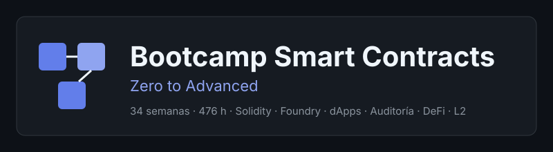

<p align="center">
  
</p>

<p align="center">
  <a href="LICENSE"></a>
  
  
  
  
</p>

<p align="center">
  <a href="README_EN.md"></a>
</p>

---

## 📋 Descripción

Bootcamp de **34 semanas** sobre **smart contracts** en Ethereum y cadenas compatibles
(EVM), desde **cero en blockchain** hasta un nivel **avanzado**: Solidity a fondo, la
EVM por dentro y Yul, estándares ERC, contratos actualizables, dApps full-stack,
**auditoría de seguridad** con análisis estático, fuzzing de invariantes y verificación
formal, DeFi, account abstraction y L2. Autoestudio, **14 horas por semana**, todo
verificable con tests.

**Requisito**: saber programar en algún lenguaje (variables, funciones, condicionales,
bucles, clases) y moverte en la terminal y en git. No hace falta saber nada de
blockchain ni de criptografía.

Aquí no se habla de trading ni de especulación, y nunca se usa dinero real: todo corre
en una blockchain local o en testnets.

### 🎯 Al terminar sabrás

- Explicar qué garantiza una blockchain y qué no: hashes, firmas, transacciones, gas.
- Escribir, probar y desplegar contratos Solidity con Foundry, incluidos ERC-20,
  ERC-721, firmas EIP-712 y proxies actualizables.
- Construir una dApp con viem y wagmi, e indexar sus eventos con FastAPI y PostgreSQL.
- Auditar un contrato: vulnerabilidades clásicas y económicas, Slither, invariantes,
  Halmos y un informe profesional.
- Leer la EVM a nivel de opcodes, escribir Yul y optimizar gas con criterio.
- Diseñar piezas DeFi, gobernanza DAO, account abstraction y despliegues en L2.

## 🗓️ Estructura

| Fase | Semanas | Horas | Qué aprendes |
| ---- | ------- | ----- | ------------ |
| 1 · Fundamentos de blockchain | 01-03 | 42 | Criptografía, Ethereum, transacciones, gas, primer contrato con Foundry |
| 2 · Solidity | 04-10 | 98 | Tipos, errores, estructuras de datos, eventos y ETH, herencia, testing, llamadas entre contratos |
| 3 · Estándares y patrones | 11-15 | 70 | ERC-20, NFTs, control de acceso, firmas EIP-712, proxies |
| 4 · dApps full-stack | 16-20 | 70 | Despliegue en testnet, viem, React + wagmi, indexación, oráculos |
| 5 · Seguridad | 21-26 | 84 | Vulnerabilidades, Slither, invariantes, verificación formal, auditoría |
| 6 · EVM avanzada y ecosistema | 27-34 | 112 | Opcodes, Yul, gas, DeFi, DAOs, account abstraction, L2, proyecto final |

Índice completo con el estado de cada semana: **[bootcamp/README.md](bootcamp/README.md)**.

### Cada semana (14 h)

| Parte | Tiempo | Contenido |
| ----- | ------ | --------- |
| `1-teoria/` | 3 h | Conceptos con ejemplos ejecutables paso a paso y diagramas |
| `2-practicas/` | 6 h | Ejercicios guiados: tests ya escritos que pones en verde paso a paso |
| `3-proyecto/` | 4 h | Una capa nueva del protocolo de tu dominio |
| Evaluación y recursos | 1 h | Autoevaluación, libros, videos y glosario |

Evaluación: Conocimiento 30 % · Desempeño 40 % · Producto 30 %, con **mínimo 70 % en
cada una**.

## 🚀 Inicio rápido

Solo necesitas **Docker** y **git** ([guía completa](docs/setup.md)).

```bash
git clone https://github.com/ergrato-dev/bc-smartcontracts.git
cd bc-smartcontracts
docker build -t bc-smartcontracts-dev docker
docker run --rm bc-smartcontracts-dev forge --version
```

Si la primera línea es `forge Version: 1.9.0`, empieza por la
[Semana 01](bootcamp/README.md).

## 🏛️ Proyecto hilo conductor y dominios únicos

Durante todo el bootcamp construyes **un solo protocolo** en el dominio que **te asigna
el instructor** ([cómo funciona](docs/proyecto-hilo-conductor.md)). Dos aprendices no
comparten dominio: copiar el trabajo de otro anula la entrega.

## 🛠️ Stack

Solidity 0.8.38 · Foundry 1.9 (forge, cast, anvil, chisel) · forge-std · OpenZeppelin
Contracts 5 · TypeScript + viem + wagmi (pnpm) · FastAPI (uv) + PostgreSQL · Slither ·
Halmos · Docker (`ubuntu:24.04`). Versiones exactas en
[docs/stack-versions.md](docs/stack-versions.md).

## 📄 Licencia

[CC BY-NC-SA 4.0](LICENSE). Puedes usar y adaptar el material sin fines comerciales,
citando la fuente y compartiendo con la misma licencia.

## 🤝 Contribuir

Lee [CONTRIBUTING.md](CONTRIBUTING.md), el [código de conducta](CODE_OF_CONDUCT.md) y la
[política de seguridad](SECURITY.md).
