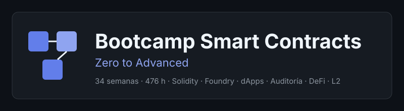

<p align="center">
  
</p>

# Smart Contracts Zero to Advanced Bootcamp

A **34-week, 476-hour** self-study bootcamp (14 h/week) that takes you from zero
blockchain knowledge to advanced smart contract engineering on Ethereum and EVM chains:
Solidity in depth, the EVM and Yul, ERC standards, upgradeable contracts, full-stack
dApps, **security auditing** (static analysis, invariant fuzzing, formal verification),
DeFi, account abstraction and L2s. Prior programming experience is required; no real
money is ever used.

**The course content is written in Spanish.** Code, identifiers and commit messages are
in English.

| Phase | Weeks | Topics |
| ----- | ----- | ------ |
| 1 · Blockchain fundamentals | 01-03 | Cryptography, Ethereum, transactions, gas, first Foundry contract |
| 2 · Solidity | 04-10 | Types, errors, data structures, events and ETH, inheritance, testing, external calls |
| 3 · Standards and patterns | 11-15 | ERC-20, NFTs, access control, EIP-712 signatures, proxies |
| 4 · Full-stack dApps | 16-20 | Testnet deployment, viem, React + wagmi, indexing, oracles |
| 5 · Security | 21-26 | Vulnerabilities, Slither, invariants, formal verification, auditing |
| 6 · Advanced EVM and ecosystem | 27-34 | Opcodes, Yul, gas, DeFi, DAOs, account abstraction, L2, capstone |

Quick start: install Docker and git, then

```bash
git clone https://github.com/ergrato-dev/bc-smartcontracts.git && cd bc-smartcontracts
docker build -t bc-smartcontracts-dev docker
```

Weekly index: [bootcamp/README.md](bootcamp/README.md). License:
[CC BY-NC-SA 4.0](LICENSE).
