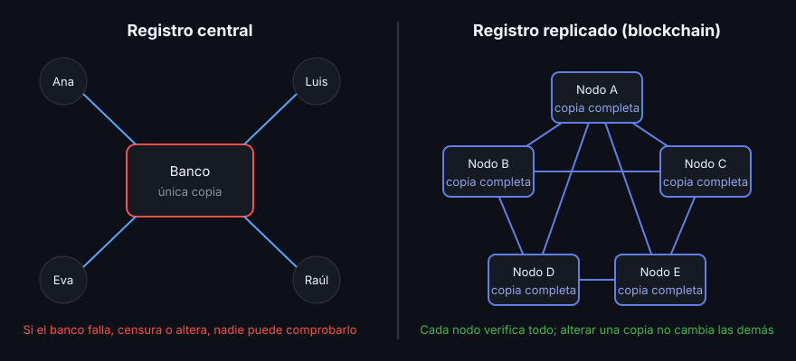

# Teoría 01 — Qué problema resuelve una blockchain

## 🎯 Objetivos

- Explicar con un ejemplo concreto qué es un **registro** y por qué importa quién lo controla.
- Distinguir un registro central de un registro replicado entre muchos participantes.
- Nombrar las tres piezas que hacen confiable una blockchain: hashes, firmas y consenso.
- Saber qué es un **smart contract** y qué no puede hacer.
- Reconocer cuándo una blockchain **no** es la herramienta adecuada.

---

## 1. El problema: ¿quién lleva la cuenta?

Piensa en un grupo de amigos que comparte gastos. Alguien apunta en un cuaderno: "Ana
pagó la cena, 60; Luis le debe 20". Ese cuaderno es un **registro** (en inglés,
*ledger*): una lista ordenada de hechos que todos aceptan como verdad.

Mientras el grupo confía en quien lleva el cuaderno, todo funciona. Los problemas
aparecen cuando:

| Situación | Qué pasa con un registro central |
| --------- | -------------------------------- |
| Quien lo lleva se equivoca | Nadie más tiene una copia para comparar |
| Quien lo lleva hace trampa | Puede borrar o cambiar una línea sin que se note |
| Quien lo lleva desaparece | El registro se pierde |
| Quien lo lleva decide no apuntarte | Te quedas fuera (censura) |

Los bancos, los registros de la propiedad y las notarías resuelven esto con
**instituciones**: leyes, auditores, reputación. Funciona, pero tiene un costo:
intermediarios, horarios, fronteras y la necesidad de confiar en alguien concreto.

## 2. La idea: un registro que nadie controla en solitario

Una **blockchain** es un registro **replicado**: muchos ordenadores independientes,
llamados **nodos**, guardan **la misma copia completa** y verifican cada cambio antes de
aceptarlo.

Si un nodo intenta colar un cambio falso, los demás lo rechazan porque no cumple las
reglas. Si un nodo se apaga, los otros siguen. Para alterar la historia habría que
convencer a la mayoría de los nodos a la vez, y el sistema está diseñado para que eso
sea carísimo.

Para que esto funcione hacen falta tres piezas, y esta semana estudias las dos primeras
a fondo:

| Pieza | Qué garantiza | Dónde la ves |
| ----- | ------------- | ------------ |
| **Función hash** | Que cualquier alteración de los datos se detecta | [Teoría 03](03-funciones-hash.md) y [Teoría 06](06-bloques-y-cadena.md) |
| **Firma digital** | Que solo el dueño de una cuenta puede ordenar movimientos de esa cuenta | [Teoría 04](04-claves-y-direcciones.md) y [Teoría 05](05-firmas-digitales.md) |
| **Consenso** | Que todos los nodos acaban con la misma copia, en el mismo orden | [Teoría 06](06-bloques-y-cadena.md), en su versión básica |

## 3. Las transacciones

En una blockchain no se edita el registro: solo se **añaden** entradas nuevas. Cada
entrada es una **transacción**: una orden firmada del tipo "yo, dueño de esta cuenta,
quiero mover 5 unidades a esta otra cuenta".

Las transacciones se agrupan en **bloques**. Cada bloque guarda el hash del bloque
anterior, y así forman una **cadena**: de ahí el nombre *block chain*. El
[Teoría 06](06-bloques-y-cadena.md) lo explica paso a paso.

Una consecuencia importante: **lo que se escribe en una blockchain pública es público y
permanente**. Cualquiera puede leer todas las transacciones de la historia. No hay
"borrar".

## 4. Ethereum y los smart contracts

Bitcoin (2009) fue la primera blockchain: su registro solo sabe una cosa, cuántas
monedas tiene cada cuenta.

**Ethereum** (2015) generalizó la idea: además de saldos, cada nodo guarda y ejecuta
**programas**. Un **smart contract** (contrato inteligente) es un programa que:

1. Se publica en la blockchain y desde ese momento tiene su propia dirección.
2. Guarda datos propios (su **estado**), replicados en todos los nodos.
3. Se ejecuta cuando alguien le envía una transacción, y **todos los nodos** lo ejecutan
   y llegan al mismo resultado.
4. No se puede modificar una vez publicado (salvo que se diseñe para ello: semana 15).

Ejemplo intuitivo: un contrato de "depósito en garantía" que recibe el pago de un
comprador y solo se lo entrega al vendedor cuando el comprador confirma la entrega. Nadie
—ni siquiera quien escribió el contrato— puede quedarse el dinero por otra vía, porque
el código es la única puerta.

El nombre "contrato" confunde: no es un documento legal. Es **código que custodia
valor y aplica reglas sin intermediarios**.

A este bootcamp le interesa Ethereum y todas las cadenas que ejecutan los mismos
programas que Ethereum: se las llama cadenas **EVM** (por *Ethereum Virtual Machine*, la
máquina que ejecuta los contratos; semana 02).

## 5. Lo que una blockchain NO hace

Saber cuándo no usarla es tan importante como saber usarla.

| Mito | Realidad |
| ---- | -------- |
| "Lo que está en la blockchain es verdad" | Es verdad **que alguien lo escribió**. Si un contrato registra "este lote de café es orgánico", la blockchain no comprueba el café: comprueba la firma de quien lo dijo |
| "Es anónima" | Es **seudónima**: las cuentas son números, pero todas sus transacciones son públicas y se pueden rastrear |
| "Es gratis" | Cada operación cuesta **gas**, que se paga (semana 02) |
| "Es rápida" | Un bloque nuevo cada 12 segundos en Ethereum; una base de datos responde en milisegundos |
| "El código no tiene fallos" | El código se ejecuta **tal cual**, fallos incluidos. Un error en un contrato puede vaciarlo y no hay a quién reclamar. Por eso la seguridad es el eje de este bootcamp |

**Regla práctica**: si todos los participantes confían en una misma organización, una
base de datos PostgreSQL es más barata, rápida y simple. Una blockchain aporta valor
cuando varias partes que **no** confían entre sí necesitan un registro común y reglas
que nadie pueda saltarse.

## 6. Antipatrones y riesgos

- ❌ **Guardar datos personales en la blockchain.** Son públicos y permanentes: no se
  pueden borrar aunque una ley te obligue. Se guarda un hash (Teoría 03), nunca el dato.
- ❌ **Pensar que "descentralizado" significa "seguro".** Un contrato mal escrito es
  igual de vulnerable en mil nodos que en uno.
- ❌ **Usar blockchain "porque sí".** Si no hay varias partes desconfiadas, sobra.

## 7. Trucos

- Cuando leas sobre un proyecto, pregúntate: **¿quién podría hacer trampa si esto fuera
  una base de datos normal?** Si la respuesta es "nadie", la blockchain sobra.
- Distingue siempre entre **lo que garantiza la cadena** (orden, integridad, autoría) y
  **lo que no** (que el dato del mundo real sea cierto).

## ✅ Checklist

- [ ] Explico con mis palabras qué es un registro y qué riesgos tiene uno central.
- [ ] Sé qué es un nodo y por qué tener muchas copias protege el registro.
- [ ] Nombro las tres piezas: hash, firma, consenso.
- [ ] Defino smart contract sin usar la palabra "contrato" legal.
- [ ] Doy un ejemplo en el que una blockchain no aporta nada.

---

| Anterior | Actual | Siguiente |
| -------- | ------ | --------- |
| [← Semana 01](../README.md) | **Teoría 01 — Qué problema resuelve una blockchain** | [Teoría 02 — El contenedor y cast →](02-el-contenedor-y-cast.md) |
