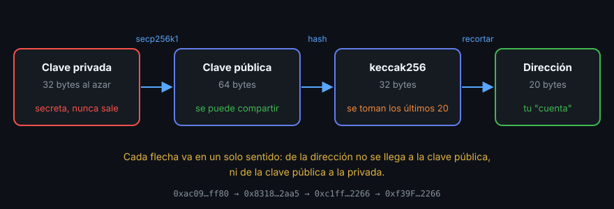

# Teoría 04 — Claves y direcciones

## 🎯 Objetivos

- Explicar qué es la criptografía de clave pública con una analogía y con datos reales.
- Recorrer el camino clave privada → clave pública → dirección, paso a paso y a mano.
- Leer el *checksum* de una dirección (mayúsculas y minúsculas mezcladas).
- Entender qué es una frase semilla y por qué de 12 palabras salen muchas cuentas.
- Conocer las cuentas de prueba que usa todo el bootcamp.

---

## 1. Qué problema resuelve

En un banco, demuestras que eres el dueño de una cuenta enseñando tu documento a un
empleado. En una blockchain no hay empleado: necesitas una forma de demostrar que eres
el dueño que **cualquiera pueda comprobar** y que **nadie pueda falsificar**, sin revelar
ningún secreto.

## 2. Cómo funciona: un par de claves

La **criptografía de clave pública** (o asimétrica) trabaja con un **par de claves**
unidas matemáticamente:

- La **clave privada**: un número secreto. Quien la tiene controla la cuenta.
- La **clave pública**: se calcula a partir de la privada y se puede enseñar a todo el
  mundo.

Calcular la pública desde la privada es instantáneo. Lo contrario es imposible en la
práctica. Analogía: mezclar dos pinturas es fácil; separar la mezcla en las pinturas
originales, no.

Ethereum usa una curva elíptica llamada **secp256k1** (la misma que Bitcoin) para pasar
de privada a pública. No necesitas su matemática para programar contratos; solo sus
consecuencias:

| Dato | Tamaño | ¿Se comparte? |
| ---- | ------ | ------------- |
| Clave privada | 32 bytes (un número al azar de 256 bits) | **Nunca** |
| Clave pública | 64 bytes | Sí |
| Dirección | 20 bytes | Sí: es el "número de cuenta" |

## 3. De la clave privada a la dirección

La **dirección** (*address*) son los **últimos 20 bytes del keccak256 de la clave
pública**.



Hazlo a mano con la primera cuenta de prueba de Foundry. **Dónde**: dentro del contenedor.

**Paso 1**: la clave privada (pública a propósito: la conoce todo el mundo).

```bash
PK=0xac0974bec39a17e36ba4a6b4d238ff944bacb478cbed5efcae784d7bf4f2ff80
```

**Paso 2**: su clave pública.

```bash
cast wallet public-key --private-key $PK
```

```
0x8318535b54105d4a7aae60c08fc45f9687181b4fdfc625bd1a753fa7397fed753547f11ca8696646f2f3acb08e31016afac23e630c5d11f59f61fef57b0d2aa5
```

128 dígitos hex: 64 bytes.

**Paso 3**: el keccak256 de esos 64 bytes.

```bash
H=$(cast keccak 0x8318535b54105d4a7aae60c08fc45f9687181b4fdfc625bd1a753fa7397fed753547f11ca8696646f2f3acb08e31016afac23e630c5d11f59f61fef57b0d2aa5)
echo $H
```

```
0xc1ffd3cfee2d9e5cd67643f8f39fd6e51aad88f6f4ce6ab8827279cfffb92266
```

**Paso 4**: los últimos 20 bytes son los últimos 40 dígitos hex. En bash,
`${H: -40}` toma los 40 últimos caracteres (el espacio antes del `-` es obligatorio).

```bash
echo 0x${H: -40}
```

```
0xf39fd6e51aad88f6f4ce6ab8827279cfffb92266
```

**Paso 5**: compáralo con lo que calcula `cast` de una vez:

```bash
cast wallet address --private-key $PK
```

```
0xf39Fd6e51aad88F6F4ce6aB8827279cffFb92266
```

Los mismos dígitos. Solo cambian algunas mayúsculas: es el *checksum*.

## 4. El checksum de una dirección (EIP-55)

Una dirección mal copiada envía fondos a una cuenta que nadie controla, y no hay vuelta
atrás. El estándar **EIP-55** (un **EIP**, *Ethereum Improvement Proposal*, es un
documento que define una regla común de Ethereum) añade una verificación sin cambiar
la dirección: pone en **mayúscula** cada letra cuya posición, en el hash de la propia
dirección, tiene un dígito mayor o igual que 8.

```bash
cast to-check-sum-address 0xf39fd6e51aad88f6f4ce6ab8827279cfffb92266
```

```
0xf39Fd6e51aad88F6F4ce6aB8827279cffFb92266
```

Si cambias un carácter, el patrón de mayúsculas deja de cuadrar y las wallets y
herramientas avisan del error. Una dirección todo en minúsculas es válida pero **no
lleva** esa protección.

## 5. Frases semilla y derivación

Guardar 32 bytes en hex es incómodo y propenso a errores. El estándar **BIP-39** convierte
entropía aleatoria en una **frase semilla** (*mnemonic*) de 12 o 24 palabras de una lista
fija. Y el estándar **BIP-44** deriva de una sola frase **muchas** claves privadas, cada
una con su **índice** (0, 1, 2...), siguiendo una ruta (*derivation path*) que en
Ethereum es `m/44'/60'/0'/0/<índice>`.

Resultado: una frase de 12 palabras respalda todas tus cuentas. Quien la tiene, tiene
todas.

```bash
cast wallet new-mnemonic
```

Salida (tus palabras y tu dirección serán otras: son aleatorias):

```
Generating mnemonic from provided entropy...
Successfully generated a new mnemonic.
Phrase:
avoid edit note popular disease blossom grow wrestle burger yellow twice boil

Accounts:
...
```

## 6. Las cuentas de prueba del bootcamp

Foundry usa una frase semilla **pública**, conocida por todo el mundo, para sus cuentas
de prueba:

```
test test test test test test test test test test test junk
```

```bash
M="test test test test test test test test test test test junk"
cast wallet derive "$M" --accounts 3
```

```
- Account 0:
Address:     0xf39Fd6e51aad88F6F4ce6aB8827279cffFb92266

- Account 1:
Address:     0x70997970C51812dc3A010C7d01b50e0d17dc79C8

- Account 2:
Address:     0x3C44CdDdB6a900fa2b585dd299e03d12FA4293BC
```

Y la clave privada de un índice:

```bash
cast wallet private-key --mnemonic "$M" --mnemonic-index 0
```

```
0xac0974bec39a17e36ba4a6b4d238ff944bacb478cbed5efcae784d7bf4f2ff80
```

Es la `PK` del apartado 3: la cuenta 0 de esa frase. En la semana 02, `anvil` llenará
estas cuentas con ETH de prueba.

## 7. Antipatrones y riesgos

- ❌ **Usar las cuentas de prueba en una red real.** Su clave es pública: hay programas
  automáticos que vacían en segundos cualquier fondo que llegue a ellas en mainnet.
- ❌ **Guardar una clave privada o una frase semilla en un repositorio, en un `.env`
  subido a git o en una captura de pantalla.** Es la causa más común de robos. La semana
  16 enseña keystores cifrados.
- ❌ **Generar claves "a mano"** con números elegidos por ti o con un generador no
  criptográfico. La seguridad depende de que sean impredecibles. La clave `0x...01`
  (el número 1) tiene la dirección `0x7E5F4552091A69125d5DfCb7b8C2659029395Bdf`, y
  cualquiera puede calcularla.
- ❌ **Copiar direcciones en minúsculas** perdiendo el checksum.

## 8. Trucos

- Las direcciones de las cuentas 0 y 1 de prueba aparecen en mil tutoriales: reconocer
  `0xf39F...2266` y `0x7099...79C8` te ahorra confusiones.
- `cast wallet address --mnemonic "$M" --mnemonic-index 1` da la dirección de un índice
  sin mostrar su clave privada.

## ✅ Checklist

- [ ] Explico qué es un par de claves y qué parte nunca se comparte.
- [ ] Derivo a mano una dirección desde una clave privada con `cast`.
- [ ] Explico qué protege el checksum EIP-55.
- [ ] Sé qué es una frase semilla y qué es un índice de derivación.
- [ ] Sé por qué las cuentas de prueba nunca se usan en una red real.

---

| Anterior | Actual | Siguiente |
| -------- | ------ | --------- |
| [← Teoría 03 — Funciones hash](03-funciones-hash.md) | **Teoría 04 — Claves y direcciones** | [Teoría 05 — Firmas digitales →](05-firmas-digitales.md) |
