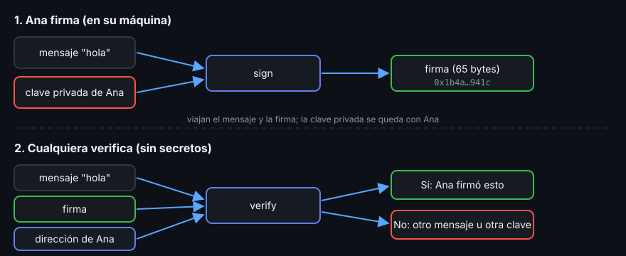

# Teoría 05 — Firmas digitales

## 🎯 Objetivos

- Explicar qué demuestra una firma digital y qué no.
- Firmar un mensaje con una clave privada y verificarlo con una dirección.
- Reconocer las tres partes de una firma de Ethereum: `r`, `s` y `v`.
- Entender el prefijo EIP-191 y por qué existe.
- Anticipar el riesgo de reutilizar una firma (*replay*).

---

## 1. Qué problema resuelve

En la [Teoría 04](04-claves-y-direcciones.md) viste que la clave privada controla una
cuenta. Pero la clave **nunca** sale de tu máquina. Entonces, ¿cómo demuestras a miles
de nodos que una orden ("mueve 5 a Luis") la diste tú?

Con una **firma digital**: un dato que solo puede producir quien tiene la clave privada
y que cualquiera puede comprobar con la dirección pública.

## 2. Cómo funciona

Hay dos operaciones:

| Operación | Entradas | Salida | Quién la hace |
| --------- | -------- | ------ | ------------- |
| **Firmar** (*sign*) | mensaje + clave privada | firma | Solo el dueño de la clave |
| **Verificar** (*verify*) | mensaje + firma + dirección | sí / no | Cualquiera |



Una firma válida demuestra dos cosas a la vez:

1. **Autoría**: la produjo quien controla esa dirección.
2. **Integridad**: el mensaje no cambió ni un byte desde que se firmó (por dentro se
   firma el hash del mensaje: [Teoría 03](03-funciones-hash.md)).

Y **no** demuestra:

- **Cuándo** se firmó.
- **Para qué** se firmó, ni que el firmante entendiera lo que firmaba.
- **Que se use una sola vez.** Una firma copiada sigue siendo válida (apartado 6).

Cada transacción de Ethereum va firmada: así sabe la red de qué cuenta sale.

## 3. Cómo se firma y verifica

**Dónde**: dentro del contenedor. Usas la cuenta 0 de prueba.

```bash
PK=0xac0974bec39a17e36ba4a6b4d238ff944bacb478cbed5efcae784d7bf4f2ff80
ADDR=0xf39Fd6e51aad88F6F4ce6aB8827279cffFb92266
```

### Firmar

```bash
SIG=$(cast wallet sign --private-key $PK "hola")
echo $SIG
```

```
0x1b4ae01d5b64ead55d120293ccdf52f9b2e03d383d8574cb28f460bcbeca3df20ffef465a8e5a53c1ea2d123c8cefbdf3f62957dd444d9b23ea4cd926bbaa8941c
```

130 dígitos hex: 65 bytes. Ejecútalo otra vez: sale **la misma** firma. Las firmas de
Ethereum son deterministas (el número aleatorio interno se deriva de la clave y del
mensaje, según el estándar RFC 6979), y por eso los tests de esta semana pueden comparar
firmas exactas.

### Verificar: caso correcto

```bash
cast wallet verify --address $ADDR "hola" $SIG
```

```
Validation succeeded. Address 0xf39Fd6e51aad88F6F4ce6aB8827279cffFb92266 signed this message.
```

### Verificar: mensaje alterado

```bash
cast wallet verify --address $ADDR "Hola" $SIG
echo "código de salida: $?"
```

```
Error: Validation failed. Address 0xf39Fd6e51aad88F6F4ce6aB8827279cffFb92266 did not sign this message.
código de salida: 1
```

### Verificar: otra dirección

```bash
cast wallet verify --address 0x70997970C51812dc3A010C7d01b50e0d17dc79C8 "hola" $SIG
```

```
Error: Validation failed. Address 0x70997970C51812dc3A010C7d01b50e0d17dc79C8 did not sign this message.
```

El **código de salida** (`$?`) es 0 si el comando tuvo éxito y distinto de 0 si falló.
Los tests de esta semana lo usan para saber si una verificación pasó.

## 4. Anatomía de una firma: r, s, v

Los 65 bytes son tres valores pegados:

| Parte | Bytes | Valor en el ejemplo |
| ----- | ----- | ------------------- |
| `r` | 32 | `0x1b4ae01d5b64ead55d120293ccdf52f9b2e03d383d8574cb28f460bcbeca3df2` |
| `s` | 32 | `0x0ffef465a8e5a53c1ea2d123c8cefbdf3f62957dd444d9b23ea4cd926bbaa894` |
| `v` | 1 | `0x1c` (28) |

`r` y `s` son la firma matemática. `v` (27 o 28) es una pista que permite **recuperar**
la clave pública —y con ella la dirección— a partir del mensaje y la firma. Por eso un
contrato no necesita que le digas quién firmó: lo calcula con la función `ecrecover`
(semana 14).

Puedes separarlas en bash con subcadenas (`${VAR:inicio:longitud}`; el `0x` ocupa las
posiciones 0 y 1):

```bash
echo r=0x${SIG:2:64}
echo s=0x${SIG:66:64}
echo v=0x${SIG:130:2}
```

## 5. El prefijo EIP-191

Imagina que una web te pide "firma este mensaje para iniciar sesión", y el mensaje es en
realidad los bytes de una transacción que vacía tu cuenta. Para que eso sea imposible,
`cast wallet sign` (y toda wallet) no firma el mensaje a secas: le antepone un prefijo
fijo definido en **EIP-191**:

```
"\x19Ethereum Signed Message:\n" + longitud del mensaje + mensaje
```

`\x19` es un byte que ninguna transacción válida tiene al principio, así que una firma de
mensaje nunca sirve como firma de transacción. El hash que se firma de verdad:

```bash
cast hash-message "hola"
```

```
0x9be0f6be75ef83634b9d09b5c1293a496c4ed0d96e8df7e296fce7a915e28d50
```

Compruébalo a mano: el prefijo, la longitud `4` y `hola`, todo en bytes, y su keccak256.

```bash
cast keccak $(cast concat-hex 0x19457468657265756d205369676e6564204d6573736167653a0a34 $(cast from-utf8 "hola"))
```

```
0x9be0f6be75ef83634b9d09b5c1293a496c4ed0d96e8df7e296fce7a915e28d50
```

`cast concat-hex` pega varios valores hex en uno. `0x19457468...0a34` son los bytes de
`\x19Ethereum Signed Message:\n4`.

## 6. Antipatrones y riesgos

- ❌ **Firmar algo que no entiendes.** Una firma es una autorización. Muchos robos
  empiezan con "firma aquí para reclamar tu premio".
- ❌ **Aceptar la misma firma dos veces** (*replay*). Si un contrato paga a quien
  presenta "firma de Ana autorizando 5", sin más, cualquiera que copie la firma cobra
  otra vez. Se evita incluyendo en el mensaje un número que solo vale una vez (*nonce*),
  la dirección del contrato y la red. Semana 14.
- ❌ **Comprobar una firma sin comprobar quién la firmó.** Verificar "que es una firma
  válida" no basta: hay que comparar la dirección recuperada con la esperada.
- ❌ **Confundir firma con cifrado.** Una firma **no** oculta el mensaje: viaja en claro.

## 7. Trucos

- `cast wallet verify ... && echo OK || echo FALLA` convierte el código de salida en un
  mensaje legible.
- Si una verificación falla y no sabes por qué, revisa en este orden: mensaje exacto
  (mayúsculas, espacios, saltos de línea), dirección correcta, firma copiada entera
  (130 dígitos).

## ✅ Checklist

- [ ] Explico qué demuestra una firma (autoría e integridad) y qué no demuestra.
- [ ] Firmo y verifico un mensaje con `cast`, e interpreto el código de salida.
- [ ] Separo una firma en `r`, `s` y `v` y sé para qué sirve `v`.
- [ ] Explico qué protege el prefijo EIP-191.
- [ ] Describo un ataque de *replay* y cómo se evita.

---

| Anterior | Actual | Siguiente |
| -------- | ------ | --------- |
| [← Teoría 04 — Claves y direcciones](04-claves-y-direcciones.md) | **Teoría 05 — Firmas digitales** | [Teoría 06 — Bloques y cadena →](06-bloques-y-cadena.md) |
