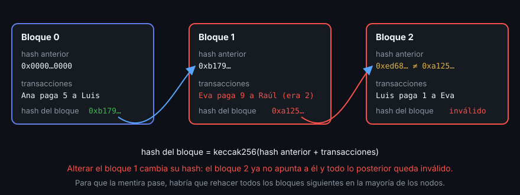

# Teoría 06 — Bloques y cadena

## 🎯 Objetivos

- Explicar qué es un bloque y qué guarda su cabecera.
- Construir a mano, con `cast`, una cadena de tres bloques enlazados por hashes.
- Demostrar por qué alterar un bloque antiguo rompe todos los posteriores.
- Describir en qué consiste el consenso y la diferencia entre prueba de trabajo y
  prueba de participación.
- Saber qué significa que un bloque sea **final**.

---

## 1. Qué problema resuelve

Con hashes ([Teoría 03](03-funciones-hash.md)) detectas que un dato cambió. Con firmas
([Teoría 05](05-firmas-digitales.md)) sabes quién ordenó cada transacción. Falta algo:
**el orden**. Si Ana tiene 5 y firma dos transacciones de 5 —una a Luis y otra a Eva—,
solo una puede valer. ¿Cuál? La que quede **primero** en el registro. Esto se llama el
problema del **doble gasto**, y la solución es acordar un orden único e inalterable.

## 2. Cómo funciona: bloques encadenados

Las transacciones se agrupan en **bloques**. Cada bloque tiene:

- Una **cabecera** (*header*): número de bloque, marca de tiempo, el **hash del bloque
  anterior** y un resumen de su contenido.
- Un **cuerpo**: la lista ordenada de transacciones.

El **hash del bloque** se calcula sobre su cabecera, que incluye el hash del anterior.
Así cada bloque "apunta" al anterior y se forma una **cadena**: la *blockchain*.



## 3. Una cadena a mano

Vas a construir una versión simplificada en la que

```
hash del bloque = keccak256(hash anterior + datos)
```

**Dónde**: dentro del contenedor. Primero una función de bash para no repetir el
comando. `$1` y `$2` son el primer y el segundo argumento de la función:

```bash
block() { cast keccak $(cast concat-hex $1 $(cast from-utf8 "$2")); }
```

El primer bloque no tiene anterior: se usa el hash de 32 bytes a cero.

```bash
G=$(cast hash-zero)
B0=$(block $G "Ana paga 5 a Luis");  echo $B0
B1=$(block $B0 "Eva paga 2 a Raúl"); echo $B1
B2=$(block $B1 "Luis paga 1 a Eva"); echo $B2
```

Salida:

```
0xb1795d5e11efa5e4692dda990a774fe0fbb61421c77b7536682ee9d3b8993b3c
0xed68955907020f56007bca4fd8c55e23438f0191b094064d056313a94269fd54
0x1f8f166d009a9340fb348970736134dc0d5d80baf30620504e6d6d3169e38147
```

## 4. Intentar alterar la historia

Alguien cambia el 2 por un 9 en el bloque 1 y recalcula:

```bash
X1=$(block $B0 "Eva paga 9 a Raúl"); echo $X1
```

```
0xa1257913190c0aa180f80171fd94d3220fe39d472c212c9c92cb7d6dcc23158a
```

El bloque 2 sigue guardando como hash anterior `0xed68...`, pero el bloque 1 ahora mide
`0xa125...`. Cualquier nodo lo detecta comparando. Para que la mentira pase, el
atacante tendría que **recalcular también el bloque 2** (y todos los siguientes):

```bash
X2=$(block $X1 "Luis paga 1 a Eva"); echo $X2
```

```
0x55f7a8b59a324cf1cd3bb3f94582dd8586b1e98ff76f32afc5e357ec87be7adc
```

Distinto de `B2`. En tu máquina eso es instantáneo; en una blockchain real **no**, por
dos razones:

1. Cada nodo honesto tiene su copia con los hashes originales y rechaza la versión
   alterada.
2. Crear bloques válidos tiene un costo (apartado 5) y el resto de la red sigue
   añadiendo bloques a la cadena honesta mientras tanto.

## 5. Consenso: quién añade el siguiente bloque

Si cualquiera pudiera añadir bloques cuando quisiera, cada nodo tendría una cadena
distinta. El **consenso** es el conjunto de reglas por el que los nodos acuerdan qué
bloque va después.

| Mecanismo | Cómo se gana el derecho a proponer el bloque | Costo de atacar | Quién lo usa |
| --------- | -------------------------------------------- | --------------- | ------------ |
| **Prueba de trabajo** (*Proof of Work*, PoW) | Encontrar, a fuerza de probar, un número que haga que el hash del bloque empiece por muchos ceros | Electricidad y hardware: más que todo el resto de la red | Bitcoin |
| **Prueba de participación** (*Proof of Stake*, PoS) | Depositar 32 ETH como garantía y ser elegido al azar | Perder el depósito si se hace trampa | Ethereum desde 2022 |

En Ethereum, a los nodos que proponen y votan bloques se les llama **validadores**. El
tiempo se divide en **slots** de 12 segundos; en cada slot un validador elegido al azar
propone un bloque y los demás lo votan.

## 6. Finalidad

Un bloque recién añadido todavía podría ser reemplazado si la red estaba dividida un
instante (dos validadores vieron cosas distintas). Esto se llama **reorganización**
(*reorg*). Con el paso de los slots, los votos se acumulan y el bloque alcanza la
**finalidad** (*finality*): revertirlo exigiría destruir al menos un tercio de todo el ETH
depositado por los validadores. En Ethereum eso ocurre en unos 13 minutos.

Consecuencia práctica para ti como desarrollador:

- Una transacción **incluida** en un bloque casi seguro se queda.
- Una transacción en un bloque **finalizado** se queda.
- Un sistema que mueve mucho valor (un puente entre cadenas, un exchange) espera a la
  finalidad antes de dar algo por hecho. Lo verás en la semana 19 al indexar eventos.

## 7. Lo que se simplificó

La cadena del apartado 3 es didáctica. En Ethereum real:

- La cabecera tiene más de 15 campos, y el hash se calcula sobre su codificación
  binaria (RLP), no sobre texto.
- Las transacciones no se hashean pegadas: se organizan en un **árbol de Merkle** cuya
  raíz va en la cabecera. Permite demostrar que una transacción está en un bloque sin
  descargar el bloque entero.
- Además del orden de transacciones, la cabecera resume el **estado** completo (saldos y
  datos de todos los contratos) con otra raíz de árbol. Semana 02.

La idea central no cambia: cada bloque contiene el hash del anterior.

## 8. Antipatrones y riesgos

- ❌ **Dar por definitiva una transacción recién enviada.** Hasta que se incluye en un
  bloque puede no ejecutarse nunca; hasta que es final, puede revertirse.
- ❌ **Usar la marca de tiempo del bloque como reloj exacto.** La pone quien propone el
  bloque, dentro de un margen. Semana 07.
- ❌ **Creer que el orden lo decide quién envía primero.** Lo decide quien construye el
  bloque, y eso se puede aprovechar (*front-running*). Semana 22.

## 9. Trucos

- Para verificar una cadena, recorre los bloques recalculando cada hash y comparándolo
  con el "hash anterior" del siguiente. Es lo que hace el ejercicio 01.
- [etherscan.io](https://etherscan.io) muestra cualquier bloque real de Ethereum: abre
  uno y busca el campo *Parent Hash*.

## ✅ Checklist

- [ ] Explico qué es el doble gasto y por qué se resuelve con un orden único.
- [ ] Construyo una cadena de bloques a mano con `cast`.
- [ ] Demuestro con hashes por qué alterar un bloque rompe los posteriores.
- [ ] Distingo prueba de trabajo de prueba de participación.
- [ ] Explico qué es la finalidad y por qué importa a una aplicación.

---

| Anterior | Actual | Siguiente |
| -------- | ------ | --------- |
| [← Teoría 05 — Firmas digitales](05-firmas-digitales.md) | **Teoría 06 — Bloques y cadena** | [Ejercicio 01 — Hashes con cast →](../2-practicas/ejercicio-01-hashes-con-cast/README.md) |
