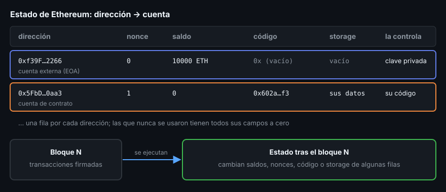

# Teoría 02 — Cuentas y unidades

## 🎯 Objetivos

- Describir el estado de Ethereum como una tabla de cuentas.
- Nombrar los cuatro campos de una cuenta: nonce, saldo, código y storage.
- Distinguir una cuenta externa (EOA) de una cuenta de contrato.
- Convertir entre wei, gwei y ether con `cast`, y saber por qué se cuenta en wei.

---

## 1. Qué problema resuelve el modelo de cuentas

Para saber cuánto tiene alguien, Bitcoin recorre las monedas sin gastar que le
pertenecen. Ethereum lo hace más directo: guarda, para cada dirección, una **cuenta** con
su saldo. Preguntar "¿cuánto tiene esta dirección?" es leer una fila de una tabla.

Esa tabla completa (todas las cuentas con todos sus datos) es el **estado** (*state*). Un
bloque no guarda el estado: guarda las transacciones que lo cambian. Cada nodo aplica las
transacciones en orden y obtiene el mismo estado que todos los demás.



## 2. Los cuatro campos de una cuenta

| Campo | Qué guarda |
| ----- | ---------- |
| **nonce** | Un contador. En una cuenta externa, cuántas transacciones envió. Teoría 05 |
| **saldo** (*balance*) | Cuánto ETH tiene, en wei |
| **código** (*code*) | El programa de la cuenta, si es un contrato. Vacío en las demás |
| **storage** | Los datos que guarda el programa (variables). Vacío si no hay código. Semana 04 |

Tres de los cuatro se leen con `cast`.

**Dónde**: en el contenedor, con anvil recién arrancado (`anvil --silent &`).

```bash
cast balance 0xf39Fd6e51aad88F6F4ce6aB8827279cffFb92266
cast nonce 0xf39Fd6e51aad88F6F4ce6aB8827279cffFb92266
cast code 0xf39Fd6e51aad88F6F4ce6aB8827279cffFb92266
```

Salida:

```
10000000000000000000000
0
0x
```

La cuenta 0 de anvil tiene un saldo enorme (en wei, sección 4), todavía no envió ninguna
transacción (nonce `0`) y no tiene código (`0x` son cero bytes).

Una dirección que nadie usó nunca también "existe": todas sus columnas valen cero.

```bash
cast balance 0x000000000000000000000000000000000000dEaD
```

```
0
```

No hay que registrarse: cualquier dirección de 20 bytes puede recibir ETH.

## 3. Dos tipos de cuenta

| | Cuenta externa (EOA) | Cuenta de contrato |
| - | -------------------- | ------------------ |
| Nombre en inglés | *Externally Owned Account* | *Contract account* |
| La controla | Una clave privada (semana 01) | Su código; nadie tiene su clave |
| Código | Vacío | El programa del contrato |
| Puede iniciar una transacción | Sí, firmándola | No: solo reacciona cuando la llaman |
| Cómo nace su dirección | Se deriva de la clave pública | Se calcula a partir de quién la crea (Teoría 07) |

Todo lo que pasa en Ethereum empieza con una transacción firmada por una EOA. Un contrato
puede llamar a otros contratos, pero solo como parte de una transacción que alguien inició.

Las cuentas de anvil son EOA: por eso `cast code` devuelve `0x`. En la Teoría 07 creas una
cuenta de contrato y ves la diferencia.

## 4. Unidades: wei, gwei y ether

El saldo de antes, `10000000000000000000000`, son 10 000 ETH. Ethereum no usa decimales:
cuenta en la unidad más pequeña, el **wei**, y 1 ETH son 10¹⁸ wei.

| Unidad | En wei | Para qué se usa |
| ------ | ------ | --------------- |
| wei | 1 | Toda cantidad dentro de la cadena y de los contratos |
| gwei | 10⁹ (mil millones) | Precios del gas (Teoría 06) |
| ether | 10¹⁸ | Cantidades para personas |

¿Por qué enteros? Porque la aritmética con decimales en coma flotante redondea, y cada
nodo debe obtener **exactamente** el mismo resultado. Con enteros, `0.1 + 0.2` no existe:
existe `100000000000000000 + 200000000000000000`, que siempre da lo mismo.

`cast` convierte en las dos direcciones:

```bash
cast to-wei 1
cast to-wei 1 gwei
cast from-wei 1000000000000000000
cast to-unit 1000000000 gwei
cast to-unit 21000000000000 ether
cast balance --ether 0xf39Fd6e51aad88F6F4ce6aB8827279cffFb92266
```

Salida:

```
1000000000000000000
1000000000
1.000000000000000000
1
0.000021000000000000
10000.000000000000000000
```

| Comando | Qué hace |
| ------- | -------- |
| `cast to-wei 1` | 1 ether a wei (la unidad por defecto es ether) |
| `cast to-wei 1 gwei` | 1 gwei a wei |
| `cast from-wei N` | N wei a ether |
| `cast to-unit N gwei` | N wei a la unidad que digas |
| `cast balance --ether` | El saldo ya convertido a ether |

En los comandos que envían valor, `cast` acepta la unidad pegada al número: `--value 1ether`,
`--value 2gwei`. Sin unidad, el número está en wei: `--value 1` es **1 wei**.

## 5. Antipatrones y riesgos

- ❌ **Confundir wei con ether.** `--value 1` envía 1 wei, no 1 ETH. Al revés es peor: un
  programa que cree que una cantidad está en ether cuando está en wei la multiplica por
  10¹⁸. Pon siempre la unidad explícita.
- ❌ **Usar coma flotante para cantidades.** En un script, `0.1 * 3` en coma flotante da
  `0.30000000000000004`. Convierte a wei y opera con enteros.
- ❌ **Creer que una dirección "no existe" porque nunca se usó.** Puedes enviarle ETH, y si
  nadie tiene su clave (por ejemplo `0x...dEaD`), ese ETH queda perdido para siempre.
- ❌ **Suponer que toda dirección es una persona.** Puede ser un contrato con reglas
  propias. `cast code` lo distingue.

## 6. Trucos

- Los números de wei son largos: `cast from-wei` antes de leerlos a ojo.
- Bash solo opera enteros hasta unos 9,2 × 10¹⁸ (9,2 ETH en wei). Para restar saldos de
  10 000 ETH no sirve `$(( ))`; para costos de gas, sí.

## ✅ Checklist

- [ ] Explico qué es el estado y por qué los bloques guardan transacciones, no el estado.
- [ ] Nombro los cuatro campos de una cuenta y leo tres con `cast`.
- [ ] Distingo una EOA de un contrato y sé cuál puede iniciar transacciones.
- [ ] Convierto entre wei, gwei y ether, y explico por qué Ethereum usa enteros.

---

| Anterior | Actual | Siguiente |
| -------- | ------ | --------- |
| [← Teoría 01 — Ethereum y anvil](01-ethereum-y-anvil.md) | **Teoría 02 — Cuentas y unidades** | [Teoría 03 — JSON-RPC →](03-json-rpc.md) |
