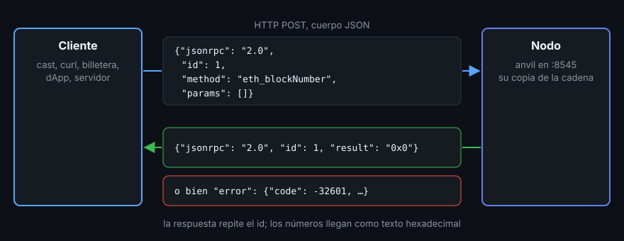

# Teoría 03 — JSON-RPC

## 🎯 Objetivos

- Explicar cómo habla un cliente con un nodo de Ethereum.
- Escribir una petición JSON-RPC a mano con `curl` y leer su respuesta.
- Interpretar las cantidades en hexadecimal que devuelve el nodo.
- Reconocer una respuesta de error.
- Usar `cast` como cliente JSON-RPC, también para métodos sin comando propio.

---

## 1. Qué problema resuelve JSON-RPC

Hay muchos nodos distintos (anvil, Geth, Reth, Nethermind...) y muchos clientes (`cast`,
billeteras, la dApp que escribirás en la semana 17, un servidor en Python). Para que
cualquiera hable con cualquiera hace falta un idioma común.

Ese idioma es **JSON-RPC**: el cliente envía por HTTP un objeto JSON que nombra un
**método** (una operación del nodo) y sus parámetros; el nodo responde con otro JSON. Todos
los nodos de Ethereum implementan los mismos métodos, que empiezan por `eth_`.



## 2. Una petición a mano

**Dónde**: en el contenedor, con anvil recién arrancado (`anvil --silent &`).

```bash
curl -s -X POST -H 'Content-Type: application/json' \
  --data '{"jsonrpc":"2.0","id":1,"method":"eth_blockNumber","params":[]}' \
  http://localhost:8545
```

Salida:

```json
{"jsonrpc":"2.0","id":1,"result":"0x0"}
```

| Parte de la petición | Qué es |
| -------------------- | ------ |
| `curl -s -X POST` | Envía una petición HTTP POST sin barra de progreso |
| `-H 'Content-Type: application/json'` | Avisa que el cuerpo es JSON |
| `"jsonrpc":"2.0"` | Versión del protocolo; siempre `2.0` |
| `"id":1` | Número que elige el cliente; la respuesta lo repite para emparejarlas |
| `"method":"eth_blockNumber"` | Qué operación pide |
| `"params":[]` | Sus parámetros, en una lista (este no lleva) |
| `http://localhost:8545` | Dónde escucha el nodo |

La respuesta repite `id` y trae el dato en `result`: `0x0`, el bloque 0.

## 3. Cantidades en hexadecimal

JSON-RPC devuelve todos los números como texto hexadecimal con `0x`. Es una regla del
protocolo: los saldos en wei no caben en los números de JSON de muchos lenguajes, así que
se mandan como texto.

Un método con parámetros, el saldo de la cuenta 0:

```bash
curl -s -X POST -H 'Content-Type: application/json' \
  --data '{"jsonrpc":"2.0","id":1,"method":"eth_getBalance","params":["0xf39Fd6e51aad88F6F4ce6aB8827279cffFb92266","latest"]}' \
  http://localhost:8545
```

```json
{"jsonrpc":"2.0","id":1,"result":"0x21e19e0c9bab2400000"}
```

El segundo parámetro, `"latest"`, es el **bloque** en el que preguntas: el estado cambia de
bloque en bloque, así que todo dato se lee "en" un bloque. Valores posibles: un número en
hex (`"0x0"`), `"latest"` (el último minado) o `"pending"` (el que se está formando,
Teoría 05).

Para leer el saldo, pásalo a decimal (semana 01):

```bash
cast to-dec 0x21e19e0c9bab2400000
```

```
10000000000000000000000
```

Son los 10 000 ETH de la Teoría 02, en wei.

## 4. Respuestas de error

Si el nodo no puede atender la petición, la respuesta no trae `result` sino `error`:

```bash
curl -s -X POST -H 'Content-Type: application/json' \
  --data '{"jsonrpc":"2.0","id":1,"method":"eth_metodoQueNoExiste","params":[]}' \
  http://localhost:8545
```

```json
{"jsonrpc":"2.0","id":1,"error":{"code":-32601,"message":"Method not found"}}
```

El código `-32601` lo fija el estándar JSON-RPC. Cuando un nodo rechaza una transacción
también responde con `error`; verás varios en las Teorías 05 y 06.

## 5. cast es un cliente JSON-RPC

Cada comando de lectura de `cast` es una petición JSON-RPC con la conversión ya hecha:

| Comando de cast | Método JSON-RPC |
| --------------- | --------------- |
| `cast block-number` | `eth_blockNumber` |
| `cast chain-id` | `eth_chainId` |
| `cast balance DIR` | `eth_getBalance` |
| `cast nonce DIR` | `eth_getTransactionCount` |
| `cast code DIR` | `eth_getCode` |

Para métodos sin comando propio está `cast rpc`, que envía cualquier método y muestra el
`result` tal cual:

```bash
cast rpc eth_blockNumber
cast rpc web3_clientVersion
cast rpc anvil_mine 3
cast block-number
```

Salida:

```
"0x0"
"anvil/v1.9.0"
null
3
```

`anvil_mine` no es estándar: los métodos `anvil_*` solo existen en anvil y sirven para
manipular la cadena de pruebas (minar, cambiar saldos, viajar en el tiempo). `null` es su
`result`: no devuelve nada.

**¿A qué nodo habla cast?** Por orden: al de la opción `--rpc-url URL` si la pones; si no,
al de la variable de entorno `ETH_RPC_URL`; si no, a `http://localhost:8545`. Los `test.sh`
de esta semana usan `ETH_RPC_URL` para apuntar a su anvil del puerto 8546.

## 6. Antipatrones y riesgos

- ❌ **Leer un `result` hexadecimal como decimal.** `"0x10"` es 16, no 10. Convierte
  siempre.
- ❌ **Fiarte de un nodo ajeno sin más.** Un nodo de un proveedor puede caerse, limitar tus
  peticiones o, si es malicioso, mentir sobre el estado. Lo que una dApp lee de su nodo es
  tan fiable como ese nodo. Semana 19.
- ❌ **Exponer el puerto RPC de tu nodo a internet.** Cualquiera podría usarlo. anvil escucha
  en `0.0.0.0` dentro del contenedor, pero el contenedor solo publica puertos si se lo pides
  con `docker run -p`.
- ❌ **Poner la clave de API de un proveedor en el repositorio.** La URL de un nodo de pago
  suele llevarla dentro. Semana 16.

## 7. Trucos

- `| jq -r .result` extrae el campo `result` de la respuesta de `curl`.
- La lista completa de métodos estándar está en la
  [especificación de la API JSON-RPC](https://ethereum.org/developers/docs/apis/json-rpc/).
- Si un comando de `cast` termina en `Connection refused (os error 111)`, no hay ningún nodo
  escuchando: anvil no está corriendo. Compruébalo con `jobs`.

## ✅ Checklist

- [ ] Explico para qué sirve JSON-RPC y qué campos lleva una petición.
- [ ] Hago una petición con `curl` y extraigo el `result` con `jq`.
- [ ] Convierto una cantidad hexadecimal de la respuesta a decimal.
- [ ] Reconozco una respuesta de error.
- [ ] Sé a qué nodo envía `cast` sus peticiones y cómo cambiarlo.

---

| Anterior | Actual | Siguiente |
| -------- | ------ | --------- |
| [← Teoría 02 — Cuentas y unidades](02-cuentas-y-unidades.md) | **Teoría 03 — JSON-RPC** | [Teoría 04 — Transacciones →](04-transacciones.md) |
