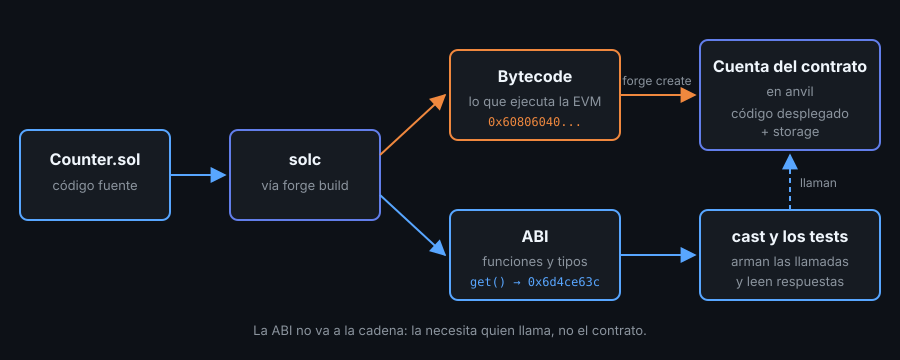

# Teoría 01 — Solidity y el compilador

## 🎯 Objetivos

- Explicar por qué se escriben contratos en un lenguaje de alto nivel y no en bytecode.
- Reconocer las partes de un archivo Solidity: licencia, `pragma`, `contract`, función.
- Explicar qué produce el compilador: bytecode y ABI.
- Leer un error del compilador y saber dónde mirar.

---

## 1. Qué problema resuelve

En la semana 02 desplegaste un contrato de 10 bytes escrito en bytecode: `602a60005260206000f3`.
Devolvía 42 y nada más. Para algo tan simple tuviste que pensar en posiciones de memoria
y en tamaños en bytes. Un contrato real (un registro, un token, un mercado) tiene miles de
bytes: escribirlo así sería imposible de leer, de revisar y de mantener.

**Solidity** es un lenguaje de programación pensado para contratos de la EVM. Escribes
funciones y variables con nombre, y un **compilador** (programa que traduce código fuente
a otro formato) lo convierte en el bytecode que ejecuta la EVM. El compilador de Solidity
se llama **solc**. En este bootcamp no lo llamas directamente: lo usa Foundry por ti.

Solidity se parece a JavaScript o a C en la sintaxis (llaves, punto y coma), pero tiene
**tipos estáticos**: cada variable declara su tipo y el compilador rechaza mezclar tipos.

## 2. El mismo 42, en Solidity

Este es el contrato de la semana 02, escrito en Solidity:

```solidity
// SPDX-License-Identifier: MIT
pragma solidity 0.8.38;

contract Answer {
    function answer() external pure returns (uint256) {
        return 42;
    }
}
```

Línea a línea:

| Línea | Qué es |
| ----- | ------ |
| `// SPDX-License-Identifier: MIT` | Licencia del código. El código de un contrato es público; la licencia dice qué puede hacer otro con él |
| `pragma solidity 0.8.38;` | Versión exacta del compilador que acepta este archivo |
| `contract Answer { ... }` | Un contrato: como una clase, agrupa variables y funciones. Lo que se despliega es un contrato |
| `function answer()` | Una función que se puede llamar desde fuera |
| `external` | Visibilidad: la función se llama desde fuera del contrato (con `cast call`, desde otro contrato...) |
| `pure` | La función no lee ni escribe nada de la cadena: solo calcula |
| `returns (uint256)` | Devuelve un `uint256`: entero sin signo (*unsigned integer*, no negativo) de 256 bits |

`uint256` es el tipo numérico básico de Solidity: la EVM trabaja con palabras de 32 bytes
(256 bits), las mismas que viste en la salida de `cast call` en la semana 02. La semana 04
presenta todos los tipos; esta semana te bastan `uint256`, `address` y `string`.

## 3. Qué produce el compilador

El compilador produce dos cosas a partir del archivo `.sol`:



1. **Bytecode**: lo que se despliega. Para `Answer` empieza así:

   ```
   0x6080604052348015600e575f5ffd5b5060af80601a5f395ff3fe6080604052348015
   ```

   Es código de creación, como en la semana 02: al ejecutarse devuelve el código
   desplegado, que aquí ocupa 175 bytes. Son más que tus 10 bytes porque el compilador
   añade comprobaciones (por ejemplo, rechazar una llamada a una función que no existe) y
   unos metadatos al final.

2. **ABI** (*Application Binary Interface*, interfaz binaria de aplicación): la lista, en
   JSON, de las funciones del contrato con sus parámetros y sus tipos de retorno:

   ```json
   [{"type":"function","name":"answer","inputs":[],"outputs":[{"name":"","type":"uint256","internalType":"uint256"}],"stateMutability":"pure"}]
   ```

   El bytecode no guarda nombres de funciones. La ABI es lo que permite a un cliente como
   `cast` saber que existe `answer()`, cómo pedirla y cómo leer lo que devuelve.

## 4. El selector: cómo se llama a una función

Una llamada a un contrato es una transacción (o un `eth_call`) cuyo campo `input` empieza
por el **selector** de la función: los 4 primeros bytes del keccak256 de su firma
(nombre y tipos de parámetros, sin espacios).

**Dónde**: en el contenedor (no necesita anvil).

```bash
cast sig "answer()"
```

**Salida**:

```
0x85bb7d69
```

El bytecode que genera el compilador compara el selector que llega con los de sus
funciones y salta a la que coincide. Con `Answer` desplegado en anvil, estas dos llamadas
son la misma:

```bash
cast call "$ANSWER" "answer()"
cast call "$ANSWER" 0x85bb7d69
```

Las dos imprimen:

```
0x000000000000000000000000000000000000000000000000000000000000002a
```

`cast` calcula el selector con la firma que le das. Si además pones el tipo de retorno,
`"answer()(uint256)"`, también decodifica la respuesta con la ABI: imprime `42`. Cómo
desplegar y llamar lo verás paso a paso en la Teoría 05.

## 5. La versión del compilador

`pragma solidity 0.8.38;` fija la versión **exacta**. Muchos proyectos escriben
`pragma solidity ^0.8.0;` ("cualquier 0.8.x a partir de 0.8.0"). Compila, pero tiene un
coste: el mismo código fuente puede producir bytecode distinto según qué versión haya
instalada, y una versión vieja puede tener un fallo de compilación conocido.

En el bootcamp el compilador está en la imagen y Foundry trabaja sin red (`offline = true`
en `foundry.toml`). Si pides otra versión, falla al momento:

```solidity
pragma solidity 0.8.20; // ❌
```

```
Error: Encountered invalid compiler version in src/Bad.sol: No compiler version installed that matches the version requirement: =0.8.20
```

## 6. Leer un error del compilador

El compilador rechaza el código antes de que llegue a la cadena. Sus errores siempre dicen
**qué** falla, **dónde** (archivo, línea, columna) y señalan el punto con `^`.

```solidity
function get() external view returns (uint256) {
    return number // ❌ falta el punto y coma
}
```

```
Error (2314): Expected ';' but got '}'
 --> src/Bad.sol:7:5:
7 |     }
  |     ^
```

El error apunta a la línea 7, la de la llave: ahí descubre el compilador que faltaba
algo. Cuando la línea señalada parece correcta, mira la anterior.

Los tipos también se comprueban:

```solidity
number = "hola"; // ❌ number es uint256
```

```
Error (7407): Type literal_string "hola" is not implicitly convertible to expected type uint256.
```

Un **warning** (aviso) no impide compilar, pero casi siempre señala algo mejorable. Los
tests resueltos de este bootcamp pasan con `--deny warnings`: un warning cuenta como
error.

## 7. Antipatrones y riesgos

- **`pragma` con `^`**: el bytecode desplegado depende de qué compilador hubiera en la
  máquina de quien desplegó. Fija la versión exacta; el bytecode tiene que poder
  reproducirse para que otros comprueben que corresponde al código publicado.
- **Ignorar warnings**: muchos fallos de seguridad empezaron siendo un warning que nadie
  leyó.
- **Creer que el código del contrato es privado**: el bytecode está en la cadena y
  cualquiera lo lee con `cast code`. Un secreto escrito en el código fuente (una
  contraseña, una clave) es público en cuanto se despliega.
- **Copiar contratos sin entenderlos**: un contrato desplegado no se puede corregir. Si
  tiene un fallo, el fallo se queda (la semana 15 verá cómo se preparan contratos
  actualizables, y su coste).

## 8. Trucos

- `cast sig "firma(tipos)"` da el selector de cualquier función.
- Cuando el compilador marca una línea que parece correcta, el error está antes.
- La documentación oficial está en [docs.soliditylang.org](https://docs.soliditylang.org):
  su sección *Solidity by Example* es buena para leer contratos cortos.

## ✅ Checklist

- [ ] Explico por qué se escribe Solidity y no bytecode.
- [ ] Reconozco licencia, `pragma`, `contract` y función en un archivo `.sol`.
- [ ] Sé qué son el bytecode y la ABI, y para qué sirve cada uno.
- [ ] Calculo el selector de una función con `cast sig`.
- [ ] Leo un error del compilador: qué, dónde y por qué.

---

| Anterior | Actual | Siguiente |
| -------- | ------ | --------- |
| [← Semana 03 — Primer contrato con Foundry](../README.md) | **Teoría 01 — Solidity y el compilador** | [Teoría 02 — Un proyecto Foundry →](02-proyecto-foundry.md) |
