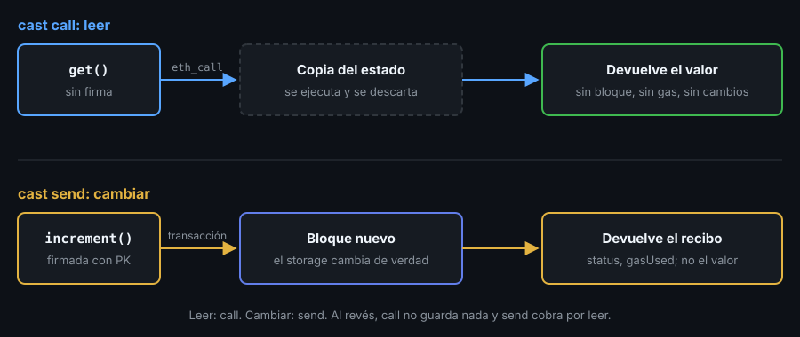

# Teoría 05 — Desplegar y llamar

## 🎯 Objetivos

- Desplegar un contrato en anvil con `forge create` y leer su dirección.
- Distinguir una simulación (sin `--broadcast`) de un despliegue real.
- Leer el contrato con `cast call` y cambiarlo con `cast send`.
- Reconocer los errores típicos de una llamada mal hecha.

---

## 1. Qué problema resuelve

`forge test` despliega en una EVM de prueba que desaparece al terminar. Para que otros
usen tu contrato hay que desplegarlo en una red: hoy, anvil; en la semana 16, una testnet
pública. Desplegar es enviar una transacción de creación (semana 02, Teoría 07): sin
destino y con el código de creación en `input`. `forge create` la construye con el
artefacto compilado, la firma y la envía.

## 2. Desplegar

**Dónde**: en el contenedor, con anvil en marcha (`anvil --silent &`) y dentro de la
carpeta del proyecto. `PK` es la clave privada de la cuenta 0 de anvil:

```bash
PK=0xac0974bec39a17e36ba4a6b4d238ff944bacb478cbed5efcae784d7bf4f2ff80
```

Primero, sin `--broadcast`:

```bash
forge create src/Counter.sol:Counter --private-key "$PK"
```

**Salida** (recortada):

```
Warning: Dry run enabled, not broadcasting transaction

Contract: Counter
Transaction: {
  "from": "0xf39fd6e51aad88f6f4ce6ab8827279cfffb92266",
  "to": null,
  ...
```

Es una **simulación** (*dry run*): `forge` construye la transacción y te la enseña, pero
no la envía. `"to": null` es lo que la hace transacción de creación. `cast block-number`
sigue en `0`: no se minó nada.

`src/Counter.sol:Counter` dice qué contrato desplegar: archivo y nombre del contrato,
porque un archivo puede tener varios. Ahora de verdad:

```bash
forge create src/Counter.sol:Counter --private-key "$PK" --broadcast
```

```
Deployer: 0xf39Fd6e51aad88F6F4ce6aB8827279cffFb92266
Deployed to: 0x5FbDB2315678afecb367f032d93F642f64180aa3
Transaction hash: 0x05499dc2e829eb31f419df857df06d970d7ea1e18226d9e96953d2c90e91974b
```

La dirección es la misma que la del contrato de bytecode de la semana 02: depende solo de
quién crea y de su nonce (0), no del código. El recibo lo confirma:

```bash
cast receipt 0x05499dc2e829eb31f419df857df06d970d7ea1e18226d9e96953d2c90e91974b contractAddress
cast receipt 0x05499dc2e829eb31f419df857df06d970d7ea1e18226d9e96953d2c90e91974b gasUsed
```

```
0x5FbDB2315678afecb367f032d93F642f64180aa3
153555
```

Con `--json`, `forge create` imprime lo mismo en JSON (`deployer`, `deployedTo`,
`transactionHash`), cómodo para un script: `jq -r .deployedTo` saca la dirección.

## 3. Leer con `cast call`

Guarda la dirección y lee el número:

```bash
COUNTER=0x5FbDB2315678afecb367f032d93F642f64180aa3
cast call "$COUNTER" "get()(uint256)"
```

```
0
```

`"get()(uint256)"` es la firma de la función y, entre los segundos paréntesis, lo que
devuelve. Sin el tipo de retorno, `cast` imprime la palabra de 32 bytes en crudo:

```bash
cast call "$COUNTER" "get()"
```

```
0x0000000000000000000000000000000000000000000000000000000000000000
```

## 4. Cambiar con `cast send`

```bash
cast send "$COUNTER" "increment()" --private-key "$PK"
```

Imprime el recibo. Las líneas que importan:

```
gasUsed              43539
status               1 (success)
to                   0x5FbDB2315678afecb367f032d93F642f64180aa3
```

Y el cambio queda en la cadena:

```bash
cast call "$COUNTER" "get()(uint256)"
cast storage "$COUNTER" 0
```

```
1
0x0000000000000000000000000000000000000000000000000000000000000001
```

Con parámetros, van detrás de la firma:

```bash
cast send "$COUNTER" "set(uint256)" 42 --private-key "$PK"
```

`cast` codifica el selector y el argumento en el `input`. `cast calldata` te enseña esos
bytes sin enviar nada:

```bash
cast calldata "set(uint256)" 42
```

```
0x60fe47b1000000000000000000000000000000000000000000000000000000000000002a
```

Selector `60fe47b1` y, detrás, 42 (`0x2a`) en una palabra de 32 bytes.

## 5. `call` y `send` no son intercambiables



| | `cast call` | `cast send` |
| - | ----------- | ----------- |
| Método JSON-RPC | `eth_call` | `eth_sendRawTransaction` |
| Firma | No | Sí, con tu clave |
| Minado, gas | No | Sí, lo pagas |
| Devuelve | Lo que devuelve la función | El recibo, no lo que devuelve la función |
| Cambia el estado | Nunca | Sí, si la función escribe |

Dos errores que no dan mensaje:

- **`cast call` a una función que escribe**: se ejecuta en la copia y se descarta.
  `cast call "$COUNTER" "set(uint256)" 99` imprime `0x` y `get()` sigue en `42`.
- **`cast send` a una función `view`**: es una transacción válida, se mina y cobra gas
  (`gasUsed 23495` para `get()`), pero el valor que devuelve no aparece en el recibo. Para
  leer, `cast call`.

## 6. Errores típicos

| Qué hiciste | Qué ves |
| ----------- | ------- |
| `cast send` a una función que no existe (`nada()`) | `Error: Failed to estimate gas: server returned an error response: error code 3: execution reverted, data: "0x"` |
| `cast call ... "get()(uint256)"` a una dirección sin contrato | `Error: contract 0x70997970c51812dc3a010c7d01b50e0d17dc79c8 does not have any code` |
| `cast call ... "get()"` (sin tipo de retorno) a esa misma dirección | `Warning: Contract code is empty` y `0x` |
| `forge create` sin `--broadcast` | `Warning: Dry run enabled, not broadcasting transaction` |

El primero viene del bytecode que añade el compilador: si el selector no es de ninguna
función, revierte. `cast` lo descubre al estimar el gas, antes de firmar nada.

## 7. Antipatrones y riesgos

- **La clave privada en la línea de comandos**: queda en el historial de la terminal y la
  ve cualquier programa que liste procesos. Con las claves de prueba de anvil da igual;
  con una clave real es perderla. La semana 16 enseña los **keystores** cifrados de
  Foundry, la forma correcta.
- **Desplegar en la red equivocada**: `forge create` y `cast send` usan la red de
  `--rpc-url` o de `ETH_RPC_URL`, y si no hay ninguna, `http://localhost:8545`. Antes de
  enviar, comprueba con `cast chain-id` dónde estás (`31337` es anvil).
- **Confiar en una dirección sin mirar**: antes de interactuar con un contrato,
  `cast code DIRECCIÓN` confirma que hay código. Una dirección mal copiada es una EOA
  vacía, o el contrato de otro.
- **Leer con `send`**: pagas gas por nada y no obtienes el valor.

## 8. Trucos

- `forge create ... --json | jq -r .deployedTo` guarda la dirección en una variable.
- `cast abi-decode "get()(uint256)" 0x...2a` decodifica una respuesta en crudo: imprime
  `42`.
- `cast call DIRECCIÓN "get()" --trace` muestra la traza de una llamada, como `-vvvv` en
  los tests.
- `cast receipt HASH status` confirma si una transacción salió bien.

## ✅ Checklist

- [ ] Despliego con `forge create --broadcast` y sé qué hace sin `--broadcast`.
- [ ] Explico por qué el contrato cae en `0x5FbDB...0aa3` en un anvil nuevo.
- [ ] Leo con `cast call` y cambio con `cast send`, con y sin parámetros.
- [ ] Sé por qué `cast call` no cambia nada y `cast send` no devuelve el valor.
- [ ] Reconozco los errores de función inexistente y de dirección sin código.

---

| Anterior | Actual | Siguiente |
| -------- | ------ | --------- |
| [← Teoría 04 — Tests con forge](04-tests-con-forge.md) | **Teoría 05 — Desplegar y llamar** | [Ejercicio 01 — Primer contrato →](../2-practicas/ejercicio-01-primer-contrato/README.md) |
