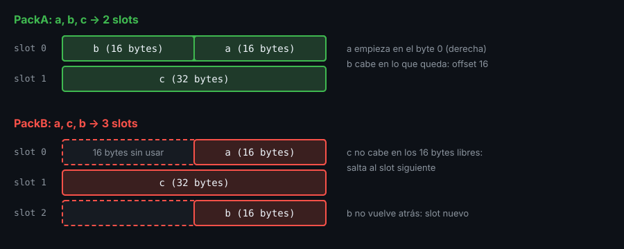

# Teoría 02 — Variables de estado y storage

## 🎯 Objetivos

- Distinguir variables de estado y variables locales.
- Predecir en qué slot y con qué desplazamiento queda cada variable de estado.
- Ordenar variables pequeñas para que compartan slot.
- Comprobar el layout con `forge inspect` y con `cast storage`.

---

## 1. Qué problema resuelve

En la semana 03 viste que `number` quedaba en el slot 0 y `lastCaller` en el 1. Con dos
variables `uint256` y `address` no hay mucho que decidir. Pero el storage es lo más caro
de la EVM: escribir un slot que estaba a cero costó 43539 de gas en el primer
`increment()`, frente a 26439 del segundo. Saber cómo reparte el compilador las variables
te deja gastar menos slots y leer cualquier variable desde fuera.

## 2. Estado y local

Una **variable de estado** se declara dentro del contrato, fuera de las funciones. Vive en
el storage: queda en la cadena entre una transacción y la siguiente.

Una **variable local** se declara dentro de una función. Existe mientras la función se
ejecuta y desaparece al terminar: no cuesta storage.

```solidity
contract Example {
    uint256 total; // estado: slot 0, persiste

    function addTwice(uint256 amount) external {
        uint256 doubled = amount * 2; // local: desaparece al terminar
        total += doubled;
    }
}
```

## 3. Cómo reparte el compilador los slots

El storage es una lista de **slots** de 32 bytes numerados desde 0 (semana 03). El
compilador recorre las variables de estado **en el orden en que las declaras** y:

1. Pone la primera en el slot 0, a partir del byte 0.
2. Si la siguiente cabe en lo que queda del slot actual, la pone a continuación (mismo
   slot, desplazamiento mayor).
3. Si no cabe, pasa al slot siguiente.

Un `uint256` ocupa 32 bytes, un `address` 20, un `uint128` 16, un `bool` y un `uint8` 1.
`constant` e `immutable` no ocupan storage (Teoría 05).



## 4. El orden importa

Mismas tres variables, dos órdenes:

```solidity
contract PackA {
    uint128 a;
    uint128 b;
    uint256 c;
}

contract PackB {
    uint128 a;
    uint256 c;
    uint128 b;
}
```

**Dónde**: en el contenedor, en la carpeta del proyecto.

```bash
forge inspect PackA storageLayout
forge inspect PackB storageLayout
```

**Salida** (columnas `Name`, `Type`, `Slot`, `Offset`, `Bytes`):

```
| a    | uint128 | 0    | 0      | 16    | src/Pack.sol:PackA |
| b    | uint128 | 0    | 16     | 16    | src/Pack.sol:PackA |
| c    | uint256 | 1    | 0      | 32    | src/Pack.sol:PackA |
```

```
| a    | uint128 | 0    | 0      | 16    | src/Pack.sol:PackB |
| c    | uint256 | 1    | 0      | 32    | src/Pack.sol:PackB |
| b    | uint128 | 2    | 0      | 16    | src/Pack.sol:PackB |
```

`PackA` usa 2 slots; `PackB`, 3. En `PackB`, `c` no cabe en los 16 bytes que deja `a` y
salta al slot 1; `b` ya no puede volver atrás. **Empaquetar** (*packing*) es declarar
juntas las variables pequeñas que se escriben a la vez, para que compartan slot.

`Offset` es el byte del slot donde empieza la variable, contando desde el lado derecho
(el menos significativo) cuando lees el slot con `cast storage`. Con `uint128 a = 1;` y
`uint128 b = 2;` desplegados, el slot 0 lleva las dos:

```
0x0000000000000000000000000000000200000000000000000000000000000001
```

Los 16 bytes de la derecha son `a` (offset 0); los 16 de la izquierda, `b` (offset 16).

## 5. Leer cualquier slot desde fuera

El layout es público: se deduce del código fuente. Con la dirección del contrato,
cualquiera lee cualquier slot, tenga la variable la visibilidad que tenga:

```bash
cast storage "$CONTRACT" 0
```

```
0x0000000000000000000000000000000000000000000000000000000000000005
```

En el ejercicio 03 lo usas para leer una variable `private`.

## 6. Valores iniciales

Una variable de estado puede llevar valor en la declaración:

```solidity
uint256 private secret = 7;
```

Ese valor se escribe en el storage **durante el despliegue**, como parte del código de
creación (semana 02), igual que lo que asigna el constructor (Teoría 05).
Sin valor inicial, el slot se queda a cero y no cuesta nada.

## 7. Antipatrones y riesgos

- **Cambiar el orden de las variables de un contrato que ya guarda datos**: el código
  nuevo leería los slots con otro significado. Con contratos normales no pasa (no se
  pueden cambiar), pero es la causa del fallo más grave de los contratos actualizables
  (semana 15).
- **Empaquetar variables que se escriben por separado**: escribir una parte de un slot
  obliga a leerlo entero y volver a escribirlo. Empaqueta lo que se usa junto.
- **Guardar en storage lo que puede ser local**: cada escritura en un slot cuesta miles
  de gas; una variable local no cuesta storage.
- **Creer que el storage es privado**: todo slot se lee con `cast storage`.

## 8. Trucos

- `forge inspect <Contrato> storageLayout` antes de desplegar: comprueba cuántos slots
  usas.
- Agrupa por tamaño: primero las de 32 bytes, luego las pequeñas juntas.
- Un `address` (20 bytes) y un `uint96` (12 bytes) llenan justo un slot.

## ✅ Checklist

- [ ] Distingo variable de estado y variable local, y sé cuál cuesta storage.
- [ ] Predigo slot y desplazamiento de una lista de variables.
- [ ] Reordeno variables para que usen menos slots.
- [ ] Leo un slot de un contrato desplegado con `cast storage`.

---

| Anterior | Actual | Siguiente |
| -------- | ------ | --------- |
| [← Teoría 01 — Tipos de valor](01-tipos-de-valor.md) | **Teoría 02 — Variables de estado y storage** | [Teoría 03 — Visibilidad →](03-visibilidad.md) |
