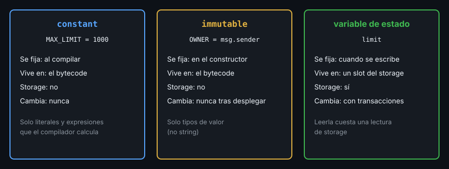

# Teoría 05 — Constructor, constant e immutable

## 🎯 Objetivos

- Escribir un constructor con parámetros y desplegarlo con `--constructor-args`.
- Distinguir `constant`, `immutable` y una variable de estado normal.
- Explicar por qué leer una constante cuesta menos gas que leer el storage.
- Guardar quién desplegó el contrato.

---

## 1. Qué problema resuelve

El registro de la semana 03 empezaba siempre igual: total a cero, sin dueño, sin límite.
Un protocolo real necesita datos que se deciden **al desplegar** (quién es el dueño,
cuánta capacidad tiene) y datos que **nunca cambian** (su nombre, un máximo). Si los
guardas en variables de estado normales, pagas storage por leerlos y cualquiera con una
función de escritura podría cambiarlos. Solidity tiene tres herramientas para esto: el
constructor, `constant` e `immutable`.

## 2. El constructor

El **constructor** es una función especial que se ejecuta **una sola vez**, dentro de la
transacción de despliegue. Después no existe: su código va en el código de creación
(semana 02), no en el desplegado, y nadie puede volver a llamarlo.

```solidity
/// @notice Fija el dueño (quien despliega) y el límite inicial.
/// @param initialLimit Límite con el que empieza la configuración.
constructor(uint256 initialLimit) {
    OWNER = msg.sender;
    limit = initialLimit;
}
```

Dentro del constructor, `msg.sender` es la cuenta que despliega. Es la forma habitual de
saber quién es el dueño del contrato.

Los argumentos se pasan al desplegar, con `--constructor-args` **al final** del comando:

**Dónde**: en el contenedor, con `anvil --silent &` en marcha.

```bash
forge create src/Config.sol:Config \
  --private-key "$PK" --broadcast --constructor-args 100
```

```
Deployer: 0xf39Fd6e51aad88F6F4ce6aB8827279cffFb92266
Deployed to: 0x5FbDB2315678afecb367f032d93F642f64180aa3
Transaction hash: 0x76c15610b6580af8a9845e9fe01c6eb71826aa6845aede487af8a6b47d0ad30a
```

`--constructor-args` se queda con **todo** lo que va detrás. Si lo pones en medio, toma
también las opciones siguientes como argumentos:

```
Error: Constructor argument count mismatch: expected 1 but got 4
```

Los argumentos viajan en la transacción de despliegue, codificados con la ABI y pegados
al final del código de creación. El campo `input` de esa transacción termina así:

```bash
cast tx 0x76c15610b6580af8a9845e9fe01c6eb71826aa6845aede487af8a6b47d0ad30a input | tail -c 66
```

```
30000000000000000000000000000000000000000000000000000000000000064
```

Los últimos 32 bytes son `100` (`0x64`).

## 3. `constant`: fijo al compilar

Una variable `constant` tiene un valor que el compilador conoce: un literal o una
expresión con literales. El compilador la sustituye por su valor en cada sitio donde se
usa. No ocupa storage.

```solidity
uint256 public constant MAX_LIMIT = 1000;
string public constant PROTOCOL_NAME = "Repair Network";
```

Si el valor depende de algo que solo se sabe al ejecutar, no puede ser `constant`:

```solidity
uint256 public constant START = block.number; // ❌
```

```
Error (8349): Initial value for constant variable has to be compile-time constant.
```

(`block.number`, el número del bloque actual, se estudia en la semana 07.)

## 4. `immutable`: fijo al desplegar

Una variable `immutable` recibe su valor **en el constructor** (o en la declaración) y
desde entonces no cambia. El compilador reserva un hueco en el código desplegado y el
constructor lo rellena: el valor queda **dentro del bytecode**, no en el storage.

```solidity
address public immutable OWNER;
```

Asignarla en otra función no compila:

```
Error (1581): Cannot write to immutable here: Immutable variables can only be initialized inline or assigned directly in the constructor.
```

Solo admite tipos de valor (Teoría 01). Un `string immutable`:

```
Error (6377): Immutable variables cannot have a non-value type.
```

Para un texto fijo, usa `constant`.



## 5. Lo que cuesta leerlas

`Config` tiene `MAX_LIMIT` (`constant`) y `limit` (estado). El gas que costaría leer cada
una en una transacción:

```bash
cast estimate "$CONFIG" "MAX_LIMIT()"
cast estimate "$CONFIG" "limit()"
```

```
21367
23532
```

Las dos incluyen los 21000 de base (semana 02). La diferencia, unos 2000, es la lectura
de un slot del storage que la constante no necesita: el valor está en el código.

Y en el storage solo quedan las variables normales:

```bash
forge inspect Config storageLayout --json | jq -r '[.storage[].label] | join(" ")'
```

```
limit secret
```

## 6. Convención de nombres

`constant` e `immutable` se escriben en `SCREAMING_SNAKE_CASE`: `MAX_LIMIT`, `OWNER`. El
nombre avisa de que el valor no cambia. El getter de una `public` se llama igual:
`OWNER()`.

## 7. Antipatrones y riesgos

- **Variable de estado para un dato que nunca cambia**: paga storage en cada lectura y
  deja abierta la puerta a que una función lo cambie. Usa `constant` o `immutable`.
- **Argumentos del constructor equivocados**: un contrato desplegado no se corrige. Un
  dueño o una capacidad mal pasados se quedan para siempre: comprueba los getters justo
  después de desplegar.
- **Creer que `OWNER` ya protege algo**: guardar el dueño no impide que otros llamen a
  las funciones. La comprobación de quién llama llega en la semana 05.
- **Guardar secretos en el constructor**: los argumentos quedan en la transacción de
  despliegue, que es pública.

## 8. Trucos

- Después de desplegar, llama a todos los getters de `constant` e `immutable`: es la forma
  más rápida de comprobar que el constructor recibió lo que debía.
- `cast abi-encode "constructor(uint256)" 100` muestra cómo quedan codificados los
  argumentos.
- En tests, `new Registry(3)` pasa los argumentos del constructor como en cualquier
  llamada.

## ✅ Checklist

- [ ] Escribo un constructor con parámetros y lo despliego con `--constructor-args`.
- [ ] Explico cuándo usar `constant`, cuándo `immutable` y cuándo una variable normal.
- [ ] Explico por qué leer `MAX_LIMIT` cuesta menos que leer `limit`.
- [ ] Guardo quién despliega con `msg.sender` en el constructor.

---

| Anterior | Actual | Siguiente |
| -------- | ------ | --------- |
| [← Teoría 04 — Funciones: view, pure y retornos](04-funciones-view-pure-y-retornos.md) | **Teoría 05 — Constructor, constant e immutable** | [Ejercicio 01 — Tipos de valor →](../2-practicas/ejercicio-01-tipos-de-valor/README.md) |
