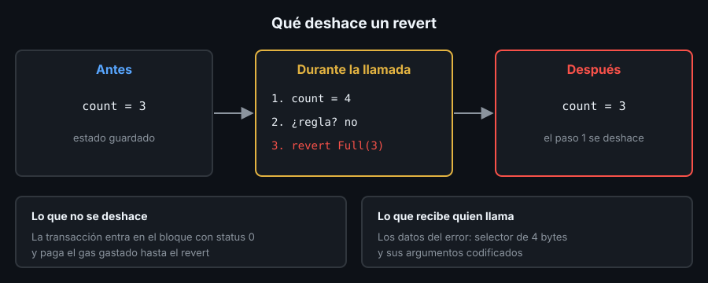

# Teoría 02 — require y revert

## 🎯 Objetivos

- Rechazar una llamada con `require` y con `revert`.
- Explicar qué deshace un revert y qué no.
- Leer el error de una llamada rechazada en `forge test` y en `cast`.
- Distinguir una transacción que falla al estimar gas de una que entra en el bloque con
  `status 0`.

---

## 1. Qué problema resuelve

El `Config` de la semana 04 dejaba que cualquiera llamara a `setLimit` con cualquier
valor. Un contrato tiene que poder decir "no": no aceptar un valor fuera de rango, no
dejar actuar a quien no debe. En Solidity decir "no" es **revertir**: detener la
ejecución, deshacer todo lo que la llamada había cambiado y devolver a quien llamó un
mensaje que explica por qué.



## 2. `require`

`require(condición, "mensaje")` sigue si la condición es `true` y revierte con el mensaje
si es `false`:

```solidity
function setReq(uint256 v) external {
    require(v <= 100, "value too large");
    value = v;
}
```

Léelo como "exijo que `v` sea como mucho 100". La comprobación va **al principio**, antes
de tocar el estado: es lo que se llama una **guarda**.

## 3. `revert`

`revert("mensaje")` revierte sin condición. Se usa dentro de un `if` cuando la condición
es más fácil de expresar al revés o cuando hay varias ramas:

```solidity
function setRev(uint256 v) external {
    if (v > 100) revert("value too large");
    value = v;
}
```

Las dos funciones hacen lo mismo y devuelven el mismo error. Ya conoces `revert` de los
starters: `revert("TODO: Paso 1")` es justo esto.

## 4. Qué ve quien llama

En un test, el mensaje aparece entre corchetes:

```
[FAIL: value too large] test_req() (gas: 27541)
```

Con `cast call` contra el contrato desplegado en anvil:

```bash
cast call "$CONTRACT" "setReq(uint256)" 101
```

```
Error: execution reverted: value too large

Context:
- server returned an error response: error code 3: execution reverted: value too large, data: "0x08c379a00000000000000000000000000000000000000000000000000000000000000020000000000000000000000000000000000000000000000000000000000000000f76616c756520746f6f206c617267650000000000000000000000000000000000"
```

`data` son los **datos del revert**: lo que el contrato devuelve al revertir. Empiezan por
`0x08c379a0`, que es el selector de `Error(string)`:

```bash
cast sig "Error(string)"
```

```
0x08c379a0
```

Detrás va el texto codificado (`76616c756520746f6f206c61726765` es `value too large` en
hexadecimal). Todo `require` o `revert` con mensaje devuelve ese formato.

Sin mensaje, `require(v > 0);` revierte con los datos vacíos y nadie sabe por qué:

```
Error: server returned an error response: error code 3: execution reverted, data: "0x"
```

## 5. Qué deshace un revert y qué no

**Deshace** todos los cambios de estado de la llamada: las variables escritas antes del
`revert` vuelven a su valor. No hay que deshacer nada a mano.

**No deshace** la transacción en sí. Con `cast send`, `cast` estima el gas antes de enviar;
si la llamada revierte, ni siquiera la envía:

```bash
cast send "$CONTRACT" "noMsg(uint256)" 0 --private-key "$PK"
```

```
Error: Failed to estimate gas: server returned an error response: error code 3: execution reverted, data: "0x"
```

Pero si fuerzas el envío fijando tú el gas con `--gas-limit`, la transacción entra en el
bloque, revierte y **paga** el gas gastado hasta el revert:

```bash
cast send "$CONTRACT" "noMsg(uint256)" 0 --private-key "$PK" --gas-limit 100000
```

```
gasUsed              21673
status               0 (failed)
```

`status 0` es el recibo de una transacción fallida: existe, tiene hash, gastó 21673 de gas
y no cambió nada del contrato.

## 6. Riesgos

- **Guardas después de escribir**: revertir deshace igual, pero leer el código se vuelve
  confuso y es fácil olvidar una rama. Comprueba primero, escribe después.
- **`require` sin mensaje**: quien llama no sabe qué regla rompió. Pon siempre un motivo
  (o un error personalizado, teoría 03).
- **Confiar en que el revert avisa a alguien**: un revert solo informa a quien llama. Si
  otro contrato te llama y no comprueba el resultado, el fallo puede pasar desapercibido
  (semana 10).

## 7. Trucos

- Escribe las guardas como frases: "exijo que el registro no esté lleno".
- En los tests, `vm.expectRevert(bytes("value too large"))` antes de la llamada hace que
  el test pase solo si revierte con ese mensaje exacto.

## ✅ Checklist

- [ ] Escribo una guarda con `require` y la misma con `if` + `revert`.
- [ ] Explico qué deshace un revert y qué no.
- [ ] Reconozco `0x08c379a0` como `Error(string)` en los datos de un revert.
- [ ] Sé por qué `cast send` no envía una transacción que va a revertir y cómo forzarla.

---

| Anterior | Actual | Siguiente |
| -------- | ------ | --------- |
| [← Teoría 01 — Condicionales y bucles](01-condicionales-y-bucles.md) | **Teoría 02 — require y revert** | [Teoría 03 — Errores personalizados →](03-errores-personalizados.md) |
