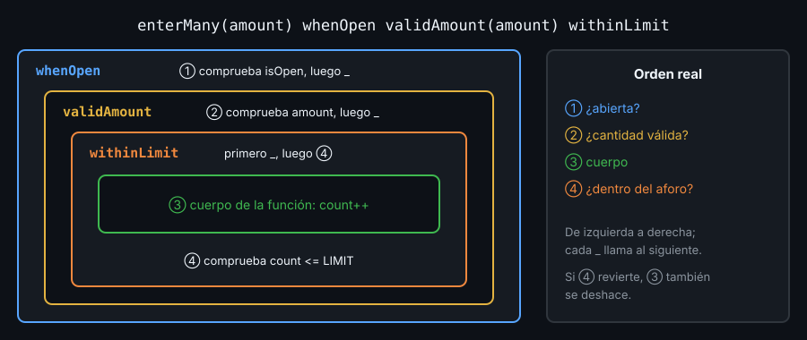

# Teoría 05 — Modificadores

## 🎯 Objetivos

- Escribir un modificador y aplicarlo a varias funciones.
- Explicar qué hace `_` y qué se ejecuta antes y después.
- Escribir modificadores con parámetros y combinar varios en una función.
- Reconocer los riesgos de un modificador mal escrito o ausente.

---

## 1. Qué problema resuelve

En la semana 04 tu registro guardó `OWNER`, pero no lo usaba. Para que solo el dueño
pueda cerrar el registro hace falta una guarda: `if (msg.sender != OWNER) revert ...`. Si
tres funciones son solo del dueño, esa línea se repite tres veces, y basta olvidarla en
una para abrir una puerta. Un **modificador** (*modifier*) es un bloque de código con
nombre que se pega a la firma de una función y se ejecuta alrededor de ella. Se escribe una
vez y se aplica donde haga falta.

## 2. Declarar y aplicar

```solidity
contract E {
    error NotOwner(address caller);

    address public immutable OWNER;
    uint256 public value;

    constructor() {
        OWNER = msg.sender;
    }

    modifier onlyOwner() {
        if (msg.sender != OWNER) revert NotOwner(msg.sender);
        _;
    }

    function setOwner(uint256 v) external onlyOwner {
        value = v;
    }
}
```

- `modifier onlyOwner() { ... }` declara el modificador.
- `_;` marca dónde se ejecuta el cuerpo de la función. Todo lo anterior va antes; todo lo
  posterior, después.
- `function setOwner(...) external onlyOwner` lo aplica. El nombre va después de la
  visibilidad (y de `view` o `pure`, si los hay).

Desde otra cuenta, el modificador revierte antes de llegar a `value = v`:

```
[FAIL: NotOwner(0x0000000000000000000000000000000000000001)] test_owner() (gas: 30500)
```

Un modificador **tiene** que contener `_`. Sin él, la función nunca se ejecutaría, y el
compilador lo rechaza:

```
Error (2883): Modifier body does not contain '_'.
```

## 3. Código después de `_`

Lo que va detrás de `_` se ejecuta cuando la función termina, incluso si la función hace
`return`. Sirve para comprobar **después** que la función dejó el estado bien
(una **poscondición**):

```solidity
modifier withinLimit() {
    _;
    if (count > LIMIT) revert LimitExceeded(count, LIMIT);
}
```

Si la comprobación revierte, se deshace también lo que hizo el cuerpo de la función: es
la misma llamada.

## 4. Parámetros y varios modificadores

Un modificador puede recibir parámetros, normalmente los de la propia función:

```solidity
modifier validAmount(uint256 amount) {
    if (amount == 0 || amount > MAX_BATCH) revert InvalidAmount(amount);
    _;
}

function enterMany(uint256 amount) external whenOpen validAmount(amount) withinLimit {
    // ...
}
```

Varios modificadores se ejecutan **de izquierda a derecha**, cada uno envolviendo al
siguiente: el `_` de `whenOpen` ejecuta `validAmount`, el `_` de `validAmount` ejecuta
`withinLimit`, y el `_` de `withinLimit` ejecuta el cuerpo.



Pon primero las guardas más baratas y más generales: si la puerta está cerrada, no merece
la pena validar la cantidad.

## 5. Patrón comprobar, cambiar

Con modificadores y guardas, una función que escribe estado sigue este orden:

1. **Comprobar**: modificadores y guardas al principio. Si algo no cuadra, revertir.
2. **Cambiar**: escribir el estado.

Son las dos primeras partes del patrón *checks-effects-interactions*. La tercera,
"interactuar" (enviar ETH o llamar a otros contratos), llega en las semanas 07 y 10, y el
ataque que evita el orden completo, en la semana 21.

## 6. Riesgos

- **Olvidar el modificador**: `close()` sin `onlyOwner` compila sin warnings y deja a
  cualquiera cerrar el registro. Repasa cada función que escribe estado y pregúntate quién
  puede llamarla. Los tests de "otra cuenta revierte" (`vm.prank`) lo detectan.
- **Modificadores que escriben estado**: un modificador que cambia variables esconde
  efectos en la firma de la función. Que los modificadores comprueben; que la función
  escriba.
- **Lógica escondida después de `_`**: es fácil de pasar por alto al leer la función.
  Ponle un nombre que lo diga (`withinLimit`) y documéntalo.
- **`immutable` como dueño**: `OWNER` no se puede cambiar nunca. Si se pierde la clave
  del dueño, sus funciones quedan bloqueadas para siempre. Transferir la propiedad llega
  en la semana 13.

## 7. Trucos

- Nombra los modificadores como condiciones: `onlyOwner`, `whenOpen`, `validAmount`.
- `forge inspect <Contrato> abi --json` no muestra los modificadores: la ABI solo dice qué
  funciones existen, no quién puede llamarlas. Esa información está en el código y en tus
  tests.

## ✅ Checklist

- [ ] Escribo un modificador `onlyOwner` y lo aplico a dos funciones.
- [ ] Explico qué se ejecuta antes y después de `_`.
- [ ] Predigo el orden de ejecución de una función con tres modificadores.
- [ ] Explico qué pasa si una función que escribe estado se queda sin su modificador.

---

| Anterior | Actual | Siguiente |
| -------- | ------ | --------- |
| [← Teoría 04 — assert, panic y unchecked](04-assert-panic-y-unchecked.md) | **Teoría 05 — Modificadores** | [Ejercicio 01 — Control de flujo →](../2-practicas/ejercicio-01-control-de-flujo/README.md) |
