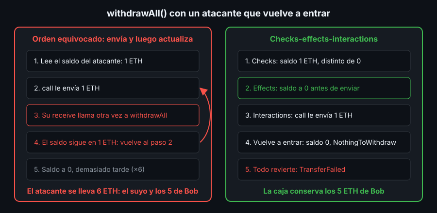

# Teoría 04 — Enviar ETH

## 🎯 Objetivos

- Enviar ETH desde un contrato con `transfer`, `send` y `call`, y saber cuál usar.
- Convertir una `address` en `address payable`.
- Comprobar siempre si el envío salió bien.
- Ordenar una función en checks-effects-interactions y explicar qué es la reentrada.

---

## 1. Qué problema resuelve

Un contrato que cobra tiene que poder pagar: devolver un depósito, repartir lo recaudado,
enviarle al dueño las tasas. Si no, el ETH se queda bloqueado (teoría 03).

Enviar ETH desde un contrato es más delicado que recibirlo por una razón: **al enviar ETH a
un contrato, se ejecuta su código** (`receive` o `fallback`). Le pasas el control a alguien
que no conoces, en mitad de tu función. Puede fallar, gastar mucho gas o volver a llamarte.

## 2. Tres formas de enviar

Solo una `address payable` puede recibir ETH desde código. Si tienes una `address`,
conviértela con `payable(...)`. Con una `address` normal, el compilador no te deja:

```
Error (9862): "send" and "transfer" are only available for objects of type "address payable", not "address".
```

Crea `src/Payer.sol` con un pagador y un receptor que apunta lo que recibe:

```solidity
// SPDX-License-Identifier: MIT
pragma solidity 0.8.38;

contract Payer {
    error TransferFailed(address to, uint256 amount);

    constructor() payable {}

    function viaTransfer(address payable to) external {
        to.transfer(1 ether);
    }

    function viaSend(address payable to) external returns (bool) {
        return to.send(1 ether);
    }

    function viaCall(address payable to) external {
        (bool ok,) = to.call{value: 1 ether}("");
        if (!ok) revert TransferFailed(to, 1 ether);
    }
}

contract Logger {
    uint256 public received;

    receive() external payable {
        received += msg.value;
    }

    function withdraw() external {
        (bool ok,) = payable(msg.sender).call{value: address(this).balance}("");
        require(ok);
    }
}
```

`constructor() payable` deja que el despliegue traiga ETH: así `Payer` empieza con saldo.

| Forma | Gas que recibe el destino | Si falla |
| ----- | ------------------------- | -------- |
| `to.transfer(x)` | 2300 fijos | Revierte toda la transacción |
| `to.send(x)` | 2300 fijos | Devuelve `false`; tú decides qué hacer |
| `to.call{value: x}("")` | Todo el que queda | Devuelve `false` (y lo que respondió el destino) |

Con anvil recién arrancado, despliega los dos contratos; `Payer` con 5 ETH:

```bash
PK=$(cast wallet private-key "test test test test test test test test test test test junk" 0)
forge create src/Payer.sol:Payer --private-key "$PK" --broadcast --value 5ether
forge create src/Payer.sol:Logger --private-key "$PK" --broadcast
P=0x5FbDB2315678afecb367f032d93F642f64180aa3
G=0xe7f1725E7734CE288F8367e1Bb143E90bb3F0512
```

Envía 1 ETH a `Logger` de las tres formas:

```bash
cast send $P "viaTransfer(address)" $G --private-key "$PK"
```

```
Error: Failed to estimate gas: server returned an error response: error code 3: execution reverted, data: "0x"
```

```bash
cast call $P "viaSend(address)(bool)" $G
```

```
false
```

```bash
cast send $P "viaCall(address)" $G --private-key "$PK"
cast call $G "received()(uint256)"
```

```
1000000000000000000 [1e18]
```

`transfer` y `send` fallan: el `receive` de `Logger` escribe en storage, y eso cuesta más
de 2300 de gas. Con `call`, el destino tiene gas de sobra y el envío llega. A una cuenta
de usuario, que no ejecuta código, las tres funcionan:
`cast send $P "viaTransfer(address)" 0x70997970C51812dc3A010C7d01b50e0d17dc79C8 ...` da
`status 1 (success)`.

**Usa `call`.** Los 2300 de gas de `transfer` y `send` se pensaron para impedir que el
destino hiciera nada, pero el coste de las operaciones cambia con las actualizaciones de la
red, y muchos destinos legítimos (una cartera multifirma, un contrato que lleva cuentas) no
caben. `call` funciona con cualquiera; a cambio, te obliga a hacer dos cosas bien.

## 3. Primera obligación: comprobar el resultado

`call` no revierte si el envío falla: devuelve `false`. Si no lo miras, tu contrato sigue
como si hubiera pagado. Si escribes la llamada sin recoger el resultado, el compilador
avisa:

```
Warning (9302): Return value of low-level calls not used.
```

El patrón es siempre el mismo:

```solidity
(bool ok,) = to.call{value: amount}("");
if (!ok) revert TransferFailed(to, amount);
```

La coma deja sin nombre el segundo valor que devuelve `call` (los bytes que respondió el
destino), que aquí no necesitas.

## 4. Segunda obligación: checks-effects-interactions

Mientras `call` envía, el destino ejecuta su código con todo el gas que quede. Ese código
puede **volver a llamar a tu contrato** antes de que tu función termine. Es la
**reentrada** (*reentrancy*).

Mira este retiro, con el orden equivocado:

```solidity
function withdrawAll() external {
    uint256 amount = balanceOf[msg.sender];
    (bool ok,) = payable(msg.sender).call{value: amount}("");  // 1. envía
    if (!ok) revert TransferFailed(msg.sender, amount);
    balanceOf[msg.sender] = 0;                                  // 2. actualiza
}
```

Un contrato atacante deposita 1 ETH y llama a `withdrawAll`. Al recibir el ETH, su
`receive` vuelve a llamar a `withdrawAll`. Su saldo **todavía** vale 1 ETH (la línea 2 no
se ha ejecutado), así que cobra otra vez. Y otra, hasta vaciar la caja. En el ejercicio 03
lo ves pasar: con 5 ETH de otra cuenta en la caja, el atacante se lleva los 6.

La defensa es un orden fijo, **checks-effects-interactions** (CEI):

1. **Checks**: las comprobaciones (`if (...) revert`).
2. **Effects**: los cambios de estado (saldo a 0, contadores).
3. **Interactions**: la llamada externa (el envío), lo último.

```solidity
function withdrawAll() external {
    uint256 amount = balanceOf[msg.sender];
    if (amount == 0) revert NothingToWithdraw();                 // checks
    balanceOf[msg.sender] = 0;                                   // effects
    (bool ok,) = payable(msg.sender).call{value: amount}("");    // interactions
    if (!ok) revert TransferFailed(msg.sender, amount);
}
```



Si el atacante vuelve a entrar, su saldo ya es 0: la segunda llamada revierte con
`NothingToWithdraw`. Ese revert hace fallar el `receive` del atacante, el primer envío
devuelve `false` y toda la transacción se deshace con `TransferFailed`. La semana 21 estudia más formas de reentrada y sus defensas.

## 5. Antipatrones y riesgos

- **Ignorar el resultado de `call`**: el contrato descuenta el saldo, el envío falla y el
  ETH se queda en el contrato sin dueño en las cuentas. Compruébalo siempre.
- **Estado después del envío**: cualquier cambio de estado después de `call` abre la puerta
  a la reentrada. Envía lo último.
- **`transfer` "porque es más seguro"**: protege contra la reentrada solo por casualidad
  (el gas no alcanza) y rompe el pago a destinos legítimos. CEI es la protección de verdad.
- **Enviar a una dirección que elige quien llama sin pensarlo**: si `to` es un parámetro,
  cualquiera puede apuntar el pago a un contrato que revierte o consume gas. Envía a
  `msg.sender` (que retire quien cobra) siempre que puedas: es el patrón de la teoría 05.

## 6. Trucos

- `payable(msg.sender)` convierte a quien llama en destino de pago.
- Un error `TransferFailed(address to, uint256 amount)` dice a quién y cuánto no llegó.
- El evento del pago (`Withdrawn`) es un effect: va **antes** del `call`. Si el envío
  falla, el revert lo borra igual (teoría 01), y si quien recibe vuelve a entrar, los
  eventos no salen desordenados. `forge build` avisa si lo emites después
  (`warning[reentrancy-events]`).

## ✅ Checklist

- [ ] Envío ETH con `call` y compruebo `ok`.
- [ ] Explico por qué `transfer` y `send` fallan con un `receive` que escribe en storage.
- [ ] Ordeno una función que paga en checks-effects-interactions.
- [ ] Explico la reentrada con un ejemplo de retiro.

---

| Anterior | Actual | Siguiente |
| -------- | ------ | --------- |
| [← Teoría 03 — Recibir ETH](03-recibir-ether.md) | **Teoría 04 — Enviar ETH** | [Teoría 05 — Pagos seguros →](05-pagos-seguros.md) |
