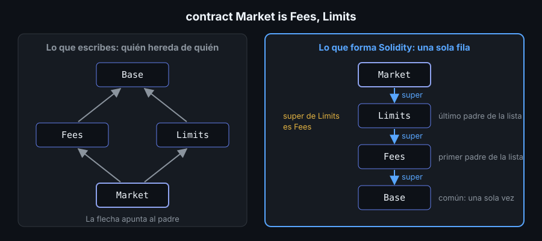

# Teoría 02 — `virtual`, `override` y `super`

## 🎯 Objetivos

- Cambiar en un hijo el comportamiento de una función del padre con `virtual` y
  `override`.
- Llamar a la versión del padre con `super` sin perder sus comprobaciones.
- Predecir el orden en que se ejecutan las versiones con herencia múltiple
  (linealización).
- Resolver un conflicto entre dos padres con `override(A, B)`.

---

## 1. Qué problema resuelve

Heredar `Owned` (teoría 01) te da su `transferOwnership` tal cual. Pero tu contrato
puede necesitar algo más: por ejemplo, impedir que el dueño pase la propiedad a
`address(0)` por error y deje el contrato sin dueño para siempre. No quieres reescribir
`Owned`; quieres **añadir** una regla a su función.

Para eso el padre marca la función como `virtual` ("se puede sustituir") y el hijo la
vuelve a escribir con `override` ("sustituyo la del padre"). Dentro de la nueva versión,
`super` llama a la anterior.

## 2. Cómo se escribe

Crea `src/SafeOwned.sol`:

```solidity
// SPDX-License-Identifier: MIT
pragma solidity 0.8.38;

contract Owned {
    address public owner;

    error NotOwner(address caller);

    constructor() {
        owner = msg.sender;
    }

    modifier onlyOwner() {
        if (msg.sender != owner) revert NotOwner(msg.sender);
        _;
    }

    function transferOwnership(address newOwner) public virtual onlyOwner {
        owner = newOwner;
    }
}

contract SafeOwned is Owned {
    error ZeroAddress();

    function transferOwnership(address newOwner) public override {
        if (newOwner == address(0)) revert ZeroAddress();
        super.transferOwnership(newOwner);
    }
}
```

La versión de `SafeOwned` comprueba su regla y le pasa el resto a la de `Owned`, que lleva
el `onlyOwner`. Sin las dos palabras, el compilador no te deja:

| Te falta | `forge build` |
| -------- | ------------- |
| `virtual` en el padre | `Error (4334): Trying to override non-virtual function. Did you forget to add "virtual"?` |
| `override` en el hijo | `Error (9456): Overriding function is missing "override" specifier.` |

La firma (nombre, parámetros y retorno) tiene que ser la misma. La visibilidad puede pasar
de `external` a `public`, nunca al revés ni a `internal`.

Con anvil recién arrancado, despliégalo y prueba las tres situaciones:

```bash
PK=$(cast wallet private-key "test test test test test test test test test test test junk" 0)
PK1=$(cast wallet private-key "test test test test test test test test test test test junk" 1)
forge create src/SafeOwned.sol:SafeOwned --private-key "$PK" --broadcast
S=0x5FbDB2315678afecb367f032d93F642f64180aa3
cast send $S "transferOwnership(address)" 0x0000000000000000000000000000000000000000 --private-key "$PK"
```

```
Error: Failed to estimate gas: server returned an error response: error code 3: execution reverted: custom error 0xd92e233d, data: "0xd92e233d": ZeroAddress
```

La regla nueva. La cuenta 1 intenta quedarse con el contrato:

```bash
cast send $S "transferOwnership(address)" 0x70997970C51812dc3A010C7d01b50e0d17dc79C8 --private-key "$PK1"
```

```
Error: Failed to estimate gas: server returned an error response: error code 3: execution reverted: custom error 0x245aecd3: 00000000000000000000000070997970c51812dc3a010c7d01b50e0d17dc79c8, data: "0x245aecd300000000000000000000000070997970c51812dc3a010c7d01b50e0d17dc79c8": NotOwner(0x70997970C51812dc3A010C7d01b50e0d17dc79C8)
```

`SafeOwned` no tiene `onlyOwner`, pero `super` ejecutó el de `Owned`. Y el dueño de verdad
sí puede: `cast send ... --private-key "$PK"` da `status 1 (success)` y `owner()` pasa a
ser `0x70997970C51812dc3A010C7d01b50e0d17dc79C8`.

## 3. Herencia múltiple: ¿a quién llama `super`?

Con un solo padre, `super` es el padre. Con varios, Solidity ordena todos los contratos de
la jerarquía en una sola fila, la **linealización** (*linearization*), y `super` es "el
siguiente de la fila". Crea `src/Market.sol`:

```solidity
// SPDX-License-Identifier: MIT
pragma solidity 0.8.38;

contract Base {
    function layers() public pure virtual returns (string memory) {
        return "Base";
    }
}

contract Fees is Base {
    function layers() public pure virtual override returns (string memory) {
        return string.concat("Fees > ", super.layers());
    }
}

contract Limits is Base {
    function layers() public pure virtual override returns (string memory) {
        return string.concat("Limits > ", super.layers());
    }
}

contract Market is Fees, Limits {
    function layers() public pure override(Fees, Limits) returns (string memory) {
        return string.concat("Market > ", super.layers());
    }
}
```

`string.concat` une textos. Cada versión se apunta y llama a la siguiente. Despliega
`Market` (en el mismo anvil, queda en `0xe7f1725E7734CE288F8367e1Bb143E90bb3F0512`) y
pregunta:

```bash
cast call 0xe7f1725E7734CE288F8367e1Bb143E90bb3F0512 "layers()(string)"
```

```
"Market > Limits > Fees > Base"
```

Fíjate en `Limits > Fees`: `Limits` no hereda de `Fees`, y aun así su `super` es `Fees`.
La fila se construye leyendo la lista `is` **de derecha a izquierda**: el último padre
que escribes es el más cercano al hijo. `Base`, que es padre de los dos, va una sola vez y
al final.



Cambia el orden a `contract Market is Limits, Fees` y vuelve a desplegar:

```
"Market > Fees > Limits > Base"
```

Por eso la regla es escribir los padres **del más general al más específico**. Si pones
un padre antes que su propio hijo, por ejemplo `contract Market is Fees, Base, Limits`,
no hay fila posible:

```
Error (5005): Linearization of inheritance graph impossible
```

## 4. Dos padres con la misma función

`Fees` y `Limits` tienen su propio `layers`. `Market` hereda los dos y el compilador no
elige por ti: el hijo tiene que escribir su versión y nombrar a todos los padres a los que
sustituye. Con solo `override`:

```
Error (4327): Function needs to specify overridden contracts "Fees" and "Limits".
```

Con `override(Fees, Limits)`, compila. El orden dentro del paréntesis da igual: lo que
manda es la fila de la sección 3.

## 5. Antipatrones y riesgos

- **Olvidar `super`**: si `Limits` devuelve `"Limits"` sin llamar a `super.layers()`, la
  cadena se corta y `Market` devuelve `"Market > Limits"`: ni `Fees` ni `Base` se
  ejecutan. Con `layers` solo pierdes texto. Con un `transferOwnership` que no llama a
  `super` y escribe `owner = newOwner` directamente, pierdes el `onlyOwner` del padre y
  **cualquiera** se queda con el contrato. Lo rompes a propósito en el ejercicio 01.
- **`virtual` por defecto**: cada función `virtual` es una puerta para que un hijo cambie
  las reglas. Márcala solo si de verdad está pensada para extenderse.
- **Contar con un orden que no controlas**: en herencia múltiple, `super` puede caer en un
  contrato que no conoces (el `super` de `Limits` llamó a `Fees`). No escribas una versión
  que solo funcione si el siguiente de la fila es uno concreto.
- **Cambiar el significado**: un `override` debe hacer al menos lo que prometía el padre.
  Uno que acepta lo que el padre rechazaba rompe a quien confiaba en esa regla.

## 6. Trucos

- `super.f()` y no `Padre.f()`: `Padre.f()` salta directamente a ese padre y se salta los
  que la fila tenga en medio. `super` respeta la fila.
- Los modificadores también pueden ser `virtual` y sustituirse con `override`, con las
  mismas reglas.
- Una función `virtual` sin cuerpo convierte el contrato en abstracto: es la teoría 03.

## ✅ Checklist

- [ ] Sustituyo una función del padre con `virtual` y `override`.
- [ ] Llamo a la versión del padre con `super` y conservo sus comprobaciones.
- [ ] Escribo la fila de linealización de un rombo de herencia.
- [ ] Resuelvo dos padres con la misma función con `override(A, B)`.

---

| Anterior | Actual | Siguiente |
| -------- | ------ | --------- |
| [← Teoría 01 — Herencia](01-herencia.md) | **Teoría 02 — `virtual`, `override` y `super`** | [Teoría 03 — Contratos abstractos →](03-contratos-abstractos.md) |
