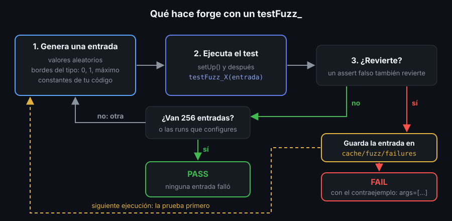

# Teoría 03 — Fuzz testing

## 🎯 Objetivos

- Distinguir un test de ejemplo de una **propiedad**.
- Escribir un fuzz test y leer su contraejemplo.
- Acotar las entradas con `bound` y descartarlas con `vm.assume`, y saber cuándo usar cada
  uno.
- Configurar cuántas entradas se prueban y repetir un fallo con la misma semilla.

---

## 1. Qué problema resuelve

Un test de ejemplo prueba un caso que elegiste tú: "la media de 4 y 10 es 7". Si el error
está en un caso que no se te ocurrió, ese test no lo ve. En un contrato los casos raros no
son raros: cualquiera puede llamar con el número más grande que cabe en un `uint256`.

Un **fuzz test** (*prueba con entradas aleatorias*) es un test con parámetros. Forge lo
ejecuta muchas veces, cada una con valores distintos, y falla en cuanto una revierte. Para
que eso funcione, el test no puede decir "el resultado es 7": tiene que decir algo que valga
para **cualquier** entrada. Eso es una **propiedad** (*property*): "la media nunca es mayor
que el mayor de los dos".

## 2. Un fallo que el ejemplo no ve

Crea `src/Average.sol` con dos formas de calcular la media:

```solidity
// SPDX-License-Identifier: MIT
pragma solidity 0.8.38;

library Average {
    function naive(uint256 a, uint256 b) internal pure returns (uint256) {
        return (a + b) / 2;
    }

    function safe(uint256 a, uint256 b) internal pure returns (uint256) {
        return a / 2 + b / 2 + (a % 2 + b % 2) / 2;
    }
}
```

Y `test/Average.t.sol`:

```solidity
// SPDX-License-Identifier: MIT
pragma solidity 0.8.38;

import {Test} from "forge-std/Test.sol";
import {Average} from "../src/Average.sol";

contract AverageTest is Test {
    function test_Naive() public pure {
        assertEq(Average.naive(4, 10), 7);
    }

    function testFuzz_Naive(uint256 a, uint256 b) public pure {
        uint256 avg = Average.naive(a, b);
        assertLe(avg, a > b ? a : b);
    }
}
```

```bash
forge test --match-path test/Average.t.sol --fuzz-seed 1
```

```
[FAIL: panic: arithmetic underflow or overflow (0x11); counterexample: calldata=0xf561517e0000000000000000000000000000000000000000629b3b9f13a6f06af48f7892ffffffffffffffffffffffffffffffffffffffffffffffffffffffffffffffff args=[30517196018602964761009158290 [3.051e28], 115792089237316195423570985008687907853269984665640564039457584007913129639935 [1.157e77]]] testFuzz_Naive(uint256,uint256) (runs: 5, μ: 1237, ~: 1175)
[PASS] test_Naive() (gas: 654)
```

El ejemplo pasa. El fuzz test encuentra, tras pocas entradas, que `a + b` se desborda
cuando `b` es el máximo de `uint256` (2²⁵⁶ − 1): el overflow de la semana 05. Las partes del
mensaje:

| Parte | Qué es |
| ----- | ------ |
| `panic: ... (0x11)` | Por qué falló |
| `counterexample` | El **contraejemplo**: la entrada que lo rompe |
| `calldata=0x…` | Esa entrada codificada en ABI, lista para repetirla con `cast` |
| `args=[…]` | La misma entrada, legible |
| `runs: 5` | Cuántas entradas probó hasta fallar |
| `μ` y `~` | Gas medio y mediano de las ejecuciones |

## 3. Cómo funciona el fuzzer



- **No es azar puro.** Mezcla valores aleatorios con los bordes de cada tipo (`0`, `1`, el
  máximo) y con las constantes que encuentra en tu código. Por eso da con el máximo de
  `uint256` en pocas vueltas.
- **256 entradas** por test, por defecto. Si las 256 pasan, el test pasa. Eso no demuestra
  que no haya fallo: demuestra que no lo encontró.
- **Se para en el primer fallo** y te da esa entrada tal cual. No la simplifica: el `a` del
  ejemplo es un número enorme que no tiene nada que ver con el fallo. Leer cuál de los
  argumentos importa es trabajo tuyo.
- **Guarda el fallo** en `cache/fuzz/failures/AverageTest/testFuzz_Naive`. La próxima vez
  prueba esa entrada primero, aunque cambie la semilla: un fallo no desaparece por suerte.
  Se borra con `forge clean` o borrando `cache/fuzz`.

## 4. Propiedades que sí valen

Una buena propiedad no repite el código del contrato. Tres formas habituales:

```solidity
// Un límite: el resultado queda entre las dos entradas.
function testFuzz_SafeIsBetween(uint256 a, uint256 b) public pure {
    uint256 avg = Average.safe(a, b);
    assertGe(avg, a < b ? a : b);
    assertLe(avg, a > b ? a : b);
}

// Una referencia: con entradas de 128 bits, la suma cabe en 256 y la cuenta directa es exacta.
function testFuzz_SafeMatchesWideMath(uint128 a, uint128 b) public pure {
    assertEq(Average.safe(a, b), (uint256(a) + b) / 2);
}
```

La tercera, la más útil en contratos, es una **regla del negocio**: "quien no registró no
puede retirar", "lo que entra es lo que sale más la comisión". El proyecto de la semana
está hecho de esas.

## 5. Acotar con `bound`, descartar con `vm.assume`

Casi nunca quieres cualquier valor. Hay dos formas de restringirlos:

| | `x = bound(x, min, max)` | `vm.assume(condición)` |
| - | ------------------------ | ---------------------- |
| Qué hace | Lleva `x` al rango `[min, max]` | Descarta la entrada si la condición es falsa |
| Cuántas entradas pierde | Ninguna | Las que no cumplen |
| Para qué | Rangos de números | Excluir pocos valores concretos (`a != b`, `to != address(0)`) |

`vm.assume` descarta y pide otra entrada. Si casi ninguna cumple, el fuzzer se rinde:

```solidity
function testFuzz_AssumeTooStrict(uint256 seed) public pure {
    // Solo una de cada 10 000 semillas da un hash múltiplo de 10 000.
    vm.assume(uint256(keccak256(abi.encode(seed))) % 10_000 == 0);
    assertTrue(true);
}
```

```
[FAIL: `vm.assume` rejected too many inputs (65536 allowed)] testFuzz_AssumeTooStrict(uint256) (runs: 1, μ: 3969, ~: 3969)
```

Para un rango, `bound` no desperdicia nada:

```solidity
function testFuzz_Bound(uint256 amount) public pure {
    amount = bound(amount, 1 ether + 1, 2 ether - 1);
    assertGt(amount, 1 ether);
}
```

Otra forma de acotar es el tipo del parámetro: un `uint128` o un `uint16` ya limita el
rango sin perder entradas. Para direcciones, `forge-std` trae `assumePayable(a)`,
`assumeNotPrecompile(a)` y `assumeNotForgeAddress(a)`: descartan las que no pueden recibir
ETH, las de los contratos especiales de la EVM y las de forge (como `vm`).

## 6. Configuración

| Qué | Cómo |
| --- | ---- |
| Más entradas en una ejecución | `forge test --fuzz-runs 1000` |
| Más entradas en un test concreto | `/// forge-config: default.fuzz.runs = 1000` encima del test |
| Más entradas en todo el proyecto | `[fuzz]` y `runs = 1000` en `foundry.toml` |
| Repetir exactamente las mismas entradas | `--fuzz-seed 1` (cualquier número) |

Sin `--fuzz-seed`, cada ejecución usa una **semilla** (*seed*) distinta y prueba entradas
distintas. Es lo que quieres casi siempre: cada vez exploras más. La semilla fija sirve para
repetir un resultado (como en esta teoría) y para que el gas medio sea siempre el mismo
(teoría 05).

## 7. Antipatrones y riesgos

- **Acotar el fallo fuera.** Si `bound` excluye justo los valores que rompen el contrato, el
  test pasa y el fallo sigue ahí. Acota a lo que el contrato **admite**, no a lo que te
  resulta cómodo. Si un valor no debería admitirse, el contrato tiene que rechazarlo y
  necesitas otro test que lo compruebe.
- **Repetir la implementación.** `assertEq(split(a), a * bps / 10_000)` copia la fórmula: si
  la fórmula está mal, el test también. Compara con un límite, una referencia distinta o una
  regla.
- **Fiarte del verde.** 256 entradas de 2²⁵⁶ posibles no son una prueba. Sube las `runs` en
  las propiedades que protegen dinero. La semana 25 enseña a **demostrar** propiedades.
- **Un fuzz test de una sola llamada no prueba secuencias.** "Registrar, retirar y volver a
  registrar" necesita **invariantes** (*invariant testing*), que llegan en la semana 24.

## 8. Trucos

- Un fallo del fuzzer se convierte en un test de ejemplo: copia los `args` a un
  `test_Algo` con esos valores. Queda fijo aunque cambie el fuzzer.
- Nombra los fuzz tests `testFuzz_Algo`: se ven en la salida y en la rúbrica.
- Si la propiedad necesita un valor que depende de otro (un pago que no sea la tasa), usa
  `bound` para el rango y `vm.assume` solo para el valor que sobra.

## ✅ Checklist

- [ ] Escribo una propiedad que valga para cualquier entrada, no un ejemplo con parámetros.
- [ ] Leo un contraejemplo y lo convierto en un test de ejemplo.
- [ ] Elijo entre `bound`, `vm.assume` y el tipo del parámetro, y sé qué pierde cada uno.
- [ ] Cambio las `runs` y repito un resultado con `--fuzz-seed`.

---

| Anterior | Actual | Siguiente |
| -------- | ------ | --------- |
| [← Teoría 02 — Reverts, eventos y llamadas](02-reverts-eventos-y-llamadas.md) | **Teoría 03 — Fuzz testing** | [Teoría 04 — Forks →](04-forks.md) |
