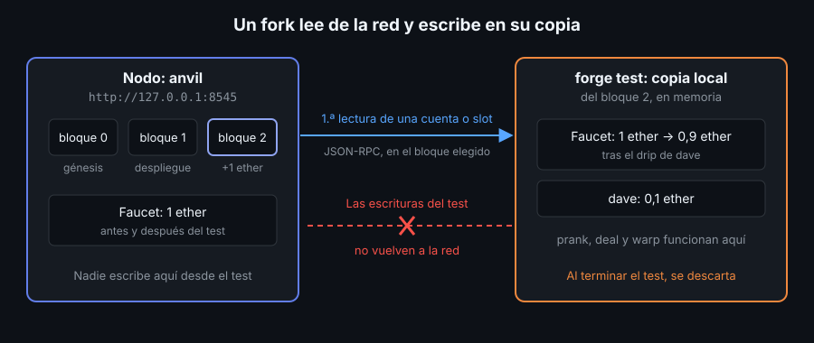

# Teoría 04 — Forks

## 🎯 Objetivos

- Explicar qué es un fork y de dónde saca el estado.
- Ejecutar tests sobre un fork con `--fork-url` y con `vm.createSelectFork`.
- Fijar el bloque del fork y moverlo con `vm.rollFork`.
- Saber qué riesgos trae depender de una red en los tests.

---

## 1. Qué problema resuelve

Hasta ahora cada test despliega sus contratos en `setUp` sobre una cadena vacía. Pero tu
protocolo va a convivir con contratos que no despliegas tú: el que ya tienes en anvil, un
token que otro publicó o un oráculo (semana 20). Para probar contra ellos necesitas su
código **y su estado**: saldos, mappings, lo que otros hicieron antes.

Un **fork** (*bifurcación*) es una copia local de una red en un bloque concreto. El test
lee el estado de la red real y escribe solo en la copia: puedes registrar, pagar y retirar
sin tocar la red ni gastar ETH de verdad.

## 2. Cómo funciona



Forge no descarga la red entera. Cuando el test toca por primera vez una cuenta (su saldo,
su código, un valor de su storage), lo pide al nodo por **JSON-RPC**, el protocolo de
peticiones de la semana 02, en el bloque elegido. Lo guarda en la copia y desde ahí todo es
local. Lo que escribe el test se queda en la copia y desaparece al terminar.

Para practicar sin internet, el nodo es tu anvil. Con una testnet o mainnet funciona igual:
cambia solo la URL del nodo (*RPC URL*), que te da un proveedor de nodos.

## 3. Preparar la red

Con el `Faucet` de la teoría 01. En el contenedor, arranca anvil, despliega desde la
cuenta 0 de anvil y envía 1 ether al grifo:

```bash
anvil --silent &
PK=$(cast wallet private-key "test test test test test test test test test test test junk" 0)
forge create src/Faucet.sol:Faucet --private-key "$PK" --broadcast
```

```
Deployer: 0xf39Fd6e51aad88F6F4ce6aB8827279cffFb92266
Deployed to: 0x5FbDB2315678afecb367f032d93F642f64180aa3
Transaction hash: 0xf796afb8947a2b43afb90ba7be65148e2e994d53afd940870010396a270e3833
```

```bash
cast send 0x5FbDB2315678afecb367f032d93F642f64180aa3 --value 1ether --private-key "$PK"
cast balance 0x5FbDB2315678afecb367f032d93F642f64180aa3 --ether
```

El recibo dice `blockNumber 2` y `status 1 (success)`, y el saldo `1.000000000000000000`.
Anvil hace un bloque por transacción: el despliegue fue el bloque 1 y el envío, el 2.

## 4. Fork desde la línea de comandos

El modo más simple: el test no sabe nada del fork, y `--fork-url` hace que todos los tests
de la ejecución corran sobre él. Crea `test/FaucetCli.t.sol`:

```solidity
// SPDX-License-Identifier: MIT
pragma solidity 0.8.38;

import {Test} from "forge-std/Test.sol";

contract FaucetCliForkTest is Test {
    function test_ReadsForkedChain() public view {
        assertEq(block.chainid, 31337);
        assertEq(block.number, 2);
        assertEq(address(0x5FbDB2315678afecb367f032d93F642f64180aa3).balance, 1 ether);
    }
}
```

```bash
forge test --match-path test/FaucetCli.t.sol --fork-url http://127.0.0.1:8545
```

```
[PASS] test_ReadsForkedChain() (gas: 3029)
```

El test ve el bloque 2, el `chainid` de anvil (31337) y el saldo del grifo, que nadie le dio
en `setUp`. Sin `--fork-url` fallaría: en una cadena vacía no hay nada en esa dirección.

Con `--fork-block-number` copias un bloque anterior:

```bash
forge test --match-path test/FaucetCli.t.sol --fork-url http://127.0.0.1:8545 --fork-block-number 1
```

```
[FAIL: assertion failed: 1 != 2] test_ReadsForkedChain() (block: 1) (gas: 3453)
```

## 5. Fork desde el test

Lo normal es que el fork lo abra el propio test, para que el archivo diga qué red necesita.
`vm.createSelectFork(url)` crea el fork y lo activa; `vm.rollFork(n)` lo mueve a otro
bloque. Crea `test/FaucetFork.t.sol`:

```solidity
// SPDX-License-Identifier: MIT
pragma solidity 0.8.38;

import {Test} from "forge-std/Test.sol";
import {Faucet} from "../src/Faucet.sol";

contract FaucetForkTest is Test {
    Faucet faucet;

    function setUp() public {
        string memory url = vm.envOr("FORK_URL", string(""));
        vm.skip(bytes(url).length == 0, "sin FORK_URL");
        vm.createSelectFork(url);
        faucet = Faucet(payable(vm.envAddress("FAUCET")));
    }

    function test_DripOnFork() public {
        assertEq(block.number, 2);
        assertEq(address(faucet).balance, 1 ether);
        address dave = makeAddr("dave");
        vm.prank(dave);
        faucet.drip();
        assertEq(dave.balance, 0.1 ether);
        assertEq(address(faucet).balance, 0.9 ether);
    }

    function test_BeforeFunding() public {
        vm.rollFork(1);
        assertEq(address(faucet).balance, 0);
        assertGt(address(faucet).code.length, 0);
    }
}
```

Tres cheatcodes nuevos:

| Cheatcode | Qué hace |
| --------- | -------- |
| `vm.envOr("X", valor)` | Lee la **variable de entorno** `X` de la terminal; si no existe, devuelve `valor` |
| `vm.envAddress("X")` | Lee `X` como dirección; si no existe, el test falla |
| `vm.skip(condición, "motivo")` | Si la condición es cierta, el test se salta: ni pasa ni falla |

Sin variables, el test se salta en vez de fallar. Así `forge test` sigue funcionando en un
equipo sin nodo:

```bash
forge test --match-path test/FaucetFork.t.sol
```

```
[SKIP: skipped: sin FORK_URL] setUp() (gas: 0)
Ran 1 test suite in 3.16ms (216.42µs CPU time): 0 tests passed, 0 failed, 1 skipped (1 total tests)
```

Con ellas, corre sobre anvil:

```bash
export FORK_URL=http://127.0.0.1:8545 FAUCET=0x5FbDB2315678afecb367f032d93F642f64180aa3
forge test --match-path test/FaucetFork.t.sol
cast balance "$FAUCET" --ether
```

```
[PASS] test_BeforeFunding() (gas: 8498)
[PASS] test_DripOnFork() (gas: 63945)
Ran 1 test suite in 20.75ms (20.27ms CPU time): 2 tests passed, 0 failed, 0 skipped (2 total tests)
1.000000000000000000
```

En la copia, dave sacó 0,1 ether. En anvil el grifo sigue con 1 ether: el fork no escribe en
la red. `test_BeforeFunding` va al bloque 1, recién desplegado: hay código pero aún no hay
saldo.

## 6. Antipatrones y riesgos

- **Fork sin bloque fijo.** `createSelectFork(url)` copia el último bloque. En una red viva
  ese bloque cambia cada pocos segundos, y el test que hoy pasa mañana falla porque alguien
  movió un saldo. Para tests que se repiten, fija el bloque: `createSelectFork(url, bloque)`.
- **Confiar en el nodo.** El fork cree lo que le responde el nodo. Un proveedor caído o
  malicioso te da otro estado. Para testnet y mainnet usa proveedores conocidos.
- **Claves en la URL.** Muchos proveedores meten tu clave de acceso en la RPC URL. Nunca la
  escribas en el código ni en `foundry.toml`: léela de una variable de entorno, como aquí.
  La semana 16 lo trata a fondo.
- **Tests lentos y frágiles.** Cada cuenta nueva es una petición de red. Los forks se usan
  para lo que solo se puede probar contra una red; el resto va sin fork.
- **Creer que el fork es la red.** `prank` y `deal` también funcionan en el fork: puedes
  hacer cosas que en la red real serían imposibles. Lo que pruebas sigue siendo una copia
  manipulable.

## 7. Trucos

- `cast block-number` te dice el bloque actual del nodo, para fijarlo en el test.
- Puedes tener varios forks en un test: `vm.createFork(url)` devuelve un identificador y
  `vm.selectFork(id)` cambia entre ellos.
- Con un nodo de testnet, `forge test --fork-url "$SEPOLIA_RPC_URL"` funciona igual; lo
  usarás desde la semana 16.

## ✅ Checklist

- [ ] Explico qué lee el fork del nodo y dónde escribe.
- [ ] Ejecuto un test con `--fork-url` y con `createSelectFork`.
- [ ] Muevo el fork con `rollFork` y fijo el bloque para tests reproducibles.
- [ ] Hago que un test de fork se salte sin nodo, en vez de fallar.

---

| Anterior | Actual | Siguiente |
| -------- | ------ | --------- |
| [← Teoría 03 — Fuzz testing](03-fuzz-testing.md) | **Teoría 04 — Forks** | [Teoría 05 — Gas y cobertura →](05-gas-y-cobertura.md) |
