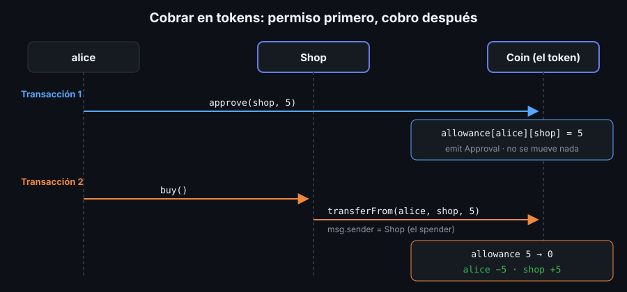

# Teoría 02 — Allowance

## 🎯 Objetivos

- Explicar por qué un contrato no puede cobrar en tokens con `transfer`.
- Usar `approve`, `allowance` y `transferFrom` para que un contrato cobre.
- Reconocer la carrera de `approve` y el riesgo de los permisos ilimitados.

---

## 1. Qué problema resuelve

Una tienda quiere cobrar 5 tokens por cada compra. Con ETH era fácil (semana 07): la
función es `payable`, el ETH llega **con** la llamada y la tienda lo ve en `msg.value`.

Con un token no hay nada parecido. El token es otro contrato: si le envías 5 tokens a la
tienda con `transfer`, esa transacción va al **token**, no a la tienda. La tienda no se
entera y no puede saber quién pagó qué. Y si primero pagas y luego llamas a `buy()`, nada
une las dos transacciones: otro podría llamar a `buy()` antes que tú y quedarse tu pago.

La solución del estándar es dar la vuelta al orden: en vez de empujar los tokens a la
tienda, le das **permiso** para que ella los saque de tu saldo cuando la llames. A ese
permiso se le llama **allowance** (*asignación*).

## 2. Cómo funciona

Son dos pasos y tres funciones:



1. Alice llama al **token**: `approve(shop, 5 ether)`. El token apunta en una tabla
   `allowance[alice][shop] = 5 ether` y emite `Approval`. No se mueve ningún token.
2. Alice llama a la **tienda**: `buy()`. Dentro, la tienda llama al token:
   `transferFrom(alice, shop, 5 ether)`. El token comprueba que `allowance[alice][shop]`
   alcanza, lo resta y mueve los tokens.

Dentro de `transferFrom`, `msg.sender` es la tienda: el **spender** (*quien gasta*). El
permiso es de alice **para** ese spender, y nadie más puede usarlo. `allowance(owner,
spender)` dice cuánto queda.

Es el mismo patrón que verás en casi cualquier contrato que acepta tokens: un intercambio,
un préstamo, una subasta. En una dApp, el botón "Aprobar" que sale antes de "Comprar" es
el paso 1.

## 3. Cómo se escribe

En el `Coin` de la teoría 01 (`src/Coin.sol`), añade la tabla de permisos, su evento y su
error, y separa el movimiento de saldos en una función interna para usarla dos veces:

```solidity
    mapping(address => mapping(address => uint256)) public allowance;

    event Approval(address indexed owner, address indexed spender, uint256 value);

    error InsufficientAllowance(address spender, uint256 allowance, uint256 needed);

    function transfer(address to, uint256 value) external returns (bool) {
        _transfer(msg.sender, to, value);
        return true;
    }

    function approve(address spender, uint256 value) external returns (bool) {
        allowance[msg.sender][spender] = value;
        emit Approval(msg.sender, spender, value);
        return true;
    }

    function transferFrom(address from, address to, uint256 value) external returns (bool) {
        uint256 allowed = allowance[from][msg.sender];
        if (allowed < value) revert InsufficientAllowance(msg.sender, allowed, value);
        allowance[from][msg.sender] = allowed - value;
        _transfer(from, to, value);
        return true;
    }

    function _transfer(address from, address to, uint256 value) internal {
        uint256 balance = balanceOf[from];
        if (balance < value) revert InsufficientBalance(from, balance, value);
        balanceOf[from] = balance - value;
        balanceOf[to] += value;
        emit Transfer(from, to, value);
    }
```

`approve` **sustituye** el permiso, no lo suma: `approve(shop, 5)` y después
`approve(shop, 3)` deja 3. Un mapping de mappings: el primer índice es el dueño, el
segundo el spender.

La tienda, en `src/Shop.sol`:

```solidity
// SPDX-License-Identifier: MIT
pragma solidity 0.8.38;

import {Coin} from "./Coin.sol";

contract Shop {
    Coin public immutable COIN;
    uint256 public constant PRICE = 5 ether;
    mapping(address => uint256) public bought;

    constructor(Coin coin) {
        COIN = coin;
    }

    function buy() external {
        bool ok = COIN.transferFrom(msg.sender, address(this), PRICE);
        require(ok, "pago rechazado");
        bought[msg.sender]++;
    }
}
```

Y en `test/Shop.t.sol`, con 200 tokens para alice en el `setUp`, los dos casos:

```solidity
    function test_BuyWithApproval() public {
        vm.startPrank(alice);
        coin.approve(address(shop), 5 ether);
        shop.buy();
        vm.stopPrank();
        assertEq(coin.balanceOf(address(shop)), 5 ether);
        assertEq(coin.allowance(alice, address(shop)), 0);
    }

    function test_BuyWithoutApproval() public {
        vm.prank(alice);
        shop.buy();
    }
```

`forge test -vvv`: el primero pasa; el segundo falla a propósito, y la traza enseña quién
es quién:

```
[FAIL: InsufficientAllowance(0x5615dEB798BB3E4dFa0139dFa1b3D433Cc23b72f, 0, 5000000000000000000 [5e18])] test_BuyWithoutApproval() (gas: 38376)
Traces:
  [38376] ShopTest::test_BuyWithoutApproval()
    ├─ [0] VM::prank(alice: [0x328809Bc894f92807417D2dAD6b7C998c1aFdac6])
    │   └─ ← [Return]
    ├─ [28066] Shop::buy()
    │   ├─ [3646] Coin::transferFrom(alice: [0x328809Bc894f92807417D2dAD6b7C998c1aFdac6], Shop: [0x5615dEB798BB3E4dFa0139dFa1b3D433Cc23b72f], 5000000000000000000 [5e18])
    │   │   └─ ← [Revert] InsufficientAllowance(0x5615dEB798BB3E4dFa0139dFa1b3D433Cc23b72f, 0, 5000000000000000000 [5e18])
```

El spender del error es la tienda (`0x5615…`), no alice: alice no aprobó a la tienda. Es el
error que más verás al empezar con tokens, también en una dApp.

## 4. Antipatrones y riesgos

**La carrera de `approve`.** Alice aprobó 100 a bob y quiere bajarlo a 50. Envía
`approve(bob, 50)`. Mientras esa transacción espera en el mempool (semana 02), bob la ve,
y envía con más gas un `transferFrom` de los 100 que se ejecuta antes. Después entra el
`approve(bob, 50)`, que no sabe que los 100 ya se gastaron, y bob saca 50 más. En
`test/Shop.t.sol`:

```solidity
    function test_ApproveRace() public {
        vm.prank(alice);
        coin.approve(bob, 100 ether);
        // Alice quiere bajar el permiso a 50. Bob ve la transacción pendiente y se adelanta.
        vm.prank(bob);
        coin.transferFrom(alice, bob, 100 ether);
        vm.prank(alice);
        coin.approve(bob, 50 ether);
        // El permiso nuevo no sabe que el viejo ya se gastó.
        vm.prank(bob);
        coin.transferFrom(alice, bob, 50 ether);
        assertEq(coin.balanceOf(bob), 150 ether);
    }
```

`[PASS] test_ApproveRace() (gas: 207049)`: bob se llevó 150 cuando alice quería darle como
mucho 100, o 50. El propio EIP-20 lo advierte. Las defensas:

- Para cambiar un permiso, primero ponlo a 0, comprueba que no se gastó y después pon el
  nuevo valor.
- Aprueba lo justo para cada operación, en vez de un permiso grande que vas ajustando.
- Aprueba solo a contratos que gastan el permiso en la misma transacción en que los llamas,
  como la tienda, y no a cuentas que deciden cuándo.

**Permisos ilimitados.** Muchas dApps piden `approve(contrato, type(uint256).max)` para no
pedir otro permiso en cada compra. Por convención, un permiso igual al máximo no se resta
al gastarlo (el ejercicio 01 lo implementa). Es cómodo, pero si ese contrato tiene un fallo
o una función de dueño que mueve tokens, puede sacar **todo** tu saldo, hoy o dentro de un
año. Muchos robos reales no atacaron a la víctima, sino a un contrato al que ella había
dado un permiso ilimitado hacía tiempo. Los permisos no caducan: revísalos y retíralos
con `approve(contrato, 0)`.

**Aprobar al contrato equivocado.** Un permiso es tan seguro como el spender. Una web falsa
que te pide aprobar "la tienda" puede pasarte la dirección de su propio contrato. Para la
red es un `approve` normal: comprueba la dirección del spender antes de firmar.

**Cobrar con `transfer` desde el contrato.** Dentro de `buy()`, `COIN.transfer(...)`
movería tokens **de la tienda**, no del cliente, porque `msg.sender` para el token es la
tienda. Para cobrar, `transferFrom(msg.sender, ...)`. `transfer` es para que el contrato
pague.

**Fiarse de un `transferFrom` sin mirar el resultado.** La tienda comprueba `ok`. Algunos
tokens devuelven `false` en vez de revertir; otros no devuelven nada. La teoría 04 resuelve
los dos casos con `SafeERC20`.

## 5. Trucos

- Lee un permiso con `cast call $TOKEN "allowance(address,address)(uint256)" $OWNER $SPENDER`.
- En los tests, `vm.startPrank(alice)` y `vm.stopPrank()` agrupan el `approve` y la
  llamada, que en la red son dos transacciones de la misma cuenta.
- Si un test falla con `InsufficientAllowance` o `ERC20InsufficientAllowance`, mira quién
  es el spender del error: casi siempre aprobaste a otra dirección, o desde otra cuenta.

## ✅ Checklist

- [ ] Explico por qué la tienda no puede saber quién le hizo un `transfer`.
- [ ] Sé qué guarda `allowance[owner][spender]` y quién es `msg.sender` en `transferFrom`.
- [ ] Leo en una traza quién es el spender de un `InsufficientAllowance`.
- [ ] Explico la carrera de `approve` y dos formas de evitarla.
- [ ] Sé qué arriesgo con un permiso ilimitado y cómo lo retiro.
- [ ] Sé cuándo un contrato usa `transfer` y cuándo `transferFrom`.

---

| Anterior | Actual | Siguiente |
| -------- | ------ | --------- |
| [← Teoría 01 — Tokens y ERC-20](01-tokens-y-erc20.md) | **Teoría 02 — Allowance** | [Teoría 03 — OpenZeppelin y forge install →](03-openzeppelin-y-forge-install.md) |
