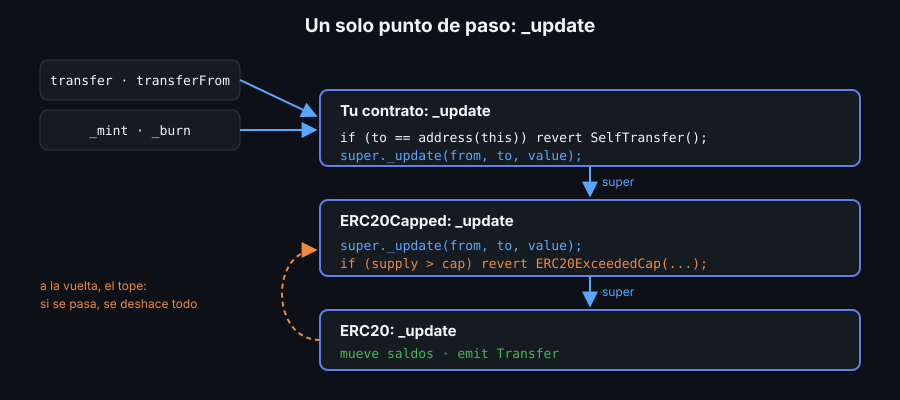

# Teoría 03 — OpenZeppelin y forge install

## 🎯 Objetivos

- Instalar una biblioteca con `forge install` y explicar qué deja en el proyecto.
- Importar OpenZeppelin con un remapping, aquí y en un proyecto propio.
- Escribir un ERC-20 heredando de OpenZeppelin y extenderlo con `_update` y `super`.
- Reconocer lo que heredas sin haberlo escrito, y sus riesgos.

---

## 1. Qué problema resuelve

El `Coin` de las teorías 01 y 02 tiene 50 líneas y ya tiene huecos: acepta enviar a
`address(0)` y no limita el suministro. Un token real tiene más detalles, y en cada uno
cabe un error que cuesta dinero. Escribirlo de cero en cada proyecto es repetir esos
errores.

**OpenZeppelin Contracts** es una biblioteca de contratos estándar (ERC-20, ERC-721,
control de acceso, utilidades) escrita y auditada por la empresa OpenZeppelin, con
licencia MIT. Es la base de la mayoría de tokens desplegados. No la usas porque sea
perfecta, sino porque cada línea la han revisado más personas de las que revisarán la tuya.

Una **biblioteca** aquí es código Solidity de otro que importas en tu proyecto. No tiene
que ver con `library` de Solidity (semana 08): casi todo OpenZeppelin son contratos para
heredar.

## 2. Cómo funciona

### `forge install`

En un proyecto Foundry propio, fuera del bootcamp, se instala así. Dentro del contenedor:

```bash
forge init --offline demo
cd demo
forge install OpenZeppelin/openzeppelin-contracts@v5.7.0
```

La última línea de la salida:

```
    Installed openzeppelin-contracts tag=v5.7.0@cab19933c33c2ad1d4c7a84864a3601dddfd16f3
```

`forge install` clona el repositorio de GitHub en `lib/openzeppelin-contracts`, en la
etiqueta `v5.7.0`, y deja tres cosas en tu proyecto:

| Qué | Para qué |
| --- | -------- |
| `lib/openzeppelin-contracts/` | El código, como **submódulo de git**: tu repositorio guarda solo la URL y el commit, no los archivos |
| `.gitmodules` | La URL del submódulo |
| `foundry.lock` | La etiqueta y el commit exacto (`cab19933…`): quien clone tu proyecto obtiene lo mismo |

`git status --short` lo confirma:

```
A  .gitmodules
AM lib/openzeppelin-contracts
?? foundry.lock
```

**Siempre con versión** (`@v5.7.0`). Sin ella, `forge install` toma la última del día, y
el mismo proyecto compila distinto la semana que viene (`docs/stack-versions.md`). Quien
clone tu proyecto ejecuta `git clone --recursive`, o `forge install` sin argumentos dentro
del proyecto, para bajar los submódulos.

### Remappings

En tu código no escribes la ruta de `lib/`. Escribes:

```solidity
import {ERC20} from "@openzeppelin/contracts/token/ERC20/ERC20.sol";
```

y un **remapping** (*reasignación*) le dice al compilador qué carpeta hay detrás del
prefijo. Foundry los deduce de lo que hay en `lib/`. En `demo`, `forge remappings` imprime:

```
@openzeppelin/contracts/=lib/openzeppelin-contracts/contracts/
erc4626-tests/=lib/openzeppelin-contracts/lib/erc4626-tests/
forge-std/=lib/openzeppelin-contracts/lib/forge-std/src/
halmos-cheatcodes/=lib/openzeppelin-contracts/lib/halmos-cheatcodes/src/
openzeppelin-contracts/=lib/openzeppelin-contracts/
```

Fíjate en la tercera: con `--offline`, `forge init` no instaló forge-std, y Foundry
encontró la copia que OpenZeppelin trae para sus propios tests. Funciona, pero tus tests
dependerían de la versión que eligió otro. Por eso conviene fijar los remappings en
`foundry.toml` en vez de fiarse de los deducidos.

### En el bootcamp

Los starters no usan `forge install`: OpenZeppelin v5.7.0 está en la imagen, en
`/opt/lib/openzeppelin-contracts`, igual que forge-std. Desde esta semana, el `foundry.toml`
de cada starter trae los dos remappings:

```toml
libs = ["/opt/lib"]
remappings = [
    "forge-std/=/opt/lib/forge-std/src/",
    "@openzeppelin/contracts/=/opt/lib/openzeppelin-contracts/contracts/",
]
```

El `import` es el mismo que en un proyecto con `lib/`: tu código no cambia si mañana lo
mueves a un proyecto propio con `forge install`.

## 3. Cómo se escribe

### Un ERC-20 en diez líneas

En `src/OzCoin.sol`:

```solidity
// SPDX-License-Identifier: MIT
pragma solidity 0.8.38;

import {ERC20} from "@openzeppelin/contracts/token/ERC20/ERC20.sol";

contract OzCoin is ERC20 {
    constructor(uint256 supply) ERC20("Class Coin", "CLS") {
        _mint(msg.sender, supply);
    }
}
```

El constructor de `ERC20` recibe nombre y símbolo; `decimals()` devuelve 18. `_mint` es
`internal`: crea tokens y emite `Transfer` desde `address(0)`. `forge inspect OzCoin methods`
lista las nueve funciones públicas, todas heredadas.

Desplegado en anvil con 1000 tokens, los dos huecos del `Coin` ya no están:

```bash
cast send $C "transfer(address,uint256)" 0x0000000000000000000000000000000000000000 1 --private-key "$PK0"
```

```
Error: ... execution reverted: custom error 0xec442f05: , data: "0xec442f05...": ERC20InvalidReceiver(0x0000000000000000000000000000000000000000)
```

Y sin saldo suficiente, `ERC20InsufficientBalance(cuenta, saldo, pedido)`. Son los errores
del estándar [ERC-6093](https://eips.ethereum.org/EIPS/eip-6093), que OpenZeppelin declara
en `IERC20Errors`. En un test se importan de
`@openzeppelin/contracts/interfaces/draft-IERC6093.sol`.

### Extensiones

En `token/ERC20/extensions/` hay contratos que añaden una función cada uno. Esta semana usas
dos:

| Extensión | Qué añade |
| --------- | --------- |
| `ERC20Burnable` | `burn(value)` destruye tokens propios; `burnFrom(account, value)` destruye de otro gastando su allowance |
| `ERC20Capped` | Un tope de suministro: `cap()`, y un `_mint` que pase el tope revierte con `ERC20ExceededCap` |

Hay más (`ERC20Pausable`, `ERC20Permit`, `ERC20Votes`, `ERC4626`): cada una llega en la
semana que enseña lo que hay debajo.

### `_update` y `super`

En OpenZeppelin 5, mint, burn y transfer pasan todos por una función:
`_update(from, to, value)`. Es el **punto de extensión**: para cambiar una regla de
movimiento, sobrescribes `_update` y llamas a `super._update`. `ERC20Capped` lo hace:

```solidity
    function _update(address from, address to, uint256 value) internal virtual override {
        super._update(from, to, value);

        if (from == address(0)) {
            uint256 maxSupply = cap();
            uint256 supply = totalSupply();
            if (supply > maxSupply) {
                revert ERC20ExceededCap(supply, maxSupply);
            }
        }
    }
```

Primero mueve los saldos (`super`) y después comprueba: si el suministro pasó el tope,
revierte y deshace todo. Si heredas `ERC20` y `ERC20Capped`, hay dos `_update` y el
compilador te obliga a elegir. En `src/Medal.sol`, sin la función:

```solidity
contract Medal is ERC20, ERC20Capped { // ❌ Error (6480)
    constructor() ERC20("Medal", "MDL") ERC20Capped(100 ether) {}
}
```

```
Error (6480): Derived contract must override function "_update". Two or more base classes define function with same name and parameter types.
```

La solución nombra las dos bases y llama a `super`:

```solidity
    function _update(address from, address to, uint256 value) internal override(ERC20, ERC20Capped) {
        super._update(from, to, value);
    }
```

`super` sigue el orden de herencia (semana 08): de `Medal` pasa a `ERC20Capped`, y de ahí
a `ERC20`. Cada capa añade su comprobación sin copiar el código de las otras.



## 4. Antipatrones y riesgos

**Heredar sin leer.** Cada función pública de OpenZeppelin es una función pública **tuya**.
Si heredas `ERC20Burnable`, cualquiera puede quemar sus tokens, y cualquiera con allowance
puede quemar los de otro: si tu protocolo cuenta con que el suministro no baja, acabas de
romperlo. Antes de heredar una extensión, lee su código (está en `/opt/lib` o en `lib/`) y
mira qué añade `forge inspect <Contrato> methods`.

**Exponer `_mint` sin control.** Si a `Medal` le añades
`function award(address to) external { _mint(to, 40 ether); }`, cualquiera crea medallas.
El tope solo limita cuántas: con un test que llama tres veces, la tercera revierte con
`ERC20ExceededCap(120000000000000000000 [1.2e20], 100000000000000000000 [1e20])`, pero las
dos primeras ya las cobró quien llamó. El tope no sustituye al control de acceso: `mint`
siempre detrás de un `onlyOwner` o, desde la semana 13, de un rol.

**Editar `lib/` o `/opt/lib`.** Si cambias una línea de OpenZeppelin, tu proyecto ya no usa
la versión auditada, y el cambio se pierde al reinstalar. Para cambiar un comportamiento,
sobrescribe la función `virtual` en tu contrato.

**Olvidar `super`.** Un `_update` que no llama a `super._update` no mueve saldos: el token
deja de funcionar sin un solo error de compilación.

**Versiones viejas o mezcladas.** OpenZeppelin 4 y 5 no son compatibles: en la 4 el punto de
extensión era `_beforeTokenTransfer`, y muchos tutoriales en internet siguen usándolo. Si un
ejemplo no compila con la 5, mira primero de qué versión es. Y revisa los avisos de
seguridad del repositorio antes de fijar una versión.

## 5. Trucos

- La primera línea de cada archivo de OpenZeppelin dice cuándo cambió:
  `// OpenZeppelin Contracts (last updated v5.4.0) (token/ERC20/extensions/ERC20Capped.sol)`.
- `docker run --rm bc-smartcontracts-dev ls /opt/lib/openzeppelin-contracts/contracts/token/ERC20/extensions`
  lista las extensiones disponibles en la imagen.
- La documentación de cada contrato está en
  [docs.openzeppelin.com/contracts/5.x](https://docs.openzeppelin.com/contracts/5.x/erc20).

## ✅ Checklist

- [ ] Sé qué dejan `forge install`, `.gitmodules` y `foundry.lock`, y por qué se fija la versión.
- [ ] Explico qué hace un remapping y dónde está OpenZeppelin en el bootcamp.
- [ ] Escribo un ERC-20 heredando de `ERC20` y creo su suministro con `_mint`.
- [ ] Resuelvo el error 6480 con `override(ERC20, ERC20Capped)` y `super`.
- [ ] Reviso las funciones públicas que heredo antes de desplegar.
- [ ] Sé por qué un tope no sustituye al control de acceso de `mint`.

---

| Anterior | Actual | Siguiente |
| -------- | ------ | --------- |
| [← Teoría 02 — Allowance](02-allowance.md) | **Teoría 03 — OpenZeppelin y forge install** | [Teoría 04 — Tokens raros y SafeERC20 →](04-tokens-raros-y-safeerc20.md) |
