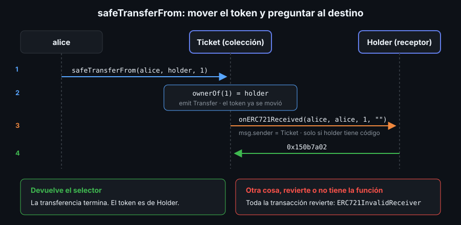

# Teoría 02 — Transferencias seguras y receptores

## 🎯 Objetivos

- Explicar qué comprueba `safeTransferFrom` y por qué existe.
- Escribir un contrato que recibe NFTs con `IERC721Receiver`, y saber de quién fiarse en él.
- Reconocer la reentrancy que abre la llamada a `onERC721Received`, también en `_safeMint`.

---

## 1. Qué problema resuelve

Un token de ERC-721 enviado a un contrato que no sabe qué hacer con él se queda allí para
siempre: el contrato es el dueño y no tiene ninguna función que llame a `transferFrom`. En
ERC-20 pasaba lo mismo con los tokens enviados al propio token (semana 11), pero aquí
duele más: no pierdes "algunos tokens", pierdes **ese** token, el único.

En `test/Ticket.t.sol`, con el `Ticket` de la teoría 01 y un contrato vacío:

```solidity
contract Locker {}
```

```solidity
    function test_TransferToLocker() public {
        uint256 id = ticket.mint(alice);
        Locker locker = new Locker();
        vm.prank(alice);
        ticket.transferFrom(alice, address(locker), id);
        assertEq(ticket.ownerOf(id), address(locker));
    }
```

`[PASS] test_TransferToLocker() (gas: 245405)`: la entrada ahora es de `Locker`, que no la
puede mover ni devolver. `transferFrom` no pregunta nada al destino.

## 2. Cómo funciona

`safeTransferFrom` hace lo mismo que `transferFrom` y, después de mover el token, mira el
destino:

- Si **no tiene código** (una cuenta normal), termina.
- Si **tiene código**, le llama: `to.onERC721Received(operator, from, tokenId, data)`. El
  destino tiene que devolver exactamente el selector de esa función, `0x150b7a02`. Si
  devuelve otra cosa, revierte, o no tiene la función, **toda** la transferencia revierte
  con `ERC721InvalidReceiver(to)`.



Devolver el selector, y no un `bool`, es a propósito: un contrato cualquiera con una
función de fallback que devuelva `true` no pasaría la comprobación por casualidad. Solo
pasa quien declara que sabe recibir NFTs.

Los cuatro argumentos que recibe el destino:

| Argumento | Qué es |
| --------- | ------ |
| `operator` | Quien llamó a `safeTransferFrom`: el dueño, su aprobado o su operador |
| `from` | El dueño anterior. `address(0)` si es un mint |
| `tokenId` | El token que acaba de llegar |
| `data` | Los `bytes` del cuarto argumento de `safeTransferFrom`, sin tocar. Vacío en la versión de tres |

El token **ya es** del destino cuando se ejecuta `onERC721Received`: el contrato puede
consultar `ownerOf(tokenId)` y verse a sí mismo. Y la llamada la hace la **colección**:
dentro de `onERC721Received`, `msg.sender` es el contrato del NFT.

`_safeMint(to, tokenId)` es la versión segura de `_mint`, con la misma comprobación.

## 3. Cómo se escribe

Un receptor implementa la interfaz de OpenZeppelin:

```solidity
// SPDX-License-Identifier: MIT
pragma solidity 0.8.38;

import {IERC721Receiver} from "@openzeppelin/contracts/token/ERC721/IERC721Receiver.sol";

contract Locker {}

contract Holder is IERC721Receiver {
    function onERC721Received(address, address, uint256, bytes calldata) external pure returns (bytes4) {
        return IERC721Receiver.onERC721Received.selector;
    }
}
```

Con los dos, en `test/Ticket.t.sol`:

```solidity
    function test_SafeTransferToLocker() public {
        uint256 id = ticket.mint(alice);
        Locker locker = new Locker();
        vm.prank(alice);
        ticket.safeTransferFrom(alice, address(locker), id);
    }

    function test_SafeTransferToHolder() public {
        uint256 id = ticket.mint(alice);
        Holder holder = new Holder();
        vm.prank(alice);
        ticket.safeTransferFrom(alice, address(holder), id);
        assertEq(ticket.ownerOf(id), address(holder));
    }
```

```
[PASS] test_SafeTransferToHolder() (gas: 372688)
[FAIL: ERC721InvalidReceiver(0xF62849F9A0B5Bf2913b396098F7c7019b51A820a)] test_SafeTransferToLocker() (gas: 250419)
```

El mismo envío que antes dejaba la entrada atrapada ahora revierte, y la entrada sigue en
manos de alice. `Holder` la acepta.

`Holder` acepta cualquier NFT y no hace nada con él: es lo que trae OpenZeppelin como
`ERC721Holder`. Un receptor útil hace algo más: apunta quién lo envió para poder
devolvérselo, o rechaza lo que no espera. Eso es el ejercicio 02.

## 4. Antipatrones y riesgos

**Fiarse de cualquiera que llame a `onERC721Received`.** Es una función `external`:
cualquiera puede llamarla directamente, sin enviar ningún token, con el `tokenId` y el
`from` que quiera. Un receptor que apunte un depósito solo porque le llamaron apunta
depósitos falsos. Comprueba que `msg.sender` es la colección que esperas; si aceptas
varias, que es una que conoces.

**Apuntar `operator` como dueño.** Si un mercado mueve tu token a una caja, `operator` es
el mercado y `from` eres tú. Quien tiene derecho a recuperarlo es `from`.

**Llamar a un contrato desconocido antes de apuntar.** `safeTransferFrom` y `_safeMint`
llaman al destino, y el destino puede volver a llamarte desde `onERC721Received` antes de
que tu función termine (reentrancy; la semana 21 la estudia entera). En `src/FreeMint.sol`,
una entrada gratis por cuenta:

```solidity
contract FreeMint is ERC721 {
    uint256 public nextId = 1;
    mapping(address => bool) public claimed;

    error AlreadyClaimed(address account);

    constructor() ERC721("Free Pass", "PASS") {}

    function claim() external {
        if (claimed[msg.sender]) revert AlreadyClaimed(msg.sender);
        _safeMint(msg.sender, nextId++); // ❌ llama a msg.sender antes de apuntar
        claimed[msg.sender] = true;
    }
}
```

En `test/Greedy.sol`, un contrato que vuelve a pedir desde el aviso:

```solidity
    function onERC721Received(address, address, uint256, bytes calldata) external returns (bytes4) {
        if (SALE.balanceOf(address(this)) < 5) SALE.claim();
        return IERC721Receiver.onERC721Received.selector;
    }
```

El test pasa con `assertEq(sale.balanceOf(address(greedy)), 5)`. Con `-vvvv`:

```
    ├─ [227660] Greedy::attack()
    │   ├─ [203594] FreeMint::claim()
    │   │   ├─ emit Transfer(from: 0x0000000000000000000000000000000000000000, to: Greedy: [0x2e234DAe75C793f67A35089C9d99245E1C58470b], tokenId: 1)
    │   │   ├─ [147036] Greedy::onERC721Received(Greedy: [0x2e234DAe75C793f67A35089C9d99245E1C58470b], 0x0000000000000000000000000000000000000000, 1, 0x)
    │   │   │   ├─ [908] FreeMint::balanceOf(Greedy: [0x2e234DAe75C793f67A35089C9d99245E1C58470b]) [staticcall]
    │   │   │   │   └─ ← [Return] 1
    │   │   │   ├─ [143829] FreeMint::claim()
    │   │   │   │   ├─ emit Transfer(from: 0x0000000000000000000000000000000000000000, to: Greedy: [0x2e234DAe75C793f67A35089C9d99245E1C58470b], tokenId: 2)
```

Cada `claim` entra en el anterior antes de que llegue a `claimed[msg.sender] = true`: el
contrato cree cinco veces que es la primera. El arreglo es el orden de la semana 07:
apunta primero y llama después.

```solidity
        claimed[msg.sender] = true;
        _safeMint(msg.sender, nextId++);
```

Con ese cambio, el mismo test da
`[FAIL: AlreadyClaimed(0x2e234DAe75C793f67A35089C9d99245E1C58470b)]`: la segunda entrada
encuentra la marca.

**Usar `_safeMint` por costumbre.** `_safeMint` protege a quien recibe, pero le da el
control en medio de tu función y puede bloquearla: un destino que revierte en
`onERC721Received` hace revertir el mint. Si tu contrato emite para una dirección que
eligió quien llama (como `msg.sender`), esa cuenta ya sabe lo que hace: `_mint` no llama a
nadie. Si emite para un tercero, `_safeMint` evita que el token se pierda. Elige, y en los
dos casos deja el estado escrito antes.

## 5. Trucos

- `cast sig "onERC721Received(address,address,uint256,bytes)"` da `0x150b7a02`, el valor
  que tiene que devolver el receptor.
- Para que un test o un contrato tuyo reciba NFTs con `safeTransferFrom`, hereda
  `ERC721Holder` de OpenZeppelin (`token/ERC721/utils/ERC721Holder.sol`).
- En una traza con `-vvvv`, busca `onERC721Received` dentro de tu función: todo lo que
  cuelga de ella se ejecutó con tu estado a medias.

## ✅ Checklist

- [ ] Explico qué comprueba `safeTransferFrom` y qué hace con una cuenta sin código.
- [ ] Escribo un receptor que devuelve el selector correcto.
- [ ] Compruebo `msg.sender` en `onERC721Received` y apunto `from`, no `operator`.
- [ ] Apunto el estado antes de `_safeMint` o `safeTransferFrom`.
- [ ] Sé cuándo elegir `_mint` y cuándo `_safeMint`.

---

| Anterior | Actual | Siguiente |
| -------- | ------ | --------- |
| [← Teoría 01 — NFTs y ERC-721](01-nfts-y-erc721.md) | **Teoría 02 — Transferencias seguras y receptores** | [Teoría 03 — Metadata y tokenURI →](03-metadata-y-tokenuri.md) |
