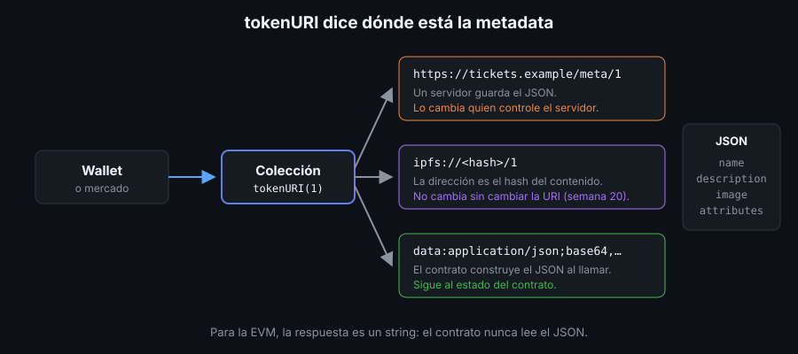

# Teoría 03 — Metadata y tokenURI

## 🎯 Objetivos

- Explicar qué devuelve `tokenURI` y qué forma tiene el JSON de metadata.
- Comparar las tres formas de servir la metadata: servidor, IPFS y en el propio contrato.
- Generar la metadata on-chain con `Strings` y `Base64` de OpenZeppelin.
- Escapar los datos que escribe un usuario antes de meterlos en un JSON.

---

## 1. Qué problema resuelve

El contrato de la teoría 01 sabe que la entrada 1 es de la cuenta 2. Una wallet quiere más:
un nombre que enseñar, una imagen, el asiento. Esos datos son la **metadata** del token, y
el contrato no la guarda en sus tablas de dueños: dice **dónde** está.

La extensión de metadata de ERC-721 añade una función para eso:

```solidity
function tokenURI(uint256 tokenId) external view returns (string memory);
```

Devuelve una URI (una dirección de un recurso: `https://...`, `ipfs://...` o `data:...`)
que apunta a un JSON. Quien muestra el token (una wallet, un mercado) llama a `tokenURI`,
descarga el JSON y lo pinta. El contrato nunca lee ese JSON: para la EVM es un `string`.

## 2. Cómo funciona

### El JSON

EIP-721 propone tres campos; los mercados añadieron `attributes`, y hoy casi todos lo leen:

```json
{
  "name": "Badge #1",
  "description": "Class badge",
  "image": "https://...",
  "attributes": [{ "trait_type": "level", "value": 3 }]
}
```

`image` es otra URI: la imagen tampoco está en el JSON, salvo que se incruste (en la sección
3 se ve cómo).

### Tres sitios donde vive



| Dónde | `tokenURI` devuelve | A favor | En contra |
| ----- | ------------------- | ------- | --------- |
| Un servidor web | `https://tickets.example/meta/1` | Barato, se cambia cuando quieras | Si el servidor cae o cambia el archivo, el token cambia o queda en blanco. El dueño del servidor manda |
| IPFS | `ipfs://<hash del contenido>/1` | La dirección es el hash del contenido: no se puede cambiar sin cambiar la URI | Alguien tiene que mantener el archivo disponible. Se estudia en la semana 20 |
| El contrato | `data:application/json;base64,...` | Nada fuera de la cadena; la metadata puede leer el estado del contrato | Más código, y la cadena no es buena guardando imágenes grandes |

La tercera es la única donde la metadata **sigue al estado**: si el JSON se construye al
llamar a `tokenURI`, refleja lo que el contrato sabe en ese bloque.

### `_baseURI`

El `ERC721` de OpenZeppelin trae un `tokenURI` que devuelve `_baseURI()` seguido del
`tokenId` en decimal, y una cadena vacía si `_baseURI()` es vacía (lo es por defecto).
Antes comprueba que el token existe.

## 3. Cómo se escribe

### En un servidor

Basta con sobrescribir `_baseURI`. En `src/Badge.sol`:

```solidity
contract HostedTicket is ERC721 {
    constructor() ERC721("Hosted Ticket", "HTX") {
        _mint(msg.sender, 1);
    }

    function _baseURI() internal pure override returns (string memory) {
        return "https://tickets.example/meta/";
    }
}
```

Con `anvil --silent &` recién arrancado y las variables `M`, `PK0` y `A0` de la teoría 01,
despliega este contrato y el `Badge` de la sección siguiente, que está en el mismo archivo:

```bash
forge create src/Badge.sol:HostedTicket --private-key "$PK0" --broadcast
forge create src/Badge.sol:Badge --private-key "$PK0" --broadcast
H=0x5FbDB2315678afecb367f032d93F642f64180aa3; B=0xe7f1725E7734CE288F8367e1Bb143E90bb3F0512
cast call $H "tokenURI(uint256)(string)" 1
cast call $H "tokenURI(uint256)(string)" 2
```

```
"https://tickets.example/meta/1"
Error: execution reverted: ERC721NonexistentToken(2)
```

Lo que haya en esa URL lo decide quien controle el servidor, no el contrato.

### En el contrato

Dos bibliotecas de OpenZeppelin: `Strings` convierte números en texto (`toString`) y
`Base64` codifica bytes en Base64, el formato que piden las URI `data:` para contenido
binario o con caracteres especiales. En el mismo archivo:

```solidity
import {Base64} from "@openzeppelin/contracts/utils/Base64.sol";
import {Strings} from "@openzeppelin/contracts/utils/Strings.sol";

contract Badge is ERC721 {
    using Strings for uint256;

    mapping(uint256 => uint256) public levelOf;
    uint256 public nextId = 1;

    constructor() ERC721("Class Badge", "BDG") {}

    function mint(address to, uint256 level) external returns (uint256 id) {
        id = nextId++;
        levelOf[id] = level;
        _mint(to, id);
    }

    function tokenURI(uint256 id) public view override returns (string memory) {
        _requireOwned(id);
        string memory json = string.concat(
            '{"name":"Badge #', id.toString(),
            '","description":"Class badge","attributes":[{"trait_type":"level","value":',
            levelOf[id].toString(), "}]}"
        );
        return string.concat("data:application/json;base64,", Base64.encode(bytes(json)));
    }
}
```

`_requireOwned(id)` es la comprobación interna de OpenZeppelin: revierte con
`ERC721NonexistentToken(id)` si el token no existe, como `ownerOf`. `string.concat` une
cadenas. El texto entre comillas simples deja escribir las comillas dobles del JSON sin
escaparlas.

```bash
cast send $B "mint(address,uint256)" $A0 3 --private-key "$PK0"
URI=$(cast call $B "tokenURI(uint256)(string)" 1); echo "$URI"
echo "$URI" | tr -d '"' | sed 's/^data:application\/json;base64,//' | base64 -d; echo
```

```
"data:application/json;base64,eyJuYW1lIjoiQmFkZ2UgIzEiLCJkZXNjcmlwdGlvbiI6IkNsYXNzIGJhZGdlIiwiYXR0cmlidXRlcyI6W3sidHJhaXRfdHlwZSI6ImxldmVsIiwidmFsdWUiOjN9XX0="
{"name":"Badge #1","description":"Class badge","attributes":[{"trait_type":"level","value":3}]}
```

El JSON se construye en cada llamada: si `levelOf[1]` cambiara, `tokenURI(1)` cambiaría
con él. `tokenURI` es `view`: leerlo con `cast call` no cuesta gas a nadie.

Una imagen se incrusta igual: un SVG codificado en Base64 como
`data:image/svg+xml;base64,...` dentro del campo `image`.

## 4. Antipatrones y riesgos

**Meter en el JSON texto que escribió un usuario, tal cual.** Una comilla en ese texto cierra
el campo y deja escribir los siguientes. En `src/Nametag.sol`, cada visitante pone su
apodo y el contrato lo pega (desplegado en un anvil nuevo, en `$N`) en `{"description":"Visitor","name":"<apodo>"}`. Con este
apodo:

```bash
cast send $N "mint(string)" 'Eve","description":"Official staff' --private-key "$PK0"
cast call $N "rawJson(uint256)(string)" 1 | jq -r . | jq -c .
```

```
{"description":"Official staff","name":"Eve"}
```

El JSON tiene ahora dos `description`, y quien lo lee se queda con la última: el visitante
se ha hecho pasar por personal. `Strings.escapeJSON` escapa las comillas y las barras antes
de pegarlas:

```solidity
        return string.concat('{"description":"Visitor","name":"', Strings.escapeJSON(nickOf[id]), '"}');
```

```
{"description":"Visitor","name":"Eve\",\"description\":\"Official staff"}
```

El apodo entero queda dentro de `name`, comillas incluidas.

**Prometer que un token no cambia con la metadata en un servidor.** Si el dueño del
servidor cambia el archivo, el token cambia. Si se apaga, la imagen desaparece. El
contrato no puede impedirlo: solo guarda la URL.

**Llamar a `tokenURI` desde otro contrato en una transacción.** Construir el JSON y
codificarlo cuesta mucho gas. Es para leerlo fuera de la cadena; un contrato que
necesite un dato del token lo lee de su función propia (`levelOf`), no del JSON.

**Olvidar comprobar que el token existe.** Sin `_requireOwned`, `tokenURI(99)` devolvería
un JSON de un token que no existe, y una web podría enseñarlo como si existiera.

## 5. Trucos

- `cast call ... | tr -d '"' | sed 's/^data:application\/json;base64,//' | base64 -d`
  decodifica una metadata on-chain; añade `| jq .` para verla con formato.
- `cast call $B "supportsInterface(bytes4)(bool)" 0x5b5e139f` comprueba si la colección
  declara la extensión de metadata (`IERC721Metadata`).
- `ERC721URIStorage` de OpenZeppelin guarda una URI distinta por token, para cuando cada
  uno apunta a un archivo propio.

## ✅ Checklist

- [ ] Explico qué devuelve `tokenURI` y qué campos tiene el JSON.
- [ ] Comparo servidor, IPFS y on-chain: quién controla la metadata en cada caso.
- [ ] Sobrescribo `_baseURI` o `tokenURI` y compruebo que el token existe.
- [ ] Construyo un JSON con `Strings` y lo devuelvo como `data:` con `Base64`.
- [ ] Escapo con `Strings.escapeJSON` todo texto que venga de un usuario.

---

| Anterior | Actual | Siguiente |
| -------- | ------ | --------- |
| [← Teoría 02 — Transferencias seguras y receptores](02-transferencias-seguras-y-receptores.md) | **Teoría 03 — Metadata y tokenURI** | [Teoría 04 — ERC-1155 →](04-erc1155.md) |
