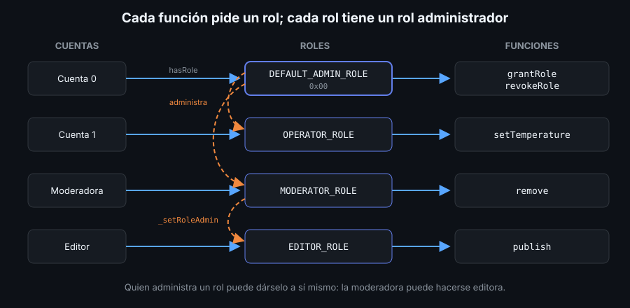

# Teoría 02 — AccessControl y roles

## 🎯 Objetivos

- Explicar qué es un rol y por qué repartir permisos entre varias cuentas.
- Usar `AccessControl` de OpenZeppelin: `onlyRole`, `grantRole`, `revokeRole` y
  `renounceRole`.
- Entender el rol administrador de cada rol y el poder de `DEFAULT_ADMIN_ROLE`.
- Leer en los logs quién dio o quitó cada rol.

---

## 1. Qué problema resuelve

Con `Ownable`, una cuenta lo hace todo. En un protocolo real, las tareas son distintas y las
hacen personas distintas: un equipo de guardia pausa en una emergencia, tesorería retira las
tasas, quien mantiene el protocolo cambia la configuración. Si las tres cosas dependen de la
misma clave, quien la roba puede retirar el dinero, aunque solo la usaras para pausar.

El **principio de mínimo privilegio** dice que cada cuenta tenga solo los permisos que
necesita para su tarea. Un **rol** es un nombre para un conjunto de permisos: "operador",
"tesorero", "guardián". El contrato exige un rol en cada función, y se da o se quita ese rol
a las cuentas que hagan falta, sin desplegar otra vez.

**Control de acceso basado en roles** (RBAC, *role-based access control*) es este modelo, y
`AccessControl` de OpenZeppelin es su versión en Solidity.

## 2. Cómo funciona

Un rol es un `bytes32`. Por convención, el `keccak256` de su nombre:

```solidity
bytes32 public constant OPERATOR_ROLE = keccak256("OPERATOR_ROLE");
```

`AccessControl` guarda, para cada rol, qué cuentas lo tienen y cuál es su **rol
administrador**: el rol que puede darlo y quitarlo.

| Pieza | Qué hace |
| ----- | -------- |
| `hasRole(role, account)` | Si `account` tiene `role` |
| `onlyRole(role)` | Revierte con `AccessControlUnauthorizedAccount(msg.sender, role)` si `msg.sender` no tiene `role` |
| `grantRole(role, account)` | Da `role`. Solo quien tiene el rol administrador de `role` |
| `revokeRole(role, account)` | Quita `role`. Solo quien tiene el rol administrador de `role` |
| `renounceRole(role, callerConfirmation)` | Te quitas `role` a ti mismo. `callerConfirmation` tiene que ser tu propia dirección |
| `getRoleAdmin(role)` | El rol administrador de `role` |
| `DEFAULT_ADMIN_ROLE` | `0x00`: el rol administrador de todos los roles, también de sí mismo, salvo que lo cambies |
| `_grantRole`, `_revokeRole`, `_setRoleAdmin` | `internal`, sin comprobar quién llama: para el constructor y el contrato hijo |
| `RoleGranted`, `RoleRevoked`, `RoleAdminChanged` | Los eventos de cada cambio |

Nadie tiene ningún rol al desplegar: el constructor tiene que dar `DEFAULT_ADMIN_ROLE` a
alguien con `_grantRole`, o nadie podrá dar roles nunca.

Las tablas de `AccessControl` no se pueden recorrer: no hay una función que liste quién tiene
un rol. Para eso están los eventos, o la extensión `AccessControlEnumerable`.

## 3. Cómo se escribe

En `src/Thermostat.sol`, un termostato que solo cambian los operadores:

```solidity
// SPDX-License-Identifier: MIT
pragma solidity 0.8.38;

import {AccessControl} from "@openzeppelin/contracts/access/AccessControl.sol";

contract Thermostat is AccessControl {
    bytes32 public constant OPERATOR_ROLE = keccak256("OPERATOR_ROLE");

    int256 public temperature = 20;

    constructor() {
        _grantRole(DEFAULT_ADMIN_ROLE, msg.sender);
    }

    function setTemperature(int256 value) external onlyRole(OPERATOR_ROLE) {
        temperature = value;
    }
}
```

Quien despliega es administrador, pero **no** operador: tiene que darse el rol si quiere
cambiar la temperatura. Administrar y operar son permisos distintos.

### En anvil

**Dónde**: en el contenedor, en la carpeta del proyecto, con `anvil --silent &` recién
arrancado. La cuenta 0 administra; la 1 y la 2 son el equipo:

```bash
M="test test test test test test test test test test test junk"
PK0=$(cast wallet private-key "$M" 0); PK1=$(cast wallet private-key "$M" 1); PK2=$(cast wallet private-key "$M" 2)
A0=$(cast wallet address "$PK0"); A1=$(cast wallet address "$PK1"); A2=$(cast wallet address "$PK2")
forge create src/Thermostat.sol:Thermostat --private-key "$PK0" --broadcast
T=0x5FbDB2315678afecb367f032d93F642f64180aa3
OP=$(cast call $T "OPERATOR_ROLE()(bytes32)"); echo $OP
cast keccak "OPERATOR_ROLE"
cast call $T "hasRole(bytes32,address)(bool)" $(cast to-bytes32 0x00) $A0
cast send $T "setTemperature(int256)" 18 --private-key "$PK1"
```

```
0x97667070c54ef182b0f5858b034beac1b6f3089aa2d3188bb1e8929f4fa9b929
0x97667070c54ef182b0f5858b034beac1b6f3089aa2d3188bb1e8929f4fa9b929
true
Error: ... custom error 0xe2517d3f: ...: AccessControlUnauthorizedAccount(0x70997970C51812dc3A010C7d01b50e0d17dc79C8, 0x97667070c54ef182b0f5858b034beac1b6f3089aa2d3188bb1e8929f4fa9b929)
```

El rol es el hash de su nombre, y la cuenta 0 tiene `DEFAULT_ADMIN_ROLE` (`cast to-bytes32`
rellena `0x00` hasta 32 bytes). El error dice quién llamó y qué rol le faltaba.

### Dar y quitar

La cuenta 0 da el rol a la 1, que ya puede operar. Un `int256` negativo necesita las opciones
antes del contrato y `--` antes del valor, para que `cast` no lo lea como una opción:

```bash
cast send $T "grantRole(bytes32,address)" $OP $A1 --private-key "$PK0" --json | jq -c '[.status, .logs[0].topics]'
cast send --private-key "$PK1" --json $T "setTemperature(int256)" -- -5 | jq -r .status
cast call $T "temperature()(int256)"
```

```
["0x1",["0x2f8788117e7eff1d82e926ec794901d17c78024a50270940304540a733656f0d","0x97667070c54ef182b0f5858b034beac1b6f3089aa2d3188bb1e8929f4fa9b929","0x00000000000000000000000070997970c51812dc3a010c7d01b50e0d17dc79c8","0x000000000000000000000000f39fd6e51aad88f6f4ce6ab8827279cfffb92266"]]
0x1
-5
```

`RoleGranted` (`0x2f878811…`) indexa los tres campos: el rol, la cuenta que lo recibe y quien
lo dio. Con `cast logs` y ese topic 0 tienes la historia de permisos del contrato.

Un operador no puede dar su rol: el administrador de `OPERATOR_ROLE` es `DEFAULT_ADMIN_ROLE`.
Dar un rol que ya se tiene no falla, pero no emite nada:

```bash
cast send $T "grantRole(bytes32,address)" $OP $A2 --private-key "$PK1"
cast call $T "getRoleAdmin(bytes32)(bytes32)" $OP
cast send $T "grantRole(bytes32,address)" $OP $A1 --private-key "$PK0" --json | jq -c '[.status, (.logs | length)]'
```

```
Error: ... custom error 0xe2517d3f: ...: AccessControlUnauthorizedAccount(0x70997970C51812dc3A010C7d01b50e0d17dc79C8, 0x0000000000000000000000000000000000000000000000000000000000000000)
0x0000000000000000000000000000000000000000000000000000000000000000
["0x1",0]
```

`renounceRole` pide tu propia dirección como confirmación. Si la cuenta 1 intenta renunciar
por la 2, revierte; el administrador, en cambio, sí puede quitárselo a cualquiera:

```bash
cast send $T "renounceRole(bytes32,address)" $OP $A2 --private-key "$PK1"
cast send $T "revokeRole(bytes32,address)" $OP $A1 --private-key "$PK0" --json | jq -c '[.status, .logs[0].topics]'
cast call $T "hasRole(bytes32,address)(bool)" $OP $A1
```

```
Error: ... custom error 0x6697b232: ...: AccessControlBadConfirmation
["0x1",["0xf6391f5c32d9c69d2a47ea670b442974b53935d1edc7fd64eb21e047a839171b","0x97667070c54ef182b0f5858b034beac1b6f3089aa2d3188bb1e8929f4fa9b929","0x00000000000000000000000070997970c51812dc3a010c7d01b50e0d17dc79c8","0x000000000000000000000000f39fd6e51aad88f6f4ce6ab8827279cfffb92266"]]
false
```

`RoleRevoked` (`0xf6391f5c…`) tiene los mismos tres campos que `RoleGranted`.

### Jerarquías

`_setRoleAdmin(role, adminRole)` cambia quién administra un rol. Con
`_setRoleAdmin(EDITOR_ROLE, MODERATOR_ROLE)` en el constructor, los moderadores dan y quitan
el rol de editor sin pedírselo al administrador general. Lo harás en el ejercicio 01.



## 4. Antipatrones y riesgos

**Renunciar al último administrador.** Si la única cuenta con `DEFAULT_ADMIN_ROLE` renuncia,
nadie puede volver a dar ni quitar roles:

```bash
cast send $T "renounceRole(bytes32,address)" $(cast to-bytes32 0x00) $A0 --private-key "$PK0" --json | jq -c .status
cast send $T "grantRole(bytes32,address)" $OP $A1 --private-key "$PK0"
```

```
"0x1"
Error: ... custom error 0xe2517d3f: ...: AccessControlUnauthorizedAccount(0xf39Fd6e51aad88F6F4ce6aB8827279cffFb92266, 0x0000000000000000000000000000000000000000000000000000000000000000)
```

Los roles que existían siguen funcionando, pero quedan congelados: si la clave de un operador
se pierde, nadie se lo puede quitar.

**`DEFAULT_ADMIN_ROLE` en una cuenta normal.** Es el rol que da todos los demás: quien lo
tiene puede darse a sí mismo cualquier rol. Proteger los roles pequeños no sirve si el
grande está en una sola clave. Por eso se suele dar a un multisig o a un timelock
(teoría 04). OpenZeppelin trae `AccessControlDefaultAdminRules`, que obliga a cambiar el
administrador en dos pasos y con espera, como `Ownable2Step` con plazo.

**Una jerarquía que da la vuelta.** Si `MODERATOR_ROLE` administra `EDITOR_ROLE`, un
moderador puede hacerse editor a sí mismo. Cada rol administrador incluye, en la práctica,
los permisos de los roles que administra.

**Roles con el mismo nombre en contratos distintos.** `keccak256("OPERATOR_ROLE")` es el
mismo `bytes32` en todos los contratos, pero cada contrato tiene su propia tabla: ser
operador en uno no da nada en otro.

**Olvidar `onlyRole`.** Una función nueva sin modificador la puede llamar cualquiera. Un
test por función protegida, con una cuenta sin rol, detecta el olvido.

## 5. Trucos

- `cast keccak "OPERATOR_ROLE"` calcula el `bytes32` de un rol sin llamar al contrato.
- `cast logs --from-block 0 --address $T "RoleGranted(bytes32 indexed,address indexed,address indexed)"`
  lista todos los roles dados; con `RoleRevoked`, los quitados.
- `supportsInterface(0x7965db0b)` dice si un contrato implementa `IAccessControl`:
  `AccessControl` ya trae ERC-165.
- En un test, `vm.expectRevert(abi.encodeWithSelector(IAccessControl.AccessControlUnauthorizedAccount.selector, alice, ROLE))`
  comprueba quién y qué rol.

## ✅ Checklist

- [ ] Explico el principio de mínimo privilegio con un ejemplo.
- [ ] Defino un rol con `keccak256` y lo exijo con `onlyRole`.
- [ ] Doy el primer `DEFAULT_ADMIN_ROLE` en el constructor con `_grantRole`.
- [ ] Distingo `revokeRole` de `renounceRole` y sé qué confirma `callerConfirmation`.
- [ ] Explico qué pasa si nadie tiene `DEFAULT_ADMIN_ROLE`.

---

| Anterior | Actual | Siguiente |
| -------- | ------ | --------- |
| [← Teoría 01 — Ownable y Ownable2Step](01-ownable-y-ownable2step.md) | **Teoría 02 — AccessControl y roles** | [Teoría 03 — Pausable y parada de emergencia →](03-pausable-y-parada-de-emergencia.md) |
