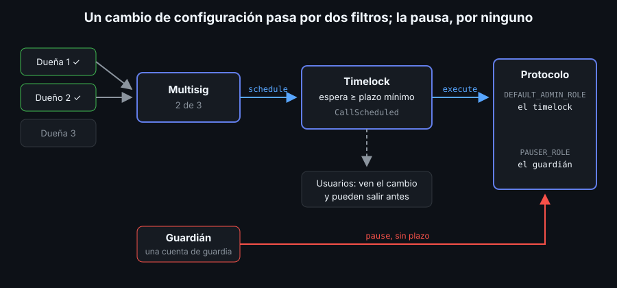

# Teoría 04 — Timelock y multisig

## 🎯 Objetivos

- Explicar qué añaden un multisig y un timelock al control de acceso.
- Poner un contrato bajo un `TimelockController` y cambiar un parámetro con
  `schedule` y `execute` en anvil.
- Leer el estado de una operación programada y sus errores.
- Combinar multisig, timelock y roles en un protocolo.

---

## 1. Qué problema resuelve

Con `Ownable` o con roles decides **qué** cuenta puede hacer cada cosa. Pero si esa cuenta
es una sola clave, dos problemas siguen ahí:

- **Una clave es un punto único de fallo.** Se pierde, se roba, o la persona que la tiene se
  equivoca o decide hacer trampa. El contrato no distingue entre el dueño legítimo y quien le
  robó la clave.
- **Los cambios son instantáneos.** Si el administrador sube la tasa al 100 %, los usuarios
  se enteran cuando ya la pagaron. No tienen tiempo de salir.

Dos herramientas responden a cada problema:

- Un **multisig** (*multi-signature wallet*) es un contrato que actúa como una cuenta, pero
  solo ejecuta una llamada cuando la aprueban M de sus N dueños. "2 de 3": tres personas,
  dos tienen que estar de acuerdo. Robar una clave ya no basta.
- Un **timelock** es un contrato que ejecuta llamadas con un retraso mínimo. Primero se
  **programa** la llamada, que queda publicada en la cadena; pasado el plazo, se **ejecuta**.
  Los usuarios ven el cambio antes de que ocurra y pueden irse si no les gusta.

En un protocolo real se combinan: el multisig es el único que puede programar en el timelock,
y el timelock es el administrador del protocolo.



## 2. Cómo funciona un timelock

`TimelockController` de OpenZeppelin es un contrato con `AccessControl` y cuatro roles:

| Rol | Qué puede hacer |
| --- | --------------- |
| `PROPOSER_ROLE` | Programar operaciones con `schedule` |
| `EXECUTOR_ROLE` | Ejecutarlas con `execute` cuando pasa el plazo. Si se da a `address(0)`, cualquiera puede ejecutar |
| `CANCELLER_ROLE` | Cancelar una operación pendiente con `cancel`. El constructor se lo da a los proponentes |
| `DEFAULT_ADMIN_ROLE` | Lo tiene el propio timelock: cambiar sus roles también pasa por el plazo |

Una **operación** es una llamada: dirección de destino, ETH enviado y `data` (el selector y
los argumentos, semana 10). Se identifica con un hash de esos datos, más un `predecessor`
(otra operación que tiene que ejecutarse antes, o `0x00`) y un `salt` (un número para
programar dos veces la misma llamada). Cada operación pasa por cuatro estados:

| Estado | Valor | Significado |
| ------ | ----- | ----------- |
| `Unset` | 0 | No está programada |
| `Waiting` | 1 | Programada, sin cumplir el plazo |
| `Ready` | 2 | Cumplido el plazo, se puede ejecutar |
| `Done` | 3 | Ejecutada. No se puede repetir |

El constructor recibe el plazo mínimo en segundos, la lista de proponentes, la de ejecutores
y un administrador opcional (con `address(0)`, ninguno: el timelock se administra solo).

## 3. Cómo se escribe

En `src/Settings.sol`, un contrato con una tasa que solo cambia su dueño. El dueño se pasa
al desplegar, porque será el timelock:

```solidity
// SPDX-License-Identifier: MIT
pragma solidity 0.8.38;

import {Ownable} from "@openzeppelin/contracts/access/Ownable.sol";

contract Settings is Ownable {
    uint256 public fee = 100;

    event FeeChanged(uint256 fee);

    constructor(address initialOwner) Ownable(initialOwner) {}

    function setFee(uint256 newFee) external onlyOwner {
        fee = newFee;
        emit FeeChanged(newFee);
    }
}
```

### En anvil

**Dónde**: en el contenedor, en la carpeta del proyecto, con `anvil --silent &` recién
arrancado. `forge create` compila también un contrato de `/opt/lib`: despliega el timelock
con 3600 segundos (una hora) de plazo, la cuenta 0 como proponente y ejecución abierta a
cualquiera. Después, `Settings` con el timelock como dueño:

```bash
M="test test test test test test test test test test test junk"
PK0=$(cast wallet private-key "$M" 0); PK1=$(cast wallet private-key "$M" 1); A0=$(cast wallet address "$PK0")
Z=0x0000000000000000000000000000000000000000; Z32=$(cast to-bytes32 0x00)
forge create /opt/lib/openzeppelin-contracts/contracts/governance/TimelockController.sol:TimelockController \
  --private-key "$PK0" --broadcast --constructor-args 3600 "[$A0]" "[$Z]" $Z
TL=0x5FbDB2315678afecb367f032d93F642f64180aa3
forge create src/Settings.sol:Settings --private-key "$PK0" --broadcast --constructor-args $TL
ST=0xe7f1725E7734CE288F8367e1Bb143E90bb3F0512
cast send $ST "setFee(uint256)" 50 --private-key "$PK0"
```

```
Error: ... custom error 0x118cdaa7: ...: OwnableUnauthorizedAccount(0xf39Fd6e51aad88F6F4ce6aB8827279cffFb92266)
```

La cuenta 0 desplegó los dos contratos, pero no es la dueña de `Settings`: lo es el timelock.
El único camino es programar la llamada. `cast calldata` codifica `setFee(50)`:

```bash
DATA=$(cast calldata "setFee(uint256)" 50); echo $DATA
cast send $TL "schedule(address,uint256,bytes,bytes32,bytes32,uint256)" $ST 0 $DATA $Z32 $Z32 60 --private-key "$PK0"
cast send $TL "schedule(address,uint256,bytes,bytes32,bytes32,uint256)" $ST 0 $DATA $Z32 $Z32 3600 --private-key "$PK1"
cast send $TL "schedule(address,uint256,bytes,bytes32,bytes32,uint256)" $ST 0 $DATA $Z32 $Z32 3600 --private-key "$PK0" --json | jq -c '[.status, .logs[0].topics]'
```

```
0x69fe0e2d0000000000000000000000000000000000000000000000000000000000000032
Error: ... data: "0x54336609...": TimelockInsufficientDelay(60, 3600)
Error: ... custom error 0xe2517d3f: ...: AccessControlUnauthorizedAccount(0x70997970C51812dc3A010C7d01b50e0d17dc79C8, 0xb09aa5aeb3702cfd50b6b62bc4532604938f21248a27a1d5ca736082b6819cc1)
["0x1",["0x4cf4410cc57040e44862ef0f45f3dd5a5e02db8eb8add648d4b0e236f1d07dca","0x763fd79cf416f2fad8f75ba7a29d98d22184c8e1deda381e37b6716d22320e1c","0x0000000000000000000000000000000000000000000000000000000000000000"]]
```

Un plazo menor que el mínimo se rechaza, y la cuenta 1 no es proponente (`0xb09aa5ae…` es
`keccak256("PROPOSER_ROLE")`). La programación válida emite `CallScheduled`
(`0x4cf4410c…`) con el id de la operación en el topic 1. Ese evento es el aviso público: con
`cast logs` cualquiera ve qué llamada va a ejecutarse y cuándo.

### Esperar y ejecutar

```bash
ID=$(cast call $TL "hashOperation(address,uint256,bytes,bytes32,bytes32)(bytes32)" $ST 0 $DATA $Z32 $Z32)
cast call $TL "getOperationState(bytes32)(uint8)" $ID
cast call $TL "getTimestamp(bytes32)(uint256)" $ID
cast block latest -f timestamp
cast send $TL "execute(address,uint256,bytes,bytes32,bytes32)" $ST 0 $DATA $Z32 $Z32 --private-key "$PK1"
```

```
1
1795410759 [1.795e9]
1795407159
Error: ... custom error 0x5ead8eb5: ...: TimelockUnexpectedOperationState(0x763fd79cf416f2fad8f75ba7a29d98d22184c8e1deda381e37b6716d22320e1c, 0x0000000000000000000000000000000000000000000000000000000000000004)
```

Estado 1, `Waiting`: la operación estará lista 3600 segundos después del bloque actual. El
error de ejecutar antes trae el estado que esperaba como un mapa de bits: `0x04` es
`1 << 2`, el bit de `Ready`. En anvil puedes adelantar el reloj con `evm_increaseTime` y
minar un bloque con `evm_mine`:

```bash
cast rpc evm_increaseTime 3600 >/dev/null; cast rpc evm_mine >/dev/null
cast call $TL "getOperationState(bytes32)(uint8)" $ID
cast send $TL "execute(address,uint256,bytes,bytes32,bytes32)" $ST 0 $DATA $Z32 $Z32 --private-key "$PK1" --json | jq -c '[.status, [.logs[].topics[0]]]'
cast call $ST "fee()(uint256)"
cast call $TL "getOperationState(bytes32)(uint8)" $ID
cast send $TL "execute(address,uint256,bytes,bytes32,bytes32)" $ST 0 $DATA $Z32 $Z32 --private-key "$PK1"
```

```
2
["0x1",["0x6bbc57480a46553fa4d156ce702beef5f3ad66303b0ed1a5d4cb44966c6584c3","0xc2617efa69bab66782fa219543714338489c4e9e178271560a91b82c3f612b58"]]
50
3
Error: ... custom error 0x5ead8eb5: ...: TimelockUnexpectedOperationState(0x763fd79cf416f2fad8f75ba7a29d98d22184c8e1deda381e37b6716d22320e1c, 0x0000000000000000000000000000000000000000000000000000000000000004)
```

Ejecutó la cuenta 1, que no es proponente: la ejecución es abierta. Salen dos eventos, en
orden: `FeeChanged` de `Settings` y `CallExecuted` (`0xc2617efa…`) del timelock. La operación
queda en `Done` (3) y no se puede repetir.

## 4. Cómo funciona un multisig

Un multisig guarda una lista de dueños y un umbral. Cada propuesta es, como en el timelock,
una llamada: destino, ETH y `data`. Un dueño la propone, los dueños la **confirman** uno a
uno, y cuando hay tantas confirmaciones como el umbral, cualquiera de ellos la ejecuta. El
contrato hace la llamada como `msg.sender`: para el contrato de destino, el multisig es una
cuenta más.

En el ejercicio 03 escribirás uno en el que cada confirmación es una transacción. El multisig
más usado, Safe, funciona de otra manera: los dueños **firman** la propuesta fuera de la
cadena y una sola transacción lleva todas las firmas. Las firmas llegan en la semana 14.

## 5. Antipatrones y riesgos

**Un timelock que no protege nada.** Si el contrato tiene otro administrador además del
timelock (quien lo desplegó, por ejemplo), ese otro se salta el plazo. Al pasar el control al
timelock, el resto de cuentas tiene que renunciar. Compruébalo con `hasRole` y `owner()`.

**Un plazo demasiado corto.** Un plazo de un minuto no da tiempo a nadie a reaccionar. El
plazo tiene que ser mayor que lo que tarda un usuario en enterarse y retirar sus fondos.

**Un timelock en las emergencias.** La pausa de la teoría 03 tiene que ser inmediata: si
pasa por el timelock, llega una hora tarde. Lo habitual es que el guardián pause sin plazo y
que todo lo demás pase por el timelock.

**Un multisig con todas las claves en el mismo sitio.** Tres claves en el mismo portátil son
una clave. El valor del multisig está en que las claves las tienen personas distintas, en
dispositivos distintos.

**Un umbral mal elegido.** "1 de N" es N claves que pueden actuar solas. "N de N" se bloquea
para siempre si se pierde una clave. Elige un umbral que resista la pérdida de una clave y el
robo de otra.

**Ejecutar sin leer.** Un dueño que confirma sin decodificar `data` puede aprobar cualquier
cosa. `cast calldata-decode "setFee(uint256)" $DATA` muestra qué hace la llamada antes de
confirmarla.

## 6. Trucos

- `cast call $TL "getMinDelay()(uint256)"` da el plazo mínimo del timelock.
- `cast logs --from-block 0 --address $TL "CallScheduled(bytes32 indexed,uint256 indexed,address,uint256,bytes,bytes32,uint256)"`
  lista todo lo que se programó: es la agenda pública de cambios.
- En un test, `vm.warp(block.timestamp + 3600)` hace lo que `evm_increaseTime` en anvil.

## ✅ Checklist

- [ ] Explico qué problema resuelve un multisig y cuál un timelock.
- [ ] Despliego un `TimelockController` y le paso la propiedad de un contrato.
- [ ] Programo, espero y ejecuto una operación, y leo su estado.
- [ ] Sé por qué la pausa de emergencia no pasa por el timelock.
- [ ] Explico qué umbral elegiría para un multisig de tres personas.

---

| Anterior | Actual | Siguiente |
| -------- | ------ | --------- |
| [← Teoría 03 — Pausable y parada de emergencia](03-pausable-y-parada-de-emergencia.md) | **Teoría 04 — Timelock y multisig** | [Ejercicio 01 — Roles con AccessControl →](../2-practicas/ejercicio-01-roles-con-accesscontrol/README.md) |
