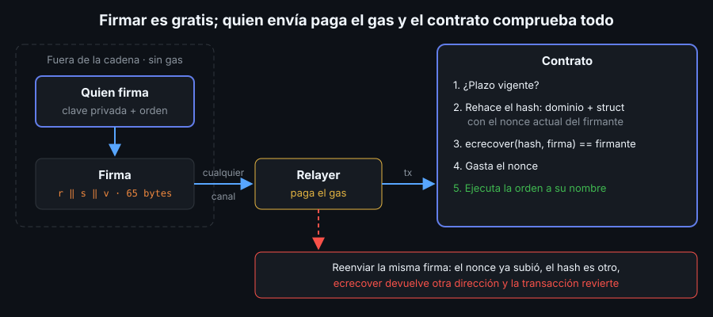

# Teoría 01 — ECDSA y ecrecover

## 🎯 Objetivos

- Explicar para qué quiere un contrato comprobar una firma hecha fuera de la cadena.
- Recuperar el firmante de una firma con `ecrecover` y con la librería `ECDSA` de
  OpenZeppelin.
- Firmar en un test con los cheatcodes `makeAddrAndKey` y `vm.sign`.
- Reconocer los fallos clásicos: `address(0)` como firmante, firmas maleables y firmas
  usadas como identificador.

---

## 1. Qué problema resuelve

Hasta ahora, toda orden que recibe tu registro llega en una transacción, y quien la firma es
quien paga el gas: `msg.sender`. Eso deja fuera casos muy comunes:

- **Un miembro sin ETH** quiere darse de alta, y la red de talleres está dispuesta a pagarle
  la tasa y el gas.
- **Un emisor reparte cupones** a cientos de personas. Enviar una transacción por cupón
  costaría gas por cada uno, aunque nadie llegue a canjearlo.
- **Un usuario gasta tokens** en un contrato y no quiere pagar dos transacciones (`approve`
  y después la compra).

La solución es separar **quién autoriza** de **quién envía**. Quien autoriza firma un mensaje
con su clave, fuera de la cadena (*off-chain*: en su máquina, sin transacción y sin gas).
Cualquier otra cuenta lleva esa firma al contrato en una transacción. Esa cuenta que envía
firmas ajenas y paga el gas se llama **relayer**. El contrato, con la firma y el mensaje,
averigua quién firmó y decide si le hace caso.



Esta semana ves cómo se hace bien: esta teoría, la verificación; la 02, el formato de los
mensajes y cómo evitar que una firma se use dos veces; la 03, los mensajes con estructura
(EIP-712); la 04, el caso de los tokens (permit).

## 2. Cómo funciona

En la [semana 01](../../week-01-criptografia_y_blockchain/1-teoria/05-firmas-digitales.md)
viste que una firma de Ethereum tiene tres partes, `r`, `s` y `v`, y que `cast wallet verify`
la comprueba con una dirección. El algoritmo de firma se llama **ECDSA** (*Elliptic Curve
Digital Signature Algorithm*, firma con curvas elípticas), sobre la curva **secp256k1**.

ECDSA tiene una propiedad que Ethereum aprovecha: de un hash y una firma se puede
**recuperar** la clave pública que firmó, y de ella, la dirección. Así que el contrato no
necesita "verificar contra" una dirección: la recupera y la compara con la que espera.

La EVM trae esa operación como **precompilado**: un contrato que viene con la propia red, en
una dirección fija (la `0x01`), escrito en el código del cliente y no en bytecode. Solidity lo
expone como la función global `ecrecover`:

```solidity
ecrecover(bytes32 hash, uint8 v, bytes32 r, bytes32 s) returns (address)
```

Dos detalles que causan la mayoría de los fallos:

1. **No revierte nunca.** Con una firma inválida devuelve `address(0)`. Con una firma válida
   de **otro** mensaje devuelve una dirección cualquiera, la de nadie.
2. **Recibe un hash, no un mensaje.** Lo que se firma son siempre 32 bytes. Qué hash
   exactamente (con qué prefijo, con qué campos) es el tema de las teorías 02 y 03.

## 3. Cómo se escribe

**Dónde**: en un proyecto Foundry de prácticas (por ejemplo `firmas/`, creado con la
plantilla del bootcamp), archivo `test/Recover.t.sol`. Dos cheatcodes nuevos:

| Cheatcode | Qué hace |
| --------- | -------- |
| `makeAddrAndKey("alice")` | Como `makeAddr` (semana 09), pero devuelve también la clave privada, derivada del nombre. Solo sirve en tests |
| `vm.sign(key, hash)` | Firma `hash` con `key` y devuelve `(v, r, s)`. No añade ningún prefijo: firma esos 32 bytes tal cual |

```solidity
// SPDX-License-Identifier: MIT
pragma solidity 0.8.38;

import {Test, console} from "forge-std/Test.sol";
import {ECDSA} from "@openzeppelin/contracts/utils/cryptography/ECDSA.sol";

contract RecoverTest is Test {
    function test_Recover() public {
        (address alice, uint256 aliceKey) = makeAddrAndKey("alice");
        bytes32 hash = keccak256("hola");
        (uint8 v, bytes32 r, bytes32 s) = vm.sign(aliceKey, hash);

        console.log("alice    ", alice);
        console.log("v        ", v);
        console.log("recupera ", ecrecover(hash, v, r, s));
        console.log("otro hash", ecrecover(keccak256("adios"), v, r, s));
        console.log("v = 0    ", ecrecover(hash, 0, r, s));
    }
}
```

```bash
forge test --match-test test_Recover -vv
```

```
  alice     0x328809Bc894f92807417D2dAD6b7C998c1aFdac6
  v         27
  recupera  0x328809Bc894f92807417D2dAD6b7C998c1aFdac6
  otro hash 0x964b3f269Aa24C3036733d7f8cfe86604341ac2d
  v = 0     0x0000000000000000000000000000000000000000
```

Con el hash correcto sale alice. Con otro hash, la misma firma "funciona" y da otra
dirección: no hay error que avise. Con un `v` imposible (solo valen 27 y 28), `address(0)`.
Por eso un contrato **siempre** compara lo recuperado con la dirección esperada.

### La librería ECDSA

`ECDSA` de OpenZeppelin envuelve `ecrecover` y convierte cada caso raro en un error:

| Función | Qué hace |
| ------- | -------- |
| `ECDSA.recover(hash, signature)` | Recibe los 65 bytes `r ‖ s ‖ v` juntos (`‖` es "pegado a"). Revierte con `ECDSAInvalidSignatureLength(n)` si no son 65, con `ECDSAInvalidSignatureS(s)` si `s` es maleable (apartado 5) y con `ECDSAInvalidSignature()` si sale `address(0)` |
| `ECDSA.recover(hash, v, r, s)` | Lo mismo, con las partes separadas |
| `ECDSA.tryRecover(...)` | No revierte: devuelve `(address, RecoverError, bytes32)` para que decidas tú |

La firma de 65 bytes se monta en un test con `abi.encodePacked(r, s, v)`: 32 + 32 + 1 bytes,
el mismo formato que imprime `cast wallet sign`.

## 4. Lo que la firma no dice

Recuperar el firmante prueba que **alguien con esa clave firmó ese hash**. Nada más. Como
viste en la semana 01, no dice cuándo, ni para qué contrato, ni cuántas veces se puede
usar. Si el contrato acepta "firma de Ana: dale 50 puntos a Ana", cualquiera que vea la firma
(está en una transacción pública) la puede enviar otra vez. Ese ataque, el **replay**, y sus
defensas son la teoría 02.

## 5. Antipatrones y riesgos

- ❌ **Comparar con un firmante sin asignar.** `ecrecover` devuelve `address(0)` con basura,
  y una variable `address` sin asignar vale `address(0)`. Juntos, cualquier firma pasa:

  ```solidity
  // ❌ `signer` nunca se asignó: vale address(0), lo mismo que devuelve ecrecover con basura.
  contract BadVerifier {
      address public signer;

      function isValid(bytes32 hash, uint8 v, bytes32 r, bytes32 s) external view returns (bool) {
          return ecrecover(hash, v, r, s) == signer;
      }
  }
  ```

  Un test con `bad.isValid(keccak256("lo que sea"), 0, bytes32(0), bytes32(0))` da `true`:
  `[PASS] test_GarbageSignaturePasses()`. `ECDSA.recover` nunca devuelve `address(0)`:
  revierte antes.

- ❌ **Aceptar firmas maleables.** Por la simetría de la curva, de cada firma válida
  `(r, s, v)` sale otra igual de válida: `(r, N - s, v')`, donde `N` es el orden de la curva
  y `v'` el otro valor de `v`. Las dos recuperan la misma dirección con `ecrecover`. Si tu
  contrato marca como usada "esta firma" (sus bytes), un atacante envía la gemela y pasa.
  `ECDSA` solo acepta la de `s` en la mitad baja, como exige Ethereum para transacciones
  desde EIP-2:

  ```solidity
  bytes32 s2 = bytes32(N - uint256(s));
  uint8 v2 = v == 27 ? 28 : 27;
  assertEq(ecrecover(hash, v2, r, s2), alice);   // ecrecover la acepta
  vm.expectRevert(abi.encodeWithSelector(ECDSA.ECDSAInvalidSignatureS.selector, s2));
  this.recover(hash, v2, r, s2);                 // ECDSA.recover, no
  ```

  `this.recover` es una función `external` del propio test que llama a `ECDSA.recover`:
  `vm.expectRevert` necesita una llamada externa (semana 09).

- ❌ **Usar la firma como identificador.** Por lo mismo, nunca guardes
  `used[keccak256(signature)]`. Marca como usado el **mensaje** (su hash) o, mejor, un nonce
  (teoría 02).
- ❌ **Llamar a `ecrecover` directamente.** Salvo que sepas exactamente por qué, usa `ECDSA`:
  cubre los tres casos de arriba en una línea.

## 6. Trucos

- `makeAddrAndKey` da siempre la misma clave para el mismo nombre: los tests son
  reproducibles y las direcciones salen etiquetadas en las trazas.
- Las cuentas de anvil firman igual en tests: `vm.sign(0xac09...ff80, hash)` es la cuenta 0.
  Nunca pongas en un test una clave que no sea de prueba.
- Si `ECDSA.recover` revierte con `ECDSAInvalidSignatureLength(64)`, alguien te pasó una
  firma compacta (ERC-2098, 64 bytes): es otro formato, no una firma rota.

## ✅ Checklist

- [ ] Explico qué es un relayer y por qué separa a quien autoriza de quien paga el gas.
- [ ] Recupero el firmante con `ecrecover` y explico qué devuelve con una firma inválida.
- [ ] Firmo en un test con `makeAddrAndKey` y `vm.sign`, y monto los 65 bytes.
- [ ] Explico la maleabilidad y por qué `ECDSA` la rechaza.
- [ ] Sé por qué una firma válida no basta para aceptar una orden.

---

| Anterior | Actual | Siguiente |
| -------- | ------ | --------- |
| [← Semana 14 — Firmas, EIP-712 y permit](../README.md) | **Teoría 01 — ECDSA y ecrecover** | [Teoría 02 — EIP-191 y replay →](02-eip191-y-replay.md) |
