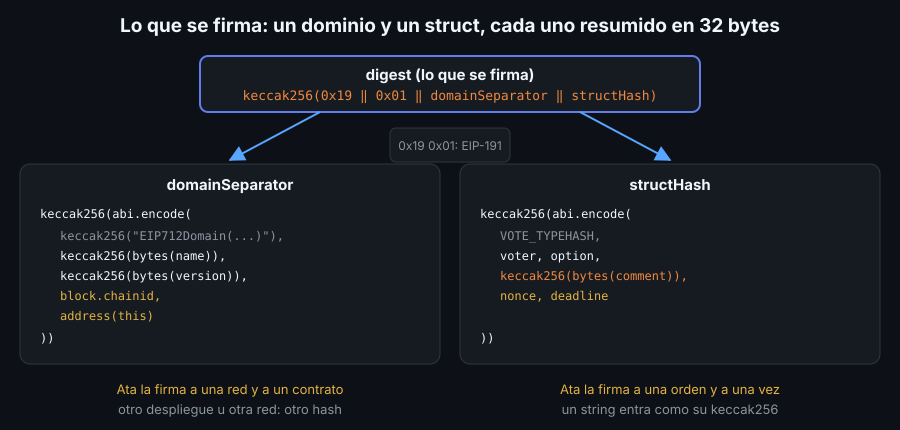

# Teoría 03 — EIP-712, datos tipados

## 🎯 Objetivos

- Explicar qué añade EIP-712 a una firma EIP-191: campos legibles y un dominio.
- Calcular el typehash, el hash de un struct y el domain separator.
- Usar `EIP712` y `Nonces` de OpenZeppelin en un contrato.
- Firmar datos tipados con `cast wallet sign --data` a partir de un JSON.

---

## 1. Qué problema resuelve

Con EIP-191 (teoría 02), la wallet le enseña al usuario un hash: 32 bytes en hexadecimal.
Nadie sabe qué autoriza al firmar `0x4167…`. Y las defensas contra el replay (contrato, red,
nonce, plazo) se las inventa cada contrato a su manera.

**EIP-712** estandariza las dos cosas:

- El mensaje es un **struct con tipos**: `Vote(address voter, uint256 option, ...)`. La wallet
  muestra cada campo con su nombre y su valor ("voter: 0x3C44…, option: 2, comment: yes"),
  y el usuario ve qué firma.
- El **dominio** (*domain*) dice para qué aplicación es la firma: nombre, versión, red y
  dirección del contrato. Va dentro del hash, así que una firma para un contrato no vale en
  otro ni en otra red, sin que el contrato tenga que acordarse.

## 2. Cómo funciona

Lo que se firma es la versión `0x01` de EIP-191:

```
digest = keccak256(0x19 ‖ 0x01 ‖ domainSeparator ‖ structHash)
```



Tres piezas, cada una de 32 bytes:

1. **Typehash**: el keccak256 del tipo escrito como texto, sin espacios después de las
   comas: `keccak256("Vote(address voter,uint256 option,string comment,uint256 nonce,uint256 deadline)")`.
   Ata la firma a ese struct con esos campos en ese orden.
2. **Struct hash**: `keccak256(abi.encode(typehash, campo1, campo2, ...))`. Los tipos de
   tamaño fijo (`address`, `uint256`, `bool`, `bytes32`) entran tal cual. Los **dinámicos**
   (`string`, `bytes`) entran como su `keccak256`. Los arrays y los structs anidados tienen
   sus propias reglas (en el EIP); esta semana no los usas.
3. **Domain separator**: el struct hash de un struct especial, `EIP712Domain`, con los campos
   `name`, `version`, `chainId` y `verifyingContract`. Es fijo para cada despliegue.

### Lo que da OpenZeppelin

| Pieza | Qué hace |
| ----- | -------- |
| `EIP712(name, version)` | Contrato abstracto. Su constructor calcula y guarda el domain separator. `_hashTypedDataV4(structHash)` devuelve el digest completo |
| `eip712Domain()` | Función pública (estándar **ERC-5267**) que devuelve el dominio, para que una wallet o un script lo lean del contrato en vez de adivinarlo |
| `Nonces` | `nonces(cuenta)` público y `_useNonce(cuenta)` interno (teoría 02) |

Si la red cambia de `chainid` (una bifurcación), `EIP712` lo detecta y recalcula el domain
separator: las firmas viejas dejan de valer en la red nueva.

## 3. Cómo se escribe

**Dónde**: en tu proyecto de prácticas, `src/Notes.sol`. Un tablón donde se publica con una
firma: quien escribe firma una `Note` y cualquiera la envía.

```solidity
// SPDX-License-Identifier: MIT
pragma solidity 0.8.38;

import {ECDSA} from "@openzeppelin/contracts/utils/cryptography/ECDSA.sol";
import {EIP712} from "@openzeppelin/contracts/utils/cryptography/EIP712.sol";
import {Nonces} from "@openzeppelin/contracts/utils/Nonces.sol";

contract Notes is EIP712, Nonces {
    bytes32 public constant NOTE_TYPEHASH = keccak256("Note(address author,string text,uint256 nonce)");

    event Posted(address indexed author, string text);

    error InvalidSigner(address signer, address author);

    constructor() EIP712("Notes", "1") {}

    function noteDigest(address author, string calldata text, uint256 nonce) public view returns (bytes32) {
        return _hashTypedDataV4(keccak256(abi.encode(NOTE_TYPEHASH, author, keccak256(bytes(text)), nonce)));
    }

    function postBySig(address author, string calldata text, bytes calldata signature) external {
        address signer = ECDSA.recover(noteDigest(author, text, _useNonce(author)), signature);
        if (signer != author) revert InvalidSigner(signer, author);
        emit Posted(author, text);
    }
}
```

`_useNonce(author)` va dentro del digest: se rehace el hash con el nonce actual y, en la misma
línea, se gasta. Si alguien reenvía la firma, el nonce ya es otro, el hash también, y
`ECDSA.recover` devuelve una dirección que no es `author`.

### Firmar con cast

Despliega en anvil con la cuenta 0 y lee el dominio:

```bash
anvil --silent &
PK=0xac0974bec39a17e36ba4a6b4d238ff944bacb478cbed5efcae784d7bf4f2ff80
forge create src/Notes.sol:Notes --private-key $PK --broadcast
N=0x5FbDB2315678afecb367f032d93F642f64180aa3
cast call $N "eip712Domain()(bytes1,string,string,uint256,address,bytes32,uint256[])"
```

```
0x0f
"Notes"
"1"
31337 [3.133e4]
0x5FbDB2315678afecb367f032d93F642f64180aa3
0x0000000000000000000000000000000000000000000000000000000000000000
[]
```

`0x0f` son cuatro bits encendidos: el dominio usa los cuatro campos (nombre, versión, red y
contrato) y no usa los dos últimos (`salt` y extensiones). Con esos datos, el JSON que firma
una wallet, en `note.json`:

```json
{
  "types": {
    "EIP712Domain": [
      {"name": "name", "type": "string"},
      {"name": "version", "type": "string"},
      {"name": "chainId", "type": "uint256"},
      {"name": "verifyingContract", "type": "address"}
    ],
    "Note": [
      {"name": "author", "type": "address"},
      {"name": "text", "type": "string"},
      {"name": "nonce", "type": "uint256"}
    ]
  },
  "primaryType": "Note",
  "domain": {"name": "Notes", "version": "1", "chainId": 31337, "verifyingContract": "0x5FbDB2315678afecb367f032d93F642f64180aa3"},
  "message": {"author": "0xf39Fd6e51aad88F6F4ce6aB8827279cffFb92266", "text": "hola", "nonce": 0}
}
```

Firma la cuenta 0 y publica la cuenta 1, que paga el gas:

```bash
SIG=$(cast wallet sign --private-key $PK --data --from-file note.json); echo $SIG
PK1=0x59c6995e998f97a5a0044966f0945389dc9e86dae88c7a8412f4603b6b78690d
cast send $N "postBySig(address,string,bytes)" 0xf39Fd6e51aad88F6F4ce6aB8827279cffFb92266 hola $SIG --private-key $PK1 --json | jq -r .status
cast call $N "nonces(address)(uint256)" 0xf39Fd6e51aad88F6F4ce6aB8827279cffFb92266
```

```
0x0918c27ff7a55b2fbb8357c2c7c7c728a582b815fc9fe9aab173f8a2a3e9344e2e5d01074c8faec628b757c20bd563a6086e4bc13782ea18dbc02391f829242e1c
0x1
1
```

`cast` montó el digest con las reglas de EIP-712 a partir del JSON, y el contrato rehízo el
mismo con Solidity. Es la prueba de que los dos lados coinciden.

## 4. Antipatrones y riesgos

- ❌ **Un typehash con espacios o con otro orden.** El typehash es el keccak256 de un texto:
  un espacio lo cambia entero, y la firma de la wallet deja de coincidir.

  ```bash
  cast keccak "Vote(address voter,uint256 option,string comment,uint256 nonce,uint256 deadline)"
  cast keccak "Vote(address voter, uint256 option, string comment, uint256 nonce, uint256 deadline)"
  ```

  ```
  0x06ce40ca1bda3efc42bc5c07bceaac52612314c8e892b36cd5cab3ea66cfe4c6
  0x194023e86dcabfb31b74a7878e944f09a33d3ef74f51f79c3c687a1e8ea3c918
  ```

- ❌ **Meter un `string` sin su keccak256.** `abi.encode(TYPEHASH, author, text, nonce)`
  compila, pero no es EIP-712: ninguna wallet firma eso, y la firma nunca coincide.
- ❌ **Un campo en el typehash que no está en el `abi.encode`, o al revés.** Compila y falla
  en silencio: toda firma da `InvalidSigner`. Un test que monta el digest a mano (como los de
  los ejercicios) lo detecta.
- ❌ **Dejar fuera el nonce o el plazo** porque "el dominio ya protege". El dominio evita el
  replay en otro contrato o en otra red; en el mismo contrato, solo lo evita el nonce.
- ❌ **Cambiar `name` o `version` sin querer.** Todas las firmas pendientes dejan de valer.
  Se cambia la versión a propósito cuando cambia el formato de la orden.
- ❌ **Firmar sin leer.** EIP-712 enseña los campos, pero no los explica: un usuario puede
  firmar un `Permit` que le vacía la cuenta (teoría 04).

## 5. Trucos

- Ten en el contrato una función `view` que devuelva el digest (`noteDigest`). Los tests
  firman lo que devuelve y comparan con un digest montado a mano.
- Lee el dominio con `eip712Domain()` en vez de copiarlo: el `name` es el del constructor y
  la dirección es la del despliegue.
- `cast wallet verify --data --from-file note.json --address <cuenta> <firma>` comprueba una
  firma de datos tipados sin tocar la cadena.

## ✅ Checklist

- [ ] Explico qué ve el usuario al firmar con EIP-712 y qué veía con EIP-191.
- [ ] Calculo typehash, struct hash (con un `string`) y digest.
- [ ] Explico qué protege el dominio y qué no.
- [ ] Uso `EIP712`, `_hashTypedDataV4`, `Nonces` y `eip712Domain`.
- [ ] Firmo un JSON de datos tipados con `cast wallet sign --data`.

---

| Anterior | Actual | Siguiente |
| -------- | ------ | --------- |
| [← Teoría 02 — EIP-191 y replay](02-eip191-y-replay.md) | **Teoría 03 — EIP-712, datos tipados** | [Teoría 04 — Permit (ERC-2612) →](04-permit-erc2612.md) |
