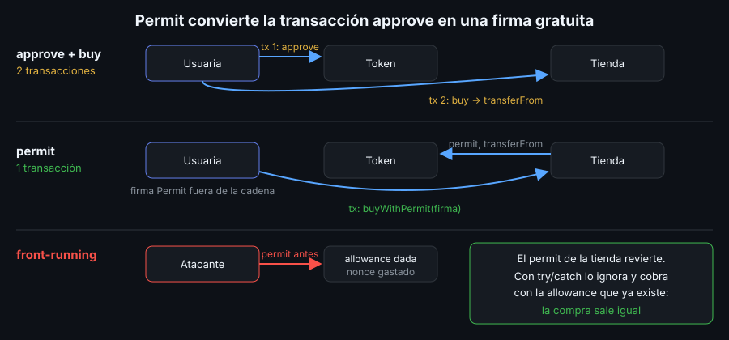

# Teoría 04 — Permit (ERC-2612)

## 🎯 Objetivos

- Explicar qué problema de `approve` resuelve `permit`.
- Añadir `permit` a un token con `ERC20Permit` y leer cómo verifica la firma.
- Usar un permit desde el contrato que gasta, en una sola transacción.
- Defenderse del front-running de permits y reconocer el phishing con firmas de permit.

---

## 1. Qué problema resuelve

En la semana 11, gastar tokens en un contrato exige dos transacciones: `approve` en el token
y después la llamada al contrato, que usa `transferFrom`. Dos pagos de gas, dos esperas, y
una allowance que a menudo queda abierta para siempre.

**ERC-2612** añade al token una función `permit`: el dueño de los tokens firma la
autorización fuera de la cadena (gratis, con EIP-712), y cualquiera la lleva al token. El
token comprueba la firma y hace el `approve` por él. Así el contrato que gasta puede recibir
la firma, llamar a `permit` y a `transferFrom` **en la misma transacción**.



## 2. Cómo funciona

`permit` es EIP-712 (teoría 03) con un struct fijo:

```
Permit(address owner,address spender,uint256 value,uint256 nonce,uint256 deadline)
```

El dominio es el del token: su nombre, versión `"1"`, la red y la dirección del token. El
estándar añade tres funciones al ERC-20:

| Función | Qué hace |
| ------- | -------- |
| `permit(owner, spender, value, deadline, v, r, s)` | Comprueba plazo y firma, gasta el nonce de `owner` y fija `allowance(owner, spender) = value` |
| `nonces(owner)` | El nonce que tiene que llevar el próximo permit de `owner` |
| `DOMAIN_SEPARATOR()` | El domain separator del token, para montar el digest fuera |

La firma llega partida en `v`, `r` y `s`, no en 65 bytes: así lo fija el estándar.

## 3. Cómo se escribe

### En el token

`ERC20Permit` de OpenZeppelin lo trae todo. Su constructor recibe el `name` del dominio, que
debe ser el mismo que el nombre del token:

```solidity
import {ERC20} from "@openzeppelin/contracts/token/ERC20/ERC20.sol";
import {ERC20Permit} from "@openzeppelin/contracts/token/ERC20/extensions/ERC20Permit.sol";

contract PointsToken is ERC20, ERC20Permit {
    constructor(uint256 supply) ERC20("Club Points", "CPT") ERC20Permit("Club Points") {
        _mint(msg.sender, supply);
    }
}
```

Su `permit`, en `/opt/lib/openzeppelin-contracts/contracts/token/ERC20/extensions/ERC20Permit.sol`
dentro del contenedor, es lo que ya sabes escribir:

```solidity
        if (block.timestamp > deadline) {
            revert ERC2612ExpiredSignature(deadline);
        }

        bytes32 structHash = keccak256(abi.encode(PERMIT_TYPEHASH, owner, spender, value, _useNonce(owner), deadline));

        bytes32 hash = _hashTypedDataV4(structHash);

        address signer = ECDSA.recover(hash, v, r, s);
        if (signer != owner) {
            revert ERC2612InvalidSigner(signer, owner);
        }

        _approve(owner, spender, value);
```

Plazo, struct hash con el nonce, digest, firmante y, al final, el `approve`. El typehash es
el keccak256 del struct de arriba:

```bash
cast keccak "Permit(address owner,address spender,uint256 value,uint256 nonce,uint256 deadline)"
```

```
0x6e71edae12b1b97f4d1f60370fef10105fa2faae0126114a169c64845d6126c9
```

### En el contrato que gasta

```solidity
function buyWithPermit(uint256 deadline, uint8 v, bytes32 r, bytes32 s) external {
    try TOKEN.permit(msg.sender, address(this), PRICE, deadline, v, r, s) {} catch {}
    _buy(msg.sender); // safeTransferFrom(msg.sender, address(this), PRICE)
}
```

`owner` es `msg.sender`: solo quien firmó puede gastar su permit en esta función. El
`try ... {} catch {}` no es descuido: es la defensa del apartado 4.

## 4. Front-running: por qué el `try`

La firma viaja en la transacción de la usuaria, que espera en el **mempool** (la cola pública
de transacciones pendientes, semana 02). Cualquiera puede leerla y enviar antes, con más gas,
una llamada directa a `token.permit(...)` con esos `v`, `r` y `s`. Eso se llama
**front-running**: adelantarse a una transacción ajena que ya viste.

El atacante no gana nada: la allowance que da es justo la que la usuaria quería dar. Pero el
nonce queda gastado, y cuando llega la transacción de la usuaria, su `permit` revierte con
`ERC2612InvalidSigner` (el nonce es otro, el hash es otro). Sin el `try`, su compra entera
revierte: un ataque de **griefing**, que no roba pero rompe la operación.

Con el `try`, el fallo del permit se ignora y `transferFrom` usa la allowance que ya existe.
¿Regala algo ignorar el error? No: si el permit era falso o había caducado, no hay
allowance, y `transferFrom` revierte con `ERC20InsufficientAllowance`. El ejercicio 03 lo
comprueba con un test para cada caso.

## 5. Antipatrones y riesgos

- ❌ **Llamar a `permit` sin `try`.** Cualquiera bloquea tus operaciones enviando antes la
  firma. Es la recomendación de la propia documentación de OpenZeppelin.
- ❌ **Usar un `owner` que no sea `msg.sender`** en una función que gasta la allowance
  existente (`buyFor(owner, ...)`). Con el `try`, un permit falso se ignora y el contrato
  gasta la allowance que `owner` dio para otra cosa. Si el beneficiario no es quien firma,
  verifica la firma de la orden completa (EIP-712 propio, como `registerBySig`).
- ❌ **Phishing con firmas de permit.** Firmar un `Permit` no cuesta gas ni deja rastro en la
  cadena: una web falsa pide "firma para entrar" y es un permit por todo tu saldo, con
  `deadline` infinito. El atacante lo envía cuando quiere. Es uno de los robos más comunes:
  lee siempre `spender`, `value` y `deadline` antes de firmar.
- ❌ **Suponer que todo token tiene permit.** ERC-2612 es opcional, y algunos tokens antiguos
  tienen un `permit` con otros parámetros. Si llamas a `permit` en un token que no lo tiene,
  revierte (y con el `try` se ignora, así que hace falta un `approve` antes).
- ❌ **Permits sin plazo real.** `deadline = type(uint256).max` hace la firma eterna. Un plazo
  corto (minutos u horas) limita el daño si la firma se filtra.

## 6. Trucos

- `nonces(owner)` antes de firmar: el permit lleva ese nonce, y cada uno vale una vez.
- La firma de 65 bytes de `cast wallet sign` se parte así:
  `r=0x${SIG:2:64}`, `s=0x${SIG:66:64}` y `v=$((16#${SIG:130:2}))` (27 o 28, en decimal).
- Revisa los permits que firmaste: una allowance puesta por permit se ve igual que la de
  `approve` (`allowance(owner, spender)`), y se revoca igual, con `approve(spender, 0)`.

## ✅ Checklist

- [ ] Explico qué ahorra `permit` frente a `approve` + `transferFrom`.
- [ ] Añado `ERC20Permit` a un token y sé qué nombre lleva su dominio.
- [ ] Uso un permit desde el contrato que gasta, con `msg.sender` como `owner`.
- [ ] Explico el front-running de permits y por qué el `try` no regala nada.
- [ ] Reconozco una petición de firma de permit sospechosa.

---

| Anterior | Actual | Siguiente |
| -------- | ------ | --------- |
| [← Teoría 03 — EIP-712, datos tipados](03-eip712-datos-tipados.md) | **Teoría 04 — Permit (ERC-2612)** | [Ejercicio 01 — Cupones firmados →](../2-practicas/ejercicio-01-cupones-firmados/README.md) |
