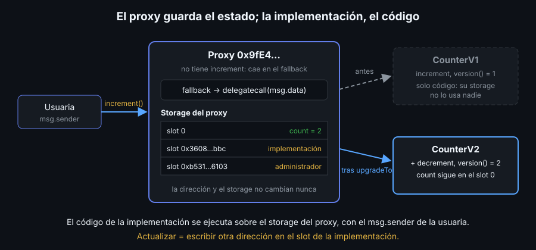

# Teoría 01 — Proxies y delegatecall

## 🎯 Objetivos

- Explicar por qué el código de un contrato desplegado no se puede cambiar y qué opciones hay.
- Recordar qué cambia `delegatecall` respecto a `call`: el storage y el `msg.sender`.
- Explicar cómo un **proxy** separa el estado (en el proxy) del código (en la implementación).
- Reconocer lo que cuesta un contrato actualizable: confianza, gas y riesgos nuevos.

---

## 1. Qué problema resuelve

El código de un contrato se fija al desplegarlo (semana 02): no hay instrucción de la EVM que
lo cambie. Es una garantía para quien lo usa, porque las reglas no cambian a sus espaldas. Pero
también un problema: si el registro de tu protocolo tiene un fallo, o necesitas una función
nueva, ese código ya no se puede tocar.

Sin proxies hay una sola salida: desplegar otro contrato y **migrar**. Pedir a cada usuario
que use la dirección nueva, copiar el estado del viejo (si se puede leer entero) y avisar a
cada web, wallet y contrato que guardaba la dirección vieja. Los tokens y los certificados
emitidos por el viejo siguen apuntando al viejo.

Un **proxy** evita la migración. Es un contrato pequeño que no cambia nunca y que guarda todo
el estado. El código de verdad vive en otro contrato, la **implementación** (también se le
llama lógica). El proxy reenvía cada llamada a la implementación. Actualizar es decirle al
proxy que reenvíe a otra implementación: la dirección y el estado siguen siendo los mismos.



## 2. Repaso: `delegatecall`

En la [semana 10](../../week-10-llamadas_entre_contratos/1-teoria/03-delegatecall.md) viste
que `delegatecall` ejecuta el código de otro contrato **sobre el storage de quien llama**, y
que para ese código `address(this)`, `msg.sender` y `msg.value` son los de la llamada original:

| | `call` | `delegatecall` |
| - | ------ | -------------- |
| Código que se ejecuta | El del contrato llamado | El del contrato llamado |
| Storage que lee y escribe | El del contrato llamado | El de quien llama |
| `msg.sender` dentro | Quien hizo el `call` | El `msg.sender` de quien llama |
| `address(this)` dentro | El contrato llamado | Quien llama |

Y viste el riesgo: el código de destino no conoce nombres de variables, escribe en slots. Si
quien llama tiene otras variables en esos slots, el código las pisa. Un proxy vive de
`delegatecall`, así que ese riesgo pasa a ser el centro de la semana (teoría 02).

## 3. Cómo funciona un proxy

Un proxy junta tres piezas:

- **El `fallback`.** Cuando llamas a una función que un contrato no tiene, la llamada llega a
  su `fallback` (semana 07). El proxy no tiene `increment` ni `register`: todo cae en el
  `fallback`.
- **El `delegatecall`.** El `fallback` reenvía los mismos datos (`msg.data`) a la
  implementación con `delegatecall`, y devuelve lo que devuelva ella, o revierte con su error.
- **La dirección de la implementación**, guardada en el storage del proxy. Cambiarla es
  actualizar.

En el ejercicio 01 lo escribes así:

```solidity
fallback(bytes calldata) external returns (bytes memory) {
    return Address.functionDelegateCall(_implementation(), msg.data);
}
```

`Address.functionDelegateCall` es de OpenZeppelin: hace el `delegatecall` y, si la
implementación revierte, revierte con el mismo error. Los proxies de OpenZeppelin hacen lo
mismo en `assembly`, para ahorrar gas y copiar los datos sin pasar por `bytes memory`.

Lo que ve cada parte en una llamada `proxy.increment()` de `alice`:

| | Valor |
| - | ----- |
| Destino de la transacción | El proxy |
| Código que se ejecuta | El de la implementación |
| Storage que cambia | El del proxy |
| `msg.sender` para la implementación | `alice` |
| Dirección de los eventos | El proxy |

Para tus usuarios, tu web y otros contratos, **el proxy es el contrato**. La implementación es
un detalle: tiene su propio storage, que nadie usa.

## 4. Qué cuesta

Un contrato actualizable no es gratis:

- **Confianza.** Quien puede actualizar puede cambiar todas las reglas: puede escribir una V2
  que se lleve los fondos. La promesa de "el código no cambia" pasa a ser "el código lo cambia
  quien tiene este rol". Por eso importa quién actualiza y con qué plazo (teoría 04).
- **Gas.** Cada llamada lee la dirección de la implementación del storage y hace un
  `delegatecall` más. Son unos miles de gas por llamada (teoría 04 lo mide).
- **Riesgos nuevos**: el orden del storage (teoría 02), el constructor que no se ejecuta en el
  proxy (teoría 03) y las funciones del proxy que tapan las de la implementación (teoría 04).

## 5. Antipatrones y riesgos

- ❌ **`delegatecall` a una dirección que elige otro.** Quien elige el código que se ejecuta
  sobre tu storage puede escribir cualquier slot: tu dueño, tus saldos. En un proxy, solo el
  administrador cambia la implementación.
- ❌ **Hacer actualizable lo que no lo necesita.** Un token sencillo y probado gana confianza
  siendo inmutable. Actualizable tiene sentido cuando esperas cambiar las reglas, y siempre con
  un proceso de actualización a la vista.
- ❌ **Guardar la implementación en el slot 0.** La implementación también escribe en el slot
  0, y lo pisa. El ejercicio 01 empieza viendo cómo se rompe (`NaiveProxy`).
- ❌ **Leer el estado en la implementación.** `implementation.count()` llamado directamente lee
  el storage de la implementación, que está vacío. El estado está en el proxy.

## 6. Trucos

- Llama siempre al proxy, con la interfaz de la implementación: en Solidity,
  `CounterV1(address(proxy))`; con `cast`, la dirección del proxy y la firma de la función.
- Un explorador de bloques reconoce un proxy por el slot de la implementación (teoría 02) y te
  deja usar las funciones de la implementación sobre la dirección del proxy.

## ✅ Checklist

- [ ] Explico por qué no se puede cambiar el código de un contrato desplegado.
- [ ] Explico qué storage cambia y qué `msg.sender` se ve con `call` y con `delegatecall`.
- [ ] Explico las tres piezas de un proxy: `fallback`, `delegatecall` y la implementación.
- [ ] Explico qué gana y qué pierde quien usa un contrato actualizable.

---

| Anterior | Actual | Siguiente |
| -------- | ------ | --------- |
| [← Semana 15 — Contratos actualizables](../README.md) | **Teoría 01 — Proxies y delegatecall** | [Teoría 02 — Storage layout →](02-storage-layout.md) |
