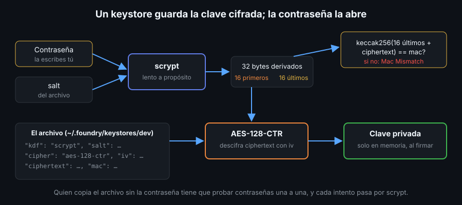

# Teoría 02 — Claves y keystores

## 🎯 Objetivos

- Explicar por qué una clave privada nunca va en un comando, en un `.env` ni en el repo.
- Explicar qué es un keystore cifrado y cómo lo abre una contraseña.
- Crear una cuenta nueva en un keystore con `cast wallet new` e importar una con
  `cast wallet import`.
- Firmar con `--account` en `forge script` y `cast send`.
- Tener tu keystore fuera del contenedor, para que sobreviva a `docker run --rm`.

---

## 1. Qué problema resuelve

Hasta ahora firmabas con `--private-key "$PK"`. En anvil da igual: la clave de la cuenta 3 es
pública (la imprime anvil al arrancar) y su ETH no vale nada. En una red pública, quien tenga
tu clave privada (semana 01) **es** tú: firma lo que quiera con tu cuenta, se lleva lo que
tenga y, si tu cuenta administra el registro, actualiza su código.

Y una clave en un comando se escapa por muchos sitios: el historial de la shell
(`~/.zsh_history`), la lista de procesos de la máquina, los logs de un servidor de CI, un `.env`
que acaba en un commit. Un repositorio público con una clave lo encuentran bots en minutos.

Mira lo que pasa con una clave pública en una red pública. La cuenta 3 de anvil, en Sepolia, el
23 de noviembre de 2026:

```bash
cast nonce 0x90F79bf6EB2c4f870365E785982E1f101E93b906 --rpc-url https://ethereum-sepolia-rpc.publicnode.com
cast balance 0x90F79bf6EB2c4f870365E785982E1f101E93b906 --ether --rpc-url https://ethereum-sepolia-rpc.publicnode.com
```

```
31249
0.000000013878614793
```

Más de 31.000 transacciones de gente que usó esa clave, y el saldo vacío: lo que alguien envía
a esa cuenta, otro lo saca enseguida. Las cuentas de anvil, solo en anvil.

## 2. Cómo funciona

Un **keystore** es un archivo JSON con tu clave privada **cifrada** con una contraseña. Es un
formato estándar de Ethereum (Web3 Secret Storage, versión 3): lo entienden `cast`, `geth` y
muchas wallets. Foundry los guarda en `~/.foundry/keystores/`, un archivo por cuenta, con el
nombre que le des.

```json
{
  "crypto": {
    "cipher": "aes-128-ctr",
    "cipherparams": { "iv": "3c5aa00ac722bd36181c4bbbc5d25ea0" },
    "ciphertext": "c1f533b8af3aa6c821f3385215c8f150d90ed47fb1ab2e356622f27fafa4bb31",
    "kdf": "scrypt",
    "kdfparams": { "dklen": 32, "n": 8192, "p": 1, "r": 8, "salt": "1c5c3b83ad82…" },
    "mac": "86df31f5dbacc3bca84e5b2e817c78a9b6eb8ea0c47a4611e70d6594a64fc68c"
  },
  "id": "362098c6-03a4-4858-ba16-9f0ed43fbcec",
  "version": 3
}
```

- **`kdf`** (*key derivation function*): `scrypt` convierte tu contraseña, con una sal
  aleatoria (`salt`), en 32 bytes. Es lento y gasta memoria a propósito (`n`, `r` y `p` dicen
  cuánto): probar millones de contraseñas cuesta millones de veces eso.
- **`cipher`**: los 16 primeros bytes son la clave de AES-128-CTR, que descifra `ciphertext` y
  da la clave privada.
- **`mac`**: comprobación de que la contraseña es la buena. Si `keccak256` de los 16 últimos
  bytes y el `ciphertext` no da `mac`, la contraseña es otra y no se descifra nada.



El archivo solo no sirve: hace falta la contraseña. La contraseña sola tampoco: hace falta el
archivo. Y la clave privada descifrada solo existe en memoria mientras `cast` o `forge` firman.

## 3. Cómo se escribe

### El keystore fuera del contenedor

El contenedor se borra al salir (`--rm`), y con él su `~/.foundry/keystores`. Crea la carpeta en
tu máquina y móntala en la ruta del contenedor (el usuario del contenedor es `ubuntu`):

**Dónde**: en tu terminal, fuera del contenedor.

```bash
mkdir -p ~/.foundry/keystores
docker run --rm -it -v "$PWD":/workspace \
  -v "$HOME/.foundry/keystores":/home/ubuntu/.foundry/keystores bc-smartcontracts-dev
```

El `mkdir` va antes: si la carpeta no existe, Docker la crea como `root` y el contenedor no
puede escribir en ella.

### Una cuenta nueva para Sepolia

**Dónde**: dentro del contenedor.

```bash
cast wallet new ~/.foundry/keystores sepolia-dev
```

`cast` te pide la contraseña dos veces (no se ve al escribir), genera una clave privada al azar
y la guarda cifrada. Solo imprime la dirección:

```
Created new encrypted keystore file: /home/ubuntu/.foundry/keystores/sepolia-dev
Address:    0x6cb79b3100b0A87BDE8D183104E84A315D455C08
```

La tuya será otra. Esta cuenta solo existe para testnets: nunca recibe ETH real.

### Importar una clave que ya tienes

`cast wallet import` cifra una clave existente. Con `--interactive` te la pide sin que pase por
el historial. Para el ejercicio 02, con la clave pública de la cuenta 3 de anvil, vale pasarla
en la línea, y la contraseña también:

```bash
cast wallet import dev --private-key "$PK" --unsafe-password "solo-pruebas"
cast wallet list
```

```
`dev` keystore was saved successfully. Address: 0x90f79bf6eb2c4f870365e785982e1f101e93b906
dev (Local)
sepolia-dev (Local)
```

`--unsafe-password` deja la contraseña en el historial: el nombre lo avisa. Solo para claves
de prueba.

### Firmar con el keystore

En cualquier comando que firma, `--account <nombre>` sustituye a `--private-key`:

```bash
cast wallet address --account dev
forge script script/DeployBox.s.sol --rpc-url http://127.0.0.1:8545 --account dev --broadcast
cast send <dirección> "store(uint256)" 9 --account dev
```

Cada uno pide la contraseña. Para un script automático (los `test.sh` de los ejercicios),
`--password-file <archivo>` la lee de un archivo. Con otra contraseña:

```
Error: Failed to decrypt keystore "/home/ubuntu/.foundry/keystores/dev"

Context:
- Mac Mismatch
```

`forge script` saca la dirección del keystore: no hace falta `--sender`. Y el script no cambia:
`vm.startBroadcast()` firma con la cuenta que reciba `forge script`, sea anvil o Sepolia.

## 4. Antipatrones y riesgos

- ❌ **`PRIVATE_KEY` en un `.env` y `vm.envUint("PRIVATE_KEY")` en el script.** Lo verás en
  muchos tutoriales: `vm.startBroadcast(vm.envUint("PRIVATE_KEY"))`. La clave queda en claro en
  un archivo a un `git add .` de distancia. Usa `--account` y `vm.startBroadcast()` sin
  argumentos.
- ❌ **Claves de anvil en una red pública.** Como viste arriba, su saldo dura segundos.
- ❌ **La misma cuenta para testnet y mainnet.** Una clave de pruebas se trata con menos
  cuidado. Si un día despliegas en mainnet, cuenta nueva, y mejor en una wallet de hardware
  (`--ledger`).
- ❌ **Una contraseña débil o en un archivo dentro del repo.** El keystore cifrado solo
  protege lo que protege su contraseña. La raíz del bootcamp ignora `keystore/` y `.env`; tu
  repositorio también debe hacerlo.
- ❌ **`cast wallet decrypt-keystore` "para ver la clave".** Imprime la clave privada en claro
  en tu terminal. No lo necesitas para nada de este bootcamp.
- ❌ **El administrador del protocolo en una cuenta suelta.** En Sepolia, tu cuenta es la
  administradora del registro. En mainnet, el administrador sería el timelock de la semana 13
  o un multisig, nunca una sola clave.

## 5. Trucos

- `cast wallet list` muestra los keystores de `~/.foundry/keystores`.
- `cast wallet change-password` cambia la contraseña sin tocar la clave.
- `cast wallet remove --name dev` borra un keystore. Sin copia, la cuenta se pierde.
- Haz una copia del archivo del keystore fuera de tu máquina (no en el repo): sin él, la
  contraseña no sirve de nada.

## ✅ Checklist

- [ ] Explico por qué `--private-key` y `PRIVATE_KEY` en un `.env` no se usan fuera de anvil.
- [ ] Explico qué guarda un keystore y para qué sirven `kdf`, `cipher` y `mac`.
- [ ] Tengo una cuenta `sepolia-dev` en un keystore montado fuera del contenedor.
- [ ] Firmo con `--account` en `forge script` y en `cast send`.

---

| Anterior | Actual | Siguiente |
| -------- | ------ | --------- |
| [← Teoría 01 — forge script](01-forge-script.md) | **Teoría 02 — Claves y keystores** | [Teoría 03 — Testnets y Sepolia →](03-testnets-y-sepolia.md) |
