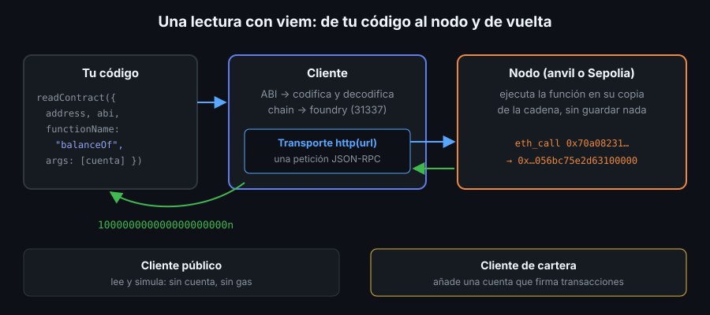

# Teoría 02 — Leer con viem

## 🎯 Objetivos

- Crear un cliente público con su transporte y su red.
- Leer bloques, saldos, código y funciones `view` con `readContract`.
- Dar a viem la ABI en formato legible o generada desde forge, y saber qué tipos devuelve.
- Pasar entre unidades con `formatUnits`/`parseUnits`, y leer el estado de un bloque pasado.

## 1. Qué problema resuelve

Lo primero que hace una página es mostrar: cuántas plazas quedan, cuántos tokens tienes, qué
recursos registraste. Todo eso es **leer**. Leer no cambia el estado, así que no necesita
cuenta ni firma ni gas: es una pregunta al nodo, que la responde con su copia de la cadena. Es
lo que hacía `cast call`.

## 2. Cómo funciona



viem separa tres cosas:

- **Transporte**: cómo llegan las peticiones al nodo. `http(url)` manda cada petición JSON-RPC
  por HTTP. Hay otros, como `webSocket(url)`.
- **Red** (*chain*): un objeto con el `id` de la red (31337 en anvil, 11155111 en Sepolia), su
  nombre y su moneda. viem trae las conocidas en `viem/chains`: `foundry` es anvil y `sepolia`
  es Sepolia.
- **Cliente**: el objeto con las acciones. Un **cliente público** (`createPublicClient`) solo
  lee y simula. El **cliente de cartera** (teoría 03) firma.

Para llamar a una función de un contrato, el cliente necesita la **ABI** (semana 10): la lista
de funciones, eventos y errores con sus tipos. Con ella codifica la llamada (`0x70a08231…` para
`balanceOf`), la manda en un `eth_call` y decodifica los bytes de vuelta.

## 3. Cómo se escribe

Los ejemplos se ejecutan en el contenedor, en el starter del ejercicio 01, con su Token
desplegado en tu anvil:

```bash
anvil --silent &
forge script --root contrato contrato/script/DeployToken.s.sol --rpc-url http://127.0.0.1:8545 \
  --broadcast --slow --private-key 0xac0974bec39a17e36ba4a6b4d238ff944bacb478cbed5efcae784d7bf4f2ff80
```

El Token queda en `0x5FbDB2315678afecb367f032d93F642f64180aa3`, la primera dirección que crea
la cuenta 0 de anvil. Tiene 1000 BCT: 100 van a la cuenta 1 y 50 a la cuenta 2, en tres bloques.

### La ABI en formato legible

`src/abi.ts` del starter describe el Token con firmas de Solidity escritas como texto:

```ts
import { parseAbi } from "viem";

export const tokenAbi = parseAbi([
  "function decimals() view returns (uint8)",
  "function balanceOf(address account) view returns (uint256)",
  "event Transfer(address indexed from, address indexed to, uint256 value)",
  "error ERC20InsufficientBalance(address sender, uint256 balance, uint256 needed)",
  // …
]);
```

`parseAbi` convierte cada línea en la entrada JSON de la ABI, y TypeScript entiende el texto:
sabe que `balanceOf` existe, que pide un `address` y que devuelve un `uint256`.

### Leer

Crea `leer.ts` junto a `src/`:

```ts
import { createPublicClient, formatUnits, http } from "viem";
import { foundry } from "viem/chains";
import { tokenAbi } from "./src/abi.ts";

const client = createPublicClient({ chain: foundry, transport: http("http://127.0.0.1:8545") });
const token = "0x5FbDB2315678afecb367f032d93F642f64180aa3";
const account = "0x70997970C51812dc3A010C7d01b50e0d17dc79C8";

console.log(await client.getBlockNumber());
console.log(await client.getBalance({ address: account }));
const raw = await client.readContract({ address: token, abi: tokenAbi, functionName: "balanceOf", args: [account] });
const decimals = await client.readContract({ address: token, abi: tokenAbi, functionName: "decimals" });
console.log(raw, formatUnits(raw, decimals));
console.log(decimals, typeof decimals);
```

`node leer.ts`:

```
3n
10000000000000000000000n
100000000000000000000n 100
18 number
```

- `getBlockNumber` es `eth_blockNumber`. Hay tres bloques: el despliegue y las dos
  transferencias.
- `getBalance` devuelve **wei** (semana 02): 10000 ETH son 10²² wei.
- `readContract` devuelve el tipo de la ABI. `uint256` llega como `bigint` y `uint8` como
  `number`: viem usa `number` para los enteros de hasta 48 bits, que caben sin perder nada.

Prueba a escribir `functionName: "balanceof"` o quitar `args`: `tsc` lo marca en rojo antes de
ejecutar nada.

### Unidades

Un ERC-20 guarda enteros. Los decimales (semana 11) solo dicen dónde poner la coma al mostrar.

```ts
import { formatEther, formatUnits, parseEther, parseUnits } from "viem";

formatUnits(100000000000000000000n, 18); // "100"
formatEther(10000000000000000000000n);   // "10000"
parseEther("0.01");                       // 10000000000000000n
parseUnits("1.5", 6);                     // 1500000n
```

`format*` pasa de entero a texto, para mostrar. `parse*` pasa de texto a entero, para enviar.
Nunca con `Number()`: `BigInt(Number("1.1") * 1e18)` da `1100000000000000128n`, 128 wei de
más, porque 1,1 no tiene representación exacta en un `number`.

### Varias lecturas a la vez

Cada `await` espera una ida y vuelta al nodo. Las lecturas que no dependen entre sí van juntas:

```ts
const [name, symbol] = await Promise.all([
  client.readContract({ address: token, abi: tokenAbi, functionName: "name" }),
  client.readContract({ address: token, abi: tokenAbi, functionName: "symbol" }),
]);
```

### Una dirección sin código

`getCode` devuelve el código de una dirección, o `undefined` si es una cuenta normal. Si llamas
a `decimals` en la cuenta 1, que no tiene código:

```
ContractFunctionExecutionError
The contract function "decimals" returned no data ("0x").
```

El nodo no da error: llamar a una cuenta sin código "funciona" y devuelve cero bytes. Es viem
quien no puede decodificar un `uint8` de la nada. Ese mensaje casi siempre significa dirección
equivocada o red equivocada.

### El pasado

Las lecturas aceptan `blockNumber`: el nodo responde con el estado al final de ese bloque.

```ts
await client.readContract({ address: token, abi: tokenAbi, functionName: "balanceOf", args: [account], blockNumber: 1n });
// 0n: en el bloque 1 la cuenta 1 aún no había recibido nada
```

anvil guarda todos los bloques. Un nodo normal de una red pública solo guarda el estado de los
últimos bloques; para consultas antiguas hace falta un **nodo de archivo** (*archive node*).

### La ABI generada desde forge

Escribir la ABI a mano vale para un Token. Para tu registro, con decenas de funciones y errores
heredados de OpenZeppelin, la sacas del compilador:

```bash
forge inspect --root ../contracts RegistryV2 abi --json
```

El proyecto la guarda en `src/registry-abi.ts` como `export const registryAbi = [ … ] as const;`.
Sin `as const`, TypeScript vería una lista de objetos cualquiera y viem no sabría qué devuelve
cada función. Por eso no sirve importar el `.json` directamente.

## 4. Antipatrones y riesgos

- **Confiar en la dirección.** Una dirección de un enlace, de una variable de entorno o
  copiada de un chat puede ser la de otro contrato con la misma ABI. Compruébala contra tu
  `run-latest.json` y contra el explorador, con el código verificado.
- **Mezclar redes.** Una dirección de Sepolia en un cliente de anvil da el `returned no data`
  de arriba. Si existe un contrato en esa dirección en la otra red, es peor: responde con otros
  datos.
- **Lo que lee la página no es una garantía.** Una lectura es lo que dice el nodo al que
  preguntas. Un RPC malicioso o caído puede mentir o fallar. Lo que importa de verdad lo
  comprueba el contrato al escribir, no la página al leer.
- **Redondear con `number`.** `formatUnits` devuelve texto exacto; conviértelo a `number` solo
  para dibujar, nunca para calcular lo que vas a enviar.

## 5. Trucos

- `getChainId()` pregunta al nodo su red: compárala con la de tu `chain` al arrancar.
- `isAddress(texto)` comprueba que un texto es una dirección antes de usarla.
- Un mismo cliente sirve para todo el programa: créalo una vez.

## ✅ Checklist

- [ ] Creo un cliente público con `chain` y `transport` y leo bloque, saldo y código.
- [ ] Llamo a una función `view` con `readContract` y sé qué tipo devuelve cada tipo de Solidity.
- [ ] Uso `formatUnits` para mostrar y `parseUnits` para enviar.
- [ ] Reconozco `returned no data ("0x")` y sus dos causas.
- [ ] Genero la ABI con `forge inspect` y sé por qué lleva `as const`.

---

| Anterior | Actual | Siguiente |
| -------- | ------ | --------- |
| [← Teoría 01 — De cast a TypeScript](01-de-cast-a-typescript.md) | **Teoría 02 — Leer con viem** | [Teoría 03 — Escribir con viem →](03-escribir-con-viem.md) |
