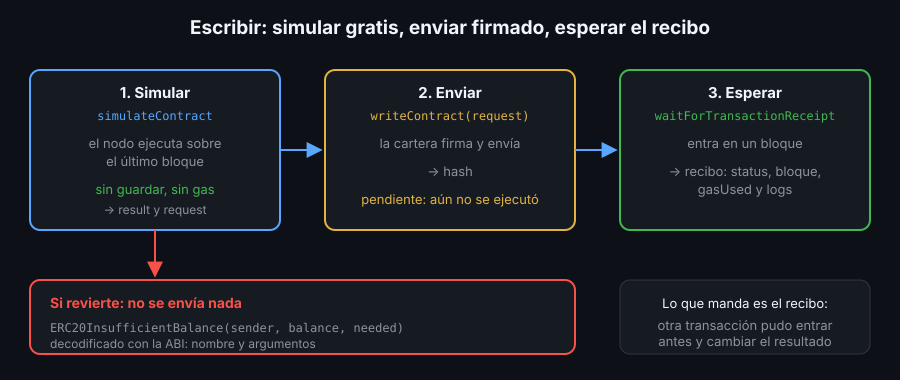

# Teoría 03 — Escribir con viem

## 🎯 Objetivos

- Crear un cliente de cartera con una cuenta local o con una cuenta del nodo.
- Escribir con el flujo simular → enviar → esperar el recibo, y leer el recibo.
- Sacar el error de Solidity de una llamada que revierte.
- Reconocer por qué una clave nunca va en el código de una página.

## 1. Qué problema resuelve

Leer no cambia nada. Para dar de alta un recurso o transferir tokens hace falta una
**transacción** (semana 02): un mensaje firmado por una cuenta, que paga gas y que el nodo mete
en un bloque. Es lo que hacía `cast send`. En viem, la firma es cosa del **cliente de cartera**
(*wallet client*), y el resto (simular, esperar, decodificar) del cliente público.

## 2. Cómo funciona



1. **Simular** (`simulateContract`): el nodo ejecuta la llamada como si fuera una transacción,
   sobre el último bloque, y no guarda nada. Devuelve lo que devolvería la función y una
   petición (`request`) lista para enviar. Si la llamada revierte, falla aquí, gratis.
2. **Enviar** (`writeContract`): la cartera firma y manda la transacción. Devuelve su **hash**
   en cuanto el nodo la acepta. La transacción aún no se ha ejecutado: está **pendiente**.
3. **Esperar** (`waitForTransactionReceipt`): pregunta al nodo hasta que la transacción entra en
   un bloque y devuelve su **recibo**: estado, bloque, gas usado y eventos.

Quién firma depende de la **cuenta** del cliente de cartera:

| Cuenta | Cómo se crea | Quién firma |
| ------ | ------------ | ----------- |
| Local | `privateKeyToAccount(clave)` | Tu programa, con la clave en memoria |
| JSON-RPC | Solo la dirección: `account: "0x7099…"` | El nodo (`eth_sendTransaction`) |

anvil tiene **desbloqueadas** sus diez cuentas de prueba: firma por ellas si se lo pides, como
con `cast send --unlocked`. Un nodo de una red pública no firma por nadie. En la semana 18,
la cuenta JSON-RPC será la **wallet** del navegador (MetaMask y similares): la página pide la
firma y es la persona quien acepta.

## 3. Cómo se escribe

Los ejemplos usan el Token de la teoría 02, en tu anvil, con la cuenta 2 (50 BCT). Su clave es
pública y solo vale en anvil.

### El cliente de cartera

```ts
import { createWalletClient, http } from "viem";
import { privateKeyToAccount } from "viem/accounts";
import { foundry } from "viem/chains";

const account = privateKeyToAccount("0x5de4111afa1a4b94908f83103eb1f1706367c2e68ca870fc3fb9a804cdab365a");
const wallet = createWalletClient({ account, chain: foundry, transport: http("http://127.0.0.1:8545") });
```

`privateKeyToAccount` calcula la dirección a partir de la clave (semana 01) sin preguntar a
nadie: `account.address` es `0x3C44CdDdB6a900fa2b585dd299e03d12FA4293BC`.

### Simular, enviar y esperar

Crea `escribir.ts` junto a `src/`, con el `client` de la teoría 02 y la cartera de arriba:

```ts
const to = "0x9965507D1a55bcC2695C58ba16FB37d819B0A4dc";
const { request, result } = await client.simulateContract({
  account,
  address: token,
  abi: tokenAbi,
  functionName: "transfer",
  args: [to, parseEther("5")],
});
console.log("result", result);
const hash = await wallet.writeContract(request);
console.log("hash", hash);
const receipt = await client.waitForTransactionReceipt({ hash });
console.log(receipt.status, receipt.blockNumber, receipt.gasUsed, receipt.logs.length);
```

`node escribir.ts`:

```
result true
hash 0xdc684373f8a2a7bc4af9f1df78751e4859b0e219902ec4ea367c3c3e19160abe
success 4n 52177n 1
```

- `result` es el `bool` que devuelve `transfer`, calculado en la simulación. Una transacción
  enviada no devuelve valores a quien la envía: si necesitas uno, sale de la simulación o de un
  evento.
- El hash depende de la clave, del nonce y de los argumentos: el tuyo será igual solo con un
  anvil recién arrancado y los mismos pasos.
- El recibo dice `success` (o `reverted`), en qué bloque entró, cuánto gas gastó y que emitió
  un evento, el `Transfer`.

`writeContract(request)` envía lo que se simuló: misma cuenta, mismo contrato, misma función y
mismos argumentos.

### Por qué revierte

Si la cuenta 2 intenta transferir 1000 BCT, `simulateContract` lanza un error:

```
The contract function "transfer" reverted.

Error: ERC20InsufficientBalance(address sender, uint256 balance, uint256 needed)
                               (0x3C44CdDdB6a900fa2b585dd299e03d12FA4293BC, 45000000000000000000, 1000000000000000000000)
```

viem decodificó el **custom error** (semana 05) con la ABI: nombre y argumentos. Por eso
`tokenAbi` trae la línea `error ERC20InsufficientBalance(…)`: sin ella, viem solo vería los
bytes del revert. Para usarlo en el código, recorre la cadena de errores con `walk`:

```ts
import { BaseError, ContractFunctionRevertedError } from "viem";

try {
  await client.simulateContract({ /* … */ });
} catch (err) {
  if (err instanceof BaseError) {
    const revert = err.walk((e) => e instanceof ContractFunctionRevertedError);
    if (revert instanceof ContractFunctionRevertedError) {
      console.log(revert.data?.errorName); // "ERC20InsufficientBalance"
      console.log(revert.data?.args);      // [sender, balance, needed]
    }
  }
}
```

`err.walk` hace falta porque viem envuelve el error: `ContractFunctionExecutionError` lleva
dentro el `ContractFunctionRevertedError`, que es el que tiene `data`.

### Firma el nodo

Con una cuenta JSON-RPC no hay clave en tu programa:

```ts
const nodeWallet = createWalletClient({
  account: "0xf39Fd6e51aad88F6F4ce6aB8827279cffFb92266",
  chain: foundry,
  transport: http("http://127.0.0.1:8545"),
});
```

`nodeWallet.account.type` es `"json-rpc"` (la local es `"local"`). El resto del flujo es el
mismo: simular, `writeContract` y esperar. La página del proyecto firma así en anvil.

## 4. Antipatrones y riesgos

- **Una clave en el código de la página.** Todo lo que llega al navegador lo puede leer
  cualquiera que abra la página: el código, las variables `VITE_` (teoría 05) y lo que haya en
  `dist/`. Una clave ahí es una clave publicada. En la página, la cuenta es la del nodo (en
  anvil) o la wallet de quien la usa (semana 18), nunca una clave.
- **Enviar sin simular.** La transacción entra en un bloque aunque revierta, y paga el gas
  gastado hasta el revert. Simular primero da el error gratis y con nombre.
- **Simular no es una garantía.** La simulación usa el último bloque. Si otra transacción entra
  antes que la tuya (otro alta llena el registro), la tuya puede revertir igual. Lo que
  manda es el recibo.
- **No esperar el recibo.** Tener el hash no significa que se ejecutó. Mostrar "hecho" con el
  hash engaña cuando la transacción revierte o se queda pendiente.
- **Comprobaciones solo en la página.** Desactivar un botón no impide llamar al contrato desde
  `cast`. Las reglas viven en el contrato. La página solo las explica.

## 5. Trucos

- `receipt.status === "reverted"` también existe: compruébalo siempre antes de dar por buena
  una escritura enviada sin simular.
- `simulateContract` acepta `value` para funciones `payable`: el registro cobra su tasa así.
- `client.getTransactionCount({ address })` es el nonce: debe subir en uno por transacción
  enviada, y no subir con una simulación.

## ✅ Checklist

- [ ] Creo un cliente de cartera con una cuenta local y con una cuenta del nodo, y sé quién
      firma en cada caso.
- [ ] Escribo con `simulateContract` → `writeContract` → `waitForTransactionReceipt`.
- [ ] Saco nombre y argumentos del error de un revert con `walk`.
- [ ] Explico por qué un `result` sale de la simulación y no de la transacción.
- [ ] Sé por qué una clave nunca va en el código de una página.

---

| Anterior | Actual | Siguiente |
| -------- | ------ | --------- |
| [← Teoría 02 — Leer con viem](02-leer-con-viem.md) | **Teoría 03 — Escribir con viem** | [Teoría 04 — Eventos y logs →](04-eventos-y-logs.md) |
