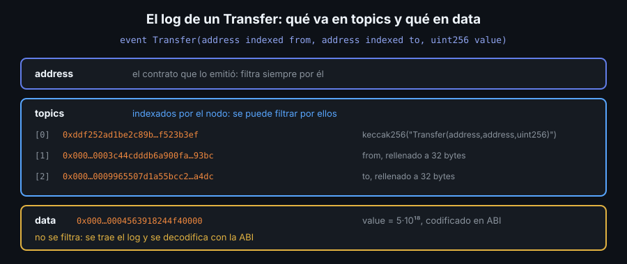

# Teoría 04 — Eventos y logs

## 🎯 Objetivos

- Explicar cómo guarda un recibo un evento: dirección, `topics` y `data`.
- Leer el historial de un evento y filtrarlo por un campo `indexed`.
- Sacar los eventos de un recibo con `parseEventLogs`.
- Escuchar eventos nuevos y dejar de escuchar.
- Reconocer los límites de rango de un RPC público y qué eventos no son de fiar.

## 1. Qué problema resuelve

La página muestra el estado actual con lecturas. Pero "quién dio de alta qué y cuándo" no está
en el storage del registro, o está repartido en mil `mapping`. Para eso emite el contrato
**eventos** (semana 07): `ItemRegistered`, `ItemRetired`, `Transfer`. Los eventos van en los
recibos de las transacciones, no en el storage: un contrato no puede leerlos, pero una página
sí, y sin pagar gas.

## 2. Cómo funciona

Cada evento emitido es un **log** dentro del recibo. Un log tiene tres partes:



- `address`: el contrato que lo emitió.
- `topics`: hasta cuatro palabras de 32 bytes. La primera es el **hash de la firma** del
  evento. Las siguientes son los campos `indexed`, uno por topic.
- `data`: los campos que no son `indexed`, codificados en ABI.

El nodo indexa `address` y `topics`: puede buscar "todos los logs de este contrato con este
topic 2" sin recorrer cada transacción. Por eso marcas como `indexed` los campos por los que
alguien va a filtrar (el `to` de un `Transfer`, el `registrant` de un alta). `data` no se puede
filtrar: hay que traer el log y decodificarlo.

## 3. Cómo se escribe

Los ejemplos siguen con el Token de las teorías 02 y 03, en tu anvil.

### Un log en crudo

El recibo del `transfer` de la teoría 03 tiene un log. Con
`console.log(receipt.logs[0].topics, receipt.logs[0].data)`:

```
[
  '0xddf252ad1be2c89b69c2b068fc378daa952ba7f163c4a11628f55a4df523b3ef',
  '0x0000000000000000000000003c44cdddb6a900fa2b585dd299e03d12fa4293bc',
  '0x0000000000000000000000009965507d1a55bcc2695c58ba16fb37d819b0a4dc'
]
0x0000000000000000000000000000000000000000000000004563918244f40000
```

El primer topic es `cast keccak "Transfer(address,address,uint256)"`, que da el mismo
`0xddf252ad…`. Los otros dos son `from` (la cuenta 2) y `to`, rellenados a 32 bytes. `data` es
`value`: `0x4563918244f40000` son 5·10¹⁸, los 5 BCT.

### El historial

`getContractEvents` pide al nodo los logs (`eth_getLogs`) y los decodifica con la ABI:

```ts
const logs = await client.getContractEvents({
  address: token,
  abi: tokenAbi,
  eventName: "Transfer",
  fromBlock: 0n,
});
for (const log of logs) console.log(log.blockNumber, log.args);
```

Cada log trae `args` con nombres (`from`, `to`, `value`), `eventName`, `blockNumber`,
`transactionHash` y `logIndex`, su posición en el bloque. Llegan en orden de bloque y, dentro de
un bloque, de `logIndex`. Sin `eventName`, `getContractEvents` trae todos los eventos de la ABI:
así lee el proyecto altas y bajas en una sola petición.

### Filtrar por un campo indexed

```ts
await client.getContractEvents({
  address: token,
  abi: tokenAbi,
  eventName: "Transfer",
  args: { to: "0x70997970C51812dc3A010C7d01b50e0d17dc79C8" },
  fromBlock: 0n,
});
```

viem convierte `args` en el topic 2 de la búsqueda, y el filtro lo hace el nodo. `args` solo
acepta campos `indexed`: `{ value: 5n }` es un error de tipos.

### Los eventos de un recibo

Después de escribir, el resultado suele estar en un evento: el id de un alta, por ejemplo. No
hace falta otra petición, porque el recibo ya trae los logs:

```ts
import { parseEventLogs } from "viem";

const [event] = parseEventLogs({ abi: registryAbi, eventName: "ItemRegistered", logs: receipt.logs });
event.args.id; // el id del recurso
```

Un recibo puede traer logs de varios contratos: el alta de tu registro emite también el
`Transfer` de los puntos y el del certificado. `parseEventLogs` se queda con los que encajan
con la ABI y el `eventName`.

### Escuchar

```ts
const unwatch = client.watchContractEvent({
  address: token,
  abi: tokenAbi,
  eventName: "Transfer",
  pollingInterval: 1000,
  onLogs: (logs) => logs.forEach((log) => console.log("nuevo", log.args)),
});
// …y cuando ya no interese:
unwatch();
```

Con transporte `http`, viem crea un filtro en el nodo (`eth_newFilter`) y le pregunta cada
`pollingInterval` milisegundos qué hay de nuevo. Solo avisa de lo que llega **después** de
empezar a escuchar: el pasado se lee con `getContractEvents`. Una página hace las dos cosas:
pinta el historial y luego escucha.

`unwatch` importa: mientras no se llama, el programa sigue preguntando. Un test que no lo llama
nunca termina.

## 4. Antipatrones y riesgos

- **`fromBlock: 0n` en una red pública.** Un RPC público limita cuántos bloques abarca una
  búsqueda. El de Sepolia del bootcamp responde:

  ```
  exceed maximum block range: 50000
  ```

  Empieza en el bloque del despliegue (está en `receipts[0].blockNumber` de tu
  `run-latest.json`) y, si la red avanzó más que el límite, pide por tramos.
- **Un evento sin comprobar quién lo emitió.** Cualquier contrato puede emitir un `Transfer` o
  un `ItemRegistered` con los datos que quiera. Filtra siempre por `address`: tu registro, no
  "cualquiera que emita ese evento".
- **Los eventos no son el estado.** Si una función cambia el estado sin emitir evento, la
  página que solo mira eventos se equivoca. Para mostrar saldos o plazas, lee el estado; los
  eventos cuentan la historia.
- **Bloques que desaparecen.** En una red pública, los últimos bloques pueden cambiar (una
  **reorganización** o *reorg*). Un log de esos bloques puede llegar marcado `removed: true`.
  En anvil no pasa. El indexador de la semana 19 lo trata en serio.
- **Pintar `args` como HTML.** Una etiqueta la escribe quien registra, y puede ser
  ``. La teoría 05 lo cierra.

## 5. Trucos

- `cast logs --address <contrato> "Transfer(address,address,uint256)"` da lo mismo desde la
  terminal: sirve para comprobar lo que ve la página.
- `client.getBlock({ blockNumber })` da la marca de tiempo (`timestamp`) de un bloque si quieres
  mostrar fechas.
- `onError` en `watchContractEvent` avisa cuando el nodo deja de responder.

## ✅ Checklist

- [ ] Explico qué va en `topics` y qué en `data`, y qué es el primer topic.
- [ ] Leo el historial de un evento y lo filtro por un campo `indexed` con `args`.
- [ ] Saco un evento de un recibo con `parseEventLogs`.
- [ ] Escucho eventos nuevos con `watchContractEvent` y dejo de escuchar con `unwatch`.
- [ ] Sé por qué no se busca desde el bloque 0 en Sepolia y por qué se filtra por `address`.

---

| Anterior | Actual | Siguiente |
| -------- | ------ | --------- |
| [← Teoría 03 — Escribir con viem](03-escribir-con-viem.md) | **Teoría 04 — Eventos y logs** | [Teoría 05 — La página con Vite →](05-la-pagina-con-vite.md) |
