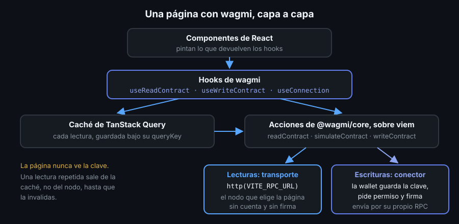

# Teoría 02 — wagmi por dentro

## 🎯 Objetivos

- Explicar qué añade wagmi a viem: hooks de React, una caché de lecturas y el estado de la
  wallet.
- Escribir la configuración de wagmi (redes, transportes y conectores) y los dos proveedores.
- Distinguir las acciones de `@wagmi/core` de los hooks de `wagmi`, y saber cuándo usar cada
  uno.
- Leer el estado de una consulta (`data`, `status`, `isPending`) y esperar datos con `enabled`.
- Saber por qué una lectura puede mostrar un valor viejo y cómo invalidarla.

## 1. Qué problema resuelve

Con viem, la página de la semana 17 creaba sus clientes, leía cuando hacía falta y repintaba a
mano. En React querrías algo así:

```tsx
const [saldo, setSaldo] = useState<bigint>();
useEffect(() => {
  client.readContract({ … }).then(setSaldo);
}, [cuenta]);
```

Y otra vez lo mismo para cada lectura, con su estado de carga, su error, qué hacer si la cuenta
cambia mientras llega la respuesta y cómo no pedir dos veces lo mismo si dos componentes lo
necesitan. **wagmi** es eso ya escrito, sobre viem:

- **Hooks** como `useReadContract` o `useWriteContract`, que devuelven datos y estado.
- Una **caché** (la de TanStack Query) que guarda cada lectura: dos componentes que piden el
  mismo saldo hacen una sola petición.
- El **estado de la conexión** con la wallet: cuenta, red, conectando o desconectada (teoría
  03).



## 2. Cómo funciona

### La configuración

Todo empieza en `createConfig`, que reúne:

| Campo | Qué es |
| ----- | ------ |
| `chains` | Las redes que acepta la página. La primera es la de partida |
| `transports` | Cómo leer de cada red: `http(url)`, como el transporte de viem |
| `connectors` | Con qué wallets puede conectar: `injected()` para la del navegador |

Lo que no está en `chains` no existe para wagmi: si la wallet está en otra red, la página lo
sabe (teoría 03) pero no puede leer de ella.

### Acciones y hooks

wagmi viene en dos paquetes:

- **`@wagmi/core`**: **acciones**, funciones normales que reciben la configuración:
  `readContract(config, { … })`, `writeContract(config, request)`. Funcionan sin React, en Node
  o en un test.
- **`wagmi`**: **hooks** de React (`useReadContract`, `useWriteContract`…). Por dentro llaman
  a las mismas acciones y guardan el resultado en la caché.

En un componente, hooks. En código que no es un componente (una función que se ejecuta al
pulsar un botón, un test), acciones, con la configuración de `useConfig()`.

### La caché

Cada lectura se guarda bajo una **clave de consulta** (*queryKey*) que identifica qué se leyó:
la acción, el contrato, la función, los argumentos y la red. Si otro componente pide la misma
clave, recibe lo guardado. Si los argumentos cambian (otra cuenta), la clave cambia y se lee de
nuevo.

## 3. Cómo se escribe

### Acciones, en Node

En el starter del ejercicio 01 (ya trae `node_modules` tras su `bash test.sh`), crea
`leer.ts`:

```ts
import { createConfig, getBalance, http } from "@wagmi/core";
import { readContractQueryKey } from "@wagmi/core/query";
import { foundry } from "viem/chains";

const config = createConfig({ chains: [foundry], transports: { [foundry.id]: http("http://127.0.0.1:8545") } });
const account1 = "0x70997970C51812dc3A010C7d01b50e0d17dc79C8";

console.log(await getBalance(config, { address: account1 }));
console.log(readContractQueryKey({ address: "0x5FbDB2315678afecb367f032d93F642f64180aa3", functionName: "balanceOf", args: [account1], chainId: foundry.id }));
```

Dentro del contenedor:

```bash
anvil --silent &
node leer.ts
```

```text
{ decimals: 18, symbol: 'ETH', value: 10000000000000000000000n }
[
  'readContract',
  {
    address: '0x5FbDB2315678afecb367f032d93F642f64180aa3',
    functionName: 'balanceOf',
    args: [ '0x70997970C51812dc3A010C7d01b50e0d17dc79C8' ],
    chainId: 31337
  }
]
```

La segunda línea no habla con el nodo: es la clave bajo la que `useReadContract` guardaría ese
`balanceOf`. Borra `leer.ts` al terminar.

### Los proveedores

En la página, `main.tsx` crea la configuración y envuelve la aplicación en dos proveedores:

```tsx
const config = createConfig({
  chains: [chain],
  connectors: [injected()],
  transports: { [chain.id]: http(env.VITE_RPC_URL) },
});
const queryClient = new QueryClient();

createRoot(document.getElementById("root")!).render(
  <StrictMode>
    <WagmiProvider config={config}>
      <QueryClientProvider client={queryClient}>
        <App registry={env.VITE_REGISTRY} fromBlock={BigInt(env.VITE_FROM_BLOCK ?? "0")} />
      </QueryClientProvider>
    </WagmiProvider>
  </StrictMode>,
);
```

Un **proveedor** (*provider* de React, no de Ethereum) es un componente que pone un valor al
alcance de todos los de dentro. Sin `WagmiProvider`, `useReadContract` no sabría qué
configuración usar y lanza un error.

### Leer con un hook

```tsx
function Saldo({ token, cuenta }: { token: Address; cuenta: Address }) {
  const { data, status, error } = useReadContract({
    address: token,
    abi: tokenAbi,
    functionName: "balanceOf",
    args: [cuenta],
  });
  if (status === "pending") return <p>Cargando…</p>;
  if (status === "error") return <p>❌ {error.shortMessage}</p>;
  return <p>{formatEther(data)} BCT</p>;
}
```

`status` es `"pending"` mientras no hay datos, `"success"` con `data` y `"error"` con `error`.
TypeScript lo sabe: después de los dos `if`, `data` es `bigint`, sin `undefined`. En el primer
render siempre es `"pending"`: el test del paso 1 del ejercicio 03 lo comprueba.

### Varias lecturas a la vez

```ts
const { data } = useReadContracts({
  allowFailure: false,
  contracts: [
    { address: token, abi: tokenAbi, functionName: "name" },
    { address: token, abi: tokenAbi, functionName: "symbol" },
    { address: token, abi: tokenAbi, functionName: "decimals" },
  ],
});
```

`data` es `[string, string, number]`. Si la red tiene el contrato Multicall3 (la `sepolia` de
viem lo trae), wagmi junta las lecturas en una sola llamada al nodo; si no lo tiene (anvil),
hace una por lectura. Con `allowFailure: false`, si una falla, falla todo; sin él, cada
resultado viene con su `status`.

### Esperar a tener datos: `enabled`

La cuenta conectada puede no existir todavía. Un hook no puede ir dentro de un `if` (teoría
01), así que la lectura se deja en espera:

```ts
const { address } = useConnection();
const { data } = useReadContract({
  address: token,
  abi: tokenAbi,
  functionName: "balanceOf",
  args: address && [address],
  query: { enabled: address !== undefined },
});
```

Con `enabled: false`, el hook no pide nada y `data` es `undefined`. En cuanto `address` existe,
lee. Así se encadenan lecturas que dependen de otra: la dirección del token de fidelidad sale
del registro y, con ella, los puntos.

## 4. Antipatrones y riesgos

- **Mostrar la caché como si fuera la cadena.** Después de escribir, el saldo guardado ya no es
  el real. Sin invalidar, el test del paso 4 del ejercicio 03 falla: el saldo de la cuenta 1
  sigue en 100 BCT después de enviar 10. Tras el recibo, `queryClient.invalidateQueries()` marca las
  lecturas como viejas y las que están en pantalla se repiten (teoría 04).
- **Leer sin `enabled`.** Con `args: [undefined]`, viem no puede codificar la dirección y la
  lectura termina en error: la página pinta un fallo cuando solo faltaba conectar.
- **Crear la configuración dentro de un componente.** Cada render crearía otra configuración y
  otra caché vacía. Va fuera, como en `main.tsx`.
- **Confiar en `VITE_RPC_URL` para cosas secretas.** Es pública como toda variable `VITE_`.
  Si usas un RPC con clave de API, cualquiera la copia; limítala por dominio en su panel.
- **Una configuración con redes que no usas.** Cada red de `chains` es una red en la que la
  página aceptaría escribir. Pon solo la de tu contrato.

## 5. Trucos

- `refetch()`, que devuelven los hooks de lectura, repite una lectura concreta.
- `query: { refetchInterval: 4000 }` repite una lectura cada 4 s, para lo que cambia sin
  eventos (el número de bloque, un precio).
- Las acciones sirven en cualquier sitio con la configuración: en un `onClick`,
  `const config = useConfig()` y después `readContract(config, { … })`.
- La clave de consulta lleva `bigint`; TanStack Query no sabe convertirlos a JSON. wagmi lo
  resuelve en sus hooks; si haces tu propio `useQuery`, pon en la clave `fromBlock.toString()`.

## ✅ Checklist

- [ ] Sé qué añade wagmi a viem y qué hay en cada capa del diagrama.
- [ ] Escribo `createConfig` con `chains`, `transports` y `connectors`, y los dos proveedores.
- [ ] Uso hooks en componentes y acciones con `useConfig()` fuera de ellos.
- [ ] Leo `status` y `data` de una consulta y encadeno lecturas con `enabled`.
- [ ] Sé por qué hay que invalidar la caché después de escribir.

---

| Anterior | Actual | Siguiente |
| -------- | ------ | --------- |
| [← Teoría 01 — De la página a React](01-de-la-pagina-a-react.md) | **Teoría 02 — wagmi por dentro** | [Teoría 03 — Conectar la wallet →](03-conectar-la-wallet.md) |
