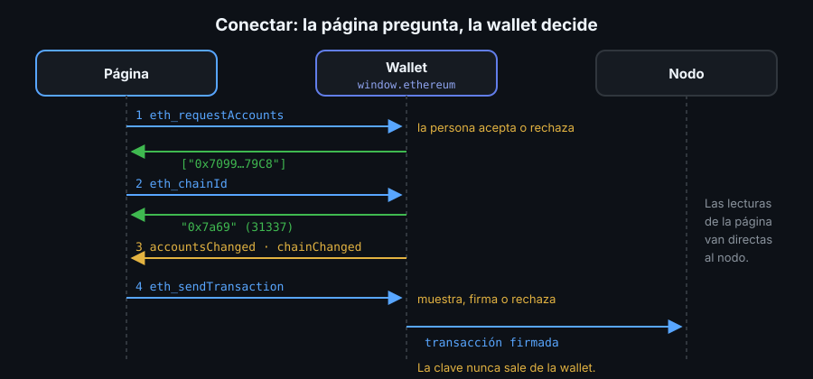

# Teoría 03 — Conectar la wallet

## 🎯 Objetivos

- Explicar qué es una wallet y por qué la página no puede firmar por sí misma fuera de anvil.
- Describir cómo habla la página con la wallet: el proveedor EIP-1193 y el anuncio EIP-6963.
- Conectar, desconectar y seguir los cambios de cuenta y de red con wagmi.
- Detectar que la wallet está en otra red y pedirle que cambie.
- Preparar una wallet del navegador para anvil sin mezclarla con nada real.

## 1. Qué problema resuelve

En la semana 17, la página escribía con una **cuenta del nodo**: anvil tiene las claves de sus
cuentas de prueba y firma por ellas. En Sepolia o en mainnet ningún nodo guarda tu clave, y no
debe: quien tiene la clave mueve los fondos. Tampoco puede ir en la página, porque el código de
la página lo descarga cualquiera.

La clave tiene que quedarse con la persona que usa la página. Eso es una **wallet**: un programa
(una extensión del navegador, una app del móvil) que guarda las claves, enseña a la persona qué
va a firmar, firma si acepta y envía la transacción a su nodo. La página solo **pide**; la wallet
y la persona **deciden**.

## 2. Cómo funciona



### El proveedor: EIP-1193

Una wallet de navegador pone en la página un objeto, el **proveedor** (`window.ethereum`), con un
método `request({ method, params })` que acepta los mismos métodos JSON-RPC que un nodo, más los
de la wallet:

| Método | Qué hace la wallet |
| ------ | ------------------ |
| `eth_requestAccounts` | Pregunta a la persona si conecta esta página; si acepta, devuelve sus cuentas |
| `eth_chainId` | Devuelve la red en la que está, en hexadecimal: `0x7a69` es 31337, anvil |
| `eth_sendTransaction` | Enseña la transacción; si la persona firma, la envía y devuelve el hash |
| `wallet_switchEthereumChain` | Pide a la persona que cambie de red |
| `wallet_addEthereumChain` | Pide añadir una red que la wallet no conoce |

Y avisa con eventos: `accountsChanged` cuando la persona cambia de cuenta y `chainChanged` cuando
cambia de red. La interfaz entera es el estándar
[EIP-1193](https://eips.ethereum.org/EIPS/eip-1193).

### Varias wallets: EIP-6963

Con dos extensiones instaladas, las dos querrían ser `window.ethereum`. Con
[EIP-6963](https://eips.ethereum.org/EIPS/eip-6963), cada wallet **se anuncia** con un evento del
navegador (nombre, icono y su proveedor) y la página puede ofrecer todas. wagmi las escucha:
`useConnectors()` devuelve el conector `injected()` de la configuración y uno más por cada wallet
anunciada, con su nombre.

### Conectores

Un **conector** es la pieza de wagmi que traduce entre wagmi y una wallet concreta:

| Conector | Para qué |
| -------- | -------- |
| `injected()` | La wallet del navegador, por `window.ethereum` o por EIP-6963 |
| `mock({ accounts })` | Tests: dice tener esas cuentas y pide al nodo que firme |

Hay más (WalletConnect para wallets del móvil, por ejemplo), cada uno con su paquete; esta
semana basta con `injected()`.

### El estado de la conexión

`useConnection()` (y `getConnection(config)` en `@wagmi/core`) devuelven:

| Campo | Qué es |
| ----- | ------ |
| `status` | `"disconnected"`, `"connecting"`, `"connected"` o `"reconnecting"` |
| `address` | La cuenta activa, o `undefined` |
| `chainId` | La red en la que está la wallet, **esté o no en la configuración** |
| `chain` | La red de la configuración con ese `chainId`, o `undefined` si no está |

Al conectar, el estado pasa por `"connecting"` y llega a `"connected"`: el paso 5 del ejercicio
01 lo ve con `watchConnection`. Al recargar la página, wagmi recuerda el último conector y
reconecta sin preguntar si la wallet lo permite: el estado pasa por `"reconnecting"`.

## 3. Cómo se escribe

### Conectar y desconectar

```tsx
function Conectar() {
  const { address } = useConnection();
  const connectors = useConnectors();
  const connect = useConnect();
  const disconnect = useDisconnect();
  if (address) return <button onClick={() => disconnect.mutate()}>Desconectar {address}</button>;
  return connectors.map((connector) => (
    <button key={connector.uid} onClick={() => connect.mutate({ connector })}>
      Conectar {connector.name}
    </button>
  ));
}
```

`useConnect`, `useDisconnect` y `useSwitchChain` son **mutaciones**: no leen nada al montarse;
hacen algo cuando llamas a `mutate`, y tienen su propio `status` y `error`. Si la persona
rechaza conectar, `connect.error` lo dice.

En la página del proyecto, con solo `injected()` y sin wallet anunciada, el botón dice
`Conectar Injected`. Con una wallet que se anuncia, aparece además un botón con su nombre.

### Seguir los cambios de la wallet

La persona cambia de cuenta o de red **en la wallet**, no en la página. La wallet avisa con
`accountsChanged` o `chainChanged`, wagmi actualiza su estado y todos los componentes que usan
`useConnection()` se vuelven a ejecutar. No hay que escribir nada más: si `useMyBalance` lee
`balanceOf(address)` y `address` cambia, cambia la clave de consulta y wagmi lee el saldo de la
cuenta nueva.

Fuera de React, `watchConnection` hace lo mismo con una función:

```ts
const unwatch = watchConnection(config, {
  onChange: (connection) => console.log(connection.status, connection.address),
});
```

Con el conector `mock` del ejercicio 01, conectar y desconectar imprime:

```text
connecting undefined
connected 0x70997970C51812dc3A010C7d01b50e0d17dc79C8
disconnected undefined
```

Como con `watchContractEvent` en la semana 17, `unwatch()` deja de escuchar.

### La red equivocada

La persona puede tener la wallet en mainnet mientras la página es de anvil:

```ts
const { status, chainId } = useConnection();
const [appChain] = useChains();
const wrongChain = status === "connected" && chainId !== appChain.id;
const switchChain = useSwitchChain();
// En el botón: switchChain.mutate({ chainId: appChain.id })
```

`useChains()` devuelve las redes de la configuración. `switchChain` pide
`wallet_switchEthereumChain`; si la wallet no conoce la red, wagmi le pide añadirla con los datos
de `chain`, incluida su URL en `rpcUrls`. La de `foundry` en viem es `http://127.0.0.1:8545`.

Con la red equivocada, la página **no ofrece escribir**. Y cada escritura lo comprueba otra
vez: si la simulación lleva `chainId` (teoría 04), `writeContract` se niega a pedir la firma
cuando la wallet está en otra red. Con la wallet en Sepolia y la simulación en anvil, el error
es:

```text
The current chain of the wallet (id: 11155111) does not match the target chain for the transaction (id: 31337 – Foundry).
```

Sin `chainId`, wagmi no compara nada: la transacción sale hacia la red en la que esté la wallet,
con la dirección y los datos de tu contrato de anvil.

### Preparar una wallet para anvil

Para el proyecto necesitas una wallet de navegador con la cuenta 1 de anvil:

1. Crea un **perfil nuevo del navegador** solo para el bootcamp e instala ahí la extensión de la
   wallet. Así nunca convive con una wallet que tenga fondos reales.
2. En la wallet, añade una red a mano: nombre `Anvil`, RPC `http://127.0.0.1:8545`, id de red
   `31337`, símbolo `ETH`.
3. Importa la cuenta 1 con su clave de prueba de anvil,
   `0x59c6995e998f97a5a0044966f0945389dc9e86dae88c7a8412f4603b6b78690d`. Es pública: está en la
   documentación de Foundry y en cada `anvil` que arrancas.

La wallet habla con anvil desde tu navegador, igual que la página: el contenedor tiene que
publicar el puerto 8545.

## 4. Antipatrones y riesgos

- **Enviar ETH real a una cuenta de anvil.** Sus claves son públicas: hay programas que vigilan
  esas direcciones en mainnet y se llevan lo que llega en cuanto llega. Las cuentas de anvil, solo en
  anvil.
- **Importar una clave real en el perfil de pruebas**, o una de anvil en tu wallet de siempre.
  Un perfil, un uso.
- **Pedir la clave a la persona.** Ninguna página legítima la pide. Si tu página tiene un campo
  para la clave o la frase de recuperación, está mal diseñada; si otra lo tiene, es un robo.
- **Fiarse de lo que dice la página.** Una página falsa puede copiar la tuya y pedir que se
  firme otra cosa. La persona debe leer en la wallet el contrato, la función y el valor antes de
  firmar. La página ayuda si dice lo mismo que verá la wallet: "Alta de «Primer recurso» por
  0.01 ETH".
- **Conectar al cargar la página.** Pedir `eth_requestAccounts` antes de que la persona pulse
  nada le abre la wallet cuando todavía no sabe qué hace tu página. Conecta cuando lo pida.
- **Dar por buena la red de la wallet.** `chainId` es la red de la wallet, no la de la página.
  Compárala siempre con la de tu contrato antes de ofrecer escribir.
- **Conectar no es gratis en privacidad.** Al conectar, la página conoce tu dirección y, con
  ella, todo tu historial en la cadena. Conecta solo donde haga falta.

## 5. Trucos

- Si reinicias anvil, la cadena vuelve al bloque 0 pero la wallet recuerda el nonce de la
  cuenta: las transacciones nuevas no entran. En los ajustes avanzados de la wallet, borra los
  datos de actividad de la cuenta.
- En la consola del navegador (F12), `await window.ethereum.request({ method: "eth_chainId" })`
  te dice en qué red está la wallet sin pasar por la página.
- `useConnection().connector?.name` dice con qué wallet está conectada la página.

## ✅ Checklist

- [ ] Sé por qué la clave va en la wallet y no en la página ni en el nodo.
- [ ] Sé qué es `window.ethereum` y qué añade EIP-6963.
- [ ] Conecto, desconecto y sigo `status`, `address` y `chainId` con wagmi.
- [ ] Detecto la red equivocada y pido el cambio con `useSwitchChain`.
- [ ] Tengo una wallet de pruebas en un perfil propio, con la red de anvil y la cuenta 1.

---

| Anterior | Actual | Siguiente |
| -------- | ------ | --------- |
| [← Teoría 02 — wagmi por dentro](02-wagmi-por-dentro.md) | **Teoría 03 — Conectar la wallet** | [Teoría 04 — Estado de una transacción →](04-estado-de-una-transaccion.md) |
