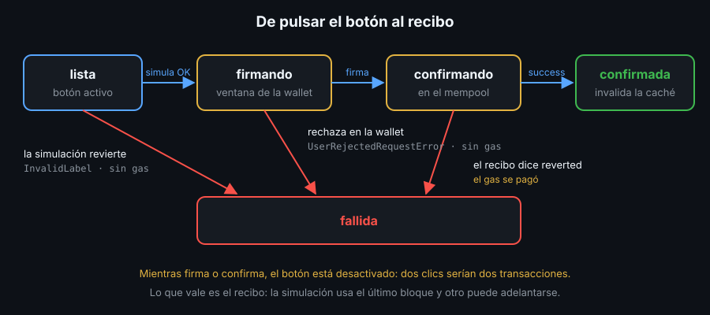

# Teoría 04 — Estado de una transacción

## 🎯 Objetivos

- Recorrer los estados de una transacción desde que se pulsa el botón hasta el recibo.
- Escribir desde un componente con `useWriteContract` y `useWaitForTransactionReceipt`.
- Distinguir los tres finales malos: revierte la simulación, la persona rechaza, revierte el
  bloque.
- Refrescar las lecturas al confirmarse y evitar el doble envío.

## 1. Qué problema resuelve

En la semana 17, `register` hacía todo en una llamada: simular, enviar, esperar. La página
mostraba "Enviando…" y, segundos después, el resultado. Con una wallet entre medias, esa espera
tiene partes muy distintas:

- **Firmar** depende de la persona: puede tardar un minuto o no ocurrir nunca.
- **Confirmar** depende de la red: en anvil, milisegundos; en Sepolia, unos 12 s por bloque, o
  más si la tarifa es baja.

Si la página solo dice "Enviando…", la persona no sabe si mirar su wallet o esperar, y pulsa
otra vez. Cada parte necesita su mensaje, y el botón tiene que saber cuándo está ocupado.

## 2. Cómo funciona



| Estado | Qué pasa | Qué ve la persona |
| ------ | -------- | ----------------- |
| lista | Nada en curso | El botón, activo |
| firmando | La simulación pasó; la wallet enseña la transacción | "Firma en tu wallet…" |
| confirmando | Firmada y enviada; espera en el **mempool** a entrar en un bloque | "Esperando el bloque…" y el hash |
| confirmada | El recibo dice `success` | "✅ Confirmada" y los datos nuevos |
| fallida | Uno de los tres caminos de abajo | Por qué, con palabras |

El **mempool** es la cola de transacciones firmadas que un nodo conoce y que todavía no están en
un bloque.

Los tres caminos a "fallida" no son iguales:

1. **La simulación revierte.** No se abre la wallet ni se gasta gas. El error trae su nombre:
   `InvalidLabel`, `ERC20InsufficientBalance`.
2. **La persona rechaza en la wallet.** Tampoco gasta gas. viem lo da como
   `UserRejectedRequestError`, código `4001`, con el mensaje `User rejected the request.`. No es
   un fallo de la página: es un "no". Díselo con otras palabras que a un error.
3. **El bloque revierte.** La simulación usó el último bloque; otra transacción entró antes y
   cambió el estado. La transacción está en la cadena, con `status: "reverted"`, y **el gas se
   pagó**. viem devolvía ese recibo sin más; la acción `waitForTransactionReceipt` de wagmi lanza
   un error, así que el hook acaba en `status: "error"`.

## 3. Cómo se escribe

### Dos hooks

```ts
const write = useWriteContract();
const receipt = useWaitForTransactionReceipt({ hash: write.data });
```

- `useWriteContract` es una mutación: `write.mutate(request)` pide la firma. Su `status` es
  `"idle"` antes de empezar, `"pending"` mientras la wallet espera, y `"success"` (con el hash
  en `write.data`) o `"error"`.
- `useWaitForTransactionReceipt` es una lectura que espera a tener `hash`: mientras
  `write.data` es `undefined`, no hace nada. Con el hash, espera el recibo y su `status` pasa de
  `"pending"` a `"success"` o `"error"`.

El estado de la página sale de los dos. En el ejercicio 03 lo escribes como `txStatus`:

| `write.status` | `receipt.status` | Estado |
| -------------- | ---------------- | ------ |
| `idle` | (cualquiera) | lista |
| `pending` | (cualquiera) | firmando |
| `error` | (cualquiera) | fallida |
| `success` | `pending` | confirmando |
| `success` | `success` | confirmada |
| `success` | `error` | fallida |

### Simular antes de pedir la firma

`write.mutate` acepta los datos de la llamada sin simular, pero entonces un revert llega del
nodo sin decodificar. Sin simular, enviar 1000 BCT desde una cuenta que tiene 50 da (salida real
del test del ejercicio 03):

```text
Execution reverted with reason: custom error 0xe450d38c: 0000000000000000000000003c44cdddb6a900fa2b585dd299e03d12fa4293bc…
```

`0xe450d38c` es el selector de `ERC20InsufficientBalance`, pero solo la simulación lo traduce con
la ABI. Y sin simular, con una wallet real, la persona habría visto la ventana de firma para una
transacción que iba a fallar. Por eso `send` simula primero con la acción de `@wagmi/core` y, si
pasa, entrega su `request` a `mutate`:

```ts
const config = useConfig();
function send(to: Address, amount: bigint) {
  simulateContract(config, {
    address: token,
    abi: tokenAbi,
    functionName: "transfer",
    args: [to, amount],
    chainId: config.chains[0].id,
  }).then(({ request }) => write.mutate(request), setSimulateError);
}
```

El `request` lleva la ABI, la función, los argumentos y el `value`. Con `chainId`, lleva también
la red, y `mutate` se niega a firmar si la wallet está en otra (teoría 03).

### Refrescar al confirmar

Las lecturas están en caché (teoría 02). Cuando el recibo llega, se invalidan:

```ts
const queryClient = useQueryClient();
useEffect(() => {
  if (receipt.isSuccess) queryClient.invalidateQueries();
}, [receipt.isSuccess, queryClient]);
```

`invalidateQueries()` sin argumentos marca todas como viejas, y las que están en pantalla se
vuelven a pedir. Con muchas lecturas, pasa una `queryKey` para invalidar solo las afectadas.

### El estado en la interfaz

En el proyecto, `App.tsx` convierte cada estado en un texto y desactiva el botón mientras hay
algo en curso:

```tsx
const TX_TEXT: Record<TxStatus, string> = {
  lista: "",
  firmando: "Firma en tu wallet…",
  confirmando: "Esperando el bloque…",
  confirmada: "✅ Confirmada",
  fallida: "❌",
};

function Register({ registry }: { registry: Address }) {
  const [label, setLabel] = useState("");
  const { register, status, id, error } = useRegister(registry);
  const busy = status === "firmando" || status === "confirmando";
  // …
  <button disabled={busy}>Dar de alta</button>
  // …
  <p>
    {TX_TEXT[status]} {status === "confirmada" && id !== undefined && `Alta #${id}`} {error}
  </p>
}
```

`Record<TxStatus, string>` obliga a tener un texto para cada estado: si añades uno a `TxStatus`
y olvidas su texto, `tsc` falla. `busy` se calcula en cada render a partir de `status`, sin
estado propio (teoría 01).

### El valor que devuelve la escritura

Como en la semana 17, la transacción no devuelve nada a la página. El id de un alta sale del
evento del recibo:

```ts
const [event] = receipt.data ? parseEventLogs({ abi: registryAbi, eventName: "ItemRegistered", logs: receipt.data.logs }) : [];
const id = event?.args.id;
```

## 4. Antipatrones y riesgos

- **El botón activo mientras firma o confirma.** Dos clics son dos transacciones, dos tasas y
  dos altas. Desactívalo en "firmando" y "confirmando".
- **Dar por hecha la transacción con el hash.** El hash solo dice que el nodo la aceptó. Puede
  no entrar nunca en un bloque o entrar y revertir. Lo que vale es el recibo.
- **Tratar el rechazo como un error.** "❌ Error" cuando la persona pulsó "Rechazar" la asusta
  sin motivo. Distingue `UserRejectedRequestError`.
- **Pintar el mensaje técnico entero.** `error.message` de viem incluye los argumentos en bruto
  y la versión de viem. Muestra el nombre del error o `shortMessage`, y deja el resto para la
  consola.
- **Olvidar invalidar.** Sin `invalidateQueries`, la página enseña el saldo de antes y la
  persona cree que la transacción no hizo nada.
- **Mostrar solo el estado final.** Si la wallet tarda, una página sin "Firma en tu wallet…"
  parece colgada.

## 5. Trucos

- `useWaitForTransactionReceipt({ hash, confirmations: 2 })` espera a que haya un bloque más
  encima del de la transacción. En una red pública, una transacción en el último bloque todavía
  puede desaparecer si la red reorganiza sus últimos bloques.
- La wallet permite "acelerar" o "cancelar" una transacción pendiente: envía otra con el mismo
  nonce. viem lo detecta y llama a `onReplaced` con el motivo (`"repriced"`, `"cancelled"` o
  `"replaced"`) y el recibo de la nueva.
- `write.reset()` vuelve la mutación a `"idle"`: úsalo al empezar otra escritura para que no se
  vea el resultado de la anterior.
- En anvil todo pasa en milisegundos y no ves "firmando" ni "confirmando". El test del paso 4
  del ejercicio 03 guarda el estado de cada render para comprobar que pasan:
  `["lista", "firmando", "confirmando", "confirmada"]`.

## ✅ Checklist

- [ ] Sé qué es cada estado y qué ve la persona en cada uno.
- [ ] Distingo los tres caminos a "fallida" y cuáles gastan gas.
- [ ] Simulo antes de `mutate` y sé por qué sin simular el error llega sin nombre.
- [ ] Invalido la caché al confirmarse y desactivo el botón mientras está ocupado.
- [ ] Saco el valor de una escritura del evento de su recibo.

---

| Anterior | Actual | Siguiente |
| -------- | ------ | --------- |
| [← Teoría 03 — Conectar la wallet](03-conectar-la-wallet.md) | **Teoría 04 — Estado de una transacción** | [Ejercicio 01 — Conectar la cuenta →](../2-practicas/ejercicio-01-conectar-la-cuenta/README.md) |
