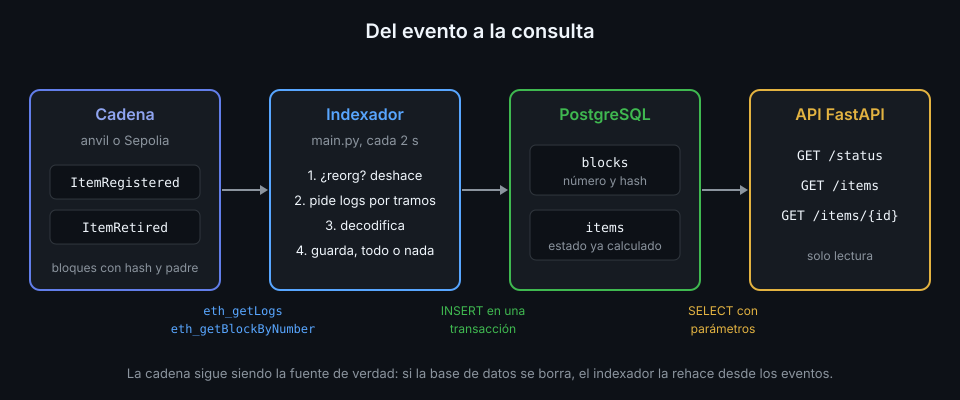

# Teoría 01 — Por qué indexar

## 🎯 Objetivos

- Explicar qué preguntas no puede contestar bien un contrato y qué hace un indexador con ellas.
- Saber por qué la cadena sigue siendo la fuente de verdad aunque haya base de datos.
- Llamar a un nodo por JSON-RPC desde Python y leer un log: topics, `data` y bloque.
- Preparar un proyecto de Python con uv y ejecutar código con sus dependencias fijas.

## 1. Qué problema resuelve

La página de la semana 18 pregunta al contrato con `getItem` e `idsOf`. Funciona para "mis
recursos", pero mira estas otras preguntas:

- "Los recursos activos de todo el registro, de 20 en 20, ordenados por id."
- "Las altas de la última semana."
- "Cuántos recursos ha retirado cada cuenta."

El contrato no las sabe contestar: solo guarda lo que necesita para sus reglas, y recorrer
miles de entradas en una función `view` es lento o choca con el límite de gas de la llamada. La
otra vía, pedir **todos los eventos** con `getLogs` desde el despliegue cada vez que alguien abre
la página, tampoco escala: cada visita repite el mismo trabajo, y los nodos públicos limitan
cuántos bloques abarca una petición de logs.

Un **indexador** (*indexer*) es un programa que lee los eventos **una sola vez**, en orden, y
guarda su resultado en una base de datos pensada para consultar: con índices, filtros, orden y
paginación. Una **API** sirve esa base de datos a la página. Es lo que hacen servicios como
Etherscan o The Graph, y lo que vas a escribir esta semana para tu protocolo.



## 2. Cómo funciona

- La **cadena es la fuente de verdad**. La base de datos es una copia calculada a partir de los
  eventos: si se borra, el indexador la vuelve a construir desde el bloque del despliegue. Por
  eso nada se escribe en la base de datos que no salga de un evento.
- El indexador recuerda **hasta qué bloque llegó** (su **cursor**). En cada vuelta pide los
  eventos de los bloques siguientes, los guarda y avanza el cursor.
- Habla con el nodo por **JSON-RPC**, el mismo protocolo que usaban `cast` y viem: un `POST`
  HTTP con un objeto `{"jsonrpc": "2.0", "id": 1, "method": ..., "params": [...]}`. La respuesta
  trae `result` o, si algo va mal, `error`.
- Los métodos que necesitas son tres:

| Método | Qué devuelve |
| ------ | ------------ |
| `eth_blockNumber` | El número del último bloque, en hexadecimal |
| `eth_getBlockByNumber` | Un bloque: su `hash`, el de su padre (`parentHash`), su hora... |
| `eth_getLogs` | Los logs que cumplen un filtro: dirección, topics y rango de bloques |

- Un **log** es el registro que deja un `emit` (semana 07). Sus **topics** son hasta cuatro
  valores de 32 bytes: el primero (**topic0**) es el keccak256 de la firma del evento; los
  siguientes, los parámetros `indexed`. Lo que no es `indexed` va codificado en ABI en `data`.
- Todo número llega en **hexadecimal** (`"0x3"`) y toda dirección, en minúsculas. En Python,
  `int("0x3", 16)` da `3`, y los enteros no tienen tamaño máximo: un `uint256` cabe entero.

## 3. Cómo se escribe

### Un proyecto de Python con uv

**uv** gestiona el Python de un proyecto y sus dependencias, como pnpm en Node. Un proyecto
lleva dos archivos:

- `pyproject.toml`: el nombre, la versión de Python y las dependencias con su versión exacta
  (`"fastapi==0.163.1"`).
- `uv.lock`: todas las dependencias, también las indirectas, con su versión y su hash. Es lo
  que hace que tu instalación sea idéntica a la de la corrección.

Y tres comandos:

| Comando | Qué hace |
| ------- | -------- |
| `uv sync` | Crea `.venv/` (el **entorno virtual**: un Python con solo las dependencias del proyecto) e instala lo de `uv.lock` |
| `uv run <comando>` | Ejecuta el comando dentro de ese entorno, sin activarlo a mano |
| `uv add 'paquete==x.y.z'` | Añade una dependencia a `pyproject.toml` y vuelve a calcular `uv.lock` |

Los starters de esta semana traen una copia de los dos archivos de `docker/py/`, y la imagen
trae esas dependencias en la caché de uv: `uv sync` instala sin red. El `pyproject.toml` lleva
además `exclude-newer`, que impide a uv elegir versiones publicadas hace menos de una semana,
también las indirectas.

### Leer la cadena desde Python

Para probarlo, entra en el starter del ejercicio 01 (trae el Token de la semana 17) y arranca
anvil y el despliegue dentro del contenedor:

```bash
cd bootcamp/week-19-indexacion_con_fastapi_y_postgresql/2-practicas/ejercicio-01-eventos-desde-python/starter
docker run --rm -it -v "$PWD":/workspace bc-smartcontracts-dev
anvil --silent &
forge script --root contrato contrato/script/DeployToken.s.sol --rpc-url http://127.0.0.1:8545 \
  --broadcast --slow --private-key 0xac0974bec39a17e36ba4a6b4d238ff944bacb478cbed5efcae784d7bf4f2ff80
uv sync
```

Crea `demo.py` en esa carpeta (lo borras al terminar):

```python
import json

import httpx2

URL = "http://127.0.0.1:8545"
TOKEN = "0x5FbDB2315678afecb367f032d93F642f64180aa3"


def rpc(method, params):
    response = httpx2.post(URL, json={"jsonrpc": "2.0", "id": 1, "method": method, "params": params})
    return response.json()


print(rpc("eth_blockNumber", []))
logs = rpc("eth_getLogs", [{"address": TOKEN, "fromBlock": "0x0", "toBlock": "latest"}])["result"]
print(len(logs), "logs")
print(json.dumps(logs[1], indent=2))
print(rpc("eth_getBlockByNumber", ["0x63", False]))
print(rpc("eth_noExiste", []))
```

`httpx2` es el cliente HTTP que usa FastAPI en sus tests (teoría 03). Ejecútalo con
`uv run python demo.py`:

```text
{'jsonrpc': '2.0', 'id': 1, 'result': '0x3'}
3 logs
{
  "address": "0x5fbdb2315678afecb367f032d93f642f64180aa3",
  "topics": [
    "0xddf252ad1be2c89b69c2b068fc378daa952ba7f163c4a11628f55a4df523b3ef",
    "0x000000000000000000000000f39fd6e51aad88f6f4ce6ab8827279cfffb92266",
    "0x00000000000000000000000070997970c51812dc3a010c7d01b50e0d17dc79c8"
  ],
  "data": "0x0000000000000000000000000000000000000000000000056bc75e2d63100000",
  "blockHash": "0x97b4d3628c87f98e260717868749e40d3232f0b8cd06681e25cc62b4df27db8e",
  "blockNumber": "0x2",
  "blockTimestamp": "0x6b040a43",
  "transactionHash": "0x83e82d6005e6fe90ead9741e8db3fe7149fca3eb944d13e30787c668d86f64a4",
  "transactionIndex": "0x0",
  "logIndex": "0x0",
  "removed": false
}
{'jsonrpc': '2.0', 'id': 1, 'result': None}
{'jsonrpc': '2.0', 'id': 1, 'error': {'code': -32601, 'message': 'Method not found'}}
```

Tus `blockHash`, `blockTimestamp` y `transactionHash` serán otros: el hash de un bloque depende
de su hora. Línea a línea:

- Es el segundo `Transfer` del despliegue: la cuenta 0 envía 100 BCT a la cuenta 1.
- **topic0** es el de `Transfer(address,address,uint256)`. Lo obtienes sin red con
  `cast sig-event "Transfer(address,address,uint256)"`, así que tu código lo escribe como
  constante.
- **topics[1] y topics[2]** son `from` y `to`, `indexed`: cada dirección ocupa los últimos 40
  caracteres de su topic. `"0x" + topic[-40:]` la recupera.
- **data** es `value`, el único parámetro sin `indexed`: un `uint256` en 32 bytes.
  `int(data, 16)` da `100000000000000000000`, 100 BCT con 18 decimales.
- **blockNumber**, **blockHash** y **logIndex** dicen dónde está el log: el bloque y su posición
  dentro del bloque. Con `(blockNumber, logIndex)` cada log es único. El hash de bloque lo
  usarás en la teoría 04 para notar que la cadena cambió.
- Un bloque que todavía no existe (el 99, `0x63`) no es un error: `result` es `None`. Un método
  que no existe sí: llega en `error`, y tu código tiene que convertirlo en una excepción.

### Logs con un `string`

Un parámetro dinámico, como el `string label` de `ItemRegistered`, va en `data` en tres trozos:
32 bytes con la **posición** donde empieza, 32 con su **longitud** en bytes y después los bytes
del texto, rellenados con ceros hasta un múltiplo de 32. En Python:

```python
raw = bytes.fromhex(data[2:])
offset = int.from_bytes(raw[0:32])
length = int.from_bytes(raw[offset:offset + 32])
text = raw[offset + 32:offset + 32 + length]
```

Lo que sale son **bytes**, no texto: cualquiera registra una etiqueta, y nada obliga a que sean
UTF-8 válidos. Lo decodificas en el proyecto con `errors="replace"`.

## 4. Antipatrones y riesgos

- **Pedir todos los logs de una vez.** `fromBlock: 0` hasta `latest` funciona en anvil con tres
  bloques. En Sepolia, un nodo público rechaza los rangos grandes o tarda tanto que corta la
  conexión. Pide **por tramos** de bloques (ejercicio 01, paso 5) y empieza en el bloque del
  despliegue, no en el 0.
- **Indexar la implementación en vez del proxy.** Tu Registry está detrás de un proxy (semana
  15): los eventos los emite la dirección del **proxy**, la misma tras cada actualización.
  Filtrar por la dirección de la implementación devuelve una lista vacía, sin error.
- **Fiarse del indexador para escribir.** La base de datos va unos segundos por detrás de la
  cadena y puede tener bloques que dejaron de existir (teoría 04). Para enseñar una lista vale;
  para decidir si una transacción va a funcionar, lee el contrato o simula, como en la semana 18.
- **Guardar lo que no sale de un evento.** Si la base de datos tiene algo que no puede
  reconstruirse desde la cadena, borrarla y reindexar lo pierde. Lo que no es de la cadena va en
  otra tabla, aparte.
- **Instalar sin versión ni lockfile.** Instalar `fastapi` a secas trae la última versión
  publicada hoy, y sin lockfile cada instalación puede traer otras dependencias indirectas. Un
  paquete comprometido que se publique hoy entra en tu proyecto. Con uv: versión exacta,
  `uv.lock` en el repositorio y `exclude-newer`.

## 5. Trucos

- `cast sig-event "ItemRegistered(uint256,address,string)"` da el topic0 de tu evento, y
  `cast logs --address <registro> --from-block 0` enseña los logs que el indexador va a recibir.
- `uv run python` abre un intérprete con las dependencias del proyecto: sirve para probar una
  llamada antes de escribirla en el código.
- `removed: true` en un log significa que salió de la cadena por un reorg. Solo aparece en
  suscripciones en vivo (filtros y `eth_subscribe`); con `eth_getLogs` por rango no lo verás.
  La teoría 04 enseña a notarlo sin depender de él.
- Al terminar de probar, borra `demo.py`: no va en el commit.

## ✅ Checklist

- [ ] Sé qué preguntas no contesta bien un contrato y qué hace con ellas un indexador.
- [ ] Sé por qué la base de datos es una copia y la cadena, la fuente de verdad.
- [ ] Llamo a `eth_getLogs` desde Python y saco de un log sus topics, su `data` y su bloque.
- [ ] Sé dónde va un parámetro `indexed`, uno que no lo es y un `string`.
- [ ] Preparo un proyecto con uv y sé qué fija `uv.lock`.

---

| Anterior | Actual | Siguiente |
| -------- | ------ | --------- |
| [← Semana 19 — Indexación con FastAPI y PostgreSQL](../README.md) | **Teoría 01 — Por qué indexar** | [Teoría 02 — Eventos en PostgreSQL →](02-eventos-en-postgresql.md) |
