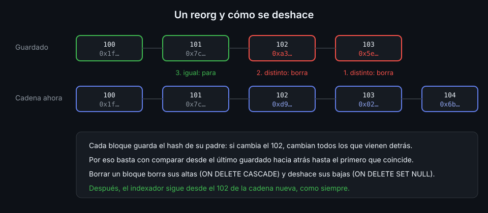

# Teoría 04 — Reorgs y confirmaciones

## 🎯 Objetivos

- Explicar qué es un reorg y por qué deja datos falsos en un indexador que no lo nota.
- Detectarlo con los hashes de bloque y deshacerlo hasta el último bloque común.
- Elegir cuántas confirmaciones esperar y qué significan `safe` y `finalized`.
- Simular un reorg en anvil para probar el indexador.

## 1. Qué problema resuelve

Hasta ahora has tratado un bloque como algo definitivo: si el bloque 102 tiene un alta, el alta
existe. No siempre es así. Los nodos de una red pueden ver durante unos segundos dos versiones
distintas de los últimos bloques, y acabar todos quedándose con una. Cuando el nodo al que
preguntas cambia de versión, los últimos bloques que te dio **dejan de existir** y en su lugar
hay otros, con otras transacciones o con las mismas en otro orden. Eso es una
**reorganización** de la cadena: un **reorg**.

Un indexador que no lo nota sigue enseñando el alta del bloque 102 viejo aunque nunca llegara a
pasar en la cadena que quedó. Y como su cursor ya va por el 103, nunca vuelve a mirar el 102:
el dato falso se queda para siempre.

## 2. Cómo funciona

- Cada bloque guarda el **hash de su padre** (`parentHash`), y su propio hash depende de todo su
  contenido, padre incluido. Si cambia el bloque 102, cambia su hash; el 103 nuevo apunta a ese
  hash nuevo, así que también cambia el suyo, y así hasta la cabeza.
- Por eso un reorg **siempre cambia la cabeza** de la cadena, y basta con mirar hacia atrás
  desde el último bloque guardado: el primer bloque cuyo hash coincide con el de la cadena es el
  **último bloque común**, y todo lo que hay por encima de él es de la versión vieja.
- **Detectar**: guarda el hash de cada bloque que indexas. En cada vuelta, antes de seguir,
  compara el hash guardado del último bloque con el que da ahora el nodo.
- **Deshacer**: borra, del último hacia atrás, cada bloque guardado cuyo hash ya no coincide (o
  que la cadena ya no tiene). Con las claves foráneas de la teoría 02, borrar un bloque borra sus
  altas (`ON DELETE CASCADE`) y deshace sus bajas (`ON DELETE SET NULL`). Después, el indexador
  sigue desde el bloque siguiente al último común, como en cualquier vuelta.
- No hace falta guardar el hash de **todos** los bloques: con los que tienen eventos y el último
  del tramo basta. Cualquier reorg cambia el último, y los bloques sin eventos no tienen nada que
  deshacer.



### Confirmaciones y finalidad

- Un bloque tiene **N confirmaciones** cuando hay N bloques encima de él. Cuanto más hondo está,
  menos probable es que un reorg lo alcance.
- En Ethereum (desde *The Merge*), los reorgs que se ven son casi siempre de un bloque. Y existe
  un punto sin vuelta atrás: un bloque **finalizado** (*finalized*) no puede revertirse sin que
  los validadores que lo votaron pierdan una parte grande de su depósito. Llega unos dos
  **epochs** después del bloque (un epoch son 32 *slots* de 12 s): unos 13 minutos.
- Los nodos aceptan dos etiquetas en lugar de un número: `safe` (un bloque que la mayoría de
  validadores ya ha votado, difícil de revertir) y `finalized`.
- Esperar confirmaciones es un **compromiso**: con 0, la página ve el alta al momento pero
  puede enseñar algo que luego desaparece; con muchas, solo enseña lo seguro, tarde. Un
  indexador correcto hace las dos cosas: espera las confirmaciones que elijas **y** deshace los
  reorgs que lleguen más hondo de lo esperado.

## 3. Cómo se escribe

### Simular un reorg en anvil

anvil nunca reorganiza solo: tiene una sola versión de la cadena. Pero puede guardar su estado y
volver a él: `evm_snapshot` guarda una foto y `evm_revert` vuelve a ella, borrando los bloques
que vinieron después. Si después mandas otra transacción, el bloque con ese número vuelve a
existir, distinto. En el contenedor:

```bash
anvil --silent &
K=0xac0974bec39a17e36ba4a6b4d238ff944bacb478cbed5efcae784d7bf4f2ff80
cast rpc anvil_mine 3
SNAP=$(cast rpc evm_snapshot); echo "SNAP=$SNAP"
cast send 0x70997970C51812dc3A010C7d01b50e0d17dc79C8 --value 1 --private-key $K >/dev/null
cast block 4 -f hash; cast block 4 -f parentHash
cast rpc evm_revert $SNAP
cast send 0x3C44CdDdB6a900fa2b585dd299e03d12FA4293BC --value 1 --private-key $K >/dev/null
cast block 4 -f hash; cast block 4 -f parentHash
```

```text
null
SNAP="0x0"
0x2a2beed3ba962a17319fcac254bbafa5994f77c38954d56379ad57c5e7cc1298
0xa46f827a2b96f2b0a8d1e46c3a36304ce6ad95e2797c578d4be7d0f5c0365e03
true
0x301a620e24876d2b4d46db7aedb05fc3b5b9eac79b42fd1480936586291e20ed
0xa46f827a2b96f2b0a8d1e46c3a36304ce6ad95e2797c578d4be7d0f5c0365e03
```

Tus hashes serán otros (dependen de la hora), pero el patrón es este: el bloque 4 tiene **el
mismo padre** y **otro hash**. Un indexador que guardó el primer bloque 4 tiene que notarlo y
deshacerlo. Es lo que hacen los tests del ejercicio 02 y del proyecto.

`anvil_mine 3` (crear tres bloques vacíos) devuelve `null`; `evm_revert`, `true`.

### Las etiquetas en anvil

```bash
cast rpc anvil_mine 100 >/dev/null
echo latest $(cast block-number) safe $(cast block safe -f number) finalized $(cast block finalized -f number)
```

```text
latest 104 safe 72 finalized 40
```

anvil calcula `safe` y `finalized` contando bloques hacia atrás (32 y 64) para que tu código
pueda usarlas igual que en Sepolia, donde las da el consenso.

### Detectar y deshacer

Con la tabla `blocks (number, hash)` de la teoría 02:

```python
def rollback_reorg(conn, url):
    removed = 0
    for number, saved_hash in conn.execute("SELECT number, hash FROM blocks ORDER BY number DESC"):
        block = rpc(url, "eth_getBlockByNumber", [hex(number), False])
        if block is not None and block["hash"] == saved_hash:
            break
        conn.execute("DELETE FROM blocks WHERE number = %s", [number])
        removed += 1
    return removed
```

- Recorre los bloques guardados del más alto al más bajo y para en el primero que coincide.
- `block is None`: después de un reorg, la cadena puede ser **más corta** que lo que guardaste.
  Un bloque que ya no existe tampoco es válido.
- Sin reorg, la primera comparación coincide y la función solo hace una petición al nodo.

### Qué borra cada bloque

El caso del diagrama, en SQL. Guárdalo en `/tmp/b.sql` y ejecútalo con
`psql -h /tmp -U postgres -f /tmp/b.sql` (con el PostgreSQL de la teoría 02 en marcha):

```sql
CREATE TABLE blocks (number BIGINT PRIMARY KEY, hash TEXT NOT NULL);
CREATE TABLE items (
    id NUMERIC(78, 0) PRIMARY KEY,
    label TEXT NOT NULL,
    registered_block BIGINT NOT NULL REFERENCES blocks (number) ON DELETE CASCADE,
    retired_block BIGINT REFERENCES blocks (number) ON DELETE SET NULL
);
INSERT INTO blocks VALUES (101, '0x7c'), (102, '0xa3'), (103, '0x5e');
INSERT INTO items VALUES (1, 'uno', 101, 103), (2, 'dos', 102, NULL);
SELECT id, label, retired_block IS NULL AS active FROM items ORDER BY items.id;
DELETE FROM blocks WHERE number IN (103, 102);
SELECT id, label, retired_block IS NULL AS active FROM items ORDER BY items.id;
```

```text
 id | label | active
----+-------+--------
  1 | uno   | f
  2 | dos   | t
(2 rows)

DELETE 2
 id | label | active
----+-------+--------
  1 | uno   | t
(1 row)
```

El recurso 1 se dio de alta en el 101, que sigue, y de baja en el 103, que desaparece: vuelve a
estar activo. El recurso 2 nació en el 102: desaparece con él. No hay columna `active`: se
calcula (`retired_block IS NULL`), así que no puede quedarse desfasada.

### El orden dentro de una vuelta

En cada vuelta, dentro de **una** transacción:

1. `rollback_reorg`.
2. Calcular el tramo: desde el bloque siguiente al último guardado hasta la cabeza menos las
   confirmaciones, con un máximo de bloques.
3. Pedir el **último bloque del tramo** (su hash).
4. Pedir los logs del tramo. Cada log trae el `blockHash` de su bloque: se guarda ese.
5. Guardar bloques y eventos.

¿Por qué el bloque antes que los logs? Si entre los dos pasos llega un reorg, el hash guardado
del último bloque es el de la versión **vieja**: en la vuelta siguiente no coincide, y se
deshace. Al revés, guardarías logs viejos con el hash del bloque nuevo, y la comparación nunca
fallaría.

## 4. Antipatrones y riesgos

- **Guardar eventos sin su bloque y su hash.** Sin hash no hay con qué comparar: el reorg pasa
  sin que lo notes y el dato falso se queda.
- **Actuar sobre un evento sin confirmar.** Enviar el ticket por correo, dar acceso o mandar
  un producto con 0 confirmaciones: si llega un reorg, el pago desaparece y lo entregado no. Para
  lo que no se puede deshacer, espera a `finalized`.
- **Estado que no se puede recalcular.** Si una baja hace `UPDATE items SET active = false` sin
  apuntar en qué bloque pasó, deshacer el bloque no sabe devolverla a `true`. Guarda el bloque de
  cada cambio (`retired_block`) y calcula el estado a partir de él.
- **Contar solo con `removed`.** El campo `removed` de los logs solo llega en suscripciones en
  vivo, y si el indexador estaba parado durante el reorg no recibe nada. La comparación de
  hashes funciona siempre.
- **Pedir siempre `latest` sin margen en una L2 o en una red pequeña.** Cada red tiene sus
  propias garantías: lee en su documentación cuándo un bloque es definitivo antes de elegir las
  confirmaciones.

## 5. Trucos

- Para probar un reorg más hondo, toma el `evm_snapshot` antes de varias transacciones: al
  volver, todas desaparecen a la vez.
- Un `CONFIRMATIONS` en el entorno (`main.py` del proyecto) deja elegir el compromiso sin tocar
  el código: 0 en anvil, unos pocos en Sepolia.
- `eth_getBlockByNumber` acepta `"safe"` y `"finalized"` en lugar de un número: puedes pedir el
  último bloque finalizado y enseñar en la página qué datos ya son definitivos.
- Un bloque vacío no se guarda, pero el último del tramo sí: es lo que permite detectar un reorg
  aunque en esos bloques no hubiera eventos.

## ✅ Checklist

- [ ] Sé qué es un reorg y por qué siempre cambia la cabeza de la cadena.
- [ ] Detecto un reorg comparando el hash guardado del último bloque con el de la cadena.
- [ ] Deshago hasta el último bloque común y sé qué borran las claves foráneas.
- [ ] Sé qué significan N confirmaciones, `safe` y `finalized`, y cuándo esperar a cada uno.
- [ ] Simulo un reorg en anvil con `evm_snapshot` y `evm_revert`.

---

| Anterior | Actual | Siguiente |
| -------- | ------ | --------- |
| [← Teoría 03 — Una API con FastAPI](03-una-api-con-fastapi.md) | **Teoría 04 — Reorgs y confirmaciones** | [Ejercicio 01 — Eventos desde Python →](../2-practicas/ejercicio-01-eventos-desde-python/README.md) |
