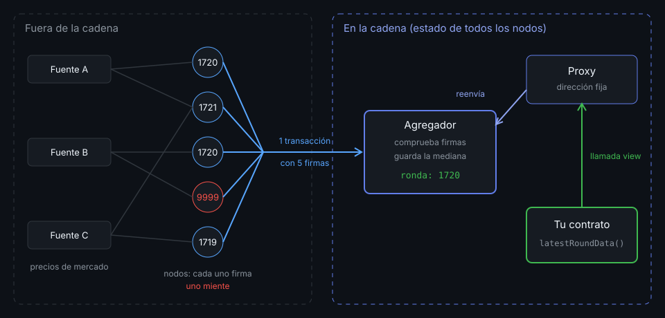

# Teoría 01 — El problema del oráculo

## 🎯 Objetivos

- Explicar por qué un contrato no puede leer nada de fuera de la cadena por sí mismo.
- Definir qué es un oráculo y qué confianza añade al protocolo.
- Conocer cómo está montada una red de oráculos como Chainlink: nodos, agregador y proxy.
- Leer con `cast` un price feed real de Sepolia.

## 1. Qué problema resuelve

Tu registro cobra 0,01 ETH por alta. Si el ETH vale 2500 dólares, el alta cuesta 25; si sube a
5000, cuesta 50 sin que hayas cambiado nada. Lo natural sería fijar la tasa en dólares y que el
contrato calculara cuánto ETH es. Para eso necesita saber **cuántos dólares vale un ETH ahora**,
y ese dato no está en la cadena: está en los exchanges, en el mundo.

Lo mismo pasa con cualquier dato de fuera: el resultado de un partido, la temperatura de una
ciudad, si un vuelo llegó con retraso o un número aleatorio que nadie pueda prever. Un contrato
solo ve el estado de la cadena y los datos de la transacción que lo llama.

## 2. Cómo funciona

### Por qué un contrato no puede hacer una petición HTTP

Cada nodo de la red ejecuta cada transacción y tiene que llegar **exactamente** al mismo estado
que los demás (semana 02): si no, no se ponen de acuerdo sobre el bloque. Esa ejecución es
**determinista**: con la misma entrada da siempre la misma salida.

Una petición HTTP no lo es. Si un contrato pudiera pedir `https://api.ejemplo.com/precio`, cada
nodo la haría en un momento distinto y recibiría una respuesta distinta (o un error, o nada).
Miles de nodos llegarían a miles de estados distintos. Por eso la EVM no tiene ninguna
instrucción para salir de la cadena: todo lo que un contrato lee tiene que estar ya **dentro**.

### Un oráculo mete el dato en la cadena

Un **oráculo** (oracle) es un sistema que lleva un dato de fuera a la cadena con una
transacción normal: lo escribe en el storage de un contrato, y desde ahí cualquier otro
contrato lo lee con una llamada `view`, como lee un saldo. El dato ya es parte del estado, igual
para todos los nodos.

El problema se mueve de sitio: ahora la pregunta es **de quién te fías**. Si una sola cuenta
escribe el precio, esa cuenta decide cuánto cobra tu protocolo, y si su clave se pierde o se
roba, también decide el atacante. Es el **problema del oráculo**: el contrato es tan fiable
como el dato que recibe, y el dato es tan fiable como quien lo escribe.

### Una red de oráculos

**Chainlink** resuelve el problema con una red descentralizada de oráculos (DON, Decentralized
Oracle Network): en vez de una cuenta, muchas, de operadores independientes.



1. **Fuentes**: cada nodo consulta varios agregadores de precios de mercado, fuera de la cadena.
2. **Nodos**: cada operador firma su respuesta. Las respuestas se combinan fuera de la cadena y
   una sola transacción lleva el informe con todas las firmas.
3. **Agregador** (aggregator): el contrato que comprueba las firmas, se queda con la **mediana**
   de las respuestas y la guarda como una nueva **ronda** (round), con su número y la hora.
4. **Proxy**: el contrato al que llamas tú. Reenvía cada lectura al agregador actual, para que
   Chainlink pueda cambiar el agregador sin que cambie la dirección que usas.

La mediana es la defensa clave: para mover el precio, un atacante necesita controlar más de la
mitad de los nodos. Uno que mienta o se caiga no cambia el resultado.

### Cuándo se actualiza

El agregador no escribe un precio nuevo en cada bloque: costaría gas sin parar. Escribe cuando
se cumple una de dos condiciones, que la página de cada feed publica:

| Condición | Qué significa | Valor típico en ETH/USD |
| --------- | ------------- | ----------------------- |
| Desviación (deviation) | El precio de fuera se ha movido más de un porcentaje desde la última ronda | 0,5 % en Ethereum |
| Latido (heartbeat) | Ha pasado este tiempo sin ronda nueva | 1 hora en Ethereum |

Consecuencia directa: **el precio que lees puede tener hasta un latido de antigüedad**, y en ese
tiempo el mercado se puede haber movido casi una desviación entera. Si lleva más de un latido
sin cambiar, algo va mal. La teoría 02 convierte esto en una comprobación.

### Tres formas de traer datos de fuera

Esta semana usa tres piezas que se confunden a menudo. Solo las dos primeras son oráculos:

| Pieza | Quién escribe en la cadena | Cuándo | Cómo lo usa tu contrato |
| ----- | -------------------------- | ------ | ----------------------- |
| Price feed (teoría 02) | La red de oráculos, por su cuenta | En cada ronda (desviación o latido) | Lo lee cuando quiere, con una llamada `view` |
| VRF (teoría 03) | Un nodo, cuando tu contrato se lo pide | Unos bloques después de la petición | Recibe la respuesta en una función suya |
| IPFS (teoría 04) | Nadie: los archivos se quedan fuera | — | Guarda solo el CID; quien lee la metadata la busca fuera |

El contrato nunca lee un archivo de IPFS. Guarda su nombre, y son las wallets y las páginas las
que lo buscan.

## 3. Cómo se escribe

### Leer un feed real con `cast`

El feed ETH/USD de Sepolia vive en `0x694AA1769357215DE4FAC081bf1f309aDC325306` (lo publica la
página de direcciones de Chainlink, en *webgrafía*). Es una lectura: no necesita cuenta ni ETH,
solo un RPC de Sepolia. El público de la semana 16 vale.

**Dónde**: en el contenedor (`docker run --rm -it bc-smartcontracts-dev`).

```bash
R=https://ethereum-sepolia-rpc.publicnode.com
F=0x694AA1769357215DE4FAC081bf1f309aDC325306
cast call $F "description()(string)" --rpc-url $R
cast call $F "decimals()(uint8)" --rpc-url $R
cast call $F "latestRoundData()(uint80,int256,uint256,uint256,uint80)" --rpc-url $R
```

```text
"ETH / USD"
8
18446744073709589472 [1.844e19]
172036000000 [1.72e11]
1795429464 [1.795e9]
1795429464 [1.795e9]
18446744073709589472 [1.844e19]
```

Los números de la ronda, el precio y la hora serán otros cuando lo ejecutes: es un dato vivo.
Lo que significan las cinco líneas de `latestRoundData`, en orden:

| Campo | Valor | Qué es |
| ----- | ----- | ------ |
| `roundId` | `18446744073709589472` | Número de ronda. Muy grande porque lleva dentro el número de agregador (fase) |
| `answer` | `172036000000` | El precio con `decimals` decimales: 1720,36 dólares |
| `startedAt` | `1795429464` | Cuándo empezó la ronda (timestamp Unix) |
| `updatedAt` | `1795429464` | Cuándo se escribió: el dato que dice su antigüedad |
| `answeredInRound` | igual que `roundId` | Obsoleto; no lo uses |

Para leer el precio en dólares, `cast` divide por los decimales:

```bash
cast --format-units 172036000000 8
```

```text
1720.36000000
```

Y para saber su antigüedad, la hora del último bloque:

```bash
cast block latest -f timestamp --rpc-url $R
```

```text
1795429992
```

`1795429992 - 1795429464 = 528`: el precio tenía 528 segundos, menos de un latido.

### El proxy y su agregador

El proxy te dice a qué agregador reenvía:

```bash
cast call $F "aggregator()(address)" --rpc-url $R
```

```text
0x719E22E3D4b690E5d96cCb40619180B5427F14AE
```

Tu contrato guarda la dirección del **proxy**, nunca la del agregador: cuando Chainlink lo
cambie, el agregador viejo deja de recibir rondas y tu contrato se quedaría con un precio
congelado.

## 4. Antipatrones y riesgos

- **El precio de un solo pool como oráculo.** Leer el precio de un par de un exchange en la
  cadena (un AMM, semana 30) parece gratis, pero ese precio lo mueve cualquiera que haga una
  compra grande en la misma transacción, incluso con un préstamo que devuelve al final. Es la
  manipulación de oráculos de la semana 22. Un feed agregado de muchas fuentes no se mueve así.
- **Un oráculo propio de una sola cuenta.** Un `setPrice` con `onlyOwner` es un oráculo con un
  solo nodo: quien tenga esa clave cobra lo que quiera. Si no hay feed para tu dato, documenta
  esa confianza y limita lo que puede cambiar.
- **Suponer que el precio es de ahora.** Puede tener hasta un latido, o más si la red se para.
  Sin comprobar `updatedAt`, tu contrato cobra con el precio de ayer.
- **Guardar la dirección del agregador.** Se queda sin rondas cuando Chainlink lo sustituye.
- **Olvidar que confías en Chainlink.** Sus operadores y su multifirma pueden cambiar el
  agregador del proxy. Para un precio es un riesgo razonable; tu README lo debe decir.

## 5. Trucos

- La página de cada feed (en *data.chain.link*) enseña su desviación, su latido y su historial.
  Mírala antes de elegir la antigüedad máxima que aceptas.
- `cast call` con la firma de retorno entre paréntesis decodifica la tupla entera; sin ella,
  verías un hexadecimal de 160 bytes.
- Hay feeds de muchos pares y de otros datos (tipos de interés, reservas). Todos tienen la misma
  interfaz: lo que aprendes con ETH/USD vale para todos.

## ✅ Checklist

- [ ] Sé por qué la EVM no puede pedir un dato a una API.
- [ ] Sé qué es un oráculo y por qué el problema pasa a ser de quién te fías.
- [ ] Describo el camino de un precio: fuentes, nodos, mediana en el agregador, proxy.
- [ ] Sé qué son la desviación y el latido, y qué dicen de la antigüedad del precio.
- [ ] Leo `latestRoundData` de un feed real con `cast` y entiendo cada campo.

---

| Anterior | Actual | Siguiente |
| -------- | ------ | --------- |
| [← Semana 20 — Oráculos y datos off-chain](../README.md) | **Teoría 01 — El problema del oráculo** | [Teoría 02 — Price feeds →](02-price-feeds.md) |
