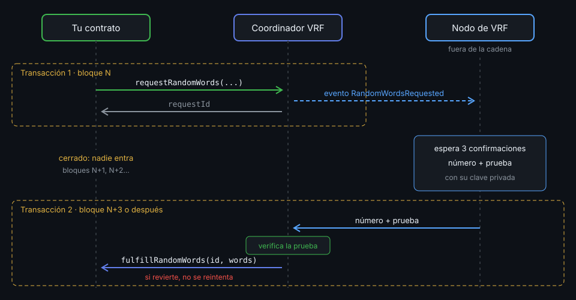

# Teoría 03 — Aleatoriedad con VRF

## 🎯 Objetivos

- Explicar por qué ningún dato del bloque sirve como número aleatorio.
- Entender qué garantiza una función aleatoria verificable (VRF).
- Pedir y recibir un número de Chainlink VRF v2.5 en dos transacciones.
- Probar un consumidor de VRF con el coordinador falso de Chainlink.

## 1. Qué problema resuelve

Un sorteo, el reparto de premios entre los inscritos, el orden de un turno, los atributos de un
NFT al acuñarlo: todos necesitan un número que **nadie pueda prever ni elegir**. Ni quien juega,
ni el dueño del contrato, ni quien produce el bloque.

La EVM es determinista (teoría 01): todo lo que calcula un contrato lo puede calcular cualquier
otro con los mismos datos. Así que un número "aleatorio" hecho con datos de la cadena lo conoce
cualquiera que esté en la misma transacción.

## 2. Cómo funciona

### Por qué el bloque no sirve

Las tentaciones habituales son `block.timestamp`, `blockhash(block.number - 1)` y
`block.prevrandao` (un valor que el protocolo de consenso cambia en cada bloque), mezclados con
`keccak256`. Tienen dos problemas:

1. **Otro contrato los lee igual.** Dentro de la misma transacción, `block.prevrandao` vale lo
   mismo en tu contrato y en el del atacante. Puede calcular el resultado antes de jugar y
   jugar solo si gana. Lo verás abajo.
2. **Quien produce el bloque influye.** Un validador que ve que el valor de su bloque le hace
   perder puede no publicarlo: pierde la recompensa del bloque, pero si el premio vale más,
   compensa. Con `block.timestamp` puede, además, mover unos segundos la hora.

### Una función aleatoria verificable

Una **VRF** (Verifiable Random Function) es una función que, con una clave privada y una
semilla, produce un número y una **prueba**. Con la clave pública, cualquiera comprueba la
prueba: que el número sale de esa semilla y esa clave, y de ninguna otra forma. Es como una
firma (semana 01) cuyo resultado sirve de número aleatorio.

Lo que garantiza:

- **El nodo no elige el número.** Para una semilla y una clave, solo hay un resultado válido. Si
  mandara otro, la prueba no pasaría.
- **Nadie lo prevé.** La semilla incluye datos del bloque en el que se pidió, que no se conocen
  hasta que se mina, y sin la clave privada del nodo no se puede calcular.

### El flujo en dos transacciones



1. **Petición.** Tu contrato llama a `requestRandomWords` del **coordinador** (el contrato de
   Chainlink que recibe peticiones y comprueba pruebas). El coordinador emite un evento con la
   petición y te devuelve un **requestId**.
2. **Espera.** El nodo de VRF ve el evento y espera `requestConfirmations` bloques: si un reorg
   cambiara el bloque de la petición, cambiaría la semilla.
3. **Respuesta.** El nodo calcula el número y la prueba y llama al coordinador, que comprueba la
   prueba y llama a `rawFulfillRandomWords` de tu contrato. Tu código va en
   `fulfillRandomWords`, con el mismo `requestId` y los números.

Entre la 1 y la 3 pasan bloques. Tu contrato tiene que **cerrar todo lo que pueda cambiar el
resultado** mientras espera: por ejemplo, no aceptar jugadores nuevos.

### La suscripción

Cada respuesta cuesta el gas de la segunda transacción más una comisión. Lo paga una
**suscripción**: una cuenta en el coordinador, con saldo en LINK (el token de Chainlink) o en
ETH, y una lista de contratos **consumidores** que pueden gastarlo. En Sepolia se crea en la web
de VRF (en *webgrafía*) con ETH y LINK de faucet; nunca con dinero real.

Cada petición lleva:

| Campo | Qué es |
| ----- | ------ |
| `keyHash` | El **carril de gas** (gas lane): el precio máximo del gas que aceptas pagar por la respuesta |
| `subId` | La suscripción que paga |
| `requestConfirmations` | Bloques que espera el nodo (mínimo 3 en Sepolia, máximo 200) |
| `callbackGasLimit` | Gas máximo de tu `fulfillRandomWords` |
| `numWords` | Cuántos números quieres (hasta 500) |
| `extraArgs` | Si pagas en ETH (`nativePayment: true`) o en LINK |

En Sepolia, el coordinador VRF v2.5 es `0x9DdfaCa8183c41ad55329BdeeD9F6A8d53168B1B`, y el carril
de 500 gwei, `0x787d74caea10b2b357790d5b5247c2f63d1d91572a9846f780606e4d953677ae`. Lo puedes
comprobar:

```bash
R=https://ethereum-sepolia-rpc.publicnode.com
C=0x9DdfaCa8183c41ad55329BdeeD9F6A8d53168B1B
cast call $C "s_provingKeys(bytes32)(bool,uint64)" \
  0x787d74caea10b2b357790d5b5247c2f63d1d91572a9846f780606e4d953677ae --rpc-url $R
cast call $C "MAX_NUM_WORDS()(uint32)" --rpc-url $R
```

```text
true
500000000000 [5e11]
500
```

`true` dice que el carril existe y `5e11` wei son sus 500 gwei.

## 3. Cómo se escribe

### El atacante que nunca pierde

Para ver el problema, un cara o cruz con el bloque. **Dónde**: un proyecto Foundry con la
plantilla (`docs/plantillas/starter-foundry/`), en `src/CoinFlip.sol`:

```solidity
// SPDX-License-Identifier: MIT
pragma solidity 0.8.38;

// ❌ Una apuesta a cara o cruz con "aleatoriedad" del bloque.
contract CoinFlip {
    receive() external payable {}

    /// @notice Paga 0,1 ETH y, si sale cara, recibe 0,2.
    function flip() external payable {
        require(msg.value == 0.1 ether);
        bool heads = uint256(keccak256(abi.encode(block.prevrandao, block.timestamp, msg.sender))) % 2 == 0;
        if (!heads) return;
        (bool ok,) = msg.sender.call{value: 0.2 ether}("");
        require(ok);
    }
}
```

Y en `src/Cheater.sol`, el atacante, que hace la misma cuenta antes de jugar:

```solidity
// SPDX-License-Identifier: MIT
pragma solidity 0.8.38;

import {CoinFlip} from "./CoinFlip.sol";

contract Cheater {
    receive() external payable {}

    function play(CoinFlip game) external {
        bool heads = uint256(keccak256(abi.encode(block.prevrandao, block.timestamp, address(this)))) % 2 == 0;
        if (heads) game.flip{value: 0.1 ether}();
    }
}
```

Un test que juega 20 bloques distintos (`vm.roll`, `vm.warp` y `vm.prevrandao` cambian el
número, la hora y el `prevrandao` del bloque), en `test/CoinFlip.t.sol`:

```solidity
function test_CheaterNeverLoses() public {
    CoinFlip game = new CoinFlip();
    vm.deal(address(game), 10 ether);
    Cheater cheater = new Cheater();
    vm.deal(address(cheater), 1 ether);
    for (uint256 i = 1; i <= 20; i++) {
        vm.roll(i);
        vm.warp(1_750_000_000 + i * 12);
        vm.prevrandao(bytes32(i));
        cheater.play(game);
    }
    assertGt(address(cheater).balance, 1 ether);
    emit log_named_decimal_uint("saldo del atacante", address(cheater).balance, 18);
}
```

```bash
forge test -vv
```

```text
[PASS] test_CheaterNeverLoses() (gas: 1106214)
Logs:
  saldo del atacante: 1.800000000000000000
```

Ganó 8 veces y no perdió ninguna: solo jugó cuando sabía que ganaba.

### Un consumidor de VRF

Chainlink da la base `VRFConsumerBaseV2Plus` (en la imagen, en `/opt/lib/chainlink-contracts`,
con el remapping `@chainlink/contracts/`). Su constructor recibe el coordinador y te deja el
contrato con dueño (`onlyOwner`) y la variable `s_vrfCoordinator`:

```solidity
import {VRFConsumerBaseV2Plus} from "@chainlink/contracts/src/v0.8/vrf/dev/VRFConsumerBaseV2Plus.sol";
import {VRFV2PlusClient} from "@chainlink/contracts/src/v0.8/vrf/dev/libraries/VRFV2PlusClient.sol";

contract Raffle is VRFConsumerBaseV2Plus {
    constructor(address coordinator, uint256 subscriptionId, bytes32 keyHash)
        VRFConsumerBaseV2Plus(coordinator) { /* ... */ }

    function draw() external onlyOwner returns (uint256 requestId) {
        requestId = s_vrfCoordinator.requestRandomWords(
            VRFV2PlusClient.RandomWordsRequest({
                keyHash: KEY_HASH,
                subId: SUBSCRIPTION_ID,
                requestConfirmations: 3,
                callbackGasLimit: 200_000,
                numWords: 1,
                extraArgs: VRFV2PlusClient._argsToBytes(VRFV2PlusClient.ExtraArgsV1({nativePayment: false}))
            })
        );
    }

    function fulfillRandomWords(uint256 requestId, uint256[] calldata randomWords) internal override {
        // randomWords[0] % players.length elige al ganador.
    }
}
```

`rawFulfillRandomWords`, de la base, comprueba que quien llama es el coordinador y llama a tu
`fulfillRandomWords`. Si otra cuenta lo intenta, revierte con
`OnlyCoordinatorCanFulfill(have, want)`.

### Probar sin red: el coordinador falso

`VRFCoordinatorV2_5Mock` hace de coordinador en un test: no comprueba pruebas y responde cuando
el test se lo pide, con el número que el test elija. Su montaje, en el `setUp`:

```solidity
coordinator = new VRFCoordinatorV2_5Mock(0.002 ether, 1e9, 4e15); // tasa base, gas, precio del LINK
uint256 subId = coordinator.createSubscription();
coordinator.fundSubscription(subId, 1000 ether);
raffle = new Raffle(address(coordinator), subId, KEY_HASH);
coordinator.addConsumer(subId, address(raffle));
```

Y para responder la petición `requestId` con el número 7:

```solidity
uint256[] memory words = new uint256[](1);
words[0] = 7;
coordinator.fulfillRandomWordsWithOverride(requestId, address(raffle), words);
```

Si tu `fulfillRandomWords` revierte, el mock no revierte: emite `RandomWordsFulfilled` con
`success = false`, como el coordinador real. El ejercicio 02 lee ese campo.

## 4. Antipatrones y riesgos

- **`block.prevrandao`, `blockhash` o `block.timestamp` como azar.** Lo calcula cualquiera en la
  misma transacción, y el validador puede influir. Para algo con valor, VRF.
- **Un `fulfillRandomWords` que revierte o se pasa de gas.** El coordinador **no reintenta**:
  el sorteo se queda esperando para siempre. Por eso el ganador no recibe el ETH ahí (si es un
  contrato que lo rechaza, revertiría): se le apunta y lo retira después (patrón *pull*).
- **Aceptar cambios entre petición y respuesta.** Si se puede entrar mientras se espera, quien
  vea la respuesta en el mempool (la transacción pendiente que aún no está en un bloque) entra
  justo antes con la posición ganadora.
- **Volver a pedir hasta que salga lo que quieres.** Si el dueño puede cancelar y pedir otra
  vez cuando quiera, puede ver la respuesta en el mempool, cancelar y repetir. Una cancelación
  solo debe ser posible tras un plazo mucho mayor que lo que tarda VRF, y la respuesta vieja
  debe dejar de valer.
- **No comprobar el `requestId`.** Si hubo una petición cancelada, su respuesta tardía no debe
  decidir el sorteo nuevo.

## 5. Trucos

- Pide varios números de una vez con `numWords` en vez de varias peticiones: es una sola
  respuesta y un solo pago.
- `randomWords[0] % n` tiene un sesgo de una parte en 2²⁵⁶ / n: para cualquier `n` real, nulo.
- Con un número puedes sacar más con `uint256(keccak256(abi.encode(word, i)))`: el resultado
  sigue siendo imprevisible porque `word` lo es.
- En tests, `fulfillRandomWordsWithOverride` con números elegidos hace que cada test sepa quién
  gana; `fulfillRandomWords(requestId, consumer)` usa números derivados del `requestId`.

## ✅ Checklist

- [ ] Sé por qué los datos del bloque no sirven como número aleatorio.
- [ ] Sé qué demuestra la prueba de una VRF y por qué el nodo no puede elegir el número.
- [ ] Describo la petición, la espera y la respuesta, y qué cierro mientras espero.
- [ ] Sé qué paga la suscripción y qué es cada campo de la petición.
- [ ] Pruebo un consumidor con `VRFCoordinatorV2_5Mock` y respondo con el número que elijo.

---

| Anterior | Actual | Siguiente |
| -------- | ------ | --------- |
| [← Teoría 02 — Price feeds](02-price-feeds.md) | **Teoría 03 — Aleatoriedad con VRF** | [Teoría 04 — IPFS y metadatos →](04-ipfs-y-metadatos.md) |
