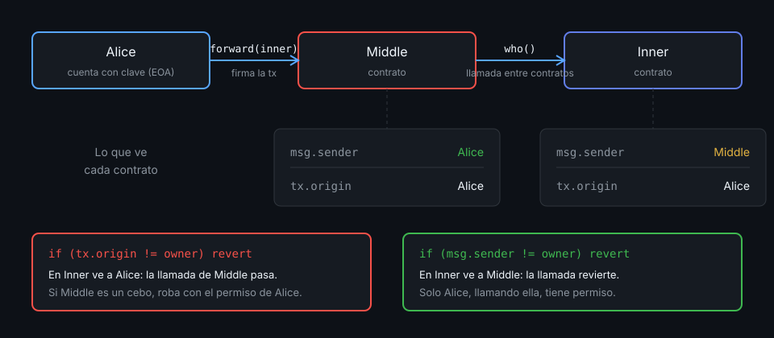

# Teoría 02 — Control de acceso y `tx.origin`

## 🎯 Objetivos

- Reconocer los fallos de control de acceso más comunes: la comprobación que falta, el
  inicializador abierto, la implementación sin cerrar y el `delegatecall` a donde diga quien llama.
- Explicar la diferencia entre `msg.sender` y `tx.origin` con una cadena de llamadas real.
- Escribir el cebo que roba a un contrato que autoriza con `tx.origin`.
- Revisar un contrato buscando cada función que mueve valor o cambia a quién se obedece.

## 1. Qué problema resuelve

El **control de acceso** decide quién puede llamar a cada función. En la semana 13 lo
construiste con `Ownable` y `AccessControl`; aquí lo miras desde el otro lado: cómo se rompe.

Es la clase de vulnerabilidad que más dinero ha costado en los últimos años, y casi nunca tiene
truco. No hace falta una secuencia ingeniosa de llamadas: basta con una función importante a la
que nadie le puso la comprobación, o una comprobación que mira la variable equivocada.

El caso de manual es la cartera multifirma de Parity, en 2017. Sus carteras delegaban el código
en una librería compartida (con `delegatecall`, semana 10). La librería tenía una función de
inicialización que nadie había llamado **en la propia librería**. Un usuario la llamó, se
convirtió en su dueño y, después, llamó a la función que la destruía. Todas las carteras que
dependían de ella se quedaron sin código: unos 513 000 ETH bloqueados para siempre.

## 2. Cómo funciona

### Cuatro formas de dejar la puerta abierta

| Fallo | Qué pasa | Defensa |
| ----- | -------- | ------- |
| Falta la comprobación | Una función que envía valor, cambia un parámetro o da roles no mira quién llama | `onlyOwner`, `onlyRole`, o `if (msg.sender != ...) revert` en **cada** función privilegiada |
| Inicializador abierto | `initialize` se puede llamar más de una vez, o alguien la llama antes que tú | `initializer` y desplegar el proxy con la llamada dentro |
| Implementación sin cerrar | La implementación detrás del proxy tiene su propio storage y nadie la inicializó | `_disableInitializers()` en su constructor |
| `delegatecall` o `call` arbitrario | El contrato ejecuta código o llamadas a la dirección que le pasa quien llama | Nunca a una dirección que venga del usuario |

El último merece una línea más. `delegatecall` ejecuta el código de otro contrato **con tu
storage y tu saldo** (semana 10). Si la dirección la elige quien llama, elige también qué se
escribe en tu storage, incluido quién es el dueño. El `multicall` de tu registro usa
`delegatecall`, pero siempre a `address(this)`: solo puede ejecutar funciones del propio
registro, cada una con sus propias comprobaciones.

### El inicializador, otra vez

Un contrato detrás de un proxy no usa el constructor: el constructor se ejecuta en la
implementación, no en el proxy (semana 15). `initialize` es una función normal, así que tiene
dos riesgos:

1. **Que se llame dos veces.** Sin `initializer`, quien la llame después se nombra dueño.
2. **Que alguien se adelante.** Si despliegas el proxy en una transacción e inicializas en otra,
   quien vigile el **mempool** (las transacciones pendientes que aún no están en un bloque) ve
   tu `initialize` y envía el suyo antes, pagando más gas. Se evita pasando la llamada en el
   constructor del proxy: `new ERC1967Proxy(implementation, initData)`.

### `msg.sender` y `tx.origin`

Las dos son direcciones que la EVM pone a disposición de cada llamada:

- `msg.sender`: quien hace **esta** llamada. Si un contrato llama a otro, es el contrato.
- `tx.origin`: la cuenta que **firmó la transacción**. Siempre una cuenta con clave privada
  (una EOA, semana 02), y la misma en toda la cadena de llamadas.



Compruébalo. **Dónde**: en un proyecto Foundry, `src/Who.sol`:

```solidity
// SPDX-License-Identifier: MIT
pragma solidity 0.8.38;

import {console} from "forge-std/console.sol";

contract Inner {
    function who() external view {
        console.log("Inner  msg.sender", msg.sender);
        console.log("Inner  tx.origin ", tx.origin);
    }
}

contract Middle {
    function forward(Inner inner) external view {
        console.log("Middle msg.sender", msg.sender);
        inner.who();
    }
}
```

Y `test/Who.t.sol`. `vm.prank(alice, alice)` hace que la siguiente llamada la haga Alice y que
`tx.origin` sea también Alice, como si ella hubiera firmado:

```solidity
function test_Who() public {
    Inner inner = new Inner();
    Middle middle = new Middle();
    address alice = makeAddr("alice");
    console.log("alice            ", alice);
    console.log("middle           ", address(middle));
    vm.prank(alice, alice);
    middle.forward(inner);
}
```

**Ejecuta** `forge test -vv --mt test_Who`:

```text
  alice             0x328809Bc894f92807417D2dAD6b7C998c1aFdac6
  middle            0x2e234DAe75C793f67A35089C9d99245E1C58470b
  Middle msg.sender 0x328809Bc894f92807417D2dAD6b7C998c1aFdac6
  Inner  msg.sender 0x2e234DAe75C793f67A35089C9d99245E1C58470b
  Inner  tx.origin  0x328809Bc894f92807417D2dAD6b7C998c1aFdac6
```

Para `Inner`, quien llama es `Middle`; quien firmó, Alice.

### El ataque de phishing

Un contrato que autoriza con `if (tx.origin != owner) revert` acepta cualquier llamada que esté
**dentro** de una transacción firmada por el dueño, venga de quien venga. El atacante solo tiene
que conseguir que el dueño llame a un contrato suyo: un "reclama tu premio", un airdrop falso,
un NFT con una función atractiva. Dentro, su contrato llama a la cartera del dueño, y la
comprobación pasa. Es lo que haces en el ejercicio 02.

Con `msg.sender`, la cartera ve al contrato del atacante, que no es el dueño, y revierte.

## 3. Cómo se escribe

Una revisión de control de acceso es una lista. Para cada función `external` o `public` que
**no** sea `view`:

1. ¿Mueve valor (ETH, tokens), cambia un parámetro, da o quita un rol, actualiza código o pausa?
2. Si sí, ¿qué comprobación tiene, y mira `msg.sender`?
3. ¿Hay un test que la llame desde una cuenta sin permiso y espere el error?

Un contrato para un proxy, con sus tres cerrojos (la tesorería del ejercicio 02):

```solidity
contract Treasury is Initializable {
    address public owner;

    /// @custom:oz-upgrades-unsafe-allow constructor
    constructor() {
        _disableInitializers(); // la implementación no se puede inicializar
    }

    function initialize(address newOwner) external initializer { // una sola vez
        owner = newOwner;
    }

    function sweep(address to) external {
        if (msg.sender != owner) revert NotOwner(msg.sender); // quién llama, no quién firmó
        // ...
    }
}
```

Y el proxy, desplegado con la llamada a `initialize` dentro, para que no haya un hueco entre
crearlo e inicializarlo:

```solidity
bytes memory init = abi.encodeCall(Treasury.initialize, (alice));
Treasury treasury = Treasury(payable(address(new ERC1967Proxy(address(implementation), init))));
```

En OpenZeppelin, cada fallo tiene su error. Sus selectores, para reconocerlos en una traza:

```bash
cast sig "AccessControlUnauthorizedAccount(address,bytes32)"
cast sig "InvalidInitialization()"
```

```text
0xe2517d3f
0xf92ee8a9
```

El test que lo prueba es aburrido a propósito: una cuenta extraña, una llamada por función,
`vm.expectRevert` con el error exacto. Tu proyecto tiene uno con todas las funciones
privilegiadas del registro.

El linter de Foundry detecta `tx.origin` usado para autorizar. Sobre la cartera vulnerable del
ejercicio 02, sin el comentario que lo silencia, `forge lint src/OriginWallet.sol` da:

```text
warning[tx-origin]: `tx.origin` is used for authorization
```

## 4. Antipatrones y riesgos

- **`tx.origin` para autorizar.** Siempre `msg.sender`. Si quieres saber quién firmó, piénsalo
  dos veces: con account abstraction (semana 32) quien firma puede no ser una EOA.
- **`require(tx.origin == msg.sender)` para "solo personas".** Intenta bloquear a los contratos.
  Rompe las carteras que son contratos (multifirmas, account abstraction) y, desde EIP-7702, una
  EOA puede tener código: ya no separa personas de contratos.
- **Una función privilegiada sin test de acceso.** Si nadie comprueba que un extraño recibe el
  error, un `onlyRole` borrado en un cambio pasa la revisión.
- **Inicializar en otra transacción.** Siempre en el constructor del proxy.
- **Implementación sin `_disableInitializers()`.** Aunque hoy no se pueda hacer daño con ella,
  mañana una función nueva puede darle poder a su dueño.
- **Roles demasiado grandes.** Una sola cuenta con `DEFAULT_ADMIN_ROLE` que puede actualizar,
  cobrar y pausar es un único punto de fallo. Separa roles y pon el de administrador detrás de un
  timelock o un multisig (semana 13).
- **`renounceOwnership` o `renounceRole` sin pensar.** Si el último administrador renuncia, nadie
  podrá actualizar ni despausar nunca.

## 5. Trucos

- `vm.prank(alice, alice)` fija `msg.sender` **y** `tx.origin`; `vm.startPrank(alice, alice)`,
  para varias llamadas.
- Para encontrar funciones privilegiadas, busca en tu código `onlyRole`, `onlyOwner` y
  `msg.sender ==`. Después busca las que mueven valor y **no** aparecen en esa lista.
- En un test de phishing, haz que el cebo guarde el error con `try`/`catch`: el test comprueba
  que el contrato rechazó al cebo por la razón correcta.

## ✅ Checklist

- [ ] Sé qué valen `msg.sender` y `tx.origin` en cada contrato de una cadena de llamadas.
- [ ] Explico el ataque de phishing contra `tx.origin` y por qué `msg.sender` lo evita.
- [ ] Protejo `initialize` con `initializer`, la implementación con `_disableInitializers()`, y
  despliego el proxy con la inicialización dentro.
- [ ] Nunca hago `delegatecall` a una dirección que elige quien llama.
- [ ] Cada función privilegiada de mi protocolo tiene un test que la llama sin permiso.

---

| Anterior | Actual | Siguiente |
| -------- | ------ | --------- |
| [← Teoría 01 — Reentrancy](01-reentrancy.md) | **Teoría 02 — Control de acceso y `tx.origin`** | [Teoría 03 — Denegación de servicio →](03-denegacion-de-servicio.md) |
