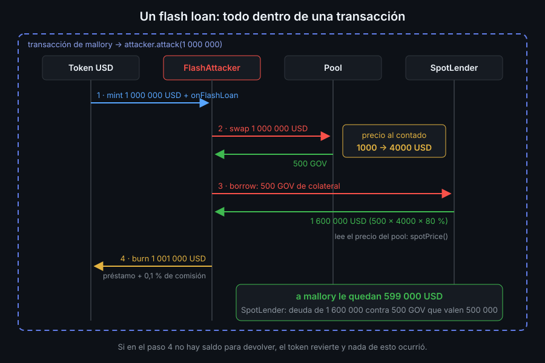

# Teoría 02 — Flash loans

## 🎯 Objetivos

- Explicar por qué un préstamo sin garantía es seguro para quien presta si se devuelve en la
  misma transacción.
- Seguir el flujo de ERC-3156: `flashLoan`, `onFlashLoan`, la comisión y la devolución.
- Escribir un prestatario que compruebe quién le presta y quién pidió el préstamo.
- Revisar un contrato suponiendo que el atacante tiene capital ilimitado durante una transacción.

## 1. Qué problema resuelve

El ataque de la teoría 01 necesitaba un millón de USD durante unos segundos. Hasta 2020 eso era
una barrera: quien tenía ese dinero rara vez lo arriesgaba en un ataque. Ese año aparecieron los
**flash loans** (préstamos relámpago): préstamos sin garantía, de cualquier cantidad que tenga el
prestamista, con una condición: se devuelven en la **misma transacción**.

Para el prestamista no hay riesgo. Una transacción es **atómica**: o se ejecuta entera o no se
ejecuta nada (semana 02). Si al final el préstamo no ha vuelto, el prestamista revierte, y con él
todo lo que pasó desde que prestó: es como si el dinero nunca hubiera salido.

Tienen usos legítimos: aprovechar la diferencia de precio entre dos pools (arbitraje), pagar una
deuda para liberar su colateral y venderlo, o cambiar una deuda de un protocolo a otro, todo sin
capital propio. Pero también borran la barrera del capital para cualquier ataque. En febrero de
2020, los primeros ataques con flash loans contra bZx movieron precios de oráculos con dinero
prestado. En abril de 2022, un atacante de Beanstalk pidió prestados tokens suficientes para
tener la mayoría de los votos de su gobernanza, aprobó en la misma transacción una propuesta que
le enviaba los fondos del protocolo y devolvió el préstamo: unos 180 millones de dólares.

## 2. Cómo funciona

### El flujo de ERC-3156



[ERC-3156](https://eips.ethereum.org/EIPS/eip-3156) estandariza la interfaz. Hay dos papeles:

- El **prestamista** (`IERC3156FlashLender`) tiene `flashLoan(receiver, token, amount, data)`,
  `maxFlashLoan(token)` (cuánto puede prestar) y `flashFee(token, amount)` (la comisión).
- El **prestatario** (`IERC3156FlashBorrower`) tiene `onFlashLoan(initiator, token, amount,
  fee, data)`, y debe devolver `keccak256("ERC3156FlashBorrower.onFlashLoan")`.

Lo que pasa en `flashLoan`, en orden:

1. El prestamista envía `amount` tokens a `receiver`.
2. Llama a `receiver.onFlashLoan(msg.sender, token, amount, fee, data)`. `initiator` es quien
   llamó a `flashLoan`, que no tiene por qué ser `receiver`.
3. El prestatario hace lo que quiera con el dinero y, antes de volver, da permiso al
   prestamista para recoger `amount + fee`.
4. El prestamista comprueba el valor devuelto y recoge `amount + fee`. Si falta algo, revierte
   la transacción entera.

### Un token que se presta a sí mismo

OpenZeppelin trae `ERC20FlashMint`, una extensión de ERC-20 que es su propio prestamista: en el
paso 1 **crea** los tokens prestados (mint) y en el paso 4 los **quema** junto con la comisión,
usando la allowance que el prestatario dio al token. Por eso `maxFlashLoan` es casi
`type(uint256).max` menos lo que ya existe: puede prestar más tokens de los que hay. El
`totalSupply` sube durante la transacción y vuelve a bajar al final.

Por defecto no cobra comisión. El token del ejercicio 01 (`src/Token.sol`) cobra un 0,1 %:

```solidity
function _flashFee(address, uint256 value) internal pure override returns (uint256) {
    return Math.mulDiv(value, FLASH_FEE_BPS, 10_000, Math.Rounding.Ceil);
}
```

Un **punto básico** (bps) es una centésima de punto porcentual: 10 bps son el 0,1 %. El redondeo
hacia arriba evita que un préstamo de menos de 1000 unidades salga gratis; la teoría 04 explica
por qué.

### Qué cambia para quien defiende

Sin flash loans, la pregunta al revisar era "¿quién tiene tanto dinero?". Con ellos es "¿qué
pasa si alguien tiene todo el dinero que hay, durante una transacción?". Todo lo que dependa
del saldo, el precio o los votos **del momento** se puede mover con capital prestado:

- un precio al contado (teoría 01);
- los votos de una gobernanza que cuenta el saldo actual en vez del de un bloque anterior (la
  semana 31 usa `ERC20Votes`, que guarda el saldo de cada bloque por eso);
- un reparto proporcional al saldo de cada uno en ese momento;
- la proporción entre participaciones y tokens de una bóveda (teoría 04).

## 3. Cómo se escribe

El atacante del ejercicio 01 (`src/FlashAttacker.sol`) pide el préstamo y, dentro de
`onFlashLoan`, hace los tres pasos de la teoría 01:

```solidity
function attack(uint256 loan) external {
    USD.flashLoan(this, address(USD), loan, "");
    IERC20(USD).safeTransfer(OWNER, USD.balanceOf(address(this)));
}

function onFlashLoan(address initiator, address, uint256 amount, uint256 fee, bytes calldata)
    external
    returns (bytes32)
{
    if (msg.sender != address(USD)) revert UntrustedLender(msg.sender);
    if (initiator != address(this)) revert UntrustedInitiator(initiator);
    IERC20(USD).forceApprove(address(POOL), amount);
    uint256 gov = POOL.swap(USD, amount);
    GOV.forceApprove(address(LENDER), gov);
    LENDER.borrow(gov, LENDER.maxDebt(gov));
    // El token cobra quemando `amount + fee` de este contrato: necesita la allowance.
    IERC20(USD).forceApprove(address(USD), amount + fee);
    return CALLBACK_SUCCESS;
}
```

`forceApprove` es la función de `SafeERC20` (semana 11) que pone una allowance aunque el token
sea de los que rechazan cambiar una allowance que no está a cero.

Las dos primeras líneas de `onFlashLoan` son las comprobaciones de todo prestatario:

- **`msg.sender` es el prestamista.** `onFlashLoan` es `external`: cualquiera puede llamarla
  con los argumentos que quiera y fingir un préstamo que no existe.
- **`initiator` es este contrato.** Cualquiera puede llamar a `flashLoan` con tu contrato como
  `receiver`. Sin esta comprobación, tu contrato ejecuta su lógica con un préstamo que pidió
  otro, en el momento que elige otro, y paga la comisión de su saldo.

En el ejercicio lo compruebas con:

```bash
forge test --mt test_Paso3
```

```text
[PASS] test_Paso3_RevertWhen_CallerIsNotLender() (gas: 1007345)
[PASS] test_Paso3_RevertWhen_UntrustedInitiator() (gas: 1044997)
```

## 4. Antipatrones y riesgos

- **Confiar en que el ataque cuesta capital.** Si un ataque solo necesita dinero durante una
  transacción, cuesta la comisión del flash loan y el gas.
- **Leer saldos o votos del bloque actual.** Cualquier decisión con el saldo de ahora se compra
  con un préstamo. Usa el de un bloque anterior (snapshots, checkpoints).
- **`onFlashLoan` sin comprobar `msg.sender` e `initiator`.** Es una función pública que mueve
  dinero de tu contrato.
- **Dejar fondos en el prestatario.** Si tu prestatario guarda saldo entre transacciones, cada
  fallo en sus comprobaciones lo pone en juego. El atacante del ejercicio envía su beneficio al
  dueño en la misma transacción.
- **Un prestamista que no revisa lo que vuelve.** Si `flashLoan` comprueba la devolución con el
  saldo y no con lo que recoge, el prestatario puede devolver el préstamo con depósitos a su
  nombre en el propio prestamista: el saldo cuadra y el préstamo sigue fuera.
- **Una comisión que se redondea a cero.** Con `amount * bps / 10_000`, los préstamos pequeños
  no pagan. Pocas veces es grave, pero es un fallo de redondeo (teoría 04).

## 5. Trucos

- Al revisar un contrato, para cada función pública pregúntate: "¿y si quien llama tiene mil
  millones durante esta transacción?". Si la respuesta cambia lo que recibe, hay un riesgo.
- En Foundry no necesitas un flash loan para probar un ataque: `deal(address(token), attacker,
  amount)` de forge-std da el saldo directamente. El flash loan solo demuestra que el capital no
  es una barrera; el fallo está en el contrato atacado.
- `forge test -vvvv` muestra el préstamo como una llamada a `flashLoan` que contiene todo el
  ataque dentro de `onFlashLoan`.

## ✅ Checklist

- [ ] Explico por qué el prestamista no arriesga nada si el préstamo vuelve en la misma
  transacción.
- [ ] Sigo los cuatro pasos de `flashLoan` en ERC-3156.
- [ ] Compruebo `msg.sender` e `initiator` en cada `onFlashLoan`.
- [ ] Reviso un contrato suponiendo capital ilimitado durante una transacción.

---

| Anterior | Actual | Siguiente |
| -------- | ------ | --------- |
| [← Teoría 01 — Manipulación de oráculos](01-manipulacion-de-oraculos.md) | **Teoría 02 — Flash loans** | [Teoría 03 — Front-running y MEV →](03-front-running-y-mev.md) |
