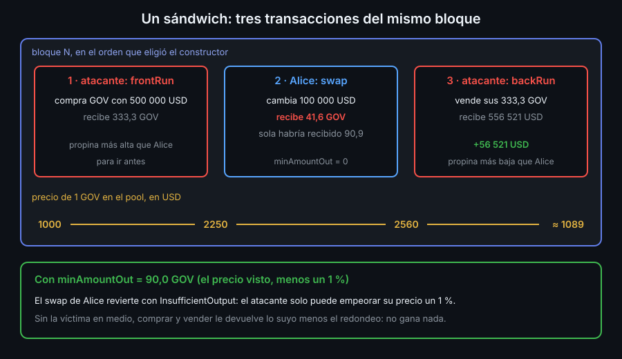

# Teoría 03 — Front-running y MEV

## 🎯 Objetivos

- Explicar quién decide el orden de las transacciones de un bloque y por qué tu transacción es
  pública antes de ejecutarse.
- Ver en anvil cómo una propina más alta adelanta una transacción enviada después.
- Reconocer un front-running, un back-running y un sándwich, y calcular cuánto pierde la víctima.
- Defender un contrato con un mínimo a recibir, un plazo y commit-reveal.

## 1. Qué problema resuelve

Cuando envías una transacción no se ejecuta en el acto. Primero viaja por la red de nodos y
espera en la **mempool** (memory pool): la lista de transacciones firmadas que todavía no están
en ningún bloque. Cualquiera que tenga un nodo la ve entera: a quién llamas, con qué
argumentos, cuánto ETH envías.

Después, alguien elige cuáles entran en el siguiente bloque y **en qué orden**. En Ethereum
hoy lo hace un **constructor de bloques** (block builder), que vende el bloque terminado al
validador al que le toca proponerlo (semana 02). Su criterio es ganar lo máximo: ordena por
propina (la priority fee de EIP-1559) y añade sus propias transacciones donde más le rinden.

El valor que se puede sacar eligiendo qué transacciones entran, cuáles no y en qué orden se
llama **MEV** (maximal extractable value). Los **searchers** son bots que leen la mempool,
buscan transacciones de las que sacar provecho y envían a los constructores las suyas, con la
propina justa para ir donde les conviene. Parte del MEV es inofensivo (el arbitraje que
devuelve un pool a su precio); otra parte sale directamente del bolsillo de otros usuarios.

Para tu contrato, la consecuencia es simple: **cualquier transacción puede tener otra justo
antes y otra justo después, escritas por alguien que ya ha visto la tuya**.

## 2. Cómo funciona

### Verlo en anvil

anvil mina un bloque por transacción, en el orden en que llegan. Con `--no-mining` las deja en
su mempool hasta que le pidas un bloque, y con `--order fees` las ordena por propina, como un
constructor.

**Dónde**: en el contenedor (`docker run --rm -it bc-smartcontracts-dev`). Arranca anvil así y
envía dos transferencias con las cuentas 1 y 2 de anvil: primero la de la cuenta 1, con 1 gwei
de propina; después la de la cuenta 2, con 5. `--async` no espera al recibo, solo imprime el
hash:

```bash
anvil --silent --no-mining --order fees &
K1=0x59c6995e998f97a5a0044966f0945389dc9e86dae88c7a8412f4603b6b78690d
K2=0x5de4111afa1a4b94908f83103eb1f1706367c2e68ca870fc3fb9a804cdab365a
BOB=0x90F79bf6EB2c4f870365E785982E1f101E93b906
cast send $BOB --value 1ether --gas-price 10gwei --priority-gas-price 1gwei --private-key $K1 --async
cast send $BOB --value 1ether --gas-price 10gwei --priority-gas-price 5gwei --private-key $K2 --async
cast rpc txpool_status
```

```text
0x5bc5a630e2968a5a36e2b39437d7ee6aa498283c6da3cdc2ef5ad8f098556f80
0x708e2b2e229e735fba5beb4aa77aabd035cf13b680759075c4c063851724077f
{"pending":"0x2","queued":"0x0"}
```

Las dos esperan (`pending` es 2). Pide un bloque y mira en qué orden entraron:

```bash
cast rpc evm_mine >/dev/null
for h in $(cast block latest --json | jq -r '.data.transactions[]'); do cast tx $h from; done
```

```text
0x3C44CdDdB6a900fa2b585dd299e03d12FA4293BC
0x70997970C51812dc3A010C7d01b50e0d17dc79C8
```

Primero la cuenta 2 (`0x3C44...`), que llegó después pero pagaba más. Eso es un
**front-running**: adelantarse a una transacción que ya está en la mempool. Ir justo detrás es
un **back-running**.

### Tres formas de sacar provecho

**Copiar.** Si tu transacción gana algo que podría ganar cualquiera (resolver un acertijo,
reclamar una recompensa, cerrar un arbitraje), un bot la simula, ve el beneficio, cambia tu
dirección por la suya y la envía con más propina. Hay bots que hacen esto con cualquier
transacción, sin entender lo que hace: se llaman *generalized front-runners*.

**Anticipar.** Si tu transacción va a mover un precio, quien la ve compra antes de que lo
mueva. Pasa también con las actualizaciones de los oráculos: quien ve en la mempool el precio
nuevo puede operar al viejo un bloque antes.

**Sándwich.** Las dos cosas a la vez, contra un swap:



En el ejercicio 02, Alice quiere cambiar 100 000 USD por GOV en un pool de 1 000 000 USD y
1000 GOV. Sola, recibiría 90,9 GOV. El atacante ve su swap en la mempool y:

1. **Antes**, compra GOV con 500 000 USD: el precio sube.
2. Alice compra al precio inflado y recibe **41,6 GOV**: menos de la mitad.
3. **Después**, el atacante vende sus GOV: el precio que subió Alice le paga a él.
   Acaba con 556 521 USD: 56 521 más de los que tenía.

Alice no ha perdido nada en el sentido de que le roben de su cuenta: firmó un swap que aceptaba
cualquier precio, y le dieron el peor.

## 3. Cómo se escribe

### Un mínimo a recibir y un plazo

La defensa contra el sándwich es decir en la transacción cuánto aceptas como mínimo. El
**slippage** (deslizamiento) es la diferencia entre el precio que ves al firmar y el que
obtienes; tu tolerancia es cuánto aceptas que empeore. El swap del ejercicio 02 (`src/Pool.sol`):

```solidity
function swap(IERC20 tokenIn, uint256 amountIn, uint256 minAmountOut, uint256 deadline)
    external
    returns (uint256 amountOut)
{
    // forge-lint: disable-next-line(block-timestamp)
    if (block.timestamp > deadline) revert Expired(deadline);
    amountOut = quote(tokenIn, amountIn);
    if (amountOut < minAmountOut) revert InsufficientOutput(amountOut, minAmountOut);
    // ... mueve las reservas y los tokens
}
```

`minAmountOut` lo calcula quien firma, **fuera de la cadena**, con el precio que ve: en el
ejercicio, `quote` menos un 1 %. El atacante puede seguir moviendo el precio, pero como mucho
ese 1 %; más allá, el swap de Alice revierte y su sándwich se queda sin relleno.

`deadline` evita la otra trampa: una transacción con poca propina puede esperar en la mempool
horas, hasta que alguien la incluye cuando el precio ya le conviene a él.

### Commit-reveal

Contra la copia, la defensa es que lo que se ve en la mempool no sirva. Un **commit-reveal**
lo hace en dos transacciones:

1. **Commit** (compromiso): envías el hash de tu respuesta, tu dirección y un **salt** (un valor
   aleatorio secreto, para que nadie pruebe respuestas hasta dar con tu hash).
2. **Reveal** (revelación): en un bloque posterior envías la respuesta y el salt; el contrato
   recalcula el hash con `msg.sender` y lo compara.

```solidity
function reveal(string calldata answer, bytes32 salt) external {
    if (solved) revert AlreadySolved();
    if (commitmentOf[msg.sender] != hashCommitment(msg.sender, answer, salt)) revert WrongCommitment();
    if (block.number <= committedAt[msg.sender]) revert RevealTooEarly();
    // ... comprueba la respuesta y paga
}
```

Copiar el commit no sirve: lleva la dirección de Alice dentro. Copiar el reveal tampoco: quien
lo ve necesita un commit suyo de un bloque **anterior**, y cuando la respuesta se ve ya es tarde.

En el ejercicio 02 lo compruebas con:

```bash
forge test --mt test_Paso5
```

```text
[PASS] test_Paso5_RevealPays() (gas: 776775)
[PASS] test_Paso5_RevertWhen_FrontRunnerCopiesCommit() (gas: 715067)
[PASS] test_Paso5_RevertWhen_FrontRunnerCopiesReveal() (gas: 860057)
```

## 4. Antipatrones y riesgos

- **`minAmountOut = 0`.** Acepta cualquier precio: es la invitación a un sándwich.
- **Calcular el mínimo dentro de la transacción.** `minAmountOut = pool.quote(...)` en el propio
  contrato da el precio ya movido por el atacante. El mínimo lo fija quien firma.
- **`deadline = block.timestamp`.** Siempre se cumple: no limita nada.
- **Secretos en los argumentos.** Una respuesta, una contraseña o una oferta en claro se leen en
  la mempool antes de ejecutarse.
- **Commit sin `msg.sender` dentro, o reveal en el mismo bloque.** Cualquiera de los dos deja
  copiar.
- **Cambiar una allowance de N a M con `approve`.** Quien tiene la allowance ve el cambio en la
  mempool, gasta N antes y M después: N + M. Baja primero a 0 o usa `permit` con nonce.
- **Firmas que se pueden enviar antes.** Un permit o una orden firmada que cualquiera puede
  enviar puede llegar antes que la transacción que la usa (semana 14): el contrato tiene que
  funcionar aunque otro la haya enviado ya.

## 5. Trucos

- Antes de dar por buena una función, imagina la misma llamada hecha por otro justo antes, y
  otra justo después. Si alguno de los dos gana a costa del usuario, hay un riesgo.
- En Foundry no hay mempool: el orden de las llamadas del test **es** el orden del bloque. Un
  front-running se escribe poniendo la llamada del atacante antes.
- Como usuario, una **mempool privada** (por ejemplo, el RPC de Flashbots Protect) envía tu
  transacción directa a los constructores sin pasar por la mempool pública. Protege tu
  transacción, no el contrato: la defensa del contrato sigue siendo tuya.

## ✅ Checklist

- [ ] Sé qué es la mempool y quién decide el orden de un bloque.
- [ ] Ordeno transacciones por propina en anvil con `--no-mining --order fees`.
- [ ] Calculo lo que pierde la víctima de un sándwich en un pool de producto constante.
- [ ] Pongo `minAmountOut` y `deadline` en cada swap, calculados fuera de la cadena.
- [ ] Escribo un commit-reveal con `msg.sender` en el hash y la revelación en otro bloque.

---

| Anterior | Actual | Siguiente |
| -------- | ------ | --------- |
| [← Teoría 02 — Flash loans](02-flash-loans.md) | **Teoría 03 — Front-running y MEV** | [Teoría 04 — Redondeo →](04-redondeo.md) |
