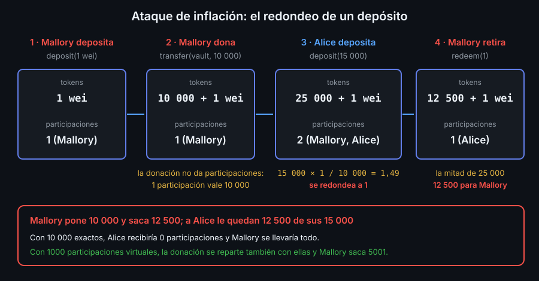

# Teoría 04 — Redondeo

## 🎯 Objetivos

- Explicar qué hace la EVM con los decimales de una división y por qué el orden de las
  operaciones cambia el resultado.
- Decidir hacia dónde redondea cada cálculo: siempre a favor del contrato.
- Usar `Math.mulDiv` de OpenZeppelin con su dirección de redondeo.
- Reproducir un ataque de inflación contra una bóveda y defenderla con participaciones virtuales.

## 1. Qué problema resuelve

La EVM no tiene decimales. Todos los números son enteros, y una división **trunca**: tira la
parte decimal. `7 / 2` es `3`. Por eso los tokens tienen 18 decimales "de mentira" (semana 11):
1 token son `1e18` unidades, y casi nunca importa perder una.

Casi nunca. Cada división de un contrato pierde hasta una unidad, y alguien se queda con ella:
el contrato o el usuario. Si es el usuario, puede repetir la operación hasta que las unidades
sumen. Y si alguien controla los números que se dividen, puede hacer que lo que se pierde no
sea una unidad, sino todo.

En abril de 2023, un atacante de Hundred Finance, un protocolo de préstamos, encontró un
mercado nuevo sin depósitos. Depositó una cantidad mínima, donó tokens al contrato para inflar
lo que valía cada participación, y aprovechó el redondeo de las conversiones para sacar más de
lo que había puesto: unos 7 millones de dólares.

## 2. Cómo funciona

### Multiplicar antes de dividir

La bóveda del ejercicio 03 tiene 200 tokens y 100 participaciones. ¿Cuántas participaciones
valen 50 tokens? `50 × 100 / 200 = 25`. Pero el orden importa:

```solidity
// ❌ 50e18 / 200e18 = 0 (trunca), y 0 * 100e18 = 0
return assets / total * shares;
// ✅ 50e18 * 100e18 = 5e39, y 5e39 / 200e18 = 25e18
return assets * shares / total;
```

Dividir primero tira los decimales de un número pequeño y después los multiplica. `forge lint`
lo detecta:

```text
warning[divide-before-multiply]: division before multiplication may lose precision
```

Multiplicar primero tiene otro riesgo: el producto puede pasar de `type(uint256).max`
(unos 1,16 × 10⁷⁷) y revertir con un desbordamiento (semana 21), aunque el resultado final
cupiera. `Math.mulDiv(a, b, c)` de OpenZeppelin calcula `a × b / c` con un intermedio de 512
bits: no desborda si el resultado cabe, y acepta una dirección de redondeo.

```solidity
Math.mulDiv(assets, shares, total);                      // hacia abajo
Math.mulDiv(assets, shares, total, Math.Rounding.Ceil);  // hacia arriba
```

Tu registro ya lo usa desde la semana 20: `registrationFee` redondea hacia arriba.

### Hacia dónde redondear

La regla es una: **el redondeo favorece al contrato**, es decir, a todos los demás usuarios.
Lo que el contrato da se redondea hacia abajo; lo que el contrato cobra, hacia arriba.

| Cálculo | Dirección | Por qué |
| ------- | --------- | ------- |
| Participaciones por un depósito | Abajo | Recibes, como mucho, lo que pagaste |
| Tokens por quemar participaciones | Abajo | Sacas, como mucho, lo que vale lo tuyo |
| Participaciones que cuesta sacar N tokens | Arriba | Pagas, como mínimo, lo que sacas |
| Comisiones, tasas, deudas | Arriba | Una comisión no se redondea a cero |

En el ejercicio 03, con 200 tokens y 100 participaciones, sacar 1 token cuesta media
participación. Hacia abajo serían 0: cualquiera sin participaciones sacaría 1 token gratis, y
otro, y otro. Hacia arriba es 1 participación, y quien no tiene ninguna recibe
`InsufficientShares(0, 1)`.

### El ataque de inflación



Una **bóveda** (vault) reparte participaciones (shares) proporcionales a lo depositado:
`participaciones = tokens × totalParticipaciones / totalTokens`. Si `totalTokens` sale de
`balanceOf(address(this))`, cualquiera puede subirlo enviando tokens directamente (una
**donación**), sin recibir participaciones a cambio.

El primer depositante de una bóveda vacía lo aprovecha:

1. Deposita **1 wei** (la unidad mínima) y recibe 1 participación.
2. **Dona** 10 000 tokens: ahora 1 participación vale 10 000 tokens y 1 wei.
3. Alice deposita 15 000 tokens: `15 000e18 × 1 / (10 000e18 + 1) = 1,49...`, que se redondea
   a **1** participación.
4. Hay 2 participaciones y 25 000 tokens. El atacante quema la suya y saca **12 500**: puso
   10 000 y un wei. Los 2500 de más eran de Alice.

Con 10 000 tokens exactos, Alice recibiría **0** participaciones y el atacante se llevaría todo.

### Las defensas

- **Revertir si salen 0 participaciones.** Evita el caso extremo, pero no el anterior: con 1
  participación en vez de 1,49, Alice sigue perdiendo.
- **Participaciones virtuales.** Calcular la proporción como si siempre hubiera unas
  participaciones y un token más que no son de nadie:
  `tokens × (totalParticipaciones + 1000) / (totalTokens + 1)`. La donación del atacante se
  reparte también con esas 1000 participaciones virtuales, y la pierde. Es lo que hace
  `ERC4626` de OpenZeppelin con `_decimalsOffset` (la semana 30 la usa).
- **Participaciones muertas.** El primer depósito quema una parte de sus participaciones
  (Uniswap v2 quema las 1000 primeras): nadie puede ser el único dueño de una bóveda casi vacía.
- **Contabilidad interna.** Llevar `totalTokens` en una variable que solo cambian los depósitos
  y retiradas, en vez de leer el saldo: las donaciones no cuentan.

## 3. Cómo se escribe

Las conversiones de la bóveda del ejercicio 03 (`src/Vault.sol`), con su dirección:

```solidity
function convertToShares(uint256 assets) public view returns (uint256) {
    (uint256 shares, uint256 total) = _totals();
    if (shares == 0) return assets;
    return Math.mulDiv(assets, shares, total);
}

function previewWithdraw(uint256 assets) public view returns (uint256) {
    (uint256 shares, uint256 total) = _totals();
    if (shares == 0) return assets;
    return Math.mulDiv(assets, shares, total, Math.Rounding.Ceil);
}
```

Y la versión con participaciones virtuales (`src/VirtualVault.sol`) solo cambia los totales:

```solidity
function _totals() internal view override returns (uint256 shares, uint256 assets) {
    return (totalShares + VIRTUAL_SHARES, totalAssets() + 1);
}
```

Con ella, el mismo ataque deja al atacante 5001 tokens de los 10 000 que donó, y Alice saca
14 997,99 de sus 15 000:

```bash
forge test --mt test_Paso4
```

```text
[PASS] test_Paso4_VirtualSharesMakeAttackLose() (gas: 320432)
[PASS] test_Paso4_VirtualVaultNormalUse() (gas: 158677)
```

## 4. Antipatrones y riesgos

- **Dividir antes de multiplicar.** Pierde todos los decimales del primer cociente.
- **Redondear todo en la misma dirección.** Hacia abajo en lo que se cobra regala unidades;
  hacia arriba en lo que se paga, también.
- **Proporciones con `balanceOf(address(this))`.** Una donación las cambia sin pasar por tu
  código.
- **Una bóveda vacía sin defensa.** El primer depósito fija la proporción; si es de 1 wei, la
  fija el atacante.
- **Pensar que una unidad no importa.** Una unidad repetida en un bucle, o multiplicada por un
  precio de 10¹⁸, es dinero. Y en una L2 el gas de repetirla es barato.
- **Restar dos valores redondeados.** `a - b` con `a` redondeado hacia abajo y `b` hacia arriba
  puede bajar de cero cuando son casi iguales, y la checked math revierte (semana 21).

## 5. Trucos

- Ante cada división, escribe en un comentario hacia dónde redondea y a favor de quién.
- Un test de fuzzing (semana 09) es la mejor prueba de redondeo: para entradas aleatorias,
  comprueba que depositar y retirar nunca devuelve más de lo que entró.
- Si un número sale de `balanceOf`, busca qué pasa si alguien envía tokens sin llamar a nada.

## ✅ Checklist

- [ ] Multiplico antes de dividir, o uso `Math.mulDiv`.
- [ ] Sé hacia dónde redondea cada conversión de una bóveda y por qué.
- [ ] Reproduzco a mano el ataque de inflación con 1 wei y una donación.
- [ ] Explico por qué revertir con 0 participaciones no basta y qué añaden las virtuales.

---

| Anterior | Actual | Siguiente |
| -------- | ------ | --------- |
| [← Teoría 03 — Front-running y MEV](03-front-running-y-mev.md) | **Teoría 04 — Redondeo** | [Ejercicio 01 — Oráculo y flash loan →](../2-practicas/ejercicio-01-oraculo-y-flash-loan/README.md) |
