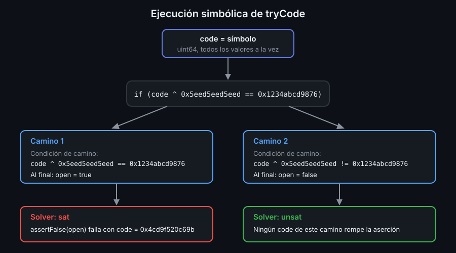
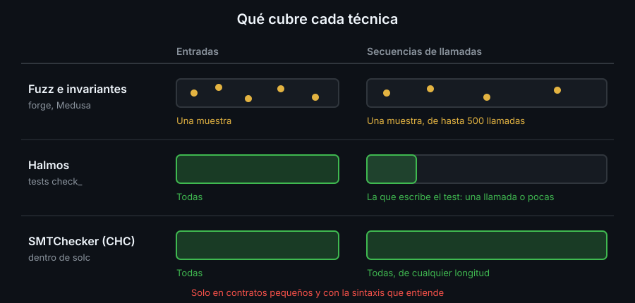

# Teoría 01 — De probar a demostrar

## 🎯 Objetivos

- Explicar por qué un test, un fuzz o una campaña de invariantes en verde no demuestran nada
  para las entradas que no probaron.
- Describir la ejecución simbólica: caminos, condiciones de camino y la pregunta que se le hace
  al solver.
- Saber qué responde un solver SMT y qué significa cada respuesta.
- Distinguir qué demuestra cada herramienta de la semana y dentro de qué límites.

## Lo que un test en verde no dice

Desde la semana 09 has escrito tres tipos de pruebas, y las tres **prueban ejemplos**:

| Prueba | Qué ejecuta |
| ------ | ----------- |
| Test unitario | Una entrada que eliges tú |
| Test de fuzz | 256 entradas aleatorias (o las que pidas con `--fuzz-runs`) |
| Invariantes (semana 24) | 256 secuencias de 500 llamadas aleatorias |

Cuando pasan, sabes que el código funciona **para esas entradas**. De las demás no sabes nada. Un
ejemplo de juguete, una caja fuerte que se abre con un código:

```solidity
contract Safe {
    bool public open;

    function tryCode(uint64 code) external {
        if (code ^ 0x5eed5eed5eed == 0x1234abcd9876) open = true;
    }
}
```

`^` es el XOR bit a bit. Hay un solo código de 64 bits que abre la caja. Un test de fuzz que dice
"la caja nunca se abre":

```solidity
function testFuzz_NeverOpens(uint64 code) public {
    safe.tryCode(code);
    assertFalse(safe.open());
}
```

```bash
forge test --fuzz-runs 100000
```

```text
[PASS] testFuzz_NeverOpens(uint64) (runs: 100000, μ: 30533, ~: 30530)
```

Cien mil códigos, verde. Hay 2⁶⁴ (unos 18 trillones), así que el fuzz tendría que tener mucha
suerte. Tampoco le sirve su diccionario: los dos números que hay en el bytecode no abren la caja,
y el que la abre no aparece en ninguna parte.

Esta semana cambias la pregunta. En vez de "¿falla con estas entradas?", "¿**existe** alguna
entrada con la que falle?". Responderla para todas las entradas a la vez es **verificación
formal**: demostrar, con un razonamiento que hace una máquina, que el código cumple una
**especificación** (lo que debe hacer, escrito de forma precisa) para todos los casos.

## Ejecución simbólica

Un test normal ejecuta el código con valores **concretos**: `code = 7`. La **ejecución simbólica**
lo ejecuta con un **símbolo**: `code` es una incógnita, como la `x` de una ecuación. Cada operación
no calcula un número sino una expresión: `code ^ 0x5eed5eed5eed`.



Cuando la ejecución llega a un `if` cuya condición depende del símbolo, no puede elegir una rama:
sigue **las dos**. Cada rama es un **camino**, y lleva su **condición de camino**: lo que tiene que
ser verdad de las entradas para que la ejecución pase por ahí.

| Camino | Condición de camino | Estado al final |
| ------ | ------------------- | --------------- |
| 1 | `code ^ 0x5eed5eed5eed == 0x1234abcd9876` | `open = true` |
| 2 | `code ^ 0x5eed5eed5eed != 0x1234abcd9876` | `open = false` |

Al llegar al `assertFalse(safe.open())`, la pregunta es, para cada camino: **¿hay algún valor de
`code` que cumpla la condición del camino y haga fallar la aserción?** En el camino 2, no:
`open` es `false`. En el camino 1, sí, si existe un `code` que cumpla la ecuación. Esa pregunta
no la responde quien ejecuta: la responde un solver.

## El solver SMT

Un **solver SAT** responde si una fórmula de lógica booleana (variables verdadero/falso con `y`,
`o` y `no`) tiene alguna asignación que la haga verdadera. Un **solver SMT** (*satisfiability
modulo theories*) hace lo mismo con fórmulas que hablan de más cosas: enteros, arrays y, lo que
importa aquí, **vectores de bits**, números de un ancho fijo (256 bits en la EVM) con su suma que
da la vuelta, sus desplazamientos y su XOR. Los dos que usarás esta semana son **z3** (de
Microsoft) y **yices** (de SRI).

Para cada pregunta, el solver da una de tres respuestas:

| Respuesta | Qué significa | Qué te dice la herramienta |
| --------- | ------------- | -------------------------- |
| `sat` (satisfacible) | Hay valores que cumplen la fórmula, y el solver da unos | Un **contraejemplo**: con estas entradas, la aserción falla |
| `unsat` (insatisfacible) | No hay ningún valor que la cumpla | La aserción se cumple en este camino, **para todas las entradas** |
| `unknown` o tiempo agotado | No lo ha podido decidir | Nada: ni demostrado ni refutado |

Si todos los caminos dan `unsat`, la propiedad está **demostrada** para todas las entradas. Es
una afirmación más fuerte que un test en verde: no dice "no he encontrado un fallo", dice "no
existe".

Para la caja fuerte, la ecuación tiene solución, y el solver la encuentra al instante. El mismo
test con el prefijo `check_`, ejecutado con Halmos (teoría 03):

```solidity
function check_NeverOpens(uint64 code) public {
    safe.tryCode(code);
    assertFalse(safe.open());
}
```

```bash
halmos
```

```text
Running 1 tests for test/Safe.t.sol:SafeTest
Counterexample:
    p_code_uint64_87621e2_00 = 0x4cd9f520c69b
[FAIL] check_NeverOpens(uint64) (paths: 4, time: 0.05s, bounds: [])
Symbolic test result: 0 passed; 1 failed; time: 0.07s
```

`0x4cd9f520c69b` es `0x1234abcd9876 ^ 0x5eed5eed5eed`: el código que abre la caja. Cinco
centésimas de segundo frente a cien mil intentos en vano.

## Qué demuestra una demostración

"Demostrado" siempre tiene letra pequeña. La demostración es sobre un **modelo** del programa,
y el modelo tiene límites:

- **La especificación.** Se demuestra lo que escribiste, no lo que querías decir. Una aserción
  equivocada o que no mira lo importante queda demostrada igual.
- **Los bucles.** Un bucle cuyo número de vueltas depende de un símbolo genera infinitos caminos.
  Las herramientas lo cortan en un número de vueltas (teoría 03), y lo que pasa después no se
  demuestra.
- **El tiempo.** Hay fórmulas que el solver no resuelve en un tiempo razonable, sobre todo con
  multiplicaciones y divisiones entre dos símbolos. El resultado es "no lo sé" (teoría 04).
- **El entorno.** Las direcciones de los contratos, el gas, el bloque o las llamadas a contratos
  que no conoce: cada herramienta los modela a su manera, y no siempre como la EVM real.
- **Lo que se llama.** Una prueba de una sola llamada no dice nada de secuencias de llamadas, salvo
  que la herramienta las explore.

Por eso la verificación formal no sustituye a los tests ni a las invariantes: los complementa.
Lo que esta semana añade es poder decir, de una regla concreta, "para todas las entradas", con
la letra pequeña escrita en el informe.

## Las herramientas de la semana



| Herramienta | Dónde vive | Qué entradas cubre | Qué secuencias cubre |
| ----------- | ---------- | ------------------ | -------------------- |
| Fuzz e invariantes (semanas 09 y 24) | forge, Medusa | Una muestra | Una muestra, de hasta 500 llamadas |
| **SMTChecker** (teoría 02) | Dentro de `solc` | Todas | **Todas**, de cualquier longitud |
| **Halmos** (teoría 03) | Programa aparte, de a16z | Todas | La que escribe el test (una llamada, o unas pocas) |

El SMTChecker es más ambicioso: razona sobre cualquier secuencia de transacciones. A cambio, solo
funciona bien con contratos pequeños y no entiende toda la sintaxis de Solidity. Halmos razona
sobre los tests que escribes, con los cheatcodes de forge que ya conoces, y aguanta protocolos
reales como el tuyo.

## ⚠️ Riesgos

- **Confundir "demostrado" con "correcto".** Una demostración vale lo que su especificación y su
  modelo. El informe tiene que decir las dos cosas.
- **Tomar un "no lo sé" por un "sí".** Un tiempo agotado no es una demostración, aunque la
  herramienta no haya dado contraejemplo.
- **Dejar de escribir tests.** Una demostración no ejecuta el código en la EVM real. Cada
  contraejemplo se convierte en un test unitario que lo reproduce, y ese test se queda como
  test de regresión.

## 📝 Resumen

- Los tests, el fuzz y las invariantes prueban ejemplos; la verificación formal pregunta si existe
  alguna entrada que rompa la especificación.
- La ejecución simbólica sigue todos los caminos con las entradas como incógnitas, y un solver
  SMT decide para cada camino si la aserción puede fallar.
- `sat` da un contraejemplo, `unsat` demuestra el camino y un tiempo agotado no dice nada.
- Toda demostración vale dentro de su modelo: especificación, bucles, tiempo, entorno y secuencias.

---

| Anterior | Actual | Siguiente |
| -------- | ------ | --------- |
| [← Semana 25 — Verificación formal](../README.md) | **Teoría 01 — De probar a demostrar** | [Teoría 02 — SMTChecker →](02-smtchecker.md) |
