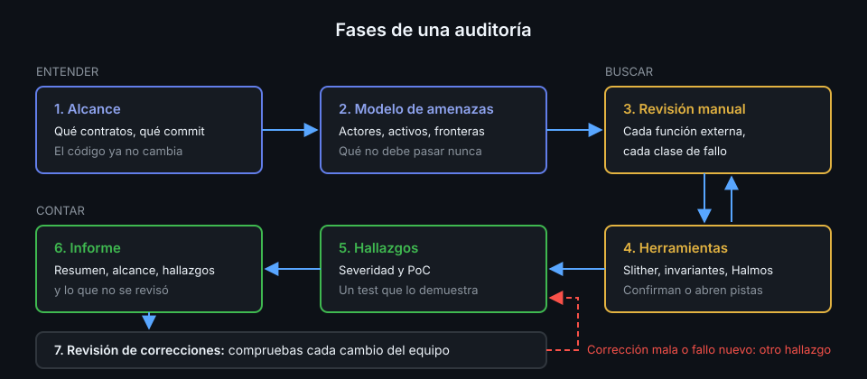

# Teoría 01 — Metodología de auditoría

## 🎯 Objetivos

- Explicar qué es una auditoría de smart contracts, qué entrega y qué no promete.
- Recorrer sus siete fases y saber qué sale de cada una.
- Fijar el alcance de una auditoría: contratos, commit y lo que queda fuera.
- Hacer una revisión manual con método: de la superficie de ataque hacia dentro, clase por clase.
- Colocar las herramientas de las semanas 23 a 25 dentro del proceso.

## Qué problema resuelve

Desde la semana 21 has encontrado fallos de muchas formas: leyendo código con la lista de
reentrancy en la cabeza, con Slither, con invariantes, con Halmos. Cada técnica encontró cosas
que las otras no veían, y ninguna encontró todo. Si las usas sin orden pasa lo de siempre:
empiezas por la herramienta que más te gusta, lees con atención los contratos que te parecen
interesantes y dejas sin mirar una función de administración "aburrida", que es justo la que
tenía el fallo.

Una **auditoría** (*audit*) es una revisión de seguridad del código de un protocolo, hecha con un
método que se puede repetir y que deja por escrito qué se miró, cómo y qué se encontró. El
resultado es un **informe** (*report*): la lista de **hallazgos** (*findings*), cada uno con su
gravedad y su prueba, y la lista de lo que no se revisó.

Lo que una auditoría **no** es:

- **No es una garantía.** Una auditoría reduce el riesgo; no demuestra que no queden fallos. Hay
  protocolos auditados varias veces que han perdido fondos.
- **No es un test del equipo.** Los tests dicen que el código hace lo que el equipo quería; el
  auditor pregunta qué hace el código cuando alguien quiere otra cosa.
- **No es para siempre.** Vale para un commit concreto. Un cambio de una línea después ya no está
  auditado.

## Cómo funciona: las siete fases



| # | Fase | Qué sale de ella |
| - | ---- | ---------------- |
| 1 | Alcance | La lista de contratos, el commit y lo que queda fuera |
| 2 | Modelo de amenazas | Actores, activos, fronteras de confianza y lo que no debe pasar nunca (teoría 02) |
| 3 | Revisión manual | Pistas y hallazgos, función por función |
| 4 | Herramientas | Confirman pistas de la revisión o abren pistas nuevas |
| 5 | Hallazgos | Cada uno con severidad y una prueba que se ejecuta (teoría 03) |
| 6 | Informe | El documento que lee el equipo y, si es público, todo el mundo (teoría 04) |
| 7 | Revisión de correcciones | Cada corrección, comprobada; si rompe algo, un hallazgo nuevo |

Las fases 3 y 4 no van en fila: lees una función, sospechas, escribes un test o una invariante
para salir de dudas, y lo que te dice la herramienta te manda a leer otra función.

### Fase 1: el alcance

El **alcance** (*scope*) dice qué se audita. Tiene tres partes:

1. **Los contratos**: los archivos, con su tamaño. El tamaño sirve para estimar el trabajo; las
   firmas de auditoría lo cuentan en líneas de código sin comentarios ni líneas en blanco
   (*nSLOC*).
2. **El commit**: el hash de git del código que se audita. Desde que empieza la auditoría, ese
   código no cambia. Si el equipo sigue programando, lo hace en otra rama.
3. **Lo que queda fuera**: las dependencias (OpenZeppelin, Chainlink), los scripts, el frontend,
   los servicios fuera de la cadena. Fuera no quiere decir sin importancia: quiere decir que no
   se revisó, y el informe lo dice.

Con el alcance vienen también la documentación del equipo, los tests que ya tiene y una
conversación para entender qué debe hacer el protocolo. Un fallo es una diferencia entre lo que el
código hace y lo que **debería** hacer: sin saber lo segundo, no hay fallo que encontrar.

### Fase 3: la revisión manual

La revisión manual es el centro de la auditoría: los fallos más graves de las semanas 21 y 22 no
los ve ningún detector, porque dependen de lo que el protocolo quiere hacer. El método:

1. **Empieza por la superficie de ataque** (*attack surface*): las funciones `external` y
   `public` que cambian estado. Son las únicas puertas por las que entra alguien de fuera.
2. **Sigue cada función hacia dentro**: qué comprueba, qué escribe, a quién llama y en qué orden.
3. **Hazle a cada función las preguntas de cada clase** de fallo que ya conoces:

| Clase | Pregunta |
| ----- | -------- |
| Control de acceso | ¿Quién puede llamarla? ¿Debería poder cualquiera? |
| Reentrancy | ¿Llama a otro contrato o envía ETH antes de terminar de escribir? |
| Estados | ¿Se puede llamar dos veces, o en un estado en que no tiene sentido? |
| Tiempo | ¿Qué pasa justo en el plazo, un segundo antes y un segundo después? |
| Aritmética | ¿Divide antes de multiplicar? ¿Hay `unchecked` o conversiones de tipo? |
| DoS | ¿Recorre una lista que alguien de fuera hace crecer? ¿Un envío que falla la bloquea? |
| Datos de fuera | ¿Confía en un precio, un saldo o una firma? ¿Puede cambiar en vuelo? |

4. **Escribe cada sospecha** en una nota con su función y su línea, aunque creas que no es nada.
   Al final o la descartas con un motivo, o se convierte en un hallazgo con su prueba.

## Cómo se hace

Con el starter del ejercicio 01 delante. **Dónde**: en el contenedor, en
`bootcamp/week-26-auditoria/2-practicas/ejercicio-01-modelo-de-amenazas/starter`.

**Paso 1, el commit.** En un repositorio de verdad, lo primero que apuntas es esto:

```bash
git rev-parse HEAD
```

Imprime 40 caracteres hexadecimales: el commit exacto que auditas. Va en la primera tabla del
informe.

**Paso 2, el tamaño.**

```bash
wc -l src/Escrow.sol
```

```text
107 src/Escrow.sol
```

Un contrato pequeño: cabe en una tarde. Un protocolo de 3000 líneas lleva semanas.

**Paso 3, la superficie de ataque.** `forge inspect` lista las funciones externas de un contrato
compilado con su selector:

```bash
forge inspect Escrow methodIdentifiers
```

```text
╭--------------------------+------------╮
| Method                   | Identifier |
+=======================================+
| ARBITER()                | 904cae5c   |
|--------------------------+------------|
| deals(uint256)           | 03988f84   |
|--------------------------+------------|
| dispute(uint256)         | 86d6282c   |
|--------------------------+------------|
| nextId()                 | 61b8ce8c   |
|--------------------------+------------|
| open(address,uint64)     | c0d045ff   |
|--------------------------+------------|
| refund(uint256)          | 278ecde1   |
|--------------------------+------------|
| release(uint256)         | 37bdc99b   |
|--------------------------+------------|
| resolve(uint256,address) | af0d467b   |
╰--------------------------+------------╯
```

`ARBITER`, `deals` y `nextId` son getters: solo leen. Quedan cinco puertas que cambian estado:
`open`, `release`, `refund`, `dispute` y `resolve`. Esa es la lista que recorres en la revisión
manual. En un protocolo grande, esta lista es lo que te asegura que no se te escapa ninguna.

**Paso 4, la base.** Antes de tocar nada, ejecuta los tests del equipo:

```bash
forge test
```

Si ya fallan, el primer hallazgo es ese. Si pasan, sabes qué comprobó el equipo, y tu trabajo
empieza donde acaban sus tests.

## Las herramientas dentro del proceso

| Herramienta | Semana | Cuándo la usas |
| ----------- | ------ | -------------- |
| Slither, forge lint | 23 | Al principio, para tener pistas; al final, para no dejar ningún patrón conocido sin revisar |
| Detector propio | 23 | Cuando una regla del protocolo debe cumplirse en todas las funciones |
| Invariantes y Medusa | 24 | Cuando sospechas de una secuencia de llamadas |
| Halmos | 25 | Cuando una regla debe valer para cualquier entrada |
| Mutantes | 24-25 | Para saber si tus pruebas de verdad miran donde dices |

Un aviso de una herramienta no es un hallazgo: es una pista que revisas a mano. Y que una
herramienta no avise no quiere decir que no haya fallo: los fallos de lógica del protocolo no son
patrones de código.

## ⚠️ Antipatrones y riesgos

- **Auditar código que se mueve.** Si el commit cambia a mitad de la auditoría, el informe habla
  de un código que ya no existe. Se congela el commit; los cambios esperan a la revisión de
  correcciones.
- **Empezar por las herramientas.** Slither da decenas de avisos y lo urgente se pierde entre
  ellos. Primero entiendes qué hace el protocolo; después las usas.
- **Leer solo lo interesante.** Los fallos están a menudo en las funciones de administración, en
  los inicializadores o en los casos límite, no en la lógica principal que el equipo cuidó más.
- **Fiarte de los nombres.** Una función `onlyOwner` o `nonReentrant` hace lo que dice su
  código, no lo que dice su nombre. Lo compruebas leyendo el modificador.
- **Dejar fuera sin decirlo.** Si no revisaste un contrato, el informe lo dice. Callarlo es dejar
  que el lector crea que está revisado.
- **Prometer que no hay fallos.** Ningún informe serio dice "seguro". Dice qué se revisó, con qué
  técnicas, y qué se encontró.

## 💡 Trucos

- **Cuenta las puertas antes de empezar.** `forge inspect <Contrato> methodIdentifiers` en cada
  contrato del alcance, y una fila por función en tus notas. Al final, cada fila tiene que estar
  revisada.
- **Lee primero el diff si es una actualización.** `git diff <commit-anterior> <commit>` sobre
  `src/` muestra lo nuevo. Pero no te quedes en el diff: un cambio pequeño puede romper una
  suposición de un código que no cambió.
- **Las sospechas se apuntan, no se recuerdan.** Una nota por sospecha, con archivo y línea. La
  mitad acabarán en nada, y está bien.
- **Un test sale de dudas antes que una discusión.** Si no sabes si algo es un fallo, escribe el
  test que lo intenta.

## ✅ Checklist

- [ ] Sé explicar qué entrega una auditoría y por qué no es una garantía.
- [ ] Sé qué sale de cada una de las siete fases.
- [ ] Sé fijar el alcance: contratos, commit y lo que queda fuera.
- [ ] Sé sacar la superficie de ataque de un contrato con `forge inspect`.
- [ ] Sé hacerle a cada función externa las preguntas de cada clase de fallo.
- [ ] Sé en qué momento de la auditoría entra cada herramienta de las semanas 23 a 25.

---

| Anterior | Actual | Siguiente |
| -------- | ------ | --------- |
| [← Semana 26 — Auditoría](../README.md) | **Teoría 01 — Metodología de auditoría** | [Teoría 02 — Modelado de amenazas →](02-modelado-de-amenazas.md) |
