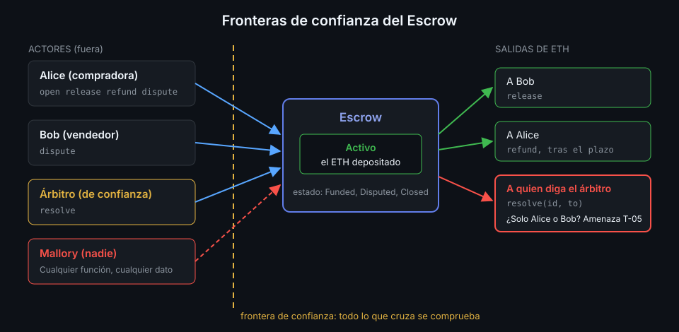

# Teoría 02 — Modelado de amenazas

## 🎯 Objetivos

- Explicar qué es un modelo de amenazas y qué encuentra que la revisión línea a línea no ve.
- Identificar los actores de un protocolo, lo que cada uno puede hacer y cuánto se confía en él.
- Identificar los activos y las fronteras de confianza.
- Escribir una tabla de amenazas con su defensa y su prueba.
- Convertir cada amenaza en un test de Foundry.
- Distinguir un hallazgo de un riesgo aceptado, incluido el riesgo de centralización.

## Qué problema resuelve

La revisión manual de la teoría 01 va de función en función y pregunta "¿esta línea está bien?".
Es buena encontrando fallos locales: un orden de escritura, una comprobación que falta. Pero hay
fallos que no están en ninguna línea concreta, sino en lo que el protocolo **permite** a alguien.
El código hace exactamente lo que dice y, aun así, alguien puede llevarse lo que no debe.

Un **modelo de amenazas** (*threat model*) es una descripción del protocolo desde el lado del
atacante: quién interactúa con él, qué tiene de valor y qué no debe pasar nunca. Se hace antes de
leer el código a fondo y se escribe en el informe. Responde cuatro preguntas:

1. **¿Quién?** Los actores.
2. **¿Qué hay que proteger?** Los activos.
3. **¿Por dónde entra?** Las fronteras de confianza.
4. **¿Qué no debe pasar nunca?** Las amenazas, cada una con su defensa y su prueba.

## Cómo funciona

### Actores

Un **actor** es cualquiera que llama al protocolo o del que el protocolo depende: usuarios,
roles con permisos, otros contratos, oráculos. Para cada uno apuntas qué puede hacer y **cuánto
se confía en él**:

- **Ninguna confianza**: cualquier cuenta. Puede llamar a cualquier función externa con cualquier
  dato, en cualquier orden, y desplegar contratos que vuelven a entrar. El caso de Mallory.
- **Confianza parcial**: un rol al que se le da un poder concreto, y solo ese. Un pauser puede
  parar el protocolo; nadie espera que pueda llevarse los fondos.
- **Confianza total**: quien puede cambiar el código o darse cualquier permiso.

La pregunta para cada actor de confianza parcial es: **si su clave se filtra, ¿qué puede hacer
quien la tenga?** Si la respuesta es "más que su trabajo", hay un hallazgo.

### Activos

Un **activo** (*asset*) es lo que un atacante querría llevarse o romper: el ETH y los tokens que
guarda el contrato, los derechos que registra (quién es dueño de qué), y también la
**disponibilidad**, que los usuarios puedan usarlo. Un contrato que no pierde un wei pero se puede
bloquear para siempre ha perdido un activo.

### Fronteras de confianza

Una **frontera de confianza** (*trust boundary*) es el sitio donde algo de fuera entra al
protocolo: los argumentos de una función externa, la llamada a otro contrato, un precio de un
oráculo, una firma. Al otro lado de una frontera no se da nada por bueno: todo se comprueba.

El `Escrow` del ejercicio 01 tiene cuatro actores, un activo y una sola frontera:



Todo lo que cruza la línea discontinua es una llamada de alguien de fuera, y todo lo que sale por
la derecha es ETH. El diagrama ya hace la pregunta incómoda: el árbitro es de confianza para
**decidir** una disputa, pero ¿puede enviar el ETH a quien quiera?

### Amenazas

Una **amenaza** es algo que no debe pasar nunca, escrito desde el punto de vista del atacante. Se
sacan cruzando actores y activos: "¿puede este actor llevarse, bloquear o cambiar este activo de
una forma que no debe?". Cada una va en una fila con su defensa y su prueba:

| Id | Amenaza | Defensa | Prueba |
| -- | ------- | ------- | ------ |
| T-01 | Alguien de fuera mueve el ETH de un trato | Cada función comprueba quién llama | `test_Paso1_RevertWhen_StrangerMovesFunds` |
| T-02 | Un trato se paga dos veces | El estado pasa a `Closed` antes de enviar | `test_Paso2_RevertWhen_PaidTwice` |
| T-03 | Alice recupera el ETH después de recibir lo comprado | `refund` solo tras el plazo y sin disputa | `test_Paso3_DeadlineRules` |
| T-04 | Bob bloquea el trato disputando tarde | `dispute` solo dentro del plazo | `test_Paso3_DeadlineRules` |
| T-05 | El árbitro se lleva el ETH de una disputa | **Ninguna** | `test_Paso4_RevertWhen_ArbiterPaysThirdParty` falla |

Una fila sin defensa es un hallazgo. La T-05 lo es: `resolve(id, to)` envía el ETH a `to` sin
comprobar que sea una de las partes.

## Cómo se escribe: de la amenaza al test

Cada amenaza con defensa se convierte en un test que **intenta** lo que no debe pasar y comprueba
que el contrato lo impide. La T-01, en `test/Threats.t.sol` del ejercicio 01:

```solidity
// T-01: alguien de fuera mueve el ETH de un trato.
function test_Paso1_RevertWhen_StrangerMovesFunds() public {
    vm.startPrank(mallory);
    vm.expectRevert(Escrow.NotBuyer.selector);
    escrow.release(id);
    vm.expectRevert(Escrow.NotBuyer.selector);
    escrow.refund(id);
    vm.expectRevert(Escrow.NotParty.selector);
    escrow.dispute(id);
    vm.expectRevert(Escrow.NotArbiter.selector);
    escrow.resolve(id, mallory);
    vm.stopPrank();
    assertEq(address(escrow).balance, 1 ether);
}
```

Mallory prueba las cinco puertas de la teoría 01 menos `open`, que crea un trato nuevo y no toca
uno ajeno. El último `assertEq` es la amenaza dicha al revés: el ETH sigue dentro.

El test de una amenaza **sin** defensa falla, y ese fallo es la prueba del hallazgo. Con el
`Escrow` del starter, el test de T-05 da:

```text
[FAIL: next call did not revert as expected] test_Paso4_RevertWhen_ArbiterPaysThirdParty() (gas: 91555)
```

El árbitro llamó a `resolve(id, arbiter)` y el contrato le envió el ETH. Con la corrección (una
línea en `resolve`), el mismo test pasa y se queda como test de regresión.

## Riesgos aceptados y centralización

No toda amenaza es un hallazgo. Si el protocolo **decide** confiar algo a un actor, es un **riesgo
aceptado**, y el informe lo dice con esas palabras. En el `Escrow`, que el árbitro decida mal una
disputa entre Alice y Bob es un riesgo aceptado: para eso está el árbitro. Que pueda dar el ETH a
un tercero, no.

El caso más común es el **riesgo de centralización** (*centralization risk*): una sola cuenta con
poder para actualizar el código, cambiar el oráculo o mover los fondos. El código no tiene ningún
fallo; el riesgo es la clave. Las defensas las viste en la semana 13: un multisig, para que hagan
falta varias firmas, y un timelock, para que los usuarios vean el cambio antes de que se aplique.
Si el protocolo no tiene ninguna de las dos, se escribe como hallazgo, con una severidad que
depende de lo que esa clave puede hacer.

## ⚠️ Antipatrones y riesgos

- **Modelar solo a Mallory.** El atacante sin permisos es el fácil. Las amenazas que más se
  escapan son las de los actores de confianza parcial y las claves filtradas.
- **Una amenaza sin prueba.** "El pauser no puede retirar fondos" sin un test es una opinión. Si
  mañana alguien cambia el modificador, nadie se entera.
- **Confundir la defensa con el nombre.** "Lo protege `onlyRole`" vale si el test lo comprueba con
  la cuenta concreta que no tiene el rol.
- **Olvidar la disponibilidad.** "No se pierden fondos" no basta si los fondos se quedan dentro
  para siempre.
- **Esconder un riesgo aceptado.** Si el administrador puede actualizar el código sin espera, el
  informe lo dice, aunque el equipo lo haya decidido así.

## 💡 Trucos

- **Una tabla actor por activo.** Filas con los actores, columnas con los activos, y en cada celda
  "¿puede llevárselo, bloquearlo o cambiarlo?". Cada "sí" que no es su trabajo es una amenaza.
- **Para cada rol, el test de la clave filtrada**: prank con esa cuenta y prueba todo lo que **no**
  es su trabajo. Un test por rol, no uno por función.
- **Las amenazas de tiempo se prueban en el segundo exacto.** `vm.warp(deadline)`,
  `vm.warp(deadline + 1)`: los fallos viven en el límite.
- **Numera las amenazas.** `T-01`, `T-02`... El informe, los tests y los hallazgos se citan por su
  número.

## ✅ Checklist

- [ ] Sé enumerar los actores de un protocolo y cuánto se confía en cada uno.
- [ ] Sé qué es un activo, incluida la disponibilidad.
- [ ] Sé señalar las fronteras de confianza de un contrato.
- [ ] Sé escribir una tabla de amenazas con su defensa y su prueba.
- [ ] Sé convertir una amenaza en un test que intenta lo que no debe pasar.
- [ ] Sé distinguir un hallazgo de un riesgo aceptado.

---

| Anterior | Actual | Siguiente |
| -------- | ------ | --------- |
| [← Teoría 01 — Metodología de auditoría](01-metodologia-de-auditoria.md) | **Teoría 02 — Modelado de amenazas** | [Teoría 03 — Hallazgos y severidad →](03-hallazgos-y-severidad.md) |
