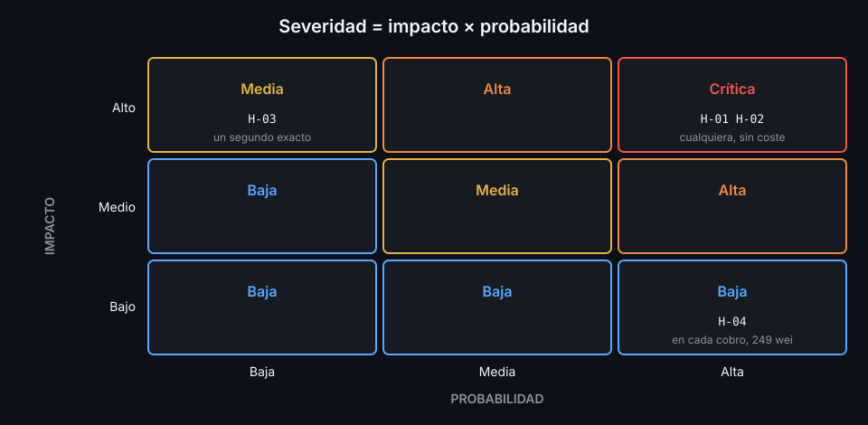

# Teoría 03 — Hallazgos y severidad

## 🎯 Objetivos

- Escribir un hallazgo con sus siete partes: título, severidad, descripción, impacto, prueba,
  recomendación y estado.
- Dar a cada hallazgo su severidad con una matriz de impacto por probabilidad, y justificarla.
- Escribir la prueba de concepto de un hallazgo como un test de Foundry que pasa porque el fallo
  existe.
- Separar los hallazgos de los falsos positivos de una herramienta.
- Agrupar por causa raíz y no confundir recomendación con corrección.

## Qué problema resuelve

Encontrar un fallo es la mitad del trabajo. La otra mitad es que el equipo lo entienda, se lo crea
y sepa qué hacer con él, y eso depende de cómo lo escribas. Un "creo que `claim` tiene un
problema con el saldo" se discute durante una semana. Un hallazgo con título claro, severidad
justificada y un test que cualquiera ejecuta se corrige esa misma tarde.

Además, un equipo con veinte hallazgos tiene que saber por cuál empezar. La **severidad**
(*severity*) es esa prioridad: lo grave antes que lo molesto.

## Cómo funciona

### Las partes de un hallazgo

| Parte | Qué dice |
| ----- | -------- |
| **Id y título** | Un número y una frase con quién hace qué y qué consecuencia tiene |
| **Severidad** | Crítica, Alta, Media, Baja o Informativa, con su porqué |
| **Descripción** | Qué hace el código, con función y línea, y por qué está mal |
| **Impacto** | Qué pierde quién, cuánto, y qué hace falta para que pase |
| **Prueba** | El test que lo demuestra (*proof of concept*, PoC) |
| **Recomendación** | Cómo corregirlo, sin escribir el parche entero |
| **Estado** | Abierto, Corregido, Reconocido o Disputado; lo rellena la revisión de correcciones |

El título se escribe como una frase con sujeto y consecuencia. "Reentrancy en `refundAll`" dice
dónde mirar; "Un aportante que rechaza ETH bloquea las devoluciones de todos" dice qué pasa y a
quién. El segundo se entiende sin abrir el código.

**Numeración**: en este bootcamp, `H-01` es el **h**allazgo número 1, y la severidad va en su
columna. Muchas firmas usan la letra de la severidad en inglés (`H-01` es el primer *High*, `M-02`
el segundo *Medium*). Cuando leas un informe ajeno, mira su leyenda.

### La severidad: impacto por probabilidad

La severidad sale de dos preguntas:

- **Impacto**: si pasa, ¿cuánto se pierde? **Alto**: fondos robados o bloqueados para siempre, o
  el control del protocolo. **Medio**: fondos bloqueados un tiempo, pérdidas pequeñas o el
  protocolo funcionando mal. **Bajo**: molestias, polvo de redondeo, gas de más.
- **Probabilidad**: ¿qué hace falta para que pase? **Alta**: cualquiera puede hacerlo, cuando
  quiera, sin coste. **Media**: hace falta un estado concreto, capital o mala suerte. **Baja**:
  hace falta una clave de un rol de confianza, un segundo exacto o varias condiciones raras a la
  vez.



Los cuatro hallazgos del `Crowdfund` del ejercicio 02 colocados:

| Id | Hallazgo | Impacto | Probabilidad | Severidad |
| -- | -------- | ------- | ------------ | --------- |
| H-01 | El creador de una campaña que no llegó a su meta cobra igual | Alto: se lleva lo que debía devolverse | Alta: basta crear una campaña | Crítica |
| H-02 | Un aportante que rechaza ETH bloquea las devoluciones de todos | Alto: fondos bloqueados para siempre | Alta: 1 wei desde un contrato | Crítica |
| H-03 | En el segundo exacto del plazo se puede aportar después de cobrar | Alto: lo aportado no se recupera | Baja: un solo segundo | Media |
| H-04 | La comisión redondea a la baja | Bajo: menos de 250 wei por campaña | Alta: en cada cobro | Baja |

**Informativa** queda fuera de la matriz: no tiene impacto hoy, pero el código se aleja de una
buena práctica (un evento que falta, un orden que rompe checks-effects-interactions sin
consecuencias). Las mejoras de gas se cuentan aparte, y las verás en la semana 29.

### La prueba de concepto

Una **prueba de concepto** (PoC) es un test que **pasa porque el fallo existe**: hace lo que el
atacante haría y comprueba con `assert` que lo consigue. Es lo contrario de los tests del modelo
de amenazas, que pasan cuando el contrato **impide** el ataque.

## Cómo se escribe

La PoC de H-04, en `test/PoC.t.sol` del ejercicio 02:

```solidity
// H-04: la comisión divide antes de multiplicar y redondea a la baja.
function test_Paso4_PoC_FeeRoundsDown() public {
    uint256 raised = 1 ether + 9_999;
    vm.prank(carol);
    uint256 id = crowdfund.create(raised, deadline);
    vm.prank(alice);
    crowdfund.contribute{value: raised}(id);
    vm.warp(deadline);
    vm.prank(carol);
    crowdfund.claim(id);

    uint256 expected = raised * crowdfund.FEE_BPS() / 10_000;
    assertEq(expected, 25_000_000_000_000_249);
    assertEq(expected - platform.balance, 249);
}
```

Ejecútalo con la traza para ver el envío:

```bash
forge test --mt test_Paso4_PoC_FeeRoundsDown -vvvv
```

```text
    ├─ [78161] Crowdfund::claim(0)
    │   ├─ [0] platform::receive{value: 25000000000000000}()
    │   │   └─ ← [Stop]
    │   ├─ [0] carol::receive{value: 975000000000009999}()
    │   │   └─ ← [Stop]
```

La plataforma recibe `25000000000000000` wei, y el 2,5 % de lo recaudado es
`25000000000000249`. `raised / 10_000` tira los últimos 9999 wei antes de multiplicar por 250. La
PoC dice el número exacto que se pierde, no "algo de redondeo".

Cuando el equipo corrija (`raised * FEE_BPS / 10_000`), la PoC fallará en su último `assertEq`.
Una PoC que deja de pasar tras la corrección es la mejor prueba de que la corrección funciona.

### Falsos positivos

Slither sobre el mismo contrato:

```bash
slither . --filter-paths "test|forge-std" --exclude-informational --exclude-optimization
```

Da `10 result(s) found`. Entre ellos, `divide-before-multiply` en `claim`, que es H-04, y
`calls-loop` en `refundAll`, que apunta hacia H-02. También da `reentrancy-eth` en `refundAll`,
que es un **falso positivo** (*false positive*): la campaña ya está `closed` y cada aportación a
cero antes de enviar, y la única función que podría volver a escribir `contributions`,
`contribute`, revierte con `Ended` porque el plazo pasó. Y no da nada de H-01 ni de H-03: son
fallos de lógica del protocolo, no patrones de código.

Un falso positivo no se borra sin más: en tus notas, o en el informe si el equipo lo va a ver, se
escribe por qué no es explotable.

### Causa raíz, recomendación y corrección

- **Un hallazgo por causa raíz.** Si `claim` usa el saldo del contrato en vez de lo recaudado, y
  eso permite dos ataques distintos, es un hallazgo con dos escenarios, no dos hallazgos.
- **La recomendación no es el parche.** El auditor dice qué hay que conseguir ("comparar con
  `c.raised`") y, si hay varias formas, cuál prefiere y por qué. El parche lo escribe y lo prueba
  el equipo, y el auditor lo revisa en la fase 7.

## ⚠️ Antipatrones y riesgos

- **Inflar la severidad.** Un "Crítico" que es Bajo hace que el equipo deje de creerte en el
  siguiente. La severidad se justifica con la matriz, en voz alta.
- **Rebajarla para no molestar.** Un fallo que bloquea fondos para siempre es grave aunque sea
  "solo un DoS".
- **Un hallazgo sin PoC.** Si no puedes escribir el test, quizá no es explotable. Si lo es pero
  el test es muy caro, dilo y explica el escenario paso a paso.
- **PoCs que dependen del orden de los tests o de la red.** Cada PoC empieza de su `setUp` y corre
  en local, sin nada externo.
- **Copiar la herramienta.** Pegar la salida de Slither como hallazgo, sin decir si es
  explotable, es trabajo que el equipo ya podía hacer solo.

## 💡 Trucos

- **El impacto en números.** "Mallory se lleva 1,95 ETH", "249 wei por campaña", "921 568 de gas
  por alta". Los números salen de la PoC.
- **Escribe la PoC antes de la descripción.** Al escribirla entiendes exactamente qué pasa, y la
  descripción sale sola.
- **Nombra las PoC con el hallazgo.** `test_PoC_...` y un comentario `// H-04` encima: quien lee
  el informe la encuentra con `--mt`.
- **Pregunta "¿y quién?" dos veces.** ¿Quién puede hacerlo? ¿Quién pierde? Si las dos respuestas
  son "cualquiera", la severidad sube.

## ✅ Checklist

- [ ] Sé escribir un hallazgo con sus siete partes y un título con sujeto y consecuencia.
- [ ] Sé dar una severidad con la matriz y justificar impacto y probabilidad por separado.
- [ ] Sé escribir una PoC que pasa porque el fallo existe y dice cuánto se pierde.
- [ ] Sé descartar un falso positivo con un motivo comprobable.
- [ ] Sé agrupar escenarios de una misma causa raíz en un hallazgo.
- [ ] Sé distinguir la recomendación del auditor de la corrección del equipo.

---

| Anterior | Actual | Siguiente |
| -------- | ------ | --------- |
| [← Teoría 02 — Modelado de amenazas](02-modelado-de-amenazas.md) | **Teoría 03 — Hallazgos y severidad** | [Teoría 04 — Informe y divulgación →](04-informe-y-divulgacion.md) |
