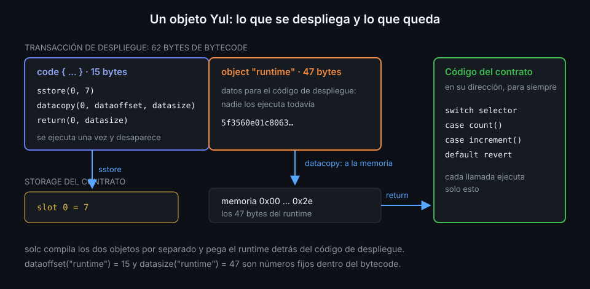

# Teoría 01 — Yul, el lenguaje

## 🎯 Objetivos

- Explicar qué es Yul y dónde está entre Solidity y el bytecode.
- Escribir expresiones de Yul: `let`, `:=`, llamadas a opcodes y literales.
- Usar el control de flujo de Yul: `if`, `switch`, `for`, funciones y `leave`.
- Saber que Yul solo tiene un tipo, la palabra de 256 bits, y qué significa eso para el signo y
  los desbordamientos.
- Leer un objeto Yul completo: el código de despliegue, el objeto `runtime` y `datacopy`.

## Qué problema resuelve

En la semana 27 escribiste bytecode a mano: `5f54600101805f555f5260205ff3`. Funciona, pero cada
opcode es un byte que tienes que contar, cada salto apunta a una posición que cambia si añades una
instrucción, y la pila la llevas tú de cabeza. Nadie escribe así un contrato.

Solidity está en el otro extremo: tipos, comprobaciones, ABI, herencia. A veces necesitas algo
que Solidity no deja decir:

- Copiar solo 4 bytes de la returndata de otro contrato, cuando Solidity copia toda (el proyecto
  de esta semana).
- Apuntar un `struct` a un slot calculado, como el espacio de nombres ERC-7201 de la semana 15.
- Leer un opcode que Solidity no expone, como `tload` en versiones antiguas o `returndatasize`
  dentro de un `catch`.

**Yul** es el lenguaje intermedio: casi tan cerca de la EVM como el bytecode, pero con variables,
funciones y bucles. Cada opcode es una función con su nombre (`add`, `sload`, `call`), y el
compilador lleva la pila y los saltos por ti. solc lo usa también por dentro: el compilador con
`--via-ir` traduce Solidity a Yul antes de generar bytecode.

Yul se escribe de dos formas:

- **Dentro de Solidity**, en un bloque `assembly { ... }`: lo que la gente llama *inline
  assembly*. Es lo que vas a usar casi siempre, y lo que cubre la teoría 02.
- **Solo**, en un archivo `.yul` con un **objeto Yul**: un contrato entero sin una línea de
  Solidity. Lo ves al final de esta teoría y en el paso 5 del ejercicio 01.

## Cómo funciona

### Un solo tipo

Yul de la EVM tiene **un tipo**: la palabra de 256 bits, `u256`. No hay `bool`, ni `address`, ni
`int`, ni arrays. Una dirección es una palabra con 12 bytes a cero arriba; `true` es una palabra
que no es cero; `-1` es una palabra con los 256 bits a uno. Lo que cambia es el **opcode** con
que la lees:

| Pregunta | Sin signo | Con signo (complemento a dos) |
| -------- | --------- | ----------------------------- |
| ¿`a < b`? | `lt(a, b)` | `slt(a, b)` |
| ¿`a > b`? | `gt(a, b)` | `sgt(a, b)` |
| `a / b` | `div(a, b)` | `sdiv(a, b)` |
| `a >> n` | `shr(n, a)` | `sar(n, a)` |

Las comparaciones devuelven `1` o `0`. No hay `<=`: se escribe `iszero(gt(a, b))`.

### Ninguna comprobación

Los opcodes aritméticos de la EVM **no** comprueban nada. `add` da la vuelta al pasar de
`2²⁵⁶ - 1`, `sub(0, 1)` da el máximo y `div(x, 0)` da 0, sin revertir. Las comprobaciones de
Solidity desde la 0.8 (el `Panic(0x11)` de la semana 05) las genera solc alrededor de cada
operación; dentro de un bloque `assembly` no genera ninguna.

### Expresiones y variables

Un opcode se llama como una función, con los argumentos en el orden de la pila **de arriba a
abajo**: `sstore(slot, valor)`, `mstore(posición, valor)`, `call(gas, destino, valor, ...)`. Los
argumentos se evalúan de derecha a izquierda, que es el orden en que entran en la pila.

```solidity
let x := 5            // declara una variable local de Yul y le da valor
x := add(x, 1)        // asigna: `:=`, nunca `=`
let y := mul(x, 3)    // las expresiones se anidan
```

Los literales son decimales (`42`), hexadecimales (`0x2a`) o strings cortos (`"abc"`, alineados a
la izquierda en la palabra). `true` y `false` son `1` y `0`.

Un opcode que devuelve algo no puede quedar suelto: o lo asignas o lo tiras con `pop(...)`.

### Control de flujo

| Construcción | Forma | Notas |
| ------------ | ----- | ----- |
| `if` | `if cond { ... }` | Sin `else`. `cond` es cierta si no es cero |
| `switch` | `switch x case 0 { ... } case 1 { ... } default { ... }` | Compara por igualdad; sin caída de un caso al siguiente |
| `for` | `for { init } cond { paso } { cuerpo }` | Tres bloques; `break` y `continue` dentro |
| Función | `function f(a, b) -> r { ... }` | Las devoluciones se nombran y empiezan a 0 |
| `leave` | `leave` | Sale de la función de Yul, como `return` de Solidity |

Una función de Yul no ve las variables de fuera: solo sus parámetros y sus variables locales.

## Cómo se escribe

Las funciones de esta sección están en un contrato de prueba. Para probarlas, copia el starter del
ejercicio 01 a una carpeta tuya y crea `src/Snippets.sol` con cada función dentro de
`contract Snippets { ... }`, y `test/Snippets.t.sol` con un test que la llame y lo imprima:

```solidity
// test/Snippets.t.sol
import {Test} from "forge-std/Test.sol";
import {Snippets} from "../src/Snippets.sol";

contract SnippetsTest is Test {
    function test_Show() public {
        Snippets s = new Snippets();
        emit log_named_uint("triple(14)", s.triple(14));
    }
}
```

```bash
cp -r bootcamp/week-28-yul_e_inline_assembly/2-practicas/ejercicio-01-yul-paso-a-paso/starter /tmp/yul
cd /tmp/yul
docker run --rm -it -v "$PWD":/workspace bc-smartcontracts-dev
forge test --mc SnippetsTest -vv
```

La primera función: `y` es la variable de retorno de Solidity, y desde el bloque se le asigna con
`:=`.

```solidity
function triple(uint256 x) external pure returns (uint256 y) {
    assembly {
        y := mul(x, 3)
    }
}
```

```text
  triple(14): 42
```

Sin comprobaciones, `sub(0, 1)` no revierte:

```solidity
function minusOne() external pure returns (uint256 r) {
    assembly {
        r := sub(0, 1)
    }
}
```

```text
  minusOne(): 115792089237316195423570985008687907853269984665640564039457584007913129639935
```

Es `2²⁵⁶ - 1`. En Solidity, `0 - 1` con `uint256` revierte con `Panic(0x11)`.

Un `for` que suma de 1 a `n`. La condición es `iszero(gt(i, n))`: "no es mayor", es decir
`i <= n`.

```solidity
function sumTo(uint256 n) external pure returns (uint256 total) {
    assembly {
        for { let i := 1 } iszero(gt(i, n)) { i := add(i, 1) } {
            total := add(total, i)
        }
    }
}
```

```text
  sumTo(10): 55
```

Un `switch`. Sin `break`: cada caso acaba en su llave.

```solidity
function describe(uint256 x) external pure returns (uint256 kind) {
    assembly {
        switch x
        case 0 { kind := 100 }
        case 1 { kind := 200 }
        default { kind := 300 }
    }
}
```

```text
  describe(1): 200
  describe(9): 300
```

Una función de Yul con `leave`. Busca el primer cero de un array de la calldata: `xs.offset` es
dónde empieza en la calldata y `xs.length`, cuántos elementos tiene (teoría 02). `shl(5, i)` es
`i * 32`.

```solidity
function firstZero(uint256[] calldata xs) external pure returns (uint256 index) {
    assembly {
        function find(offset, length) -> i {
            for { i := 0 } lt(i, length) { i := add(i, 1) } {
                if iszero(calldataload(add(offset, shl(5, i)))) { leave }
            }
        }
        index := find(xs.offset, xs.length)
    }
}
```

```text
  firstZero([5,8,0,3]): 2
```

Si no hay ningún cero, `find` acaba el bucle con `i == length`: la función devuelve la longitud.

### Un objeto Yul

Un contrato entero en Yul es un **objeto**: un bloque `code` con el código de despliegue y, dentro,
otro objeto con el código que queda en la cadena. Es el contador del paso 5 del ejercicio 01,
`src/Counter.yul`, resuelto y sin comentarios:

```text
object "Counter" {
    code {
        sstore(0, 7)
        datacopy(0, dataoffset("runtime"), datasize("runtime"))
        return(0, datasize("runtime"))
    }
    object "runtime" {
        code {
            switch shr(224, calldataload(0))
            case 0x06661abd { mstore(0, sload(0)) return(0, 0x20) }
            case 0xd09de08a { sstore(0, add(sload(0), 1)) return(0, 0) }
            default { revert(0, 0) }
        }
    }
}
```

El dispatcher es el de la semana 27, escrito por ti: `shr(224, calldataload(0))` se queda con los
4 primeros bytes de la calldata, el selector, y `switch` salta a cada función.



forge compila los `.yul` de `src/` con el resto. También puedes llamar a solc directamente, con
`--strict-assembly`. Dentro del contenedor, en el starter resuelto del ejercicio 01:

```bash
~/.svm/0.8.38/solc-0.8.38 --strict-assembly --bin src/Counter.yul
```

```text
======= src/Counter.yul (EVM) =======

Binary representation:
60075f55602f600f5f39602f5ff3fe5f3560e01c806306661abd1460265763d09de08a14601b575f80fd5b60015f54015f555f80f35b5f545f5260205ff3
```

`602f` es `PUSH1 0x2f`: `datasize("runtime")` vale 47. `600f` es `PUSH1 0x0f`: el runtime empieza
en el byte 15, justo después del `fe` (`INVALID`) que separa los dos objetos.

## ⚠️ Antipatrones y riesgos

- **Contar con las comprobaciones de Solidity.** `add`, `sub`, `mul` dan la vuelta; `div` y `mod`
  entre cero dan 0. Si la cuenta puede desbordar, compruébalo tú, como en el paso 2 del
  ejercicio 01.
- **Confundir el signo.** `lt` con un `int256` negativo lo lee como un número enorme: `-1` es
  mayor que todo. Con enteros con signo, `slt`, `sgt`, `sdiv` y `sar`.
- **Un objeto Yul sin dispatcher completo.** Nadie añade por ti el `default { revert(0, 0) }`, ni
  rechaza el ETH que llega, ni valida la calldata. Lo que no escribes no existe.
- **Yul para todo.** Cada línea de assembly es una línea que solc no comprueba y que un auditor
  revisa a mano. Úsalo donde Solidity no llega o el ahorro de gas está medido (semana 29), y en
  la función más pequeña posible.

## 💡 Trucos

- `iszero(iszero(x))` convierte cualquier palabra en `0` o `1`.
- `shl(5, i)` es `i * 32`, el paso entre palabras de la calldata o la memoria.
- La lista completa de opcodes con su nombre en Yul está en la
  [documentación de Yul](https://docs.soliditylang.org/en/v0.8.38/yul.html#evm-dialect).

## ✅ Checklist

- [ ] Sé qué es Yul y las dos formas de escribirlo.
- [ ] Sé por qué Yul solo tiene `u256` y qué opcodes leen con signo.
- [ ] Sé que la aritmética de Yul no comprueba desbordamientos.
- [ ] Sé escribir `let`, `:=`, `if`, `switch`, `for`, funciones y `leave`.
- [ ] Sé qué hacen el código de despliegue y el objeto `runtime` de un objeto Yul.

---

| Anterior | Actual | Siguiente |
| -------- | ------ | --------- |
| [← Semana 28](../README.md) | **Teoría 01 — Yul, el lenguaje** | [Teoría 02 — Assembly dentro de Solidity →](02-assembly-dentro-de-solidity.md) |
