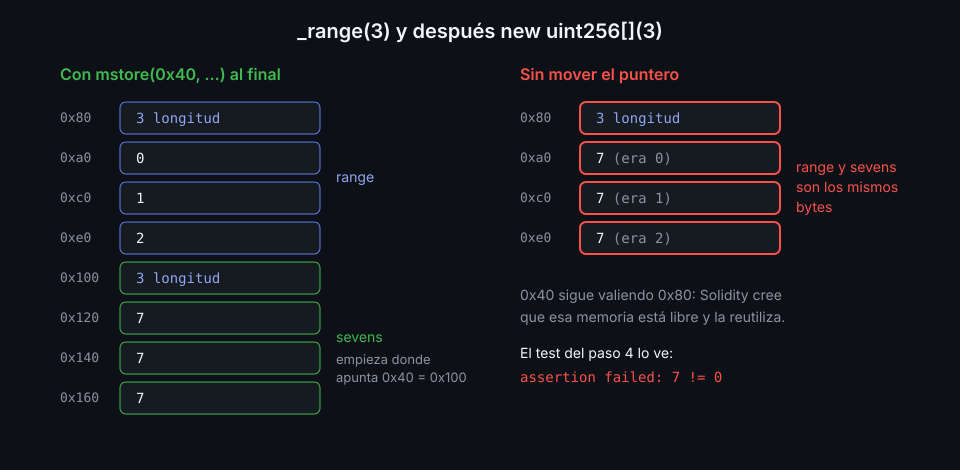

# Teoría 02 — Assembly dentro de Solidity

## 🎯 Objetivos

- Escribir un bloque `assembly { ... }` dentro de una función y saber qué variables de Solidity
  ve y cómo.
- Leer y escribir storage desde assembly con `.slot` y `.offset`, y apuntar un `struct` a un slot
  calculado.
- Usar la memoria sin romper la de Solidity: scratch space, puntero de memoria libre y
  `memory-safe`.
- Explicar qué son los bits sucios y cuándo los limpia solc y cuándo no.
- Usar el transient storage con `tload` y `tstore`.

## Qué problema resuelve

Un objeto Yul entero (teoría 01) es todo o nada: ni ABI, ni herencia, ni tests cómodos. Casi nunca
quieres eso. Quieres un contrato de Solidity normal con **una** función, o una parte de una, en
Yul: la llamada al hook que no copia la returndata, el cálculo de un slot, un cerrojo en
transient storage.

Un bloque `assembly { ... }` mete Yul en medio de una función de Solidity. Dentro, todo es Yul:
`let`, `:=`, opcodes. Fuera, todo sigue siendo Solidity. La frontera entre los dos es lo que tienes
que entender: qué ve el bloque de las variables de Solidity, y qué tiene que dejar como estaba
para que Solidity siga funcionando después.

## Cómo funciona

### Lo que ve el bloque

El bloque ve las variables locales de la función, sus parámetros y sus variables de retorno, y
las constantes del contrato. Cada una aparece como **una palabra**, y qué significa esa palabra
depende de dónde vive el dato:

| Variable de Solidity | En assembly | Ejemplo |
| -------------------- | ----------- | ------- |
| Tipo de valor (`uint256`, `address`, `bool`, `bytes4`...) | El valor | `x` |
| `memory` (`bytes`, arrays, structs) | La **posición** en memoria donde empieza | `mload(b)` es la longitud de un `bytes` |
| `calldata` de tamaño dinámico | `.offset` (dónde empiezan los datos) y `.length` | `xs.offset`, `xs.length` |
| Variable de estado | `.slot` y `.offset` (byte dentro del slot) | `sload(count.slot)` |
| Puntero `storage` local | `.slot` (y se puede asignar) | `$.slot := LOCATION` |

Las variables de estado **no** se leen por su nombre. Con `uint256 public count;`:

```solidity
assembly {
    r := count // ❌ Error (1408): Only local variables are supported. To access state variables, use the ".slot" and ".offset" suffixes.
}
```

Se leen con `sload(count.slot)`.

### Las posiciones de storage

El contrato `Snippets` de la teoría 01 tiene tres variables de estado:

```solidity
uint64 public small;
uint64 public other;
uint256 public big;
```

```solidity
function slots() external pure returns (uint256 s1, uint256 o1, uint256 s2, uint256 o2, uint256 s3) {
    assembly {
        s1 := small.slot
        o1 := small.offset
        s2 := other.slot
        o2 := other.offset
        s3 := big.slot
    }
}
```

```text
  small.slot: 0
  small.offset: 0
  other.slot: 0
  other.offset: 8
  big.slot: 1
```

`small` y `other` van empaquetadas en el slot 0 (semana 27, teoría 03): `other` empieza en el
byte 8. Para leer `other` a mano: `and(shr(64, sload(0)), 0xffffffffffffffff)`. Para escribirla
sin pisar `small`, lees el slot, borras sus 8 bytes con una máscara, pones el valor nuevo con `or`
y guardas. Es fácil equivocarse: por eso, con variables empaquetadas, mejor desde Solidity.

### Un `struct` en un slot calculado

Un puntero `storage` local es solo un número de slot, y en assembly lo puedes asignar. Es cómo
OpenZeppelin pone cada contrato en su espacio de nombres ERC-7201 (semana 15):

```solidity
/// @custom:storage-location erc7201:bootcamp.ledger.config
struct Config {
    address owner;
    uint64 fee;
}

bytes32 private constant CONFIG_LOCATION = 0xdd5f1edd997c3883620047e02264e62911601722964f04716e490bb06f097900;

function _config() private pure returns (Config storage $) {
    assembly {
        $.slot := CONFIG_LOCATION
    }
}
```

`CONFIG_LOCATION` es lo que da `cast index-erc7201 bootcamp.ledger.config` en el contenedor. Desde
ahí, `$.owner` y `$.fee` son Solidity normal. Lo haces en el paso 3 del ejercicio 02.

### La memoria: lo que Solidity da por hecho

Solidity reparte la memoria con unas reglas fijas (semana 27, teoría 02):

| Posición | Qué es | Puedes |
| -------- | ------ | ------ |
| `0x00`-`0x3f` | Scratch space, la zona de trabajo | Usarla libremente para algo corto: un hash, una llamada pequeña |
| `0x40` | El puntero de memoria libre | Leerlo; moverlo hacia delante cuando reservas |
| `0x60` | El slot cero | Nada: Solidity cuenta con que vale 0 |
| Desde `mload(0x40)` | Memoria libre | Escribir; si lo escrito tiene que durar, mover el puntero detrás |

```solidity
function freePointer() external pure returns (uint256 before, uint256 afterAlloc) {
    assembly {
        before := mload(0x40)
    }
    bytes memory b = new bytes(10);
    assembly {
        afterAlloc := mload(0x40)
    }
    b;
}
```

```text
  free pointer antes: 128
  free pointer despues: 192
```

128 es `0x80`. `new bytes(10)` reserva 32 bytes de longitud y 32 para los 10 bytes de datos,
redondeados a la palabra: el puntero pasa a 192.

Si tu bloque escribe en memoria libre algo que Solidity tiene que ver después (un array que
devuelves), tienes que mover el puntero detrás. Si no, la siguiente reserva de Solidity empieza en
el mismo sitio y escribe encima.



### `memory-safe`

Un bloque marcado `assembly ("memory-safe") { ... }` promete al compilador que respeta esas reglas:
solo toca el scratch space, la memoria que ya reservó Solidity y la memoria libre (moviendo el
puntero si quiere conservarla). A cambio, con el optimizador de `--via-ir`, solc puede mover
variables de la pila a memoria y evitar el error *stack too deep*.

Es una promesa, no una comprobación: solc no mira si la cumples. Si escribes más allá sin
respetarlas y marcas el bloque como seguro, el optimizador puede poner sus variables justo donde
escribes.

### Bits sucios

Un `uint8` ocupa una palabra entera en la pila. Solidity mantiene los 248 bits altos a cero, pero
desde assembly puedes asignarle cualquier palabra:

```solidity
function dirtyByte() external pure returns (uint8 r) {
    assembly {
        r := 0x1ff
    }
}

function isFF() external pure returns (bool) {
    uint8 r;
    assembly {
        r := 0x1ff
    }
    return r == 0xff;
}

function raw() external pure returns (uint256 w) {
    uint8 r;
    assembly {
        r := 0x1ff
    }
    assembly {
        w := r
    }
}
```

```text
  dirtyByte(): 255
  isFF(): true
  raw(): 511
```

Solidity **limpia** el valor antes de usarlo: antes de codificarlo para devolverlo (255) y antes
de compararlo (`true`). Pero otro bloque de assembly recibe la palabra tal cual: `raw` devuelve
511, `0x1ff`. Los bits que sobran se llaman **bits sucios** (*dirty bits*). La regla: un valor que
sale de assembly hacia una variable de menos de 256 bits, límpialo tú (`and(x, 0xff)`), porque no
sabes qué bloque lo leerá después.

### Transient storage

`tstore(slot, valor)` y `tload(slot)` son el **transient storage** (EIP-1153, semana 27): un
storage aparte que se borra al acabar la transacción, a 100 de gas por acceso. Es el sitio natural
para un cerrojo contra reentrancy (semana 21):

```solidity
modifier nonReentrant() {
    assembly ("memory-safe") {
        if tload(LOCK_SLOT) {
            mstore(0, shl(224, 0xab143c06)) // Reentrancy()
            revert(0, 4)
        }
        tstore(LOCK_SLOT, 1)
    }
    _;
    assembly ("memory-safe") {
        tstore(LOCK_SLOT, 0)
    }
}
```

`mstore(0, shl(224, selector))` pone el selector en los 4 primeros bytes de la memoria, y
`revert(0, 4)` revierte con esos 4 bytes: el custom error `Reentrancy()` (teoría 03).

Se borra al acabar la **transacción**, no la llamada. Si una transacción retira dos veces, el
cerrojo tiene que quitarse al acabar cada retiro, o el segundo revierte. Lo compruebas en el paso
5 del ejercicio 02. Desde Solidity 0.8.28 también existe `uint256 transient locked;`, sin
assembly; aquí ves los opcodes que hay debajo.

## ⚠️ Antipatrones y riesgos

- **No mover el puntero de memoria libre** después de reservar en assembly algo que dura: la
  siguiente reserva de Solidity lo pisa (el diagrama de arriba).
- **Escribir en `0x60` o más allá del scratch space sin reservar.** El slot cero tiene que valer
  0: Solidity lo usa como array vacío.
- **Marcar `memory-safe` un bloque que no lo es.** La promesa no se comprueba y el fallo aparece
  lejos, cuando cambia el optimizador.
- **Escribir un slot de storage a mano.** `sstore(5, x)` no sabe qué variable vive en el slot 5.
  Con proxies (semana 15), un slot elegido a ojo puede ser el de otra versión.
- **Dejar bits sucios** en una variable pequeña o en una dirección. Solidity la limpia en sus
  operaciones; otro bloque de assembly, no.
- **Olvidar quitar un cerrojo en transient storage.** Dura hasta el final de la transacción: un
  segundo uso legítimo en la misma transacción queda bloqueado.

## 💡 Trucos

- `mload(b)` es la longitud de un `bytes memory b`, y `add(b, 0x20)`, donde empiezan sus datos.
- Para el slot de `mapping[k]`, el scratch space basta: `mstore(0, k)`, `mstore(0x20, m.slot)`,
  `keccak256(0, 0x40)`. Lo haces en el paso 2 del ejercicio 02.
- `forge inspect <Contrato> storageLayout` da el slot y el offset de cada variable sin escribir
  assembly.

## ✅ Checklist

- [ ] Sé qué palabra ve un bloque de assembly para un valor, una variable `memory`, una
  `calldata` dinámica y una variable de estado.
- [ ] Sé usar `.slot`, `.offset` y `.length`, y apuntar un `struct` a un slot ERC-7201.
- [ ] Sé qué hay en `0x00`, `0x40` y `0x60`, y cuándo tengo que mover el puntero de memoria libre.
- [ ] Sé qué promete `memory-safe` y que nadie lo comprueba.
- [ ] Sé qué son los bits sucios y cuándo los limpia solc.
- [ ] Sé usar `tload` y `tstore` y cuándo se borra el transient storage.

---

| Anterior | Actual | Siguiente |
| -------- | ------ | --------- |
| [← Teoría 01 — Yul, el lenguaje](01-yul-el-lenguaje.md) | **Teoría 02 — Assembly dentro de Solidity** | [Teoría 03 — Llamadas, errores y despliegues →](03-llamadas-errores-y-despliegues.md) |
